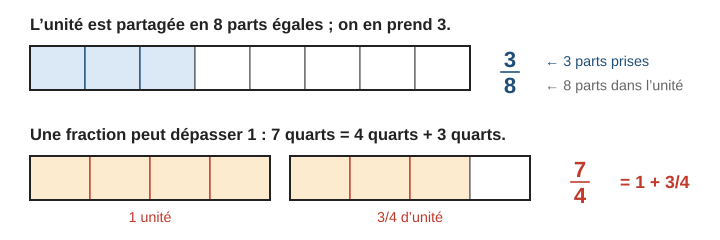
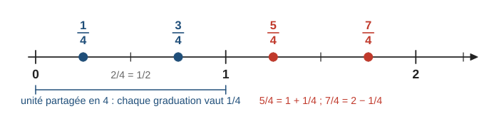
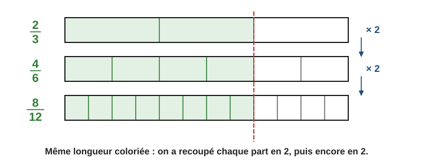
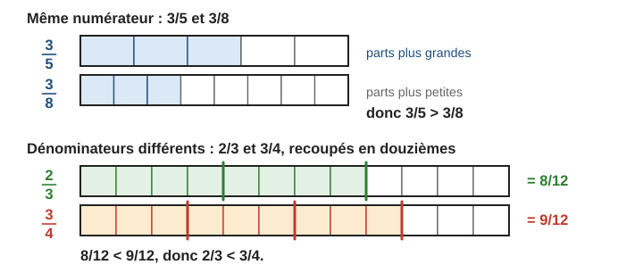
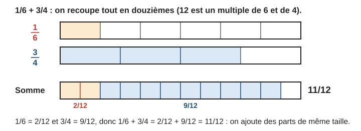
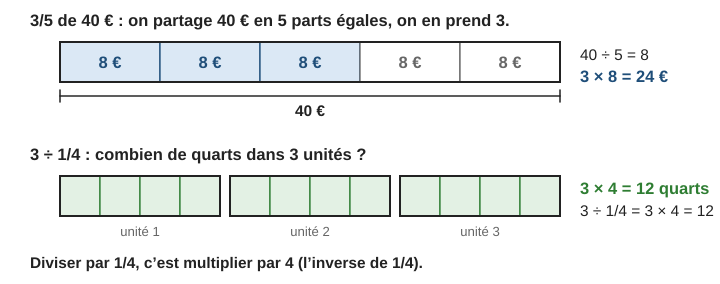
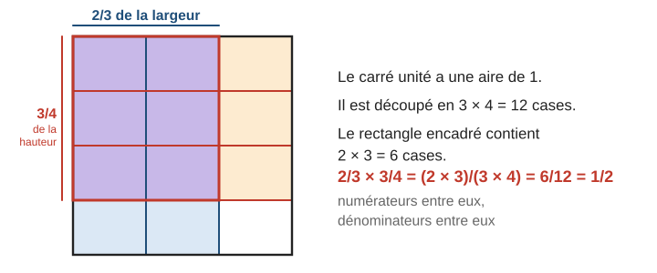

# Fractions et nombres rationnels

> Compendium collège — chapitre unifié (sans découpage 6e / 5e / 4e / 3e).  
> Cours compact pour un élève de niveau moyen : intuition, méthode, exemples guidés, erreurs fréquentes, puis exercices progressifs (★ facile, ★★ standard, ★★★ approfondissement) avec corrigés détaillés.

---

## 0. Ce qu’on vise

**En une phrase :** une fraction est un **nombre**, qu’on comprend en **partageant une unité en parts égales** ; toutes les règles de calcul viennent d’une idée simple : on ne compare et on n’ajoute que des **parts de même taille**.

À la fin de ce chapitre, je sais :

1. Représenter une fraction (barre, demi-droite graduée) et la lire comme un **quotient**.
2. Reconnaître des fractions **égales** et rendre une fraction **irréductible**.
3. **Comparer** et ranger des fractions.
4. **Additionner** et **soustraire** des fractions.
5. **Multiplier** des fractions, prendre une **fraction d’une quantité**, **diviser** par une fraction.
6. Passer d’une fraction à une écriture décimale ou à un pourcentage, et savoir ce qu’est un **nombre rationnel**.

> **Prérequis.** Tables de multiplication ; divisibilité et nombres premiers (chapitre 2, § 5 et 6) ; pour les fractions négatives, règle des signes (chapitre 3, § 5).

---

## 1. Qu’est-ce qu’une fraction ?

### 1.1 Partager l’unité

> **Définition.** $a$ et $b$ étant des nombres entiers avec $b \neq 0$, la fraction $\dfrac{a}{b}$ est le nombre obtenu en **partageant l’unité en $b$ parts égales** et en prenant **$a$ parts**. $a$ est le **numérateur** (combien de parts on prend), $b$ le **dénominateur** (en combien de parts on a partagé l’unité).

Si on prend plus de parts qu’il n’y en a dans une unité, la fraction **dépasse 1** : $\dfrac{7}{4} = \dfrac{4}{4} + \dfrac{3}{4} = 1 + \dfrac{3}{4}$. Une fraction est inférieure à $1$ quand son numérateur est plus petit que son dénominateur, supérieure à $1$ dans le cas contraire, et $\dfrac{b}{b} = 1$.

### 1.2 Une fraction est un quotient

Partager $3$ pizzas entre $4$ personnes : chacun reçoit $3 \div 4 = 0{,}75$ pizza, c’est-à-dire $\dfrac{3}{4}$ de pizza.

> **Propriété.** $\dfrac{a}{b}$ est le nombre qui, multiplié par $b$, donne $a$ : $b \times \dfrac{a}{b} = a$. Autrement dit, $\dfrac{a}{b} = a \div b$.

Ainsi $\dfrac{3}{4} = 0{,}75$, $\dfrac{12}{3} = 4$, $\dfrac{5}{1} = 5$. Tout nombre entier est une fraction.

### 1.3 Placer une fraction sur une demi-droite graduée

> **Méthode — Placer $\dfrac{a}{b}$.** 1. Partager chaque unité en $b$ parts égales (on choisit une unité facile à partager, par exemple $b$ carreaux ou un multiple de $b$). 2. Compter $a$ parts à partir de $0$.

**Exemple guidé 1.** L’unité mesure $8$ carreaux. Placer $\dfrac{3}{4}$, $\dfrac{7}{4}$ et $\dfrac{5}{8}$.

**Réflexion.** Un quart d’unité mesure $8 \div 4 = 2$ carreaux ; un huitième mesure $1$ carreau.

> $\dfrac{3}{4}$ : $3 \times 2 = 6$ carreaux après $0$.  
> $\dfrac{7}{4}$ : $7 \times 2 = 14$ carreaux, soit $1$ unité et $6$ carreaux (car $\dfrac{7}{4} = 1 + \dfrac{3}{4}$).  
> $\dfrac{5}{8}$ : $5$ carreaux.

**Contrôle.** $\dfrac{7}{4}$ est entre $1$ et $2$ ; $\dfrac{5}{8}$ est un peu plus petit que $\dfrac{3}{4} = \dfrac{6}{8}$ ✓.

> **Erreur fréquente.** Croire que $\dfrac{1}{8}$ est plus grand que $\dfrac{1}{4}$ « parce que $8 > 4$ ». Partager en $8$ donne des parts **plus petites** qu’en $4$ : $\dfrac{1}{8} < \dfrac{1}{4}$.

---

## 2. Fractions égales, simplification

### 2.1 Des écritures différentes pour un même nombre

Si on recoupe chaque part en $2$, on a **deux fois plus de parts** et on en prend **deux fois plus** : la longueur coloriée ne change pas.

> **Propriété.** On ne change pas la valeur d’une fraction en **multipliant** ou en **divisant** son numérateur **et** son dénominateur par un même nombre non nul : $\dfrac{a}{b} = \dfrac{a \times k}{b \times k}$.

$\dfrac{2}{3} = \dfrac{4}{6} = \dfrac{8}{12} = \dfrac{20}{30}$ $\qquad$ $\dfrac{15}{25} = \dfrac{15 \div 5}{25 \div 5} = \dfrac{3}{5}$.

### 2.2 Simplifier, fraction irréductible

**Simplifier** une fraction, c’est diviser numérateur et dénominateur par un même diviseur commun. Une fraction est **irréductible** quand on ne peut plus la simplifier : numérateur et dénominateur n’ont plus que $1$ comme diviseur commun.

> **Méthode — Rendre une fraction irréductible.**
> - **Pas à pas :** diviser par des diviseurs communs évidents ($2$, $3$, $5$, $10$… voir les critères de divisibilité au chapitre 2) jusqu’à ce qu’il n’y en ait plus.
> - **Par la décomposition en facteurs premiers (★★) :** décomposer numérateur et dénominateur (chapitre 2), puis barrer les facteurs communs.

**Exemple guidé 2.** Rendre irréductibles $\dfrac{24}{36}$ et $\dfrac{84}{120}$.

> $\dfrac{24}{36} = \dfrac{12}{18}$ (÷ 2) $= \dfrac{6}{9}$ (÷ 2) $= \dfrac{2}{3}$ (÷ 3). On aurait pu diviser directement par $12$.  
> $84 = 2 \times 2 \times 3 \times 7$ et $120 = 2 \times 2 \times 2 \times 3 \times 5$. Facteurs communs : $2 \times 2 \times 3 = 12$.  
> $\dfrac{84}{120} = \dfrac{7}{2 \times 5} = \dfrac{7}{10}$.

**Contrôle.** $2$ et $3$ n’ont pas de diviseur commun autre que $1$ ; $7$ et $10$ non plus ✓. Et $0{,}7 \times 120 = 84$ ✓.

> **Erreur fréquente.** « Simplifier » dans une somme : $\dfrac{2 + 3}{2} \neq 3$. On ne peut simplifier que des **facteurs** (des multiplications), jamais des termes. Ici $\dfrac{2 + 3}{2} = \dfrac{5}{2}$.

---

## 3. Comparer des fractions

> **Propriété (comparer).**
> - **Même dénominateur :** la plus grande est celle qui a le **plus grand numérateur** (même taille de parts, on en prend plus). $\dfrac{5}{9} < \dfrac{7}{9}$.
> - **Même numérateur :** la plus grande est celle qui a le **plus petit dénominateur** (parts plus grandes). $\dfrac{3}{5} > \dfrac{3}{8}$.
> - **Cas général :** on écrit les deux fractions avec un **même dénominateur**, puis on compare les numérateurs.

On peut aussi comparer à $1$ : $\dfrac{8}{7} > 1 > \dfrac{13}{15}$.

**Exemple guidé 3.** Comparer $\dfrac{5}{6}$ et $\dfrac{7}{9}$.

**Réflexion.** On cherche un multiple commun de $6$ et $9$, le plus petit possible : $18$.

> $\dfrac{5}{6} = \dfrac{15}{18}$ et $\dfrac{7}{9} = \dfrac{14}{18}$. Comme $15 > 14$, $\dfrac{5}{6} > \dfrac{7}{9}$.

**Contrôle.** À la calculatrice : $\dfrac{5}{6} \approx 0{,}83$ et $\dfrac{7}{9} \approx 0{,}78$ ✓.

> **Erreur fréquente.** Comparer seulement les numérateurs ou seulement les dénominateurs quand les deux changent : $\dfrac{2}{3}$ et $\dfrac{3}{4}$ ne se comparent pas en regardant « $2 < 3$ ». Il faut le même dénominateur.

---

## 4. Additionner et soustraire

On ne peut ajouter que des parts **de même taille** : on commence par écrire les fractions avec un **même dénominateur**.

> **Propriété.** $\dfrac{a}{d} + \dfrac{b}{d} = \dfrac{a + b}{d}$ et $\dfrac{a}{d} - \dfrac{b}{d} = \dfrac{a - b}{d}$ : on ajoute (ou soustrait) les numérateurs et on **garde** le dénominateur.

> **Méthode — Dénominateurs différents.** 1. Chercher un dénominateur commun (un multiple commun, le plus petit possible). 2. Transformer chaque fraction. 3. Ajouter ou soustraire les numérateurs. 4. Simplifier le résultat si possible.

**Exemple guidé 4.** Calculer $A = \dfrac{5}{6} - \dfrac{1}{4}$ et $B = 2 + \dfrac{3}{5}$.

> $A$ : multiple commun de $6$ et $4$ : $12$. $A = \dfrac{10}{12} - \dfrac{3}{12} = \dfrac{7}{12}$.  
> $B$ : $2 = \dfrac{10}{5}$, donc $B = \dfrac{10}{5} + \dfrac{3}{5} = \dfrac{13}{5}$.

**Contrôle.** $A \approx 0{,}83 - 0{,}25 = 0{,}58$ et $\dfrac{7}{12} \approx 0{,}58$ ✓ ; $B = 2{,}6 = \dfrac{13}{5}$ ✓.

> **Erreur fréquente.** Ajouter les numérateurs **et** les dénominateurs : $\dfrac{1}{2} + \dfrac{1}{3} \neq \dfrac{2}{5}$. La moitié d’une pizza plus un tiers, c’est plus que la moitié, alors que $\dfrac{2}{5} < \dfrac{1}{2}$. Bonne réponse : $\dfrac{3}{6} + \dfrac{2}{6} = \dfrac{5}{6}$.

---

## 5. Multiplier : fraction d’une quantité, produit de fractions

### 5.1 Prendre une fraction d’une quantité

> **Propriété.** Prendre les $\dfrac{a}{b}$ d’une quantité, c’est la **multiplier** par $\dfrac{a}{b}$ : $\dfrac{3}{5}$ de $40$ € $= \dfrac{3}{5} \times 40 = \dfrac{3 \times 40}{5} = 24$ €. On peut calculer dans l’ordre le plus simple : $(40 \div 5) \times 3$ ou $(40 \times 3) \div 5$.

### 5.2 Produit de deux fractions

> **Propriété.** $\dfrac{a}{b} \times \dfrac{c}{d} = \dfrac{a \times c}{b \times d}$ : on multiplie les numérateurs entre eux et les dénominateurs entre eux. On a intérêt à **simplifier avant** de calculer les produits.

**Exemple guidé 5.** Calculer $C = \dfrac{6}{35} \times \dfrac{14}{9}$.

**Réflexion.** On écrit le produit sur une seule barre de fraction, on décompose, puis on simplifie les facteurs communs avant de multiplier.

> $C = \dfrac{6 \times 14}{35 \times 9} = \dfrac{2 \times 3 \times 2 \times 7}{5 \times 7 \times 3 \times 3}$  
> On simplifie par $3$ et par $7$ : $C = \dfrac{2 \times 2}{5 \times 3} = \dfrac{4}{15}$.

**Contrôle.** $\dfrac{6}{35} \approx 0{,}171$ et $\dfrac{14}{9} \approx 1{,}556$ ; produit $\approx 0{,}267$ ; $\dfrac{4}{15} \approx 0{,}267$ ✓.

> **Erreur fréquente.** Multiplier aussi le dénominateur par un entier : $\dfrac{2}{3} \times 4 \neq \dfrac{8}{12}$. Comme $4 = \dfrac{4}{1}$, on a $\dfrac{2}{3} \times 4 = \dfrac{8}{3}$ (quatre fois deux tiers, c’est huit tiers).

---

## 6. Inverse et division (★★)

> **Définition.** Deux nombres sont **inverses** l’un de l’autre si leur produit vaut $1$. L’inverse de $\dfrac{a}{b}$ (avec $a \neq 0$ et $b \neq 0$) est $\dfrac{b}{a}$ ; l’inverse de $5$ est $\dfrac{1}{5}$. $0$ n’a pas d’inverse.

> **Propriété.** **Diviser par un nombre non nul, c’est multiplier par son inverse :** $\dfrac{a}{b} \div \dfrac{c}{d} = \dfrac{a}{b} \times \dfrac{d}{c}$.

Le schéma du § 5.1 le montre : « combien de quarts dans $3$ unités ? » ; il y en a $3 \times 4 = 12$, donc $3 \div \dfrac{1}{4} = 3 \times 4 = 12$.

**Exemple guidé 6.** Calculer $D = \dfrac{9}{2} \div \dfrac{3}{4}$.

> $D = \dfrac{9}{2} \times \dfrac{4}{3} = \dfrac{9 \times 4}{2 \times 3} = \dfrac{3 \times 3 \times 2 \times 2}{2 \times 3} = 3 \times 2 = 6$.

**Contrôle.** Dans $4{,}5$, combien de fois $0{,}75$ ? $6 \times 0{,}75 = 4{,}5$ ✓. Diviser par un nombre plus petit que $1$ donne un résultat **plus grand**.

> **Erreur fréquente.** Prendre l’inverse de la **première** fraction, ou des deux : $\dfrac{3}{4} \div 2 \neq \dfrac{6}{4}$. On multiplie par l’inverse du **diviseur** : $\dfrac{3}{4} \times \dfrac{1}{2} = \dfrac{3}{8}$ (la moitié de trois quarts).

---

## 7. Calculs avec priorités (★★)

Les priorités sont les mêmes qu’avec les autres nombres : parenthèses, puis multiplications et divisions, puis additions et soustractions.

**Exemple guidé 7.** Calculer $E = \dfrac{1}{2} + \dfrac{3}{4} \times \dfrac{2}{9}$.

> La multiplication est prioritaire : $\dfrac{3}{4} \times \dfrac{2}{9} = \dfrac{3 \times 2}{2 \times 2 \times 3 \times 3} = \dfrac{1}{6}$.  
> $E = \dfrac{1}{2} + \dfrac{1}{6} = \dfrac{3}{6} + \dfrac{1}{6} = \dfrac{4}{6} = \dfrac{2}{3}$.

**Contrôle.** $0{,}5 + 0{,}75 \times 0{,}222 \approx 0{,}5 + 0{,}167 = 0{,}667$ ✓.

---

## 8. Fractions, décimaux, pourcentages, rationnels

### 8.1 Changer d’écriture

- **Fraction → décimal :** on divise. $\dfrac{3}{4} = 0{,}75$ ; $\dfrac{7}{4} = 1{,}75$. Parfois la division ne s’arrête pas : $\dfrac{1}{3} = 0{,}333\ldots$, $\dfrac{1}{6} \approx 0{,}167$.
- **Décimal → fraction :** on lit le nombre. $0{,}25$ se lit « $25$ centièmes » : $\dfrac{25}{100} = \dfrac{1}{4}$. $1{,}2 = \dfrac{12}{10} = \dfrac{6}{5}$.
- **Pourcentage :** $p\,\% = \dfrac{p}{100}$. $35\,\% = \dfrac{35}{100} = \dfrac{7}{20}$ ; $\dfrac{3}{4} = \dfrac{75}{100} = 75\,\%$ (chapitre 5).

### 8.2 Fractions négatives

Les règles des signes du chapitre 3 s’appliquent : $\dfrac{-3}{4} = \dfrac{3}{-4} = -\dfrac{3}{4}$ et $\dfrac{-3}{-4} = \dfrac{3}{4}$. On écrit de préférence le dénominateur **positif**.

### 8.3 Nombres rationnels

> **Définition.** Un nombre **rationnel** est un nombre qui peut s’écrire comme le quotient $\dfrac{a}{b}$ de deux **entiers** (relatifs), avec $b \neq 0$.

Les entiers ($4 = \dfrac{4}{1}$), les décimaux ($0{,}5 = \dfrac{1}{2}$), les fractions positives ou négatives sont rationnels ; $\dfrac{1}{3}$ aussi, bien que son écriture décimale soit illimitée. En revanche, $\sqrt{2}$ et $\pi$ **ne sont pas rationnels** (on dit **irrationnels**) : aucune fraction d’entiers ne leur est égale. Au collège, on l’admet.

> **Erreur fréquente.** Croire que toute écriture « avec une barre de fraction » montre un rationnel : $\dfrac{\sqrt{2}}{2}$ est un quotient, mais pas de deux entiers ; ce nombre n’est pas rationnel.

---

## 9. Mini-synthèse

> **À retenir.**
> - $\dfrac{a}{b}$ : unité partagée en $b$ parts égales, on en prend $a$ ; c’est aussi $a \div b$.
> - $\dfrac{a}{b} = \dfrac{a \times k}{b \times k}$ ($k \neq 0$) : sert à simplifier et à mettre au même dénominateur. Irréductible : plus de diviseur commun autre que $1$.
> - Comparer, ajouter, soustraire : **même dénominateur d’abord**.
> - Multiplier : numérateurs entre eux, dénominateurs entre eux (simplifier avant). « $\dfrac{a}{b}$ de » $=$ « $\dfrac{a}{b} \times$ ».
> - Diviser : multiplier par l’**inverse** du diviseur.
> - Rationnel : quotient de deux entiers ; $\sqrt{2}$ et $\pi$ ne le sont pas.

---

## 10. Exercices types

### A. Représenter, lire (★)

**A1.** a) Un disque est partagé en $12$ secteurs égaux ; $5$ sont grisés. Quelle fraction du disque est grisée ? b) Une barre est partagée en $6$ parts égales ; $4$ sont coloriées. Écrire la fraction coloriée, puis la simplifier.

**A2.** Sur une demi-droite graduée, l’unité mesure $8$ carreaux. À combien de carreaux de $0$ faut-il placer $\dfrac{1}{2}$ ; $\dfrac{3}{4}$ ; $\dfrac{5}{4}$ ; $\dfrac{3}{8}$ ; $2$ ?

**A3.** Écrire sous forme de fraction : $3 \div 8$ ; $7 \div 2$ ; $0{,}4$.

**A4.** a) Écrire comme somme d’un entier et d’une fraction inférieure à $1$ : $\dfrac{7}{4}$ ; $\dfrac{17}{5}$ ; $\dfrac{23}{6}$. b) Encadrer $\dfrac{11}{7}$ par deux entiers consécutifs.

### B. Fractions égales, simplification (★ → ★★)

**B1.** Compléter : $\dfrac{3}{5} = \dfrac{\ldots}{20} = \dfrac{21}{\ldots}$.

**B2.** Rendre irréductibles : $\dfrac{18}{24}$ ; $\dfrac{45}{60}$ ; $\dfrac{14}{35}$ ; $\dfrac{100}{250}$.

**B3.** Vrai ou faux ? a) $\dfrac{2}{3} = \dfrac{8}{12}$ ; b) $\dfrac{4}{6} = \dfrac{6}{8}$ ; c) $\dfrac{9}{15} = \dfrac{3}{5}$.

**B4.** (★★) En décomposant en produits de facteurs premiers, rendre irréductibles $\dfrac{84}{120}$ et $\dfrac{126}{210}$.

### C. Comparer (★ → ★★)

**C1.** Comparer : a) $\dfrac{5}{9}$ et $\dfrac{7}{9}$ ; b) $\dfrac{4}{7}$ et $\dfrac{4}{9}$ ; c) $\dfrac{8}{7}$ et $1$ ; d) $\dfrac{13}{15}$ et $1$.

**C2.** Ranger dans l’ordre croissant : $\dfrac{2}{5}$ ; $\dfrac{1}{2}$ ; $\dfrac{3}{8}$ ; $\dfrac{7}{10}$.

**C3.** Comparer $\dfrac{5}{6}$ et $\dfrac{7}{9}$ sans regarder l’exemple guidé 3.

### D. Additionner, soustraire (★ → ★★)

**D1.** Calculer et simplifier : a) $\dfrac{2}{9} + \dfrac{5}{9}$ ; b) $\dfrac{7}{8} - \dfrac{3}{8}$.

**D2.** Calculer : a) $\dfrac{1}{6} + \dfrac{1}{4}$ ; b) $\dfrac{5}{6} - \dfrac{1}{4}$ ; c) $\dfrac{2}{3} + \dfrac{5}{12}$.

**D3.** Calculer : a) $2 + \dfrac{3}{5}$ ; b) $1 - \dfrac{3}{8}$ ; c) $\dfrac{3}{4} + \dfrac{5}{6}$.

### E. Multiplier, diviser (★ → ★★)

**E1.** Calculer et simplifier : a) $\dfrac{3}{4} \times \dfrac{8}{9}$ ; b) $\dfrac{5}{7} \times \dfrac{14}{15}$ ; c) $4 \times \dfrac{5}{6}$.

**E2.** Calculer : a) les $\dfrac{2}{5}$ de $45$ ; b) les $\dfrac{3}{8}$ de $56$ ; c) les $\dfrac{3}{4}$ d’une heure, en minutes.

**E3.** a) Donner l’inverse de $5$ ; $\dfrac{2}{7}$ ; $-\dfrac{3}{4}$. b) Calculer : $\dfrac{9}{2} \div \dfrac{3}{4}$ ; $\dfrac{5}{6} \div 10$ ; $3 \div \dfrac{2}{5}$.

### F. Priorités, écritures décimales (★★)

**F1.** Calculer : $A = \dfrac{1}{2} + \dfrac{3}{4} \times \dfrac{2}{9}$ ; $B = \left(\dfrac{1}{2} + \dfrac{3}{4}\right) \times \dfrac{2}{9}$ ; $C = \dfrac{2}{3} - \dfrac{1}{3} \div \dfrac{1}{2}$.

**F2.** Donner l’écriture décimale (arrondie au millième si besoin) : $\dfrac{1}{2}$ ; $\dfrac{3}{5}$ ; $\dfrac{7}{4}$ ; $\dfrac{1}{6}$.

**F3.** Écrire sous forme de fraction irréductible : $0{,}8$ ; $1{,}25$ ; $35\,\%$ ; $12\,\%$.

### G. Problèmes (★ → ★★)

**G1.** Dans une classe de $28$ élèves, les $\dfrac{3}{7}$ font du football. Combien d’élèves font du football ?

**G2.** Un réservoir contient $120$ L. On en utilise les $\dfrac{2}{5}$, puis le quart de ce qui reste. Quelle quantité reste-t-il ?

**G3.** Léa mange $\dfrac{1}{4}$ d’une pizza et Tom $\dfrac{1}{3}$. Quelle fraction de la pizza ont-ils mangée ensemble ? Quelle fraction reste-t-il ?

---

## 11. Exercices atypiques

### H. Trouver l’erreur (★★)

**H1.** « $\dfrac{2 + 3}{2} = 3$, car on simplifie les $2$. »

**H2.** « $\dfrac{1}{2} + \dfrac{1}{3} = \dfrac{2}{5}$. »

**H3.** « $\dfrac{2}{3} \times 4 = \dfrac{8}{12}$. »

**H4.** « $\dfrac{3}{4} \div 2 = \dfrac{6}{4}$. »

**H5.** « Plus le dénominateur est grand, plus la fraction est petite. » Donner un contre-exemple, puis préciser dans quel cas la phrase est vraie.

### I. Comprendre (★★ → ★★★)

**I1.** Trouver trois fractions égales à $\dfrac{2}{3}$, avec des dénominateurs différents.

**I2.** On a colorié les $\dfrac{2}{3}$ d’un ruban. Comment colorier exactement $\dfrac{1}{6}$ du ruban en partageant seulement la partie déjà coloriée ?

**I3.** Sans calcul posé, ranger $\dfrac{99}{100}$ ; $\dfrac{999}{1000}$ ; $\dfrac{9}{10}$.

**I4.** Trouver une fraction comprise entre $\dfrac{1}{3}$ et $\dfrac{1}{2}$.

**I5.** (★★★) $n$ est un entier positif. Laquelle est la plus grande : $\dfrac{n}{n + 1}$ ou $\dfrac{n + 1}{n + 2}$ ?

### J. Problèmes en plusieurs étapes (★★)

**J1.** Dans un club, la moitié des membres fait de la natation, le tiers fait du tennis, et les $10$ autres font de la danse (chacun une seule activité). Combien le club a-t-il de membres ?

**J2.** Sami dépense le tiers de son argent de poche pour un livre, puis le quart de ce qui lui reste au cinéma. Il lui reste $24$ €. Combien avait-il au départ ?

**J3.** Combien de verres de $\dfrac{3}{4}$ de litre peut-on remplir avec $6$ L de jus ?

**J4.** Un nombre augmenté de sa moitié donne $18$. Quel est ce nombre ?

### K. Pour aller plus loin (★★★)

**K1.** Trouver toutes les fractions irréductibles $\dfrac{a}{b}$, avec $a$ et $b$ entiers positifs, telles que $a + b = 20$ et $\dfrac{a}{b} < 1$.

**K2.** On pose $x = 0{,}121212\ldots$ (le bloc $12$ se répète sans fin). Calculer $100x - x$ et en déduire une fraction égale à $x$.

**K3.** Montrer que la « formule » $\dfrac{a}{b} + \dfrac{c}{d} = \dfrac{a + c}{b + d}$ est fausse, avec un exemple et une explication par les parts.

### L. Situations ouvertes (★★)

**L1.** Inventer un problème de la vie courante dont la réponse est $\dfrac{5}{8}$, puis le résoudre.

**L2.** (★★★) Avec les chiffres $1$, $2$, $3$, $4$, $5$, $6$ (chacun une fois), former une fraction dont le numérateur et le dénominateur ont trois chiffres, la plus proche possible de $\dfrac{1}{2}$.

---

## 12. Corrigés

### Exercices types

**A1.** a) $\dfrac{5}{12}$. b) $\dfrac{4}{6} = \dfrac{2}{3}$.

**A2.** $\dfrac{1}{2}$ : $4$ carreaux ; $\dfrac{3}{4}$ : $6$ ; $\dfrac{5}{4}$ : $10$ ; $\dfrac{3}{8}$ : $3$ ; $2$ : $16$.

**A3.** $\dfrac{3}{8}$ ; $\dfrac{7}{2}$ ; $0{,}4 = \dfrac{4}{10} = \dfrac{2}{5}$.

**A4.** a) $1 + \dfrac{3}{4}$ ; $3 + \dfrac{2}{5}$ ; $3 + \dfrac{5}{6}$. b) $7 < 11 < 14$, donc $1 < \dfrac{11}{7} < 2$.

**B1.** $\dfrac{12}{20}$ (× 4) et $\dfrac{21}{35}$ (× 7).

**B2. (modèle)**

> $\dfrac{18}{24} = \dfrac{18 \div 6}{24 \div 6} = \dfrac{3}{4}$ ; $\dfrac{45}{60} = \dfrac{45 \div 15}{60 \div 15} = \dfrac{3}{4}$ ; $\dfrac{14}{35} = \dfrac{14 \div 7}{35 \div 7} = \dfrac{2}{5}$ ; $\dfrac{100}{250} = \dfrac{10}{25} = \dfrac{2}{5}$.  
> Contrôle : $3$ et $4$, $2$ et $5$ n’ont pas de diviseur commun autre que $1$.

**B3.** a) Vrai (× 4). b) Faux : $\dfrac{4}{6} = \dfrac{8}{12}$ et $\dfrac{6}{8} = \dfrac{9}{12}$. c) Vrai (÷ 3).

**B4.** $\dfrac{84}{120} = \dfrac{2 \times 2 \times 3 \times 7}{2 \times 2 \times 2 \times 3 \times 5} = \dfrac{7}{10}$ ; $\dfrac{126}{210} = \dfrac{2 \times 3 \times 3 \times 7}{2 \times 3 \times 5 \times 7} = \dfrac{3}{5}$.

**C1.** a) $\dfrac{5}{9} < \dfrac{7}{9}$ ; b) $\dfrac{4}{7} > \dfrac{4}{9}$ ; c) $\dfrac{8}{7} > 1$ ; d) $\dfrac{13}{15} < 1$.

**C2. (modèle)**

> Dénominateur commun $40$ : $\dfrac{2}{5} = \dfrac{16}{40}$ ; $\dfrac{1}{2} = \dfrac{20}{40}$ ; $\dfrac{3}{8} = \dfrac{15}{40}$ ; $\dfrac{7}{10} = \dfrac{28}{40}$.  
> Donc $\dfrac{3}{8} < \dfrac{2}{5} < \dfrac{1}{2} < \dfrac{7}{10}$.

**C3.** $\dfrac{15}{18} > \dfrac{14}{18}$, donc $\dfrac{5}{6} > \dfrac{7}{9}$.

**D1.** a) $\dfrac{7}{9}$ ; b) $\dfrac{4}{8} = \dfrac{1}{2}$.

**D2. (modèle)**

> a) $\dfrac{2}{12} + \dfrac{3}{12} = \dfrac{5}{12}$.  
> b) $\dfrac{10}{12} - \dfrac{3}{12} = \dfrac{7}{12}$.  
> c) $\dfrac{8}{12} + \dfrac{5}{12} = \dfrac{13}{12}$ (supérieur à $1$ : c’est normal, car $\dfrac{2}{3} + \dfrac{5}{12} > \dfrac{2}{3} + \dfrac{4}{12} = \dfrac{2}{3} + \dfrac{1}{3} = 1$).

**D3.** a) $\dfrac{10}{5} + \dfrac{3}{5} = \dfrac{13}{5}$ ; b) $\dfrac{8}{8} - \dfrac{3}{8} = \dfrac{5}{8}$ ; c) $\dfrac{9}{12} + \dfrac{10}{12} = \dfrac{19}{12}$.

**E1. (modèle)**

> a) $\dfrac{3 \times 8}{4 \times 9} = \dfrac{3 \times 2 \times 4}{4 \times 3 \times 3} = \dfrac{2}{3}$.  
> b) $\dfrac{5 \times 14}{7 \times 15} = \dfrac{5 \times 2 \times 7}{7 \times 3 \times 5} = \dfrac{2}{3}$.  
> c) $\dfrac{4 \times 5}{6} = \dfrac{20}{6} = \dfrac{10}{3}$.

**E2.** a) $45 \div 5 \times 2 = 18$ ; b) $56 \div 8 \times 3 = 21$ ; c) $60 \div 4 \times 3 = 45$ minutes.

**E3.** a) $\dfrac{1}{5}$ ; $\dfrac{7}{2}$ ; $-\dfrac{4}{3}$. b) $\dfrac{9}{2} \times \dfrac{4}{3} = 6$ ; $\dfrac{5}{6} \times \dfrac{1}{10} = \dfrac{5}{60} = \dfrac{1}{12}$ ; $3 \times \dfrac{5}{2} = \dfrac{15}{2}$.

**F1. (modèle)**

> $A = \dfrac{1}{2} + \dfrac{1}{6} = \dfrac{3}{6} + \dfrac{1}{6} = \dfrac{2}{3}$ (exemple guidé 7).  
> $B = \left(\dfrac{2}{4} + \dfrac{3}{4}\right) \times \dfrac{2}{9} = \dfrac{5}{4} \times \dfrac{2}{9} = \dfrac{10}{36} = \dfrac{5}{18}$.  
> $C = \dfrac{2}{3} - \dfrac{1}{3} \times 2 = \dfrac{2}{3} - \dfrac{2}{3} = 0$.

**F2.** $0{,}5$ ; $0{,}6$ ; $1{,}75$ ; $\dfrac{1}{6} \approx 0{,}167$.

**F3.** $\dfrac{8}{10} = \dfrac{4}{5}$ ; $\dfrac{125}{100} = \dfrac{5}{4}$ ; $\dfrac{35}{100} = \dfrac{7}{20}$ ; $\dfrac{12}{100} = \dfrac{3}{25}$.

**G1.** $28 \div 7 \times 3 = 12$ élèves.

**G2. (modèle)**

> On utilise d’abord $\dfrac{2}{5} \times 120 = 48$ L ; il reste $120 - 48 = 72$ L.  
> Puis le quart de $72$ L : $18$ L ; il reste $72 - 18 = 54$ L.  
> Il reste $54$ L dans le réservoir.

**G3.** $\dfrac{1}{4} + \dfrac{1}{3} = \dfrac{3}{12} + \dfrac{4}{12} = \dfrac{7}{12}$ mangés ; il reste $1 - \dfrac{7}{12} = \dfrac{5}{12}$.

### Exercices atypiques

**H1.** On ne simplifie pas un terme d’une somme. $\dfrac{2 + 3}{2} = \dfrac{5}{2}$.

**H2.** On n’ajoute pas les dénominateurs : $\dfrac{3}{6} + \dfrac{2}{6} = \dfrac{5}{6}$. ($\dfrac{2}{5}$ est même plus petit que $\dfrac{1}{2}$ : impossible.)

**H3.** $4 = \dfrac{4}{1}$ : on ne multiplie pas le dénominateur par $4$. $\dfrac{2}{3} \times 4 = \dfrac{8}{3}$.

**H4.** Diviser par $2$, c’est multiplier par $\dfrac{1}{2}$ : $\dfrac{3}{4} \div 2 = \dfrac{3}{8}$. Contrôle : la moitié de $0{,}75$ est $0{,}375$.

**H5.** Contre-exemple : $\dfrac{5}{6} > \dfrac{1}{100}$, alors que $6 < 100$. La phrase est vraie quand les fractions ont le **même numérateur** (positif).

**I1.** Par exemple $\dfrac{4}{6}$, $\dfrac{6}{9}$, $\dfrac{10}{15}$.

**I2.** $\dfrac{2}{3} = \dfrac{4}{6}$ : la partie coloriée contient $4$ sixièmes. On la partage en $4$ parts égales ; une part est $\dfrac{1}{6}$ du ruban.

**I3.** $\dfrac{9}{10} = 1 - \dfrac{1}{10}$, $\dfrac{99}{100} = 1 - \dfrac{1}{100}$, $\dfrac{999}{1000} = 1 - \dfrac{1}{1000}$. Il manque de moins en moins pour atteindre $1$ : $\dfrac{9}{10} < \dfrac{99}{100} < \dfrac{999}{1000}$.

**I4.** $\dfrac{1}{3} = \dfrac{4}{12}$ et $\dfrac{1}{2} = \dfrac{6}{12}$ : $\dfrac{5}{12}$ convient (autre réponse : $\dfrac{2}{5}$, car $\dfrac{10}{30} < \dfrac{12}{30} < \dfrac{15}{30}$).

**I5.** $\dfrac{n}{n + 1} = 1 - \dfrac{1}{n + 1}$ et $\dfrac{n + 1}{n + 2} = 1 - \dfrac{1}{n + 2}$. Comme $\dfrac{1}{n + 2} < \dfrac{1}{n + 1}$, il manque moins à la seconde : $\dfrac{n + 1}{n + 2}$ est la plus grande.

**J1. (modèle)**

> Natation et tennis : $\dfrac{1}{2} + \dfrac{1}{3} = \dfrac{5}{6}$ du club. La danse représente $1 - \dfrac{5}{6} = \dfrac{1}{6}$ du club, soit $10$ membres.  
> Le club compte $6 \times 10 = 60$ membres. Contrôle : $30 + 20 + 10 = 60$ ✓.

**J2.** Après le livre, il reste $\dfrac{2}{3}$. Le cinéma coûte $\dfrac{1}{4} \times \dfrac{2}{3} = \dfrac{1}{6}$ de l’argent de départ. Il reste $\dfrac{2}{3} - \dfrac{1}{6} = \dfrac{1}{2}$, soit $24$ € : il avait $48$ €. Contrôle : livre $16$ €, reste $32$ € ; cinéma $8$ €, reste $24$ € ✓.

**J3.** $6 \div \dfrac{3}{4} = 6 \times \dfrac{4}{3} = 8$ verres.

**J4.** Le nombre et sa moitié font $\dfrac{3}{2}$ du nombre : $\dfrac{3}{2}x = 18$, donc $x = 18 \times \dfrac{2}{3} = 12$. Contrôle : $12 + 6 = 18$ ✓.

**K1.** $a < b$ et $a + b = 20$, donc $a < 10$. On garde les couples sans diviseur commun : $\dfrac{1}{19}$, $\dfrac{3}{17}$, $\dfrac{7}{13}$, $\dfrac{9}{11}$. (Avec $a$ pair, $b$ est pair aussi ; $\dfrac{5}{15}$ se simplifie.)

**K2.** $100x = 12{,}1212\ldots$, donc $100x - x = 12$, $99x = 12$ et $x = \dfrac{12}{99} = \dfrac{4}{33}$.

**K3.** $\dfrac{1}{2} + \dfrac{1}{2} = 1$, mais la « formule » donne $\dfrac{2}{4} = \dfrac{1}{2}$. Les dénominateurs indiquent la **taille** des parts : on ne les ajoute pas, on ajoute seulement des parts de même taille.

**L1.** Exemple : « Dans un paquet de $8$ biscuits, j’en mange $3$. Quelle fraction du paquet reste-t-il ? » $1 - \dfrac{3}{8} = \dfrac{5}{8}$.

**L2.** On cherche un dénominateur proche du double du numérateur. Un essai systématique (par exemple au tableur) donne $\dfrac{324}{651} \approx 0{,}4977$, à $\dfrac{1}{434}$ de $\dfrac{1}{2}$ ; $\dfrac{321}{645}$ est presque aussi proche.

---

## 13. Liens avec les autres chapitres

- **Chapitre 2** (entiers) : critères de divisibilité, nombres premiers et décomposition pour simplifier.
- **Chapitre 3** (relatifs) : fractions négatives et règle des signes.
- **Chapitre 5** (proportionnalité) : pourcentages, coefficients, échelles écrites en fraction.
- **Chapitre 7** (équations) : équations à coefficients fractionnaires, $\dfrac{3}{2}x = 18$.
- **Chapitre 17** (probabilités) : une probabilité est souvent une fraction.

---

## 14. Fiche-synthèse

| Je dois savoir… | Comment | Exemple express | S’entraîner |
|---|---|---|---|
| Simplifier une fraction | diviser le numérateur et le dénominateur par un même diviseur | $\dfrac{18}{24} = \dfrac{3}{4}$ (on divise par $6$) | série B |
| Comparer deux fractions | même dénominateur, puis comparer les numérateurs | $\dfrac{2}{3} = \dfrac{8}{12} > \dfrac{7}{12}$ | série C |
| Additionner, soustraire | même dénominateur d’abord | $\dfrac{1}{2} + \dfrac{1}{3} = \dfrac{3}{6} + \dfrac{2}{6} = \dfrac{5}{6}$ | série D |
| Prendre une fraction d’une quantité | « de » se traduit par « $\times$ » | $\dfrac{3}{4}$ de $20$ : $\dfrac{3}{4} \times 20 = 15$ | séries E et G |
| Multiplier, diviser | numérateurs entre eux, dénominateurs entre eux ; diviser = multiplier par l’inverse | $\dfrac{2}{3} \div \dfrac{4}{5} = \dfrac{2}{3} \times \dfrac{5}{4} = \dfrac{5}{6}$ | série E |
| Changer d’écriture | fraction, décimal, pourcentage | $\dfrac{3}{8} = 0{,}375 = 37{,}5\,\%$ | série F |

**Pièges à éviter :** $\dfrac{1}{2} + \dfrac{1}{3} \neq \dfrac{2}{5}$ ; on ne simplifie jamais une somme : $\dfrac{3 + 5}{3} \neq 5$ ; diviser par $\dfrac{4}{5}$, ce n’est pas multiplier par $\dfrac{4}{5}$.

---

*Version v0.3 — relecture (prérequis harmonisés, fiche-synthèse, corrections : voir `PLAN-REVISION.md`, § 10). Base : v0.2 — révision vague 4 (cours développé : partage de l’unité, fraction supérieure à 1, quotient, placement sur une demi-droite, fractions égales par recoupage, simplification pas à pas et par décomposition, comparaison par la taille des parts et par dénominateur commun, addition par recoupage, fraction d’une quantité en barres, produit par le modèle d’aire, inverse et division expliquée par « combien de quarts », priorités, écritures décimales et pourcentages, fractions négatives, rationnels et irrationnels ; 7 exemples guidés ; 7 figures SVG ; 42 exercices corrigés). Anciennes versions : `cours-et-exercices.md.bak` (origine) et `cours-et-exercices.md.phase0.bak`.*
