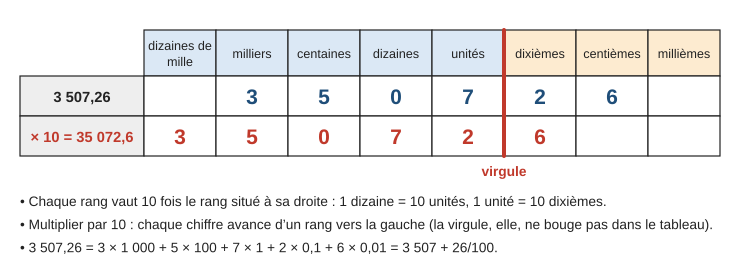
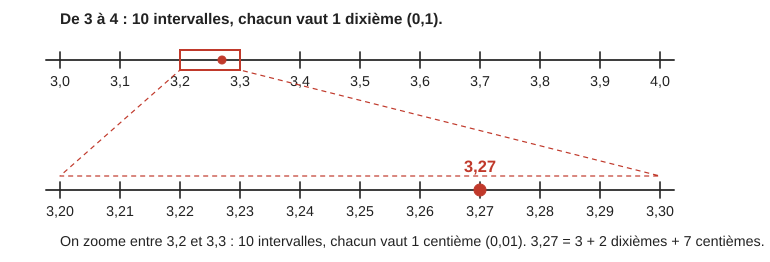
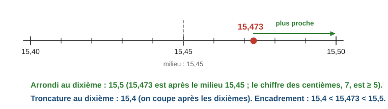
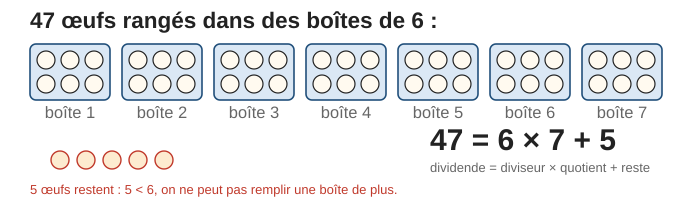
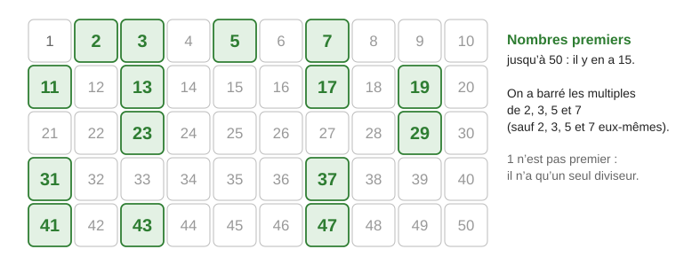
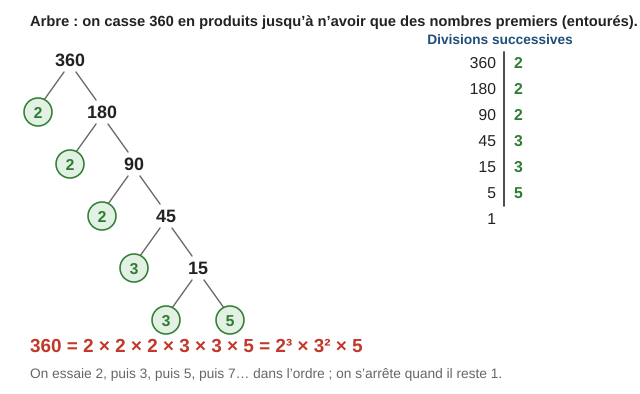

# Entiers et nombres décimaux

> Compendium collège — chapitre unifié (sans découpage 6e / 5e / 4e / 3e).  
> Cours compact pour un élève de niveau moyen : intuition, méthode, exemples guidés, erreurs fréquentes, puis exercices progressifs (★ facile, ★★ standard, ★★★ approfondissement) avec corrigés détaillés.

---

## 0. Ce qu’on vise

**En une phrase :** notre écriture des nombres repose sur des **paquets de 10** (dix unités font une dizaine, dix dixièmes font une unité) ; comprendre ces paquets permet de comparer, calculer, arrondir, puis d’étudier les **diviseurs** et les **nombres premiers**, les « briques » de tous les entiers.

À la fin de ce chapitre, je sais :

1. Lire, écrire et décomposer un nombre entier ou décimal à l’aide du **tableau de numération**.
2. **Comparer**, ranger, encadrer des décimaux et les placer sur une droite graduée.
3. Effectuer les quatre opérations sur les décimaux et **contrôler** par un ordre de grandeur.
4. **Arrondir** et **tronquer** un nombre.
5. Utiliser la **division euclidienne**, les **multiples**, les **diviseurs** et les **critères de divisibilité**.
6. Reconnaître un **nombre premier** et **décomposer** un entier en produit de facteurs premiers.

> **Prérequis.** Tables de multiplication et techniques opératoires de l’école primaire.

*Calibrage.* Nombres premiers et décomposition en facteurs premiers sont au programme du cycle 4 (programme 2020 et programme 2026) ; ils servent à rendre des fractions irréductibles (chapitre 1) et à résoudre des problèmes de partage. La racine carrée est définie au chapitre 4.

---

## 1. Écrire les nombres : le tableau de numération

### 1.1 Chaque chiffre a une valeur selon sa place

Dans $3\,507{,}26$, le chiffre $5$ vaut $5$ centaines ($500$), le chiffre $2$ vaut $2$ dixièmes ($0{,}2$). Chaque rang vaut **dix fois** le rang situé à sa droite :

$$3\,507{,}26 = 3 \times 1\,000 + 5 \times 100 + 0 \times 10 + 7 \times 1 + 2 \times 0{,}1 + 6 \times 0{,}01$$

On lit : « trois mille cinq cent sept **unités** et vingt-six **centièmes** ». Dans l’écriture des nombres, on groupe les chiffres par trois à partir de la virgule ($3\,507$, $1\,250\,000$).

**Exemple guidé 1.** Dans $3\,507{,}26$, quel est le **chiffre** des dizaines ? Quel est le **nombre** de dizaines ?

> Le chiffre des dizaines est $0$ (colonne des dizaines).  
> Le nombre de dizaines est $350$ : dans $3\,507$, il y a $350$ paquets de $10$ (et il reste $7$ unités). On lit tout ce qui est à gauche de la colonne des dizaines, celle-ci comprise.

**Contrôle.** $350 \times 10 = 3\,500 \leqslant 3\,507 < 3\,510$ ✓.

### 1.2 Multiplier ou diviser par 10, 100, 1 000

> **Propriété.** Multiplier par $10$ (par $100$, par $1\,000$) fait avancer chaque chiffre de $1$ rang (de $2$, de $3$ rangs) **vers la gauche**. Diviser par $10$, $100$, $1\,000$ les fait reculer vers la droite. Multiplier par $0{,}1$ revient à diviser par $10$ ; multiplier par $0{,}01$, à diviser par $100$.

$3{,}507 \times 100 = 350{,}7$ $\qquad 42 \div 1\,000 = 0{,}042$ $\qquad 25 \times 0{,}1 = 2{,}5$.

> **Erreur fréquente.** « Multiplier par $10$, c’est ajouter un zéro. » Vrai pour les entiers ($25 \times 10 = 250$), faux pour les décimaux : $2{,}5 \times 10 = 25$, pas $2{,}50$ (qui vaut toujours $2{,}5$). Il faut penser « les chiffres changent de rang ».

---

## 2. Nombres décimaux

### 2.1 Dixièmes, centièmes, millièmes

> **Définition.** Un nombre **décimal** est un nombre qui peut s’écrire avec un nombre **fini** de chiffres après la virgule. C’est aussi une **fraction décimale** : une fraction dont le dénominateur est $10$, $100$, $1\,000$… ($3{,}27 = \dfrac{327}{100}$).

Un dixième est l’unité partagée en $10$ ; un centième est un dixième partagé en $10$. Sur une droite graduée, cela revient à **zoomer** :

On peut ajouter des zéros à la fin de la partie décimale sans changer le nombre : $2{,}5 = 2{,}50 = 2{,}500$. Mais $2{,}05 \neq 2{,}5$ : le $5$ n’est pas au même rang. Tout entier est un décimal ($7 = 7{,}0$). En revanche, $\dfrac{1}{3} = 0{,}333\ldots$ n’est pas décimal : son écriture ne s’arrête jamais (chapitre 1).

### 2.2 Comparer, ranger, encadrer

> **Méthode — Comparer deux décimaux.** 1. Comparer les parties entières. 2. Si elles sont égales, comparer les chiffres des dixièmes, puis des centièmes, etc. (on peut compléter avec des zéros pour avoir autant de chiffres après la virgule).

**Exemple guidé 2.** Ranger dans l’ordre croissant : $2{,}5$ ; $2{,}05$ ; $2{,}49$ ; $2{,}501$.

**Réflexion.** Même partie entière $2$ : on écrit tous les nombres avec trois décimales.

> $2{,}500$ ; $2{,}050$ ; $2{,}490$ ; $2{,}501$. On compare $500$, $50$, $490$, $501$ millièmes.  
> $2{,}05 < 2{,}49 < 2{,}5 < 2{,}501$.

**Contrôle.** Sur une droite graduée de $2$ à $3$, $2{,}05$ est tout près de $2$ et $2{,}5$ au milieu ✓.

> **Erreur fréquente.** Comparer les parties décimales comme des entiers : « $0{,}19 > 0{,}2$ car $19 > 2$ ». Faux : $0{,}2 = 0{,}20$, et $19$ centièmes $< 20$ centièmes. On compare **rang par rang**, en commençant par les dixièmes.

**Encadrer** un nombre, c’est le placer entre deux nombres : au dixième près, $7{,}2 < 7{,}258 < 7{,}3$ ; au centième près, $7{,}25 < 7{,}258 < 7{,}26$. **Intercaler** : entre deux décimaux, il y en a toujours d’autres ($1{,}4 < 1{,}45 < 1{,}5$).

---

## 3. Calculer avec des décimaux

### 3.1 Addition et soustraction

On pose le calcul en **alignant les virgules** (unités sous unités, dixièmes sous dixièmes), en complétant si besoin par des zéros : $20 - 4{,}78 = 20{,}00 - 4{,}78 = 15{,}22$.

### 3.2 Multiplication

> **Méthode.** 1. Multiplier les nombres **sans les virgules**. 2. Le produit a **autant de chiffres après la virgule** que les deux facteurs réunis.

**Exemple guidé 3.** Calculer $1{,}2 \times 0{,}35$.

> $12 \times 35 = 420$. Les facteurs ont $1 + 2 = 3$ chiffres après la virgule.  
> $1{,}2 \times 0{,}35 = 0{,}420 = 0{,}42$.

**Contrôle.** Pourquoi : $1{,}2 = \dfrac{12}{10}$ et $0{,}35 = \dfrac{35}{100}$, donc le produit vaut $\dfrac{420}{1\,000}$. Ordre de grandeur : $1 \times 0{,}35 \approx 0{,}35$, et le produit est un peu plus grand ✓.

> **Erreur fréquente.** $0{,}2 \times 0{,}3 = 0{,}6$ ? Non : deux chiffres après la virgule en tout, $0{,}2 \times 0{,}3 = 0{,}06$. Multiplier par un nombre **plus petit que $1$** donne un résultat **plus petit** que le nombre de départ.

### 3.3 Division

- **Par un entier :** on pose la division ; quand on dépasse la virgule du dividende, on met la virgule au quotient et on continue avec des zéros : $7 \div 4 = 1{,}75$.
- **Par un décimal :** on multiplie dividende **et** diviseur par $10$, $100$… pour que le diviseur devienne entier (le quotient ne change pas).

**Exemple guidé 4.** Calculer $4{,}5 \div 0{,}15$.

> On multiplie les deux nombres par $100$ : $4{,}5 \div 0{,}15 = 450 \div 15 = 30$.

**Contrôle.** $30 \times 0{,}15 = 4{,}5$ ✓. Diviser par un nombre plus petit que $1$ donne un résultat **plus grand**.

### 3.4 Priorités et ordre de grandeur

Priorités : parenthèses, puis multiplications et divisions, puis additions et soustractions, de gauche à droite. $3 + 2 \times 0{,}5 = 3 + 1 = 4$, alors que $(3 + 2) \times 0{,}5 = 2{,}5$.

> **Méthode — Ordre de grandeur.** Remplacer chaque nombre par un nombre proche et simple ($1$ ou $2$ chiffres non nuls), puis calculer mentalement. Cela permet de **détecter une erreur de virgule** : $48 \times 21 \approx 50 \times 20 = 1\,000$ ; le résultat exact $1\,008$ est cohérent, $100{,}8$ ne l’est pas.

---

## 4. Arrondir, tronquer

> **Définition.**
> - **Tronquer** au dixième, c’est **couper** après le chiffre des dixièmes : la troncature de $15{,}473$ est $15{,}4$.
> - **Arrondir** au dixième, c’est choisir le nombre au dixième **le plus proche**. On regarde le chiffre **suivant** (ici les centièmes) : s’il vaut $0$, $1$, $2$, $3$ ou $4$, on garde le chiffre des dixièmes ; s’il vaut $5$, $6$, $7$, $8$ ou $9$, on l’augmente de $1$.

**Exemple guidé 5.** Arrondir $3{,}14159$ à l’unité, au dixième, au centième et au millième.

> À l’unité : chiffre suivant $1$, donc $3$. Au dixième : chiffre suivant $4$, donc $3{,}1$.  
> Au centième : chiffre suivant $1$, donc $3{,}14$. Au millième : chiffre suivant $5$, donc $3{,}142$.

**Contrôle.** Un arrondi a exactement le nombre de décimales demandé, et il est à moins d’une demi-unité du rang de la valeur exacte.

> **Erreur fréquente.** Arrondir « en cascade » : $2{,}446$ au dixième n’est pas $2{,}5$ (en arrondissant d’abord à $2{,}45$). On regarde **seulement** le chiffre qui suit le rang demandé : $4$, donc $2{,}4$. Autre piège : $9{,}97$ arrondi au dixième donne $10{,}0$ (la retenue se propage).

---

## 5. Multiples, diviseurs, division euclidienne

### 5.1 Division euclidienne

> **Définition.** Effectuer la **division euclidienne** de l’entier $a$ par l’entier $b$ non nul, c’est trouver deux entiers $q$ (le **quotient**) et $r$ (le **reste**) tels que $a = b \times q + r$ **avec $r < b$**.

**Exemple guidé 6.** $250$ élèves partent en sortie dans des cars de $52$ places. Combien de cars faut-il ?

> $52 \times 4 = 208$ et $52 \times 5 = 260 > 250$, donc $q = 4$ et $r = 250 - 208 = 42$.  
> $250 = 52 \times 4 + 42$ : $4$ cars sont pleins et il reste $42$ élèves. Il faut donc $5$ cars.

**Contrôle.** Le reste $42$ est bien inférieur à $52$ ✓. Attention à la question : le résultat utile ici n’est pas le quotient mais $q + 1$.

### 5.2 Multiples et diviseurs

> **Définition.** Si le reste de la division de $a$ par $b$ est **nul**, $a = b \times q$ : on dit que $a$ est un **multiple** de $b$, que $b$ est un **diviseur** de $a$, que $a$ est **divisible** par $b$.

$36 = 4 \times 9$ : $36$ est un multiple de $4$ et de $9$ ; $4$ et $9$ sont des diviseurs de $36$. Les diviseurs de $36$ vont **par paires** : $1 \times 36$, $2 \times 18$, $3 \times 12$, $4 \times 9$, $6 \times 6$. Liste : $1$, $2$, $3$, $4$, $6$, $9$, $12$, $18$, $36$.

> **Propriété (critères de divisibilité).** Un entier est divisible :
> - par $2$ si son chiffre des unités est $0$, $2$, $4$, $6$ ou $8$ ; par $5$ s’il se termine par $0$ ou $5$ ; par $10$ s’il se termine par $0$ ;
> - par $3$ si la **somme de ses chiffres** est divisible par $3$ ; par $9$ si la somme de ses chiffres est divisible par $9$.

Exemple : $7\,290$ se termine par $0$ (divisible par $2$, $5$, $10$) ; $7 + 2 + 9 + 0 = 18$ (divisible par $3$ et par $9$).

> **Erreur fréquente.** Utiliser la somme des chiffres pour $2$ ou $5$, ou le dernier chiffre pour $3$ : $13$ se termine par $3$ mais n’est pas divisible par $3$ ; $27$ se termine par $7$ et est divisible par $3$.

---

## 6. Nombres premiers

> **Définition.** Un nombre **premier** est un entier qui a **exactement deux diviseurs** : $1$ et lui-même. $1$ n’est pas premier (il n’a qu’un diviseur) ; $2$ est le seul nombre premier pair.

Pour trouver les nombres premiers jusqu’à $50$, on barre les multiples de $2$, $3$, $5$ et $7$ (sauf ces nombres eux-mêmes) : c’est le **crible d’Ératosthène**.

> **Méthode — Savoir si un nombre est premier.** On essaie de le diviser par les nombres premiers $2$, $3$, $5$, $7$, $11$… dans l’ordre. On peut s’arrêter dès que le carré du diviseur essayé dépasse le nombre : s’il n’y a eu aucune division exacte, le nombre est premier.

**Exemple guidé 7.** $91$ et $97$ sont-ils premiers ?

> $91$ : pas divisible par $2$ (impair), ni par $3$ ($9 + 1 = 10$), ni par $5$. Par $7$ : $91 = 7 \times 13$. Donc $91$ **n’est pas** premier.  
> $97$ : pas divisible par $2$, $3$ ($9 + 7 = 16$), $5$, ni $7$ ($7 \times 13 = 91$, $7 \times 14 = 98$). Le premier suivant est $11$, et $11 \times 11 = 121 > 97$ : on s’arrête. $97$ **est** premier.

**Contrôle.** Si $97$ avait un diviseur plus grand que $10$, il aurait aussi un diviseur plus petit que $10$ (ils vont par paires) : on l’aurait trouvé.

> **Erreur fréquente.** Croire qu’un nombre impair est premier : $51 = 3 \times 17$, $57 = 3 \times 19$, $91 = 7 \times 13$ sont impairs et non premiers.

---

## 7. Décomposer en facteurs premiers (★★)

> **Propriété.** Tout entier supérieur ou égal à $2$ peut s’écrire comme un **produit de nombres premiers**, et cette écriture est **unique** (à l’ordre des facteurs près).

> **Méthode — Décomposer.** On divise par $2$ tant que c’est possible, puis par $3$, puis par $5$, $7$, $11$… jusqu’à obtenir $1$. Les diviseurs utilisés forment la décomposition. On regroupe les facteurs égaux avec des puissances (chapitre 4) : $2 \times 2 \times 2 = 2^3$.

**À quoi ça sert ?** À simplifier une fraction (chapitre 1), à trouver les **diviseurs communs** de deux nombres, et donc à résoudre des problèmes de **partage en parts égales**.

**Exemple guidé 8.** Un fleuriste a $84$ roses et $60$ tulipes. Il veut faire le plus grand nombre possible de bouquets identiques en utilisant toutes les fleurs. Combien de bouquets ? Que contient chacun ?

**Réflexion.** Le nombre de bouquets doit diviser $84$ **et** $60$ : on cherche le plus grand diviseur commun.

> $84 = 2 \times 2 \times 3 \times 7$ et $60 = 2 \times 2 \times 3 \times 5$.  
> Facteurs communs : $2 \times 2 \times 3 = 12$. Le plus grand diviseur commun est $12$.  
> Il fait $12$ bouquets, chacun avec $84 \div 12 = 7$ roses et $60 \div 12 = 5$ tulipes.

**Contrôle.** $12 \times 7 = 84$ ✓ et $12 \times 5 = 60$ ✓. $7$ et $5$ n’ont plus de diviseur commun : on ne peut pas faire plus de bouquets.

---

## 8. Mini-synthèse

> **À retenir.**
> - Chaque rang vaut $10$ fois le rang à sa droite. $\times 10$ : les chiffres avancent d’un rang vers la gauche.
> - Comparer des décimaux : rang par rang, depuis les dixièmes. $0{,}2 = 0{,}20 > 0{,}19$.
> - Produit : autant de décimales que les deux facteurs réunis. Division par un décimal : rendre le diviseur entier. Contrôler par un ordre de grandeur.
> - Arrondir : regarder le chiffre **suivant** ($\geqslant 5$ : on augmente). Tronquer : couper.
> - $a = b \times q + r$ avec $r < b$. Reste nul : $b$ divise $a$. Critères : $2$, $5$, $10$ (dernier chiffre) ; $3$, $9$ (somme des chiffres).
> - Premier : exactement deux diviseurs ($1$ n’est pas premier). Tout entier $\geqslant 2$ se décompose de façon unique en produit de nombres premiers.

---

## 9. Exercices types

### A. Numération (★)

**A1.** a) Écrire en lettres : $405$ ; $3{,}07$ ; $12{,}508$. b) Écrire en chiffres : « deux millions trente mille six » ; « quatre unités et neuf millièmes ».

**A2.** Décomposer comme au § 1.1 : $2\,046$ ; $0{,}352$.

**A3.** a) Quel est le chiffre des centièmes de $47{,}306$ ? b) Quel est le chiffre des dizaines de $3\,507$, et le nombre de dizaines de $3\,507$ ? c) Combien y a-t-il de dixièmes dans $4{,}6$ ?

**A4.** Calculer : $3{,}507 \times 100$ ; $42 \div 1\,000$ ; $0{,}6 \times 10$ ; $25 \times 0{,}1$.

### B. Comparer, encadrer (★)

**B1.** Ranger dans l’ordre croissant : $3{,}08$ ; $3{,}8$ ; $3{,}008$ ; $3{,}80$ ; $3{,}1$.

**B2.** Encadrer $7{,}258$ au dixième près, puis au centième près.

**B3.** Trouver trois décimaux compris entre $1{,}4$ et $1{,}5$.

### C. Opérations (★ → ★★)

**C1.** Calculer : a) $12{,}6 + 3{,}45$ ; b) $20 - 4{,}78$ ; c) $7{,}5 + 0{,}05 + 1{,}2$.

**C2.** Calculer : a) $2{,}5 \times 1{,}2$ ; b) $0{,}08 \times 0{,}5$ ; c) $3{,}6 \times 0{,}01$ ; d) $1{,}25 \times 8$.

**C3.** Calculer : a) $9{,}6 \div 3$ ; b) $4{,}5 \div 0{,}5$ ; c) $0{,}72 \div 0{,}08$ ; d) $7 \div 4$.

**C4.** Calculer en respectant les priorités : a) $3 + 2 \times 0{,}5$ ; b) $(3 + 2) \times 0{,}5$ ; c) $10 - 6 \div 2$.

### D. Arrondis, ordres de grandeur (★ → ★★)

**D1.** Arrondir $15{,}473$ à l’unité, au dixième, au centième.

**D2.** Donner un ordre de grandeur de $49 \times 19$ et de $0{,}51 \times 198$.

**D3.** $\dfrac{2}{3} = 0{,}6666\ldots$ Donner sa troncature et son arrondi au centième.

### E. Division euclidienne, divisibilité (★ → ★★)

**E1.** Effectuer les divisions euclidiennes et écrire l’égalité $a = b \times q + r$ : a) $47$ par $6$ ; b) $250$ par $12$ ; c) $1\,000$ par $7$.

**E2.** Parmi $135$ ; $240$ ; $418$ ; $1\,233$ ; $7\,290$, lesquels sont divisibles par $2$ ? par $3$ ? par $5$ ? par $9$ ? par $10$ ?

**E3.** a) Donner la liste des diviseurs de $36$ et de $30$. b) Quels sont leurs diviseurs communs ?

### F. Nombres premiers, décomposition (★★)

**F1.** Parmi $21$ ; $29$ ; $51$ ; $57$ ; $61$ ; $91$ ; $97$, lesquels sont premiers ? Pour les autres, donner un produit.

**F2.** Décomposer en produit de facteurs premiers : $84$ ; $90$ ; $360$ ; $1\,001$.

**F3.** Utiliser F2 pour rendre $\dfrac{84}{90}$ irréductible.

### G. Problèmes (★ → ★★)

**G1.** Un cahier coûte $2{,}45$ €. Combien coûtent $8$ cahiers ?

**G2.** Une planche mesure $2{,}4$ m. On y découpe trois morceaux de $0{,}65$ m. Quelle longueur reste-t-il ?

**G3.** $230$ élèves partent en sortie dans des cars de $52$ places. Combien faut-il de cars ? Combien de places restent libres ?

---

## 10. Exercices atypiques

### H. Trouver l’erreur (★★)

**H1.** « $0{,}2 \times 0{,}3 = 0{,}6$, car $2 \times 3 = 6$. »

**H2.** « $0{,}19 > 0{,}2$, car $19 > 2$. »

**H3.** « $2{,}5 \times 10 = 2{,}50$ : multiplier par $10$, c’est ajouter un zéro. »

**H4.** « $51$ est premier : il est impair et ne se termine ni par $0$ ni par $5$. »

**H5.** « $1$ est un nombre premier, puisqu’il n’est divisible que par $1$ et par lui-même. »

### I. Comprendre (★★)

**I1.** Sans calculer, dire si $0{,}99 \times 0{,}99$ est plus petit ou plus grand que $1$. Justifier.

**I2.** Expliquer pourquoi $4 \div 0{,}5 = 8$ (penser à « combien de demis dans $4$ ? »).

**I3.** a) Un nombre divisible par $6$ est-il toujours divisible par $2$ et par $3$ ? b) Un nombre divisible par $2$ et par $3$ est-il toujours divisible par $6$ ? c) Un nombre divisible par $2$ et par $4$ est-il toujours divisible par $8$ ?

**I4.** (★★★) Pour savoir si un nombre inférieur à $100$ est premier, pourquoi suffit-il d’essayer de le diviser par $2$, $3$, $5$ et $7$ ?

### J. Problèmes en plusieurs étapes (★★)

**J1.** Un fleuriste a $126$ roses et $90$ tulipes. Il veut faire le plus grand nombre possible de bouquets identiques avec toutes ses fleurs. Combien de bouquets ? Que contient chacun ?

**J2.** Deux phares s’allument ensemble à minuit. Le premier s’allume toutes les $12$ secondes, le second toutes les $18$ secondes. Au bout de combien de secondes s’allumeront-ils de nouveau ensemble ? (Indice : chercher le plus petit nombre qui est à la fois un multiple de $12$ et un multiple de $18$.)

**J3.** Au marché, Inès achète un article à $4{,}95$ €, un à $12{,}40$ € et deux à $1{,}85$ € l’un. a) Estimer la dépense. b) Elle paie avec un billet de $50$ €. Combien lui rend-on ?

**J4.** On veut carreler une pièce rectangulaire de $4{,}2$ m sur $2{,}7$ m avec des dalles carrées identiques, sans découpe, les plus grandes possibles (côté en centimètres entiers). Quel est le côté d’une dalle ? Combien en faut-il ?

### K. Pour aller plus loin (★★★)

**K1.** a) Vérifier que $1\,001 = 7 \times 11 \times 13$. b) En déduire que tout nombre de la forme $abcabc$ (par exemple $274\,274$) est divisible par $7$, $11$ et $13$.

**K2.** Calculer $N = 2 \times 3 \times 5 \times 7 + 1$. Montrer que $N$ n’est divisible ni par $2$, ni par $3$, ni par $5$, ni par $7$. $N$ est-il premier ?

**K3.** Avec $360 = 2^3 \times 3^2 \times 5$, expliquer pourquoi $360$ a $24$ diviseurs.

### L. Situations ouvertes (★★)

**L1.** Avec les chiffres $1$, $2$, $3$, $4$ (chacun une fois) et une virgule, former le plus grand et le plus petit décimal ayant deux chiffres après la virgule.

**L2.** Pour $12{,}3 \times 8{,}7$, donner un ordre de grandeur, la valeur exacte, la troncature à l’unité et l’arrondi à l’unité. Expliquer la différence entre ces quatre réponses.

---

## 11. Corrigés

### Exercices types

**A1.** a) Quatre cent cinq ; trois unités et sept centièmes ; douze unités et cinq cent huit millièmes. b) $2\,030\,006$ ; $4{,}009$.

**A2.** $2\,046 = 2 \times 1\,000 + 0 \times 100 + 4 \times 10 + 6 \times 1$ ; $0{,}352 = 3 \times 0{,}1 + 5 \times 0{,}01 + 2 \times 0{,}001$.

**A3.** a) $0$. b) Chiffre des dizaines : $0$ ; nombre de dizaines : $350$. c) $46$ dixièmes.

**A4.** $350{,}7$ ; $0{,}042$ ; $6$ ; $2{,}5$.

**B1. (modèle)**

> Avec trois décimales : $3{,}080$ ; $3{,}800$ ; $3{,}008$ ; $3{,}800$ ; $3{,}100$.  
> $3{,}008 < 3{,}08 < 3{,}1 < 3{,}8 = 3{,}80$.

**B2.** $7{,}2 < 7{,}258 < 7{,}3$ ; $7{,}25 < 7{,}258 < 7{,}26$.

**B3.** Par exemple $1{,}41$ ; $1{,}45$ ; $1{,}499$.

**C1.** a) $16{,}05$ ; b) $15{,}22$ ; c) $8{,}75$.

**C2. (modèle)**

> a) $25 \times 12 = 300$, deux décimales : $3{,}00 = 3$.  
> b) $8 \times 5 = 40$, trois décimales : $0{,}040 = 0{,}04$.  
> c) Multiplier par $0{,}01$, c’est diviser par $100$ : $0{,}036$. d) $10$.

**C3.** a) $3{,}2$ ; b) $45 \div 5 = 9$ ; c) $72 \div 8 = 9$ ; d) $1{,}75$.

**C4.** a) $4$ ; b) $2{,}5$ ; c) $7$.

**D1.** $15$ ; $15{,}5$ ; $15{,}47$.

**D2.** $49 \times 19 \approx 50 \times 20 = 1\,000$ ; $0{,}51 \times 198 \approx 0{,}5 \times 200 = 100$.

**D3.** Troncature : $0{,}66$ ; arrondi : $0{,}67$ (le chiffre suivant, $6$, est $\geqslant 5$).

**E1. (modèle)**

> a) $47 = 6 \times 7 + 5$ ($5 < 6$).  
> b) $250 = 12 \times 20 + 10$ ($10 < 12$).  
> c) $1\,000 = 7 \times 142 + 6$ ($6 < 7$).

**E2.** Par $2$ : $240$, $418$, $7\,290$. Par $3$ : $135$, $240$, $1\,233$, $7\,290$. Par $5$ : $135$, $240$, $7\,290$. Par $9$ : $135$, $1\,233$, $7\,290$. Par $10$ : $240$, $7\,290$.

**E3.** a) $36$ : $1$, $2$, $3$, $4$, $6$, $9$, $12$, $18$, $36$. $30$ : $1$, $2$, $3$, $5$, $6$, $10$, $15$, $30$. b) $1$, $2$, $3$, $6$.

**F1.** Premiers : $29$, $61$, $97$. $21 = 3 \times 7$ ; $51 = 3 \times 17$ ; $57 = 3 \times 19$ ; $91 = 7 \times 13$.

**F2. (modèle)**

> $84 = 2 \times 42 = 2 \times 2 \times 21 = 2^2 \times 3 \times 7$.  
> $90 = 2 \times 45 = 2 \times 3 \times 15 = 2 \times 3^2 \times 5$.  
> $360 = 2^3 \times 3^2 \times 5$ (figure du § 7). $1\,001 = 7 \times 143 = 7 \times 11 \times 13$.

**F3.** Facteurs communs : $2 \times 3 = 6$. $\dfrac{84}{90} = \dfrac{2 \times 2 \times 3 \times 7}{2 \times 3 \times 3 \times 5} = \dfrac{2 \times 7}{3 \times 5} = \dfrac{14}{15}$.

**G1.** $2{,}45 \times 8 = 19{,}60$ €.

**G2.** $3 \times 0{,}65 = 1{,}95$ m ; $2{,}4 - 1{,}95 = 0{,}45$ m.

**G3. (modèle)**

> $230 = 52 \times 4 + 22$ : $4$ cars pleins et $22$ élèves en plus.  
> Il faut $5$ cars. Places libres : $5 \times 52 - 230 = 260 - 230 = 30$.

### Exercices atypiques

**H1.** Il y a deux chiffres après la virgule en tout : $0{,}2 \times 0{,}3 = 0{,}06$.

**H2.** $0{,}2 = 0{,}20$ et $19$ centièmes $< 20$ centièmes : $0{,}19 < 0{,}2$. On compare d’abord les dixièmes : $1 < 2$.

**H3.** Les chiffres avancent d’un rang : $2{,}5 \times 10 = 25$. ($2{,}50 = 2{,}5$, le nombre n’a pas changé.)

**H4.** $5 + 1 = 6$ est divisible par $3$ : $51 = 3 \times 17$, donc $51$ n’est pas premier.

**H5.** Un nombre premier a **exactement deux** diviseurs distincts. $1$ n’en a qu’un : il n’est pas premier.

**I1.** Plus petit : multiplier $0{,}99$ par un nombre plus petit que $1$ donne un résultat plus petit que $0{,}99$, donc que $1$ (exactement $0{,}9801$).

**I2.** Dans une unité, il y a $2$ demis ; dans $4$ unités, $4 \times 2 = 8$ demis. Donc $4 \div 0{,}5 = 8$ (et $8 \times 0{,}5 = 4$ ✓).

**I3.** a) Oui : $6 = 2 \times 3$, un multiple de $6$ est un multiple de $2$ et de $3$. b) Oui : il contient les facteurs $2$ et $3$, qui sont premiers et différents. c) Non : $12$ est divisible par $2$ et par $4$, mais pas par $8$.

**I4.** Si un nombre $n < 100$ n’est pas premier, il s’écrit $n = a \times b$ avec $a \leqslant b$. Alors $a \times a \leqslant n < 100$, donc $a < 10$ : $n$ a un diviseur plus petit que $10$, donc un diviseur premier parmi $2$, $3$, $5$, $7$.

**J1. (modèle)**

> $126 = 2 \times 3^2 \times 7$ et $90 = 2 \times 3^2 \times 5$. Facteurs communs : $2 \times 3^2 = 18$.  
> $18$ bouquets, chacun avec $126 \div 18 = 7$ roses et $90 \div 18 = 5$ tulipes.

**J2.** On cherche le plus petit multiple commun de $12 = 2^2 \times 3$ et $18 = 2 \times 3^2$ : il faut $2^2 \times 3^2 = 36$. Ils se rallument ensemble au bout de $36$ secondes. Contrôle : multiples de $18$ : $18$ (pas multiple de $12$), $36 = 3 \times 12$ ✓.

**J3.** a) $5 + 12 + 2 + 2 = 21$ € environ. b) $4{,}95 + 12{,}40 + 3{,}70 = 21{,}05$ € ; on lui rend $50 - 21{,}05 = 28{,}95$ €.

**J4.** En centimètres : $420 = 2^2 \times 3 \times 5 \times 7$ et $270 = 2 \times 3^3 \times 5$. Plus grand diviseur commun : $2 \times 3 \times 5 = 30$. Dalles de $30$ cm de côté : $14$ dans la longueur, $9$ dans la largeur, soit $14 \times 9 = 126$ dalles.

**K1.** a) $7 \times 11 = 77$ et $77 \times 13 = 1\,001$. b) $abcabc = abc \times 1\,000 + abc = abc \times 1\,001 = abc \times 7 \times 11 \times 13$. Exemple : $274\,274 = 274 \times 1\,001$.

**K2.** $N = 211$. $N - 1 = 210$ est divisible par $2$, $3$, $5$ et $7$, donc la division de $N$ par chacun d’eux laisse le reste $1$. Pour savoir si $211$ est premier, on essaie aussi $11$ et $13$ ($11 \times 19 = 209$, $13 \times 16 = 208$ : restes non nuls) ; $17 \times 17 = 289 > 211$ : on s’arrête. $211$ est premier.

**K3.** Un diviseur de $360$ s’écrit $2^a \times 3^b \times 5^c$ avec $a$ entre $0$ et $3$ ($4$ choix), $b$ entre $0$ et $2$ ($3$ choix), $c$ égal à $0$ ou $1$ ($2$ choix) : $4 \times 3 \times 2 = 24$ diviseurs.

**L1.** Plus grand : $43{,}21$. Plus petit : $12{,}34$.

**L2.** Ordre de grandeur : $12 \times 9 = 108$ (ou $10 \times 10 = 100$). Valeur exacte : $107{,}01$. Troncature à l’unité : $107$. Arrondi à l’unité : $107$. L’ordre de grandeur sert à contrôler ; la valeur exacte est le vrai résultat ; troncature et arrondi sont des valeurs approchées choisies selon une règle.

---

## 12. Liens avec les autres chapitres

- **Chapitre 1** (fractions) : simplifier une fraction grâce aux critères de divisibilité et à la décomposition ; fractions décimales.
- **Chapitre 3** (relatifs) : décimaux négatifs, droite graduée.
- **Chapitre 4** (puissances) : $10$, $100$, $1\,000$ comme puissances de $10$, notation scientifique, racine carrée ; $2^3 \times 3^2 \times 5$.
- **Chapitre 5** (proportionnalité) : calculs décimaux, prix, pourcentages.
- **Chapitre 14** (grandeurs) : conversions d’unités par le tableau de numération.

---

## 13. Fiche-synthèse

| Je dois savoir… | Comment | Exemple express | S’entraîner |
|---|---|---|---|
| Multiplier ou diviser par $10$, $100$, $1\,000$ | décaler les chiffres de un, deux ou trois rangs | $3{,}7 \times 100 = 370$ ; $45 \div 1\,000 = 0{,}045$ | série A |
| Comparer des décimaux | partie entière, puis rang par rang | $0{,}3 > 0{,}29$ | série B |
| Multiplier des décimaux | calculer sans virgule, puis placer autant de décimales que les deux facteurs réunis | $2{,}5 \times 1{,}2$ : $25 \times 12 = 300$, donc $3{,}00 = 3$ | série C |
| Arrondir | regarder le chiffre suivant ($5$ ou plus : on augmente) | $3{,}146 \approx 3{,}15$ au centième | série D |
| Division euclidienne | $a = b \times q + r$ avec $r < b$ | $47 = 6 \times 7 + 5$ | série E |
| Décomposer en facteurs premiers | diviser par $2$, $3$, $5$, $7$… tant que c’est possible | $360 = 2^3 \times 3^2 \times 5$ | série F |

**Pièges à éviter :** $0{,}12 < 0{,}9$ (comparer rang par rang, pas « $12 > 9$ ») ; $1$ n’est pas premier ; arrondir n’est pas tronquer.

---

*Version v0.3 — relecture (prérequis harmonisés, fiche-synthèse, corrections : voir `PLAN-REVISION.md`, § 10). Base : v0.2 — révision vague 4 (cours développé : tableau de numération, chiffre et nombre de, multiplication et division par 10, 100, 1 000, décimaux et zoom sur la droite graduée, comparaison, encadrement, opérations avec justification, ordre de grandeur, arrondi et troncature sur la droite, division euclidienne, multiples, diviseurs et critères, nombres premiers avec crible et méthode de test, décomposition en facteurs premiers et problèmes de partage ; 8 exemples guidés ; 6 figures SVG ; 41 exercices corrigés). Anciennes versions : `cours-et-exercices.md.bak` (origine) et `cours-et-exercices.md.phase0.bak`.*
