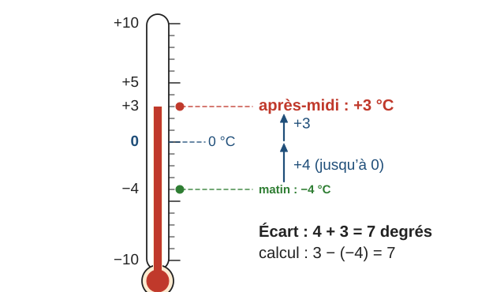
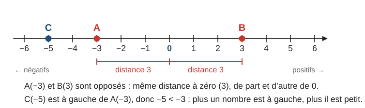
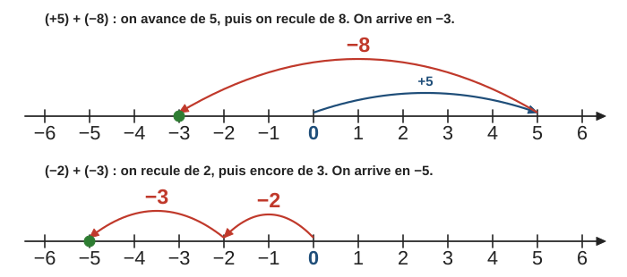
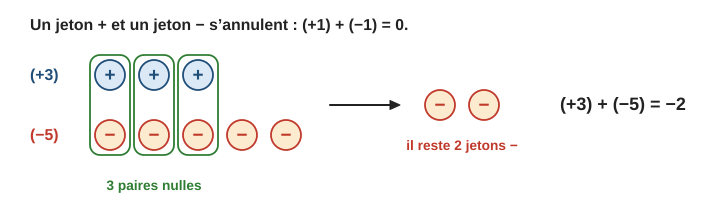
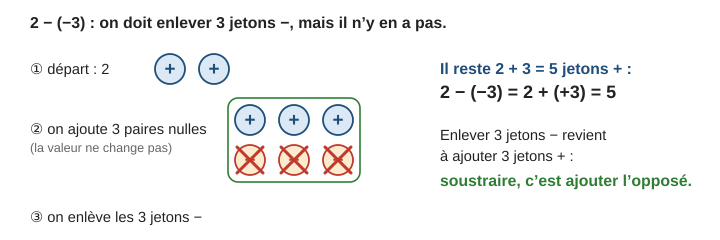
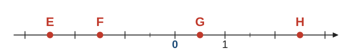

# Nombres relatifs

> Compendium collège — chapitre unifié (sans découpage 6e / 5e / 4e / 3e).  
> Cours compact pour un élève de niveau moyen : intuition, méthode, exemples guidés, erreurs fréquentes, puis exercices progressifs (★ facile, ★★ standard, ★★★ approfondissement) avec corrigés détaillés.

---

## 0. Ce qu’on vise

**En une phrase :** un nombre relatif est un nombre **avec un sens** (au-dessus ou au-dessous de zéro, gain ou perte, vers la droite ou vers la gauche) ; on le place sur une **droite graduée**, et presque toutes les règles se comprennent en s’y déplaçant.

À la fin de ce chapitre, je sais :

1. Utiliser les relatifs dans des situations concrètes (températures, altitudes, comptes, années).
2. Donner l’**opposé** et la **distance à zéro** (ou **valeur absolue**) d’un nombre ; placer et lire des nombres sur une **droite graduée**.
3. **Comparer** et ranger des relatifs.
4. **Additionner** et **soustraire** des relatifs, simplifier une suite d’additions et de soustractions.
5. **Multiplier** et **diviser** des relatifs (règle des signes).
6. Calculer une expression avec des relatifs en respectant les **priorités**.

> **Prérequis.** Calculs sur les décimaux (chapitre 2, § 3) et sur les fractions (chapitre 1, § 4 et 5) ; priorités opératoires (chapitre 2, § 3.4).

*Calibrage.* Addition, soustraction, comparaison et repérage sont travaillés dès le début du cycle 4 ; multiplication et division de relatifs viennent ensuite. Le programme 2026 nomme la distance à zéro **valeur absolue**, notée $|a|$, dès la 5e (§ 1.2).

---

## 1. Pourquoi des nombres négatifs ?

### 1.1 Des situations de la vie courante

Certaines grandeurs se mesurent **à partir d’un zéro**, avec deux sens possibles :

| Situation | Zéro | Positif | Négatif |
|---|---|---|---|
| Température | $0$ °C (l’eau gèle) | au-dessus | en dessous : $-5$ °C |
| Altitude | niveau de la mer | au-dessus | en dessous : $-120$ m |
| Compte en banque | solde nul | argent disponible | découvert : $-30$ € |
| Années | début de notre ère | après J.-C. | avant J.-C. : $-52$ |
| Étages | rez-de-chaussée | étages | sous-sols : niveau $-2$ |

Le thermomètre est une **droite graduée verticale** : au-dessus de $0$ les positifs, au-dessous les négatifs. Pour passer de $-4$ °C à $+3$ °C, la température monte de $4$ degrés (jusqu’à $0$) puis de $3$ degrés : elle monte de $7$ degrés en tout.

### 1.2 Vocabulaire

> **Définition.** Un **nombre relatif** est formé d’un **signe** ($+$ ou $-$) et d’une **distance à zéro** (un nombre positif).
> - Un nombre **positif** est supérieur ou égal à $0$ : $+7$ s’écrit aussi $7$ (le signe $+$ est souvent omis).
> - Un nombre **négatif** est inférieur ou égal à $0$ : $-3$, $-0{,}4$, $-\dfrac{1}{2}$.
> - $0$ est le seul nombre à la fois positif et négatif : on l’écrit sans signe.
> - Un nombre **strictement positif** est supérieur à $0$ (et différent de $0$) ; un nombre **strictement négatif** est inférieur à $0$ (et différent de $0$).

Exemples : la distance à zéro de $-5$ est $5$ ; celle de $+2{,}3$ est $2{,}3$ ; celle de $0$ est $0$.

> **Définition.** Deux nombres sont **opposés** s’ils ont la même distance à zéro et des signes contraires. L’opposé de $a$ se note $-a$ ; la somme de deux opposés vaut $0$.

L’opposé de $5$ est $-5$ ; l’opposé de $-3$ est $3$ ; l’opposé de $0$ est $0$. Ainsi $-(-3) = 3$ : « l’opposé de l’opposé, c’est le nombre lui-même ».

> **Erreur fréquente.** Croire que $-a$ est toujours négatif. Si $a = -3$, alors $-a = 3$ est positif. Le signe « $-$ » devant une lettre veut dire « l’opposé de », pas « négatif ».

> **Définition (valeur absolue).** [[Programme 2026 · 5e]] La **valeur absolue** d’un nombre $a$ est sa **distance à zéro**. On la note $|a|$ et on lit « valeur absolue de $a$ ».
> - $|-5| = 5$ ; $|2{,}3| = 2{,}3$ ; $|0| = 0$.
> - Une valeur absolue est toujours **positive ou nulle**.
> - Deux nombres opposés ont la même valeur absolue : $|-7| = |7| = 7$.

Les barres $|\;|$ « effacent le signe » d’un **nombre** écrit avec son signe. Attention avec un calcul à l’intérieur : on calcule d’abord, puis on prend la distance à zéro. Par exemple $|3 - 8| = |-5| = 5$, alors que $|3| - |8| = 3 - 8 = -5$.

> **Erreur fréquente.** Écrire $|-5| = -5$. La valeur absolue est une distance : elle n’est **jamais négative**. Les nombres qui ont pour valeur absolue $5$ sont $5$ et $-5$.

---

## 2. Droite graduée et comparaison

### 2.1 Se repérer

Sur une droite graduée, on choisit une **origine** (le point d’abscisse $0$) et une **unité**. Les positifs sont à droite de $0$, les négatifs à gauche, **symétriquement**. Le nombre qui repère un point est son **abscisse** : on écrit $A(-3)$.

Deux points d’abscisses opposées sont **symétriques par rapport à l’origine**. La distance à zéro d’un nombre est la longueur du segment qui va de l’origine au point.

> **Méthode — Lire une abscisse.** 1. Trouver la **valeur d’une graduation** : écart entre deux nombres écrits, divisé par le nombre d’intervalles entre eux. 2. Compter les graduations depuis $0$, vers la droite ($+$) ou vers la gauche ($-$).

### 2.2 Comparer

> **Propriété.** Sur une droite graduée, de deux nombres, le plus petit est celui qui est **le plus à gauche**. Conséquences :
> - un nombre négatif est toujours plus petit qu’un nombre positif ;
> - de deux nombres **négatifs**, le plus petit est celui qui a la **plus grande** distance à zéro.

Par exemple $-8 < -3$ : il fait plus froid à $-8$ °C qu’à $-3$ °C.

**Exemple guidé 1.** Ranger dans l’ordre croissant : $-2$ ; $3$ ; $-5{,}5$ ; $0$ ; $-0{,}5$.

**Réflexion.** On sépare négatifs et positifs. Parmi les négatifs, le plus éloigné de zéro est le plus petit.

> Négatifs : $-5{,}5 < -2 < -0{,}5$ (distances à zéro $5{,}5$ ; $2$ ; $0{,}5$, dans l’ordre inverse).  
> Donc $-5{,}5 < -2 < -0{,}5 < 0 < 3$.

**Contrôle.** On imagine les points sur la droite : de gauche à droite, on lit bien cet ordre.

> **Erreur fréquente.** Écrire $-8 > -3$ « parce que $8 > 3$ ». Pour les négatifs, c’est l’inverse : $-8$ est plus à gauche, donc $-8 < -3$. Même piège avec les décimaux : $-0{,}5 < -0{,}05$.

---

## 3. Additionner des relatifs

### 3.1 Additionner, c’est se déplacer

Sur la droite graduée, ajouter un nombre **positif** fait avancer vers la droite ; ajouter un nombre **négatif** fait reculer vers la gauche.

On peut aussi penser à des **jetons** : un jeton $+$ vaut $1$, un jeton $-$ vaut $-1$, et une paire $+/-$ vaut $0$.

### 3.2 Les règles

> **Propriété (addition de deux relatifs).**
> - **Même signe :** on **additionne** les distances à zéro et on garde le signe commun. $(-3) + (-5) = -8$.
> - **Signes contraires :** on **soustrait** les distances à zéro (la plus grande moins la plus petite) et on prend le signe du nombre qui a la **plus grande** distance à zéro. $(+3) + (-5) = -2$.
> - La somme de deux opposés vaut $0$ : $(-7) + 7 = 0$.

**Exemple guidé 2.** Calculer $A = (-7) + (+3)$ et $B = (-2{,}5) + (-4)$.

> $A$ : signes contraires ; $7 - 3 = 4$ ; c’est $-7$ qui a la plus grande distance à zéro, donc $A = -4$.  
> $B$ : même signe ; $2{,}5 + 4 = 6{,}5$ ; signe commun $-$, donc $B = -6{,}5$.

**Contrôle.** Pour $A$ : je pars de $-7$ et j’avance de $3$ : $-6$, $-5$, $-4$ ✓.

### 3.3 Additionner plusieurs relatifs

On peut changer l’ordre des termes et les regrouper : le plus simple est de regrouper **les positifs ensemble et les négatifs ensemble**.

**Exemple guidé 3.** Calculer $C = (-3) + 8 + (-6) + (-2) + 4$.

> Positifs : $8 + 4 = 12$. Négatifs : $(-3) + (-6) + (-2) = -11$.  
> $C = 12 + (-11) = 1$.

**Contrôle.** Gains $12$, pertes $11$ : on finit avec un gain de $1$ ✓.

> **Erreur fréquente.** Appliquer « moins et moins font plus » à une addition : $(-2) + (-3) \neq +5$. Deux pertes font une perte plus grande : $(-2) + (-3) = -5$. Cette phrase concerne le **produit** (§ 5).

---

## 4. Soustraire des relatifs

### 4.1 Soustraire, c’est ajouter l’opposé

Sur le thermomètre du § 1, l’écart entre $+3$ °C et $-4$ °C est $7$ degrés : c’est $3 - (-4)$, qui vaut donc $7$, c’est-à-dire $3 + 4$. Les jetons montrent pourquoi :

> **Propriété.** **Soustraire un nombre, c’est ajouter son opposé :** $a - b = a + (-b)$.

$5 - 3 = 5 + (-3) = 2$ $\qquad 5 - (-3) = 5 + 3 = 8$ $\qquad (-5) - 3 = (-5) + (-3) = -8$ $\qquad (-5) - (-3) = (-5) + 3 = -2$

> **Erreur fréquente.** Changer le signe du **premier** nombre, ou ne pas changer la soustraction en addition : $(-5) - 3$ ne vaut ni $5 + (-3)$ ni $-2$. Seul le nombre **soustrait** est remplacé par son opposé : $(-5) + (-3) = -8$.

### 4.2 Simplifier l’écriture

Dans une suite d’additions et de soustractions, on transforme chaque soustraction en addition, puis on **supprime les parenthèses et les signes $+$ d’addition** : il reste une écriture simplifiée, qu’on calcule en regroupant.

**Exemple guidé 4.** Calculer $D = -6 - (-4) + (-3) - (+2)$.

> On remplace chaque soustraction par l’addition de l’opposé :  
> $D = -6 + 4 + (-3) + (-2)$  
> Écriture simplifiée : $D = -6 + 4 - 3 - 2$  
> Positifs : $4$ ; négatifs : $-6 - 3 - 2 = -11$. Donc $D = 4 - 11 = -7$.

**Contrôle.** Sur la droite : depuis $-6$, j’avance de $4$ ($-2$), je recule de $3$ ($-5$) puis de $2$ ($-7$) ✓.

> **Méthode — Distance entre deux points.** Sur une droite graduée, la distance entre deux points est : **la plus grande abscisse moins la plus petite**. Entre $A(-4)$ et $B(3)$ : $3 - (-4) = 7$. Le résultat est toujours positif.

*Avec la valeur absolue* [[Programme 2026 · 5e]] : la distance entre les points d’abscisses $a$ et $b$ est $|b - a|$, dans n’importe quel ordre. Entre $A(-4)$ et $B(3)$ : $|3 - (-4)| = |7| = 7$, et aussi $|-4 - 3| = |-7| = 7$.

---

## 5. Multiplier et diviser des relatifs (★★)

### 5.1 D’où vient la règle des signes ?

$3 \times (-2)$, c’est $(-2) + (-2) + (-2) = -6$. Pour un facteur négatif à gauche, on prolonge la régularité :

| Calcul | $3 \times (-2)$ | $2 \times (-2)$ | $1 \times (-2)$ | $0 \times (-2)$ | $(-1) \times (-2)$ | $(-2) \times (-2)$ |
|---|---|---|---|---|---|---|
| Résultat | $-6$ | $-4$ | $-2$ | $0$ | $2$ | $4$ |

Quand le premier facteur diminue de $1$, le produit **augmente de $2$** : après $0$, on obtient des nombres positifs. C’est pourquoi $(-1) \times (-2) = 2$.

### 5.2 Les règles

> **Propriété (règle des signes).** Pour multiplier ou diviser deux relatifs, on multiplie ou divise les distances à zéro, et :
> - deux nombres de **même signe** donnent un résultat **positif** ;
> - deux nombres de **signes contraires** donnent un résultat **négatif**.

$(-3) \times (-4) = 12$ $\qquad (-3) \times 4 = -12$ $\qquad \dfrac{-12}{-3} = 4$ $\qquad \dfrac{-12}{3} = \dfrac{12}{-3} = -4$

> **Propriété (plusieurs facteurs).** Un produit de facteurs non nuls est **positif** s’il contient un nombre **pair** de facteurs négatifs, **négatif** si ce nombre est **impair**.

**Exemple guidé 5.** Calculer $E = (-2) \times 5 \times (-3) \times (-1)$ et $F = \dfrac{-24}{-6}$.

**Réflexion.** On trouve **d’abord le signe**, puis on calcule avec les distances à zéro.

> $E$ : trois facteurs négatifs (nombre impair), donc $E$ est négatif. $2 \times 5 \times 3 \times 1 = 30$, donc $E = -30$.  
> $F$ : même signe, donc positif ; $24 \div 6 = 4$, donc $F = 4$.

**Contrôle.** $E$ pas à pas : $(-2) \times 5 = -10$ ; $(-10) \times (-3) = 30$ ; $30 \times (-1) = -30$ ✓.

### 5.3 Carrés et puissances de nombres négatifs

$(-3)^2 = (-3) \times (-3) = 9$, alors que $-3^2 = -(3 \times 3) = -9$ : sans parenthèses, le carré ne porte que sur $3$. Un **carré** est toujours positif ou nul ; un **cube** a le signe du nombre : $(-2)^3 = -8$.

> **Erreur fréquente.** Écrire $(-2) \times (-3) \times (-4) = 24$ « car moins par moins donne plus ». La règle vaut pour **deux** facteurs ; avec trois facteurs négatifs, le produit est négatif : $-24$.

---

## 6. Calculer une expression avec des relatifs

Les priorités sont les mêmes qu’avec les nombres positifs : **parenthèses**, puis **puissances**, puis **multiplications et divisions**, puis **additions et soustractions** (de gauche à droite).

**Exemple guidé 6.** Calculer $G = -3 + 4 \times (-2)^2 - (-6) \div 3$.

> Puissance : $(-2)^2 = 4$, donc $G = -3 + 4 \times 4 - (-6) \div 3$.  
> Multiplication et division : $4 \times 4 = 16$ et $(-6) \div 3 = -2$, donc $G = -3 + 16 - (-2)$.  
> Additions : $G = -3 + 16 + 2 = 15$.

**Contrôle.** Signe d’abord, ordre de grandeur ensuite : $16$ domine, le résultat est positif et proche de $16$ ✓. À la calculatrice, on tape les parenthèses autour de $-2$.

> **Erreur fréquente.** Calculer de gauche à droite sans priorités : $-3 + 4 = 1$, puis $1 \times 4 = 4$… Faux : la multiplication passe avant l’addition.

---

## 7. Mini-synthèse

> **À retenir.**
> - Relatif = signe + distance à zéro. Opposés : même distance à zéro, signes contraires ; $-(-a) = a$.
> - Valeur absolue = distance à zéro : $|-6| = |6| = 6$ ; elle n’est jamais négative.
> - Sur la droite, **plus à gauche = plus petit** ; entre deux négatifs, le plus loin de zéro est le plus petit.
> - **Addition** : même signe → on additionne les distances, signe commun ; signes contraires → on soustrait, signe du « plus loin de zéro ».
> - **Soustraction** : on ajoute l’opposé, $a - b = a + (-b)$. Distance entre deux points : grande abscisse moins petite.
> - **Produit, quotient** : même signe → positif ; signes contraires → négatif ; plusieurs facteurs → compter les négatifs.
> - $(-3)^2 = 9$ mais $-3^2 = -9$. Priorités inchangées.

---

## 8. Exercices types

### A. Droite graduée, opposés, comparaison (★)

**A1.** Lire les abscisses des points $E$, $F$, $G$ et $H$.

**A2.** Ranger dans l’ordre croissant : $4$ ; $-1$ ; $0$ ; $-7$ ; $2{,}5$ ; $-2$.

**A3.** Comparer (avec $<$ ou $>$) : a) $-8$ et $-3$ ; b) $-0{,}5$ et $-0{,}05$ ; c) $-12$ et $1$ ; d) $0$ et $-4$.

**A4.** Donner l’opposé et la distance à zéro de : $7$ ; $-2{,}5$ ; $0$ ; $-(-4)$.

**A5.** [[Programme 2026 · 5e]] a) Calculer : $|-9|$ ; $|4{,}2|$ ; $|0|$ ; $|-0{,}03|$. b) Calculer : $|-3| + |5|$ ; $|-3 + 5|$ ; $|2 - 7|$ ; $-|-6|$. c) Quels nombres ont pour valeur absolue $8$ ? Et $0$ ? Et $-2$ ?

### B. Addition (★)

**B1.** Calculer : a) $(+5) + (+7)$ ; b) $(-5) + (-7)$ ; c) $(+5) + (-7)$ ; d) $(-5) + (+7)$.

**B2.** Calculer : a) $(-2{,}5) + (-1{,}5)$ ; b) $3{,}2 + (-0{,}7)$ ; c) $(-8) + (+8)$ ; d) $(-0{,}6) + 1{,}4$.

**B3.** Calculer en regroupant : a) $(-3) + (+10) + (-6) + (+1)$ ; b) $(-4) + 7 + (-9) + (-2) + 5$.

### C. Soustraction (★ → ★★)

**C1.** Calculer : a) $9 - 4$ ; b) $9 - (-4)$ ; c) $(-9) - 4$ ; d) $(-9) - (-4)$.

**C2.** Calculer : a) $2{,}5 - 3{,}8$ ; b) $(-1{,}2) - (-0{,}4)$ ; c) $0 - (-7)$ ; d) $-3{,}5 - 1{,}5$.

**C3.** Écrire sans parenthèses, puis calculer : a) $5 - (-3) + (-2) - 7$ ; b) $-4 - (+6) + (-1) - (-10)$.

**C4.** Calculer la distance entre les points : a) $A(-7)$ et $B(4)$ ; b) $C(-2{,}5)$ et $D(-9)$.

### D. Multiplication et division (★ → ★★)

**D1.** Calculer : a) $(-6) \times 4$ ; b) $(-6) \times (-4)$ ; c) $1{,}5 \times (-2)$ ; d) $(-0{,}5) \times (-8)$.

**D2.** Calculer : a) $(-18) \div 3$ ; b) $(-18) \div (-3)$ ; c) $4{,}5 \div (-0{,}5)$ ; d) $0 \div (-7)$.

**D3.** Calculer : a) $(-2) \times (-3) \times (-4)$ ; b) $(-1)^5$ ; c) $(-1)^6$ ; d) $(-2)^3$.

**D4.** Sans calculer, donner le signe : a) $(-3) \times 5 \times (-2) \times (-1) \times 4$ ; b) $(-2)^4$ ; c) $-2^4$. Puis calculer.

### E. Expressions (★★)

**E1.** Calculer : a) $5 + (-2) \times 3$ ; b) $\big(5 + (-2)\big) \times 3$ ; c) $-10 \div 2 + (-3)$ ; d) $(-3)^2 - 2 \times (-4)$.

**E2.** Calculer : $A = -2 + 3 \times (-4) - (-5)$ ; $B = (-6 + 2) \times (-3 + 5)$ ; $C = -3^2 + (-3)^2$.

**E3.** Calculer $3x - 5$ pour $x = -2$, puis $x^2 - x$ pour $x = -3$.

### F. Problèmes (★ → ★★)

**F1.** À Moscou, il fait $-12$ °C le matin et $-3$ °C à midi. De combien la température a-t-elle varié ?

**F2.** Un sous-marin est à $-180$ m. Il remonte de $65$ m, puis plonge de $40$ m. À quelle altitude est-il ?

**F3.** Le mathématicien Pythagore serait né vers $-570$ et mort vers $-495$. En comptant les années comme des relatifs, à quel âge environ est-il mort ?

**F4.** Un compte affiche $-45$ €. On dépose $30$ €, puis on retire $50$ €. Quel est le nouveau solde ?

---

## 9. Exercices atypiques

### G. Trouver l’erreur (★★)

**G1.** « $(-2) + (-3) = +5$, car moins et moins font plus. »

**G2.** « $-8 > -3$, car $8 > 3$. »

**G3.** « $(-3)^2 = -9$. »

**G4.** « $(-2) \times (-3) \times (-4) = 24$, car moins par moins donne plus. »

**G5.** « $7 - (-2) = 5$. »

### H. Comprendre (★★)

**H1.** Deux nombres ont la même distance à zéro. Que peut-on dire d’eux ?

**H2.** Peut-on avoir $a < b$ alors que $a$ a une plus grande distance à zéro que $b$ ? Donner un exemple.

**H3.** Quelle est l’abscisse du milieu du segment $[AB]$ : a) pour $A(-3)$ et $B(5)$ ? b) pour $A(-7)$ et $B(-1)$ ? (Indice : le milieu est à la même distance de $A$ et de $B$.)

**H4.** Expliquer pourquoi le carré d’un nombre relatif est toujours positif ou nul. Le cube aussi ?

**H5.** Compléter : a) $(-4) + \ldots = -10$ ; b) $\ldots - 7 = -2$ ; c) $(-3) \times \ldots = 18$ ; d) $\ldots \div (-4) = 2{,}5$.

### I. Problèmes en plusieurs étapes (★★)

**I1.** Températures relevées à midi pendant une semaine : $-3$ ; $-5$ ; $2$ ; $4$ ; $-1$ ; $0$ ; $-4$ (en °C). a) Quel est le plus grand écart de température de la semaine ? b) Calculer la température moyenne.

**I2.** Un ascenseur part du niveau $-2$ (parking). Il monte de $7$ niveaux, descend de $9$, puis monte de $3$. a) À quel niveau arrive-t-il ? b) Combien de niveaux a-t-il parcourus en tout ?

**I3.** À un quiz de $20$ questions : une bonne réponse rapporte $3$ points, une mauvaise en retire $2$, une absence de réponse rapporte $0$. a) Tom a $11$ bonnes réponses, $6$ mauvaises et $3$ sans réponse. Calculer son score. b) Lina a $8$ bonnes réponses et un score de $10$. Combien a-t-elle de mauvaises réponses ?

**I4.** Compléter ce carré magique (la somme de chaque ligne, de chaque colonne et de chaque diagonale est la même).

| $-3$ | … | $1$ |
|---|---|---|
| … | $0$ | … |
| $-1$ | … | $3$ |

### J. Pour aller plus loin (★★★)

**J1.** Trouver tous les couples d’entiers relatifs $(a\,;b)$ tels que $a \times b = -12$ et $a + b = 1$.

**J2.** Avec les nombres $-3$ ; $-1$ ; $2$ ; $4$, utilisés chacun une fois, et les opérations de son choix, écrire un calcul qui vaut $0$.

**J3.** a) Quel est le signe du produit de $25$ facteurs tous égaux à $-1$ ? b) Calculer $S = (-1) + 2 + (-3) + 4 + \ldots + (-99) + 100$.

### K. Situations ouvertes (★★)

**K1.** Inventer un problème de températures dont la réponse est $-7$ °C, et le résoudre.

**K2.** Expliquer avec des jetons pourquoi $(-2) - (-5) = 3$.

---

## 10. Corrigés

### Exercices types

**A1.** Une graduation vaut $0{,}5$. $E(-2{,}5)$ ; $F(-1{,}5)$ ; $G(0{,}5)$ ; $H(2{,}5)$.

**A2. (modèle)**

> Négatifs : $-7 < -2 < -1$ (le plus loin de zéro est le plus petit). Puis $0$, puis les positifs $2{,}5 < 4$.  
> $-7 < -2 < -1 < 0 < 2{,}5 < 4$.

**A3.** a) $-8 < -3$ ; b) $-0{,}5 < -0{,}05$ ; c) $-12 < 1$ ; d) $0 > -4$.

**A4.** Opposés : $-7$ ; $2{,}5$ ; $0$ ; $-4$ (car $-(-4) = 4$). Distances à zéro : $7$ ; $2{,}5$ ; $0$ ; $4$.

**A5.** a) $|-9| = 9$ ; $|4{,}2| = 4{,}2$ ; $|0| = 0$ ; $|-0{,}03| = 0{,}03$.
b) $|-3| + |5| = 3 + 5 = 8$ ; $|-3 + 5| = |2| = 2$ (on calcule d’abord l’intérieur) ; $|2 - 7| = |-5| = 5$ ; $-|-6| = -6$ (l’opposé de la valeur absolue).
c) $8$ et $-8$ ; seulement $0$ ; aucun nombre (une valeur absolue n’est jamais négative).

**B1.** a) $12$ ; b) $-12$ ; c) $-2$ ; d) $2$.

**B2. (modèle)**

> a) Même signe : $2{,}5 + 1{,}5 = 4$, signe $-$ : $-4$.  
> b) Signes contraires : $3{,}2 - 0{,}7 = 2{,}5$, signe de $3{,}2$ : $2{,}5$.  
> c) Opposés : $0$. d) $1{,}4 - 0{,}6 = 0{,}8$, signe de $1{,}4$ : $0{,}8$.

**B3.** a) Positifs $11$, négatifs $-9$ : $2$. b) Positifs $12$, négatifs $-15$ : $-3$.

**C1.** a) $5$ ; b) $9 + 4 = 13$ ; c) $(-9) + (-4) = -13$ ; d) $(-9) + 4 = -5$.

**C2.** a) $-1{,}3$ ; b) $(-1{,}2) + 0{,}4 = -0{,}8$ ; c) $7$ ; d) $-5$.

**C3. (modèle)**

> a) $5 - (-3) + (-2) - 7 = 5 + 3 - 2 - 7$. Positifs $8$, négatifs $-9$ : résultat $-1$.  
> b) $-4 - (+6) + (-1) - (-10) = -4 - 6 - 1 + 10$. Positifs $10$, négatifs $-11$ : résultat $-1$.

**C4.** a) $4 - (-7) = 11$. b) $-2{,}5 - (-9) = 6{,}5$ (la plus grande abscisse est $-2{,}5$).

**D1.** a) $-24$ ; b) $24$ ; c) $-3$ ; d) $4$.

**D2.** a) $-6$ ; b) $6$ ; c) $-9$ ; d) $0$.

**D3. (modèle)**

> a) Trois facteurs négatifs : négatif ; $2 \times 3 \times 4 = 24$ ; résultat $-24$.  
> b) Cinq facteurs $-1$ (impair) : $-1$. c) Six facteurs (pair) : $1$. d) $(-2)^3 = -8$.

**D4.** a) Trois facteurs négatifs : négatif ; $-120$. b) Quatre facteurs $-2$ : positif ; $16$. c) La puissance ne porte que sur $2$ : $-2^4 = -(2^4) = -16$, négatif.

**E1.** a) $5 + (-6) = -1$ ; b) $3 \times 3 = 9$ ; c) $-5 + (-3) = -8$ ; d) $9 + 8 = 17$.

**E2. (modèle)**

> $A = -2 + (-12) + 5 = -9$.  
> $B = (-4) \times 2 = -8$.  
> $C = -9 + 9 = 0$.

**E3.** $3 \times (-2) - 5 = -6 - 5 = -11$. $(-3)^2 - (-3) = 9 + 3 = 12$.

**F1. (modèle)**

> Variation $= $ température finale $-$ température initiale $= -3 - (-12) = -3 + 12 = 9$.  
> La température a augmenté de $9$ degrés.

**F2.** $-180 + 65 - 40 = -155$ : le sous-marin est à $-155$ m ($155$ m sous la surface).

**F3.** $-495 - (-570) = 75$ : environ $75$ ans.

**F4.** $-45 + 30 - 50 = -65$ : le solde est de $-65$ € (découvert de $65$ €).

### Exercices atypiques

**G1.** La règle « moins par moins » concerne le **produit**. Pour l’addition de deux négatifs : $(-2) + (-3) = -5$.

**G2.** Pour les négatifs, l’ordre s’inverse : $-8$ est plus à gauche, donc $-8 < -3$.

**G3.** $(-3)^2 = (-3) \times (-3) = 9$ (deux facteurs négatifs). C’est $-3^2$ qui vaut $-9$.

**G4.** Trois facteurs négatifs (nombre impair) : le produit est négatif, $-24$.

**G5.** Soustraire $-2$, c’est ajouter $2$ : $7 - (-2) = 7 + 2 = 9$.

**H1.** Ils sont égaux ou opposés (par exemple $5$ et $5$, ou $5$ et $-5$).

**H2.** Oui : $a = -5$ et $b = 2$. On a $-5 < 2$, mais la distance à zéro de $-5$ est $5$, plus grande que $2$.

**H3.** a) $\dfrac{-3 + 5}{2} = 1$ (contrôle : $1$ est à $4$ unités de $-3$ et de $5$). b) $\dfrac{-7 + (-1)}{2} = -4$.

**H4.** $a \times a$ : les deux facteurs ont le même signe, donc le produit est positif (ou nul si $a = 0$). Le cube $a \times a \times a$ a le signe de $a$ : $(-2)^3 = -8$ est négatif.

**H5.** a) $-6$ ; b) $5$ ; c) $-6$ ; d) $-10$.

**I1. (modèle)**

> a) Maximum $4$, minimum $-5$ : écart $4 - (-5) = 9$ degrés.  
> b) Somme : positifs $2 + 4 = 6$, négatifs $-3 - 5 - 1 - 4 = -13$, somme $-7$. Moyenne : $-7 \div 7 = -1$ °C.

**I2.** a) $-2 + 7 - 9 + 3 = -1$ : niveau $-1$. b) $7 + 9 + 3 = 19$ niveaux (les distances s’ajoutent toutes).

**I3.** a) $11 \times 3 + 6 \times (-2) = 33 - 12 = 21$ points. b) Les bonnes réponses rapportent $24$ points ; il faut perdre $14$ points, soit $14 \div 2 = 7$ mauvaises réponses.

**I4.** La diagonale $-3$, $0$, $3$ donne la somme magique $0$. On complète :

| $-3$ | $2$ | $1$ |
|---|---|---|
| $4$ | $0$ | $-4$ |
| $-1$ | $-2$ | $3$ |

Contrôle : chaque ligne, colonne et diagonale a pour somme $0$.

**J1.** $a$ et $b$ sont de signes contraires (produit négatif). Parmi $1 \times (-12)$, $2 \times (-6)$, $3 \times (-4)$, $4 \times (-3)$, $6 \times (-2)$, $12 \times (-1)$, seul $4$ et $-3$ ont pour somme $1$. Couples : $(4\,;-3)$ et $(-3\,;4)$.

**J2.** Par exemple : $4 \div 2 + (-3) - (-1) = 2 - 3 + 1 = 0$. Autre : $\big(4 + (-3) + (-1)\big) \times 2 = 0 \times 2 = 0$.

**J3.** a) $25$ est impair : le produit vaut $-1$, négatif. b) On groupe par deux : $(-1 + 2) + (-3 + 4) + \ldots + (-99 + 100)$ : $50$ paires valant chacune $1$, donc $S = 50$.

**K1.** Exemple : « Il fait $5$ °C ; la température baisse de $12$ degrés pendant la nuit. Quelle température fait-il ? » $5 - 12 = -7$ °C.

**K2.** $-2$ : deux jetons $-$. Pour enlever $5$ jetons $-$, on ajoute $3$ paires nulles : on a $5$ jetons $-$ et $3$ jetons $+$. On enlève les $5$ jetons $-$ : il reste $3$ jetons $+$, donc $(-2) - (-5) = 3$, comme $(-2) + 5$.

---

## 11. Liens avec les autres chapitres

- **Chapitre 1** (fractions) : fractions négatives, $-\dfrac{3}{4} = \dfrac{-3}{4} = \dfrac{3}{-4}$.
- **Chapitre 4** (puissances) : puissances de nombres négatifs, exposants négatifs.
- **Chapitres 6 et 7** (calcul littéral, équations) : réduire $3x - 5x = -2x$, résoudre $-3x = 12$.
- **Chapitre 8** (fonctions) : repère du plan, coordonnées négatives, coefficient directeur négatif.
- **Chapitre 16** (statistiques) : moyenne et étendue de températures.

---

## 12. Fiche-synthèse

| Je dois savoir… | Comment | Exemple express | S’entraîner |
|---|---|---|---|
| Valeur absolue [[Programme 2026 · 5e]] | distance à zéro, jamais négative | $|-4{,}5| = 4{,}5$ ; $|3 - 8| = 5$ | série A |
| Comparer deux relatifs | le plus à gauche sur la droite graduée est le plus petit | $-7 < -2$ | série A |
| Additionner | même signe : on ajoute les distances à zéro ; signes contraires : on les soustrait, signe du plus loin de zéro | $-8 + 5 = -3$ | série B |
| Soustraire | ajouter l’opposé | $3 - (-4) = 3 + 4 = 7$ | série C |
| Multiplier, diviser | même signe : positif ; signes contraires : négatif | $(-6) \times (-2) = 12$ ; $15 \div (-3) = -5$ | série D |
| Calculer une expression | priorités d’abord, puis règles des signes | $-2 + 3 \times (-4) = -2 - 12 = -14$ | série E |
| Distance entre deux points | grande abscisse moins petite abscisse | entre $-3$ et $5$ : $5 - (-3) = 8$ | séries A et F |

**Pièges à éviter :** $(-3)^2 = 9$ mais $-3^2 = -9$ ; $-8 + 5 = -3$, pas $-13$ ; entre deux négatifs, le plus loin de zéro est le plus petit.

---

*Version v0.3 — relecture (prérequis harmonisés, fiche-synthèse, corrections : voir `PLAN-REVISION.md`, § 10). Base : v0.2 — révision vague 4 (cours développé : situations concrètes, signe et distance à zéro, opposés, droite graduée et lecture d’abscisses, comparaison, addition par déplacements et par jetons, soustraction « ajouter l’opposé » expliquée par les jetons, écriture simplifiée, distance entre deux points, règle des signes justifiée par une régularité, plusieurs facteurs, carrés de négatifs, priorités ; 6 exemples guidés ; 6 figures SVG ; 41 exercices corrigés). Anciennes versions : `cours-et-exercices.md.bak` (origine) et `cours-et-exercices.md.phase0.bak`.*
