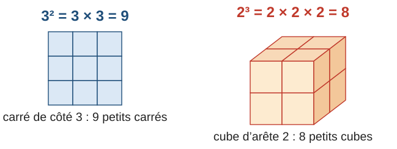
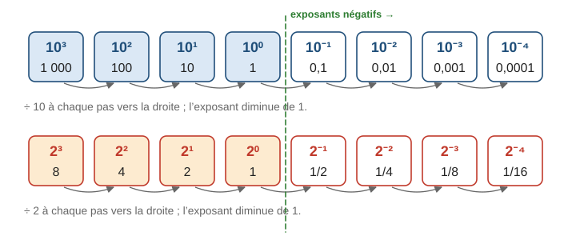
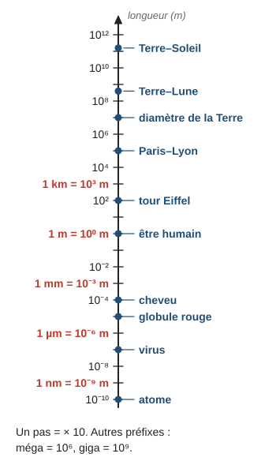
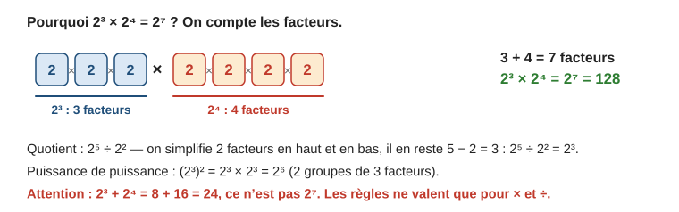
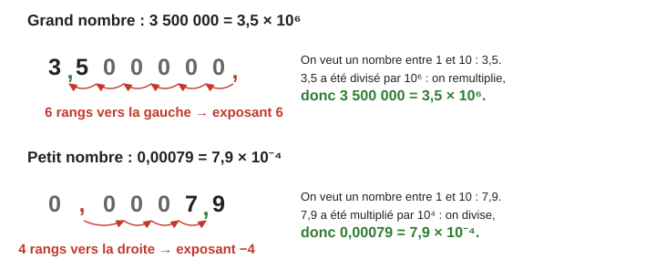
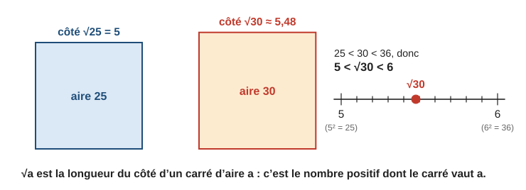

# Puissances, notation scientifique et racine carrée

> Compendium collège — chapitre unifié (sans découpage 6e / 5e / 4e / 3e).  
> Cours compact pour un élève de niveau moyen : intuition, méthode, exemples guidés, erreurs fréquentes, puis exercices progressifs (★ facile, ★★ standard, ★★★ approfondissement) avec corrigés détaillés.

---

## 0. Ce qu’on vise

**En une phrase :** une puissance est une **multiplication répétée** ($2^3 = 2 \times 2 \times 2$) ; les puissances de $10$ permettent d’écrire et de comparer des nombres **très grands** ou **très petits**, et la racine carrée fait le chemin inverse du carré.

À la fin de ce chapitre, je sais :

1. Calculer une puissance $a^n$ et respecter les priorités ($(-3)^2$ et $-3^2$).
2. Utiliser les **puissances de 10**, positives et négatives, et les **préfixes** (nano, micro, milli, kilo, méga, giga).
3. Comprendre et utiliser les **règles de calcul** sur les puissances (produit, quotient, puissance d’une puissance).
4. Écrire un nombre en **notation scientifique**, calculer et comparer avec cette écriture.
5. Connaître les **carrés parfaits**, la définition de la **racine carrée**, et encadrer ou approcher $\sqrt{a}$.

> **Prérequis.** Multiplier ou diviser par $10$, $100$, $1\,000$ (chapitre 2, § 1.2) ; règle des signes (chapitre 3, § 5) ; produit et quotient de fractions (chapitre 1, § 5 et 6).

*Calibrage.* Puissances de $10$, notation scientifique, préfixes et racine carrée d’un nombre positif sont au programme du cycle 4. Les règles de calcul sont exigibles pour les puissances de $10$ ; pour une autre base, elles doivent être **comprises** (en comptant les facteurs) plutôt qu’apprises comme formules : elles sont signalées ★★. La racine carrée, utile pour Pythagore (chapitre 11) et pour $x^2 = a$ (chapitre 7), est définie ici, au § 6.

---

## 1. Puissances d’un nombre

### 1.1 Définition

> **Définition.** $a$ est un nombre et $n$ un entier supérieur ou égal à $1$. La puissance $n$-ième de $a$ est le produit de $n$ facteurs égaux à $a$ :
> $$a^n = \underbrace{a \times a \times \cdots \times a}_{n \text{ facteurs}}$$
> $a$ est la **base**, $n$ l’**exposant**. On lit « $a$ puissance $n$ » ou « $a$ exposant $n$ ». Par convention $a^1 = a$.

$a^2$ se lit « $a$ au carré » et $a^3$ « $a$ au cube », à cause des figures :

> **Erreur fréquente.** Confondre $a^n$ et $a \times n$ : $2^3 = 2 \times 2 \times 2 = 8$, pas $2 \times 3 = 6$.

### 1.2 Signe et priorités

La puissance est **prioritaire** sur la multiplication et l’addition, et elle ne porte que sur ce qui est **juste avant** l’exposant :

- $(-3)^2 = (-3) \times (-3) = 9$, mais $-3^2 = -(3 \times 3) = -9$ ;
- $2 \times 3^2 = 2 \times 9 = 18$, mais $(2 \times 3)^2 = 6^2 = 36$.

Un nombre négatif élevé à une puissance **paire** donne un résultat positif ; à une puissance **impaire**, un résultat négatif (chapitre 3).

**Exemple guidé 1.** Calculer $A = 2^5$, $B = (-2)^4$, $C = -2^4$, $D = 5 + 2 \times 3^2$.

> $A = 2 \times 2 \times 2 \times 2 \times 2 = 32$.  
> $B = (-2) \times (-2) \times (-2) \times (-2) = 16$ (quatre facteurs négatifs : positif).  
> $C = -(2^4) = -16$ (l’exposant ne porte que sur $2$).  
> $D = 5 + 2 \times 9 = 5 + 18 = 23$ (la puissance d’abord, puis la multiplication).

**Contrôle.** À la calculatrice, taper `(-2)^4` donne $16$ et `-2^4` donne $-16$ : les parenthèses comptent.

---

## 2. Puissances de 10

### 2.1 Exposant positif, exposant négatif

> **Propriété.** Pour $n$ entier positif :
> - $10^n = 1\underbrace{0\ldots0}_{n \text{ zéros}}$ ; par exemple $10^3 = 1\,000$, $10^6 = 1\,000\,000$ ;
> - $10^0 = 1$ ;
> - $10^{-n} = \dfrac{1}{10^n} = 0{,}\underbrace{0\ldots0}_{n - 1}1$ ; par exemple $10^{-1} = 0{,}1$, $10^{-3} = 0{,}001$.

Pourquoi ? Quand l’exposant diminue de $1$, on **divise par $10$**. En continuant la suite après $10^1 = 10$, on obtient $10^0 = 1$, puis $10^{-1} = 0{,}1$, etc.

> **Erreur fréquente.** Croire que $10^{-2}$ est négatif ($-100$). Un exposant négatif donne un nombre **positif et petit** : $10^{-2} = \dfrac{1}{100} = 0{,}01$.

### 2.2 Multiplier par une puissance de 10

Multiplier par $10^n$ revient à multiplier par $10$ $n$ fois : les chiffres avancent de $n$ rangs vers la gauche (chapitre 2). Multiplier par $10^{-n}$ revient à diviser par $10^n$.

$3{,}7 \times 10^3 = 3\,700$ $\qquad 52 \times 10^{-2} = 0{,}52$ $\qquad 0{,}6 \times 10^4 = 6\,000$.

### 2.3 Préfixes et ordres de grandeur

| Préfixe | nano (n) | micro (µ) | milli (m) | — | kilo (k) | méga (M) | giga (G) | téra (T) |
|---|---|---|---|---|---|---|---|---|
| Facteur | $10^{-9}$ | $10^{-6}$ | $10^{-3}$ | $10^0 = 1$ | $10^3$ | $10^6$ | $10^9$ | $10^{12}$ |

Ainsi $5$ km $= 5 \times 10^3$ m, $3$ µm $= 3 \times 10^{-6}$ m, $2$ Go $= 2 \times 10^9$ octets.

Sur cette échelle, chaque graduation multiplie la longueur par $10$ : un cheveu ($10^{-4}$ m) est environ $10\,000$ fois plus petit qu’un être humain ($10^0 = 1$ m).

**Exemple guidé 2.** Un globule rouge mesure environ $7$ µm. Combien faudrait-il en aligner pour couvrir $7$ mm ?

> $7$ mm $= 7 \times 10^{-3}$ m et $7$ µm $= 7 \times 10^{-6}$ m.  
> $\dfrac{7 \times 10^{-3}}{7 \times 10^{-6}} = 10^{-3 - (-6)} = 10^3 = 1\,000$. Il en faudrait $1\,000$.

**Contrôle.** Le micro est mille fois plus petit que le milli ($10^{-6}$ contre $10^{-3}$) : $1\,000$ globules ✓.

---

## 3. Exposant nul et exposant négatif pour une base quelconque (★★)

La même régularité vaut pour toute base non nulle (deuxième ligne du schéma : on divise par $2$ à chaque pas).

> **Définition.** Pour $a \neq 0$ et $n$ entier positif : $a^0 = 1$ et $a^{-n} = \dfrac{1}{a^n}$. En particulier $a^{-1} = \dfrac{1}{a}$ est l’**inverse** de $a$ (chapitre 1).

**Exemple guidé 3.** Écrire sous forme de fraction : $2^{-3}$, $5^{-1}$, $(-3)^{-2}$.

> $2^{-3} = \dfrac{1}{2^3} = \dfrac{1}{8}$ ; $\quad 5^{-1} = \dfrac{1}{5}$ ; $\quad (-3)^{-2} = \dfrac{1}{(-3)^2} = \dfrac{1}{9}$.

**Contrôle.** $2^{-3} = 0{,}125$ est bien positif et petit ; $\dfrac{1}{8} \times 2^3 = 1$ ✓.

> **Erreur fréquente.** $2^{-3} \neq -8$ et $2^{-3} \neq -6$. Le signe « $-$ » de l’exposant indique **l’inverse**, pas un nombre négatif.

---

## 4. Règles de calcul

Il suffit de **compter les facteurs**. Pour une même base $a$ (non nulle) et des exposants entiers $m$ et $n$ :

> **Propriété.**
> - Produit : $a^m \times a^n = a^{m+n}$ $\qquad 10^5 \times 10^3 = 10^8$ ; $\quad 10^{-2} \times 10^5 = 10^3$.
> - Quotient : $\dfrac{a^m}{a^n} = a^{m-n}$ $\qquad \dfrac{10^7}{10^2} = 10^5$ ; $\quad \dfrac{10^4}{10^{-3}} = 10^{4-(-3)} = 10^7$.
> - Puissance d’une puissance : $(a^m)^n = a^{m \times n}$ $\qquad (10^3)^4 = 10^{12}$.

**Exemple guidé 4.** Écrire sous la forme d’une seule puissance de $10$ : $E = \dfrac{10^5 \times 10^{-2}}{10^4}$.

> Numérateur : $10^5 \times 10^{-2} = 10^{5 + (-2)} = 10^3$.  
> $E = \dfrac{10^3}{10^4} = 10^{3 - 4} = 10^{-1}$ (soit $0{,}1$).

**Contrôle.** $\dfrac{100\,000 \times 0{,}01}{10\,000} = \dfrac{1\,000}{10\,000} = 0{,}1$ ✓.

> **Erreur fréquente.** Appliquer les règles à une **somme** : $2^3 + 2^4 = 8 + 16 = 24 \neq 2^7$. Ou multiplier les exposants dans un produit : $10^2 \times 10^3 = 10^5$, pas $10^6$. Ou multiplier les bases : $2^3 \times 5^3 = (2 \times 5)^3 = 10^3$ est juste (même exposant), mais $2^3 \times 2^4 \neq 4^7$.

---

## 5. Notation scientifique

### 5.1 Définition et méthode

> **Définition.** Un nombre positif est écrit en **notation scientifique** quand il est sous la forme $a \times 10^n$, où $a$ est un décimal **supérieur ou égal à $1$ et strictement inférieur à $10$** (un seul chiffre non nul avant la virgule) et $n$ un entier relatif.

$3{,}5 \times 10^6$ est en notation scientifique ; $35 \times 10^5$ et $0{,}35 \times 10^7$ représentent le même nombre, mais **ne sont pas** en notation scientifique.

> **Méthode — Écrire en notation scientifique.** 1. Placer la virgule juste après le **premier chiffre non nul** : on obtient $a$. 2. Compter de combien de rangs la virgule s’est déplacée : c’est la valeur de $n$. 3. Signe : un **grand** nombre (supérieur à $10$) donne $n$ **positif** ; un **petit** nombre (inférieur à $1$) donne $n$ **négatif**.

**Exemple guidé 5.** Écrire en notation scientifique : $45\,000$ ; $0{,}0072$ ; $23 \times 10^4$.

> $45\,000 = 4{,}5 \times 10^4$ (virgule déplacée de $4$ rangs, grand nombre).  
> $0{,}0072 = 7{,}2 \times 10^{-3}$ (virgule déplacée de $3$ rangs, petit nombre).  
> $23 \times 10^4 = 2{,}3 \times 10 \times 10^4 = 2{,}3 \times 10^5$.

**Contrôle.** On revient à l’écriture décimale : $4{,}5 \times 10\,000 = 45\,000$ ✓ ; $7{,}2 \div 1\,000 = 0{,}0072$ ✓.

### 5.2 Calculer et comparer

On regroupe les nombres « ordinaires » d’un côté et les puissances de $10$ de l’autre, puis on réajuste si $a$ n’est plus entre $1$ et $10$.

**Exemple guidé 6.** Calculer $F = (3 \times 10^5) \times (4 \times 10^{-2})$ et $G = \dfrac{8 \times 10^7}{2 \times 10^3}$, en notation scientifique.

> $F = (3 \times 4) \times (10^5 \times 10^{-2}) = 12 \times 10^3 = 1{,}2 \times 10^4$.  
> $G = \dfrac{8}{2} \times \dfrac{10^7}{10^3} = 4 \times 10^4$.

**Contrôle.** $F = 300\,000 \times 0{,}04 = 12\,000$ ✓.

> **Méthode — Comparer.** Deux nombres en notation scientifique se comparent d’abord par leur **exposant** (le plus grand exposant donne le plus grand nombre), puis, à exposant égal, par leur nombre $a$. $9 \times 10^7 < 1{,}2 \times 10^8$ car $7 < 8$.

À la calculatrice, la touche `×10^x` (ou `EE`, `E`) sert à saisir $3 \times 10^5$ ; un affichage `1.2E4` signifie $1{,}2 \times 10^4$.

---

## 6. Carrés parfaits et racine carrée

### 6.1 Carrés à connaître

| $n$ | $1$ | $2$ | $3$ | $4$ | $5$ | $6$ | $7$ | $8$ | $9$ | $10$ | $11$ | $12$ | $13$ | $14$ | $15$ |
|---|---|---|---|---|---|---|---|---|---|---|---|---|---|---|---|
| $n^2$ | $1$ | $4$ | $9$ | $16$ | $25$ | $36$ | $49$ | $64$ | $81$ | $100$ | $121$ | $144$ | $169$ | $196$ | $225$ |

Ces nombres sont les **carrés parfaits**. Un carré n’est **jamais négatif**.

### 6.2 Définition de la racine carrée

> **Définition.** Pour un nombre $a$ **positif ou nul**, la **racine carrée** de $a$, notée $\sqrt{a}$, est le nombre **positif ou nul** dont le carré vaut $a$ : $\sqrt{a} \geqslant 0$ et $\left(\sqrt{a}\right)^2 = a$.

- $\sqrt{25} = 5$ car $5^2 = 25$ et $5 \geqslant 0$ (et non $-5$, bien que $(-5)^2 = 25$) ;
- $\sqrt{2{,}25} = 1{,}5$ car $1{,}5^2 = 2{,}25$ ; $\sqrt{0} = 0$ ; $\sqrt{1} = 1$ ;
- $\sqrt{-4}$ **n’existe pas** : aucun carré n’est négatif.

Géométriquement, $\sqrt{a}$ est le **côté d’un carré d’aire $a$**. Pour $a \geqslant 0$, on a aussi $\sqrt{a^2} = a$.

### 6.3 Valeurs approchées

Quand $a$ n’est pas un carré parfait, $\sqrt{a}$ n’est pas un nombre « rond » : on l’**encadre** avec les carrés parfaits, et la calculatrice en donne une valeur approchée qu’on **arrondit** selon la consigne.

**Exemple guidé 7.** Encadrer $\sqrt{30}$ entre deux entiers consécutifs, puis en donner l’arrondi au dixième.

> $25 < 30 < 36$, c’est-à-dire $5^2 < 30 < 6^2$, donc $5 < \sqrt{30} < 6$.  
> La calculatrice affiche $\sqrt{30} \approx 5{,}477\ldots$ ; arrondi au dixième : $\sqrt{30} \approx 5{,}5$.

**Contrôle.** $5{,}5^2 = 30{,}25$ est très proche de $30$ ✓ ; et $30$ est presque au milieu de $25$ et $36$, comme $5{,}48$ est presque au milieu de $5$ et $6$ ✓.

> **Erreur fréquente.** $\sqrt{9 + 16} = \sqrt{25} = 5$, mais $\sqrt{9} + \sqrt{16} = 3 + 4 = 7$. La racine d’une **somme** n’est pas la somme des racines. Autre piège : écrire $\sqrt{25} = \pm 5$ ; la racine carrée est **toujours positive** (c’est l’équation $x^2 = 25$ qui a deux solutions, $5$ et $-5$ : chapitre 7).

**Pour aller plus loin (★★★).** Pour $a$ et $b$ positifs, $\sqrt{a \times b} = \sqrt{a} \times \sqrt{b}$, ce qui permet de simplifier : $\sqrt{50} = \sqrt{25 \times 2} = 5\sqrt{2}$. Le nombre $\sqrt{2} \approx 1{,}414$ n’est pas rationnel : aucune fraction d’entiers ne lui est égale (chapitre 1).

---

## 7. Mini-synthèse

> **À retenir.**
> - $a^n$ : $n$ facteurs égaux à $a$. $(-3)^2 = 9$ mais $-3^2 = -9$ ; la puissance passe avant $\times$ et $+$.
> - $10^n$ : $1$ suivi de $n$ zéros ; $10^0 = 1$ ; $10^{-n} = \dfrac{1}{10^n}$ (petit, mais positif). Préfixes : n $10^{-9}$, µ $10^{-6}$, m $10^{-3}$, k $10^3$, M $10^6$, G $10^9$.
> - Même base : $a^m \times a^n = a^{m+n}$, $\dfrac{a^m}{a^n} = a^{m-n}$, $(a^m)^n = a^{mn}$. Jamais pour une somme.
> - Notation scientifique : $a \times 10^n$ avec $1 \leqslant a < 10$. Grand nombre : $n > 0$ ; petit nombre : $n < 0$.
> - $\sqrt{a}$ ($a \geqslant 0$) : le nombre **positif** dont le carré vaut $a$ ; côté d’un carré d’aire $a$. Encadrer avec les carrés parfaits ; $\sqrt{a + b} \neq \sqrt{a} + \sqrt{b}$.

---

## 8. Exercices types

### A. Puissances d’un nombre (★)

**A1.** Écrire sous forme d’une puissance : a) $7 \times 7 \times 7 \times 7$ ; b) $0{,}5 \times 0{,}5 \times 0{,}5$ ; c) $(-2) \times (-2) \times (-2)$.

**A2.** Calculer : a) $2^5$ ; b) $3^4$ ; c) $10^6$ ; d) $0{,}1^3$ ; e) $(-1)^7$.

**A3.** Calculer : a) $(-3)^2$ ; b) $-3^2$ ; c) $(-2)^3$ ; d) $-2^4$.

**A4.** Calculer en respectant les priorités : a) $5 + 2 \times 3^2$ ; b) $(5 + 2) \times 3^2$ ; c) $2^3 + 3^2$ ; d) $10 - 2^3$.

### B. Puissances de 10 (★)

**B1.** Donner l’écriture décimale : $10^4$ ; $10^{-3}$ ; $10^0$ ; $10^{-6}$.

**B2.** Écrire sous forme d’une puissance de $10$ : $100\,000$ ; $0{,}01$ ; un milliard ; $0{,}0001$.

**B3.** Calculer : a) $3{,}7 \times 10^3$ ; b) $52 \times 10^{-2}$ ; c) $0{,}6 \times 10^4$ ; d) $81 \div 10^3$.

**B4.** Exprimer en mètres (ou en octets) avec une puissance de $10$ : $5$ km ; $3$ µm ; $40$ nm ; $2{,}5$ Go.

### C. Règles de calcul (★ → ★★)

**C1.** Écrire sous la forme $10^n$ : a) $10^5 \times 10^3$ ; b) $10^7 \div 10^2$ ; c) $(10^3)^4$ ; d) $10^{-2} \times 10^5$ ; e) $\dfrac{10^4}{10^{-3}}$.

**C2.** (★★) Écrire sous la forme d’une seule puissance : a) $2^3 \times 2^4$ ; b) $\dfrac{5^6}{5^2}$ ; c) $(3^2)^3$ ; d) $7^3 \times 7^{-3}$.

**C3.** Écrire sous la forme $10^n$ : a) $\dfrac{10^5 \times 10^{-2}}{10^4}$ ; b) $(10^3)^2 \times 10^{-4}$.

### D. Exposants négatifs (★★)

**D1.** Écrire sous forme de fraction, puis d’écriture décimale : $2^{-1}$ ; $2^{-3}$ ; $5^{-2}$ ; $10^{-5}$.

### E. Notation scientifique (★ → ★★)

**E1.** Écrire en notation scientifique : $45\,000$ ; $0{,}0072$ ; $380\,000\,000$ ; $0{,}00005$.

**E2.** Donner l’écriture décimale : $2{,}1 \times 10^5$ ; $6 \times 10^{-4}$ ; $9{,}08 \times 10^3$.

**E3.** Écrire en notation scientifique : $23 \times 10^4$ ; $0{,}6 \times 10^{-2}$ ; $450 \times 10^{-5}$.

**E4.** Calculer et donner le résultat en notation scientifique : a) $(3 \times 10^5) \times (4 \times 10^{-2})$ ; b) $\dfrac{8 \times 10^7}{2 \times 10^3}$ ; c) $(5 \times 10^{-3}) \times (6 \times 10^8)$.

**E5.** Ranger dans l’ordre croissant : $3 \times 10^8$ ; $9 \times 10^7$ ; $1{,}2 \times 10^8$ ; $5 \times 10^{-2}$ ; $4{,}8 \times 10^{-3}$.

### F. Racine carrée (★ → ★★)

**F1.** Calculer sans calculatrice : $\sqrt{49}$ ; $\sqrt{144}$ ; $\sqrt{0{,}25}$ ; $\sqrt{10\,000}$ ; $\sqrt{0}$.

**F2.** Encadrer entre deux entiers consécutifs, puis donner l’arrondi au dixième (calculatrice) : $\sqrt{20}$ ; $\sqrt{70}$ ; $\sqrt{150}$.

**F3.** Quel est le côté d’un carré d’aire $81\,\mathrm{cm}^2$ ? d’un carré d’aire $50\,\mathrm{m}^2$ (au dixième) ?

### G. Problèmes (★★)

**G1.** La lumière parcourt environ $3 \times 10^5$ km par seconde. a) Quelle distance parcourt-elle en une minute ? b) Le Soleil est à environ $1{,}5 \times 10^8$ km de la Terre. Combien de temps met sa lumière pour nous parvenir ?

**G2.** Une cellule mesure $10$ µm. Combien de cellules faut-il aligner pour couvrir $1$ cm ?

---

## 9. Exercices atypiques

### H. Trouver l’erreur (★★)

**H1.** « $2^3 = 6$. »

**H2.** « $10^{-2} = -100$. »

**H3.** « $2^3 + 2^4 = 2^7$. »

**H4.** « $15 \times 10^4$ est en notation scientifique. »

**H5.** « $\sqrt{9 + 16} = \sqrt{9} + \sqrt{16} = 7$. »

### I. Comprendre (★★)

**I1.** Lequel est le plus grand : $2^{10}$ ou $10^3$ ?

**I2.** Expliquer pourquoi $10^0 = 1$, en prolongeant la suite $10^3$, $10^2$, $10^1$…

**I3.** « Le carré d’un nombre est toujours plus grand que ce nombre. » Vrai ou faux ? Donner un contre-exemple si c’est faux.

**I4.** « La racine carrée d’un nombre est toujours plus petite que ce nombre. » Vrai ou faux ?

### J. Problèmes en plusieurs étapes (★★ → ★★★)

**J1.** Une feuille de papier a une épaisseur de $0{,}1$ mm. On la plie en deux, puis encore en deux, etc. (on suppose que c’est possible). a) Quelle est l’épaisseur après $10$ pliages ? b) Après $42$ pliages ($2^{42} \approx 4{,}4 \times 10^{12}$), comparer l’épaisseur à la distance Terre–Lune, environ $3{,}8 \times 10^8$ m.

**J2.** Un disque dur a une capacité de $2$ To ($2 \times 10^{12}$ octets). Une photo occupe $4$ Mo ($4 \times 10^6$ octets). Combien de photos peut-on stocker ?

**J3.** Un terrain carré a une aire de $2\,500\,\mathrm{m}^2$. On veut le clôturer avec un poteau tous les $2{,}5$ m. Combien faut-il de poteaux ?

**J4.** Une bactérie se divise en deux toutes les $20$ minutes. On part d’une bactérie. Combien y en a-t-il au bout de $5$ heures ? Donner le résultat en écriture décimale, puis en notation scientifique arrondie.

### K. Pour aller plus loin (★★★)

**K1.** Simplifier : $\sqrt{50}$ ; $\sqrt{72}$ ; $\sqrt{12} \times \sqrt{3}$.

**K2.** Montrer que $1{,}41 < \sqrt{2} < 1{,}42$ sans utiliser la touche racine.

**K3.** Écrire $8^3 \times 4^2$ sous la forme d’une puissance de $2$.

### L. Situations ouvertes (★★)

**L1.** Citer un objet ou une distance dont l’ordre de grandeur est $10^{-3}$ m, un autre de l’ordre de $10^1$ m, un autre de l’ordre de $10^4$ m.

**L2.** Écrire $1\,000\,000$ comme une puissance de trois façons différentes.

---

## 10. Corrigés

### Exercices types

**A1.** a) $7^4$ ; b) $0{,}5^3$ ; c) $(-2)^3$.

**A2.** a) $32$ ; b) $81$ ; c) $1\,000\,000$ ; d) $0{,}001$ ; e) $-1$.

**A3. (modèle)**

> a) $(-3) \times (-3) = 9$. b) $-(3 \times 3) = -9$ (l’exposant ne porte que sur $3$).  
> c) $(-2) \times (-2) \times (-2) = -8$ (trois facteurs négatifs). d) $-(2^4) = -16$.

**A4.** a) $5 + 18 = 23$ ; b) $7 \times 9 = 63$ ; c) $8 + 9 = 17$ ; d) $10 - 8 = 2$.

**B1.** $10\,000$ ; $0{,}001$ ; $1$ ; $0{,}000001$.

**B2.** $10^5$ ; $10^{-2}$ ; $10^9$ ; $10^{-4}$.

**B3.** a) $3\,700$ ; b) $0{,}52$ ; c) $6\,000$ ; d) $0{,}081$.

**B4.** $5 \times 10^3$ m ; $3 \times 10^{-6}$ m ; $40 \times 10^{-9} = 4 \times 10^{-8}$ m ; $2{,}5 \times 10^9$ octets.

**C1. (modèle)**

> a) $10^{5+3} = 10^8$. b) $10^{7-2} = 10^5$. c) $10^{3 \times 4} = 10^{12}$.  
> d) $10^{-2+5} = 10^3$. e) $10^{4-(-3)} = 10^{4+3} = 10^7$.

**C2.** a) $2^7$ ; b) $5^4$ ; c) $3^6$ ; d) $7^0 = 1$.

**C3.** a) $10^{-1}$ (exemple guidé 4). b) $10^6 \times 10^{-4} = 10^2$.

**D1.** $2^{-1} = \dfrac{1}{2} = 0{,}5$ ; $2^{-3} = \dfrac{1}{8} = 0{,}125$ ; $5^{-2} = \dfrac{1}{25} = 0{,}04$ ; $10^{-5} = \dfrac{1}{100\,000} = 0{,}00001$.

**E1. (modèle)**

> $45\,000 = 4{,}5 \times 10^4$ ; $0{,}0072 = 7{,}2 \times 10^{-3}$ ;  
> $380\,000\,000 = 3{,}8 \times 10^8$ ; $0{,}00005 = 5 \times 10^{-5}$.

**E2.** $210\,000$ ; $0{,}0006$ ; $9\,080$.

**E3.** $2{,}3 \times 10^5$ ; $6 \times 10^{-3}$ ; $4{,}5 \times 10^{-3}$ (car $450 = 4{,}5 \times 10^2$).

**E4.** a) $12 \times 10^3 = 1{,}2 \times 10^4$ ; b) $4 \times 10^4$ ; c) $30 \times 10^5 = 3 \times 10^6$.

**E5.** $4{,}8 \times 10^{-3} < 5 \times 10^{-2} < 9 \times 10^7 < 1{,}2 \times 10^8 < 3 \times 10^8$.

**F1.** $7$ ; $12$ ; $0{,}5$ ; $100$ ; $0$.

**F2. (modèle)**

> $16 < 20 < 25$, donc $4 < \sqrt{20} < 5$ ; $\sqrt{20} \approx 4{,}5$ (calculatrice : $4{,}472\ldots$).  
> $64 < 70 < 81$, donc $8 < \sqrt{70} < 9$ ; $\sqrt{70} \approx 8{,}4$.  
> $144 < 150 < 169$, donc $12 < \sqrt{150} < 13$ ; $\sqrt{150} \approx 12{,}2$.

**F3.** $\sqrt{81} = 9$ cm ; $\sqrt{50} \approx 7{,}1$ m.

**G1. (modèle)**

> a) $60 \times 3 \times 10^5 = 180 \times 10^5 = 1{,}8 \times 10^7$ km.  
> b) $\dfrac{1{,}5 \times 10^8}{3 \times 10^5} = 0{,}5 \times 10^3 = 500$ s, soit $8$ min $20$ s.

**G2.** $1$ cm $= 10^{-2}$ m et $10$ µm $= 10^{-5}$ m : $\dfrac{10^{-2}}{10^{-5}} = 10^3 = 1\,000$ cellules.

### Exercices atypiques

**H1.** $2^3 = 2 \times 2 \times 2 = 8$ ; ce n’est pas $2 \times 3$.

**H2.** $10^{-2} = \dfrac{1}{100} = 0{,}01$ : un exposant négatif donne un nombre positif, plus petit que $1$.

**H3.** Les règles ne valent pas pour une somme : $2^3 + 2^4 = 8 + 16 = 24$, alors que $2^7 = 128$.

**H4.** $15$ n’est pas compris entre $1$ et $10$ : $15 \times 10^4 = 1{,}5 \times 10^5$.

**H5.** $\sqrt{9 + 16} = \sqrt{25} = 5$ ; la racine d’une somme n’est pas la somme des racines.

**I1.** $2^{10} = 1\,024 > 1\,000 = 10^3$.

**I2.** Chaque fois que l’exposant diminue de $1$, on divise par $10$ : $10^3 = 1\,000$, $10^2 = 100$, $10^1 = 10$, puis $10^0 = 10 \div 10 = 1$.

**I3.** Faux : $0{,}5^2 = 0{,}25 < 0{,}5$. C’est faux pour tout nombre strictement compris entre $0$ et $1$ (et $0^2 = 0$, $1^2 = 1$).

**I4.** Faux : $\sqrt{0{,}25} = 0{,}5 > 0{,}25$ ; c’est faux aussi pour $0$ et $1$ ($\sqrt{1} = 1$).

**J1. (modèle)**

> a) Chaque pliage double l’épaisseur : $0{,}1 \times 2^{10} = 0{,}1 \times 1\,024 = 102{,}4$ mm, environ $10$ cm.  
> b) $0{,}1$ mm $= 10^{-4}$ m. $4{,}4 \times 10^{12} \times 10^{-4} = 4{,}4 \times 10^8$ m : plus que la distance Terre–Lune ($3{,}8 \times 10^8$ m) !

**J2.** $\dfrac{2 \times 10^{12}}{4 \times 10^6} = 0{,}5 \times 10^6 = 5 \times 10^5 = 500\,000$ photos.

**J3.** Côté : $\sqrt{2\,500} = 50$ m ; périmètre : $4 \times 50 = 200$ m ; la clôture fait le tour (le dernier poteau est le premier) : $200 \div 2{,}5 = 80$ poteaux.

**J4.** $5$ h $= 300$ min, soit $300 \div 20 = 15$ divisions. Nombre de bactéries : $2^{15} = 32\,768 \approx 3{,}3 \times 10^4$.

**K1.** $\sqrt{50} = \sqrt{25 \times 2} = 5\sqrt{2}$ ; $\sqrt{72} = \sqrt{36 \times 2} = 6\sqrt{2}$ ; $\sqrt{12} \times \sqrt{3} = \sqrt{36} = 6$.

**K2.** $1{,}41^2 = 1{,}9881 < 2$ et $1{,}42^2 = 2{,}0164 > 2$. Comme $\sqrt{2}$ est positif et que son carré vaut $2$, il est compris entre $1{,}41$ et $1{,}42$.

**K3.** $8 = 2^3$ et $4 = 2^2$ : $8^3 \times 4^2 = 2^9 \times 2^4 = 2^{13}$.

**L1.** Exemples : l’épaisseur d’une pièce de monnaie ou d’une fourmi ($10^{-3}$ m, le millimètre) ; la hauteur d’un immeuble de trois étages ($10^1$ m) ; la longueur d’une petite ville ou d’un trajet en vélo ($10^4$ m $= 10$ km).

**L2.** $10^6$ ; $100^3$ ; $1\,000^2$ (ou encore $2^6 \times 5^6$).

---

## 11. Liens avec les autres chapitres

- **Chapitre 2** (entiers et décimaux) : rangs du tableau de numération, décomposition $360 = 2^3 \times 3^2 \times 5$.
- **Chapitre 3** (relatifs) : signe d’une puissance d’un nombre négatif.
- **Chapitre 7** (équations) : $x^2 = a$ a deux solutions $\sqrt{a}$ et $-\sqrt{a}$ si $a > 0$.
- **Chapitre 11** (Pythagore) : la racine carrée donne une longueur à partir de son carré.
- **Chapitre 14** (grandeurs) : conversions d’unités, aires et volumes ($\mathrm{m}^2$, $\mathrm{m}^3$).

---

## 12. Fiche-synthèse

| Je dois savoir… | Comment | Exemple express | S’entraîner |
|---|---|---|---|
| Calculer une puissance | $n$ facteurs égaux à $a$ | $2^5 = 32$ ; $(-2)^3 = -8$ | série A |
| Puissances de $10$ | $10^n$ : un $1$ suivi de $n$ zéros ; $10^{-n} = \dfrac{1}{10^n}$ | $10^{-3} = 0{,}001$ | série B |
| Calculer avec une même base | on ajoute, on soustrait ou on multiplie les exposants | $10^5 \times 10^{-2} = 10^3$ ; $(a^2)^3 = a^6$ | séries C et D |
| Écrire en notation scientifique | $a \times 10^n$ avec $1 \leqslant a < 10$ | $0{,}00045 = 4{,}5 \times 10^{-4}$ | série E |
| Calculer en notation scientifique | regrouper les nombres $a$, puis les puissances de $10$ | $(3 \times 10^4) \times (2 \times 10^5) = 6 \times 10^9$ | séries E et G |
| Racine carrée | le nombre positif dont le carré vaut $a$ ; encadrer par des carrés parfaits | $\sqrt{49} = 7$ ; $6 < \sqrt{40} < 7$ | série F |

**Pièges à éviter :** $2^3 = 8$, pas $6$ ; $10^{-2}$ est petit mais positif ; $\sqrt{9 + 16} = 5$, pas $3 + 4$.

---

*Version v0.3 — relecture (prérequis harmonisés, fiche-synthèse, corrections : voir `PLAN-REVISION.md`, § 10). Base : v0.2 — révision vague 4 (cours développé : définition et figures du carré et du cube, signe et priorités, puissances de 10 positives et négatives expliquées par la suite des divisions, préfixes avec échelle des longueurs, exposants négatifs d’une base quelconque, règles de calcul justifiées en comptant les facteurs, notation scientifique avec méthode du déplacement de la virgule, calcul et comparaison, carrés parfaits, **définition de la racine carrée** (côté d’un carré d’aire donnée), encadrement et valeurs approchées, simplifications en ★★★ ; 7 exemples guidés ; 6 figures SVG ; 40 exercices corrigés). Ancienne version : `cours-et-exercices.md.bak`.*
