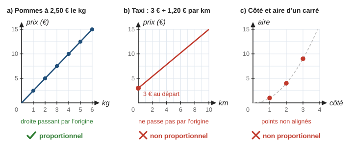
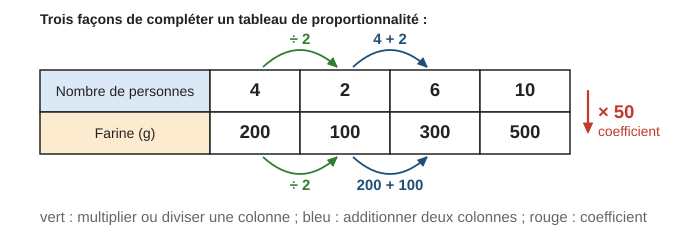
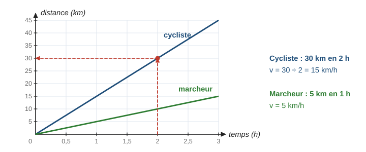
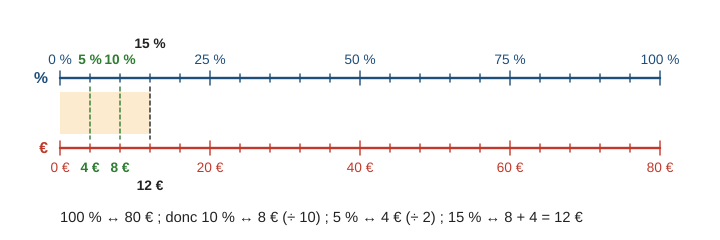
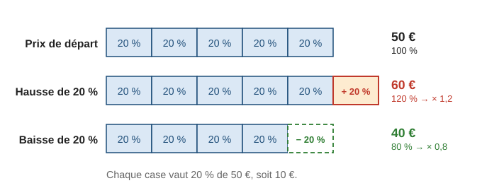
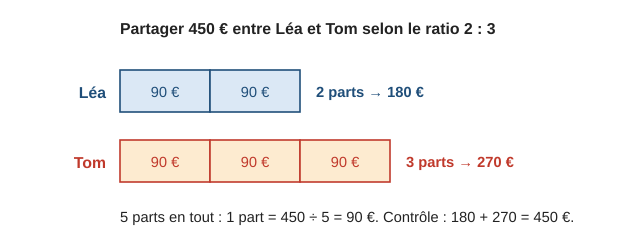
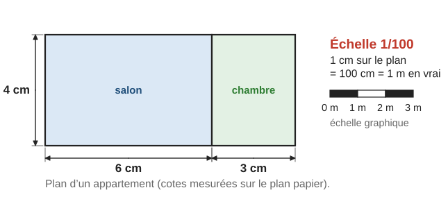

# Proportionnalité, pourcentages et échelles

> Compendium collège — chapitre unifié (sans découpage 6e / 5e / 4e / 3e).  
> Cours compact pour un élève de niveau moyen : intuition, méthode, exemples guidés, erreurs fréquentes, puis exercices progressifs (★ facile, ★★ standard, ★★★ approfondissement) avec corrigés détaillés.

---

## 0. Ce qu’on vise

**En une phrase :** la proportionnalité, c’est la situation « deux fois plus de l’un, deux fois plus de l’autre » ; elle sert partout (recettes, prix, vitesses, cartes, pourcentages) et il faut savoir la **reconnaître** avant de l’**utiliser**.

À la fin de ce chapitre, je sais :

1. Reconnaître une situation de proportionnalité avec un **tableau** ou un **graphique** (et repérer quand ce n’en est pas une).
2. Compléter un tableau et calculer une **quatrième proportionnelle** par plusieurs méthodes.
3. Utiliser des **grandeurs quotients** : prix unitaire, vitesse moyenne, débit.
4. Calculer et appliquer un **pourcentage**, traduire une hausse ou une baisse par un **coefficient multiplicateur**.
5. Utiliser un **ratio** et faire un **partage proportionnel**.
6. Utiliser une **échelle** (plan, carte, maquette).

> **Prérequis.** Calculs sur les décimaux (chapitre 2, § 3) ; fraction d’une quantité (chapitre 1, § 5) ; conversions de durées et d’unités (chapitre 14, § 1 et 6.1).

---

## 1. Reconnaître une situation de proportionnalité

### 1.1 Définition

Au marché, les pommes coûtent $2{,}50$ € le kilogramme. Pour $2\,\mathrm{kg}$ on paie $5$ €, pour $4\,\mathrm{kg}$ on paie $10$ € : on passe toujours de la masse au prix en **multipliant par le même nombre**, $2{,}5$.

> **Définition.** Deux grandeurs sont **proportionnelles** quand on obtient les valeurs de l’une en multipliant les valeurs de l’autre par un **même nombre** $k$, appelé **coefficient de proportionnalité**. Si $y$ est proportionnel à $x$ : $y = k \times x$.

Dans un tableau de proportionnalité, tous les quotients $\dfrac{y}{x}$ sont égaux (ils valent $k$).

**Exemple guidé 1.** Les tableaux suivants sont-ils des tableaux de proportionnalité ?

| Nombre de cahiers | $2$ | $5$ | $8$ |
|---|---|---|---|
| Prix (€) | $3{,}60$ | $9$ | $14{,}40$ |

| Âge (ans) | $2$ | $5$ | $8$ |
|---|---|---|---|
| Taille (cm) | $86$ | $110$ | $128$ |

**Réflexion.** On calcule les quotients « deuxième ligne ÷ première ligne ».

> Cahiers : $3{,}60 \div 2 = 1{,}8$ ; $9 \div 5 = 1{,}8$ ; $14{,}40 \div 8 = 1{,}8$. Les quotients sont égaux : c’est un tableau de proportionnalité, de coefficient $1{,}8$ (un cahier coûte $1{,}80$ €).  
> Tailles : $86 \div 2 = 43$ ; $110 \div 5 = 22$. Les quotients sont différents : ce n’est **pas** un tableau de proportionnalité.

**Contrôle.** Bon sens : un enfant de $8$ ans n’est pas quatre fois plus grand qu’un enfant de $2$ ans.

> **Erreur fréquente.** « Les deux grandeurs augmentent ensemble, donc elles sont proportionnelles. » Faux : l’âge et la taille augmentent ensemble, mais $8$ ans n’est pas $4 \times 2$ ans pour la taille ($128 \neq 4 \times 86 = 344$). Il faut **calculer** les quotients.

### 1.2 Le graphique d’une situation de proportionnalité

> **Propriété.** Une situation est de proportionnalité **si et seulement si** sa représentation graphique est formée de points **alignés avec l’origine** du repère (ou d’une **droite passant par l’origine**).

Les trois graphiques ci-dessous montrent les trois cas à reconnaître : une droite passant par l’origine (proportionnalité), une droite qui ne passe pas par l’origine, des points qui ne sont pas alignés.

- **a)** $1\,\mathrm{kg}$ → $2{,}50$ € ; $2\,\mathrm{kg}$ → $5$ € ; … Les points sont alignés avec l’origine : proportionnalité.
- **b)** Le taxi coûte déjà $3$ € pour $0\,\mathrm{km}$ : la droite coupe l’axe vertical en $3$, pas en $0$. Pour $10\,\mathrm{km}$ on paie $15$ €, pour $20\,\mathrm{km}$ on paie $27$ € (et pas $30$ €).
- **c)** Un carré de côté $1$ a pour aire $1$, de côté $2$ a pour aire $4$, de côté $3$ a pour aire $9$ : quand le côté double, l’aire est multipliée par $4$.

> **Erreur fréquente.** Une droite ne suffit pas : il faut qu’elle passe **par l’origine**. La droite du taxi (b) ne représente pas une proportionnalité.

---

## 2. Compléter un tableau, quatrième proportionnelle

### 2.1 Quatre méthodes

Une recette demande $200\,\mathrm{g}$ de farine pour $4$ personnes. Le schéma ci-dessous montre trois façons de compléter le tableau.

1. **Multiplier ou diviser une colonne** (en vert) : pour $2$ personnes, deux fois moins de farine : $200 \div 2 = 100\,\mathrm{g}$.
2. **Additionner deux colonnes** (en bleu) : $6$ personnes $= 4 + 2$ personnes, donc $200 + 100 = 300\,\mathrm{g}$.
3. **Utiliser le coefficient** (en rouge) : $200 \div 4 = 50$, donc on multiplie le nombre de personnes par $50$ : $10 \times 50 = 500\,\mathrm{g}$.
4. **Passer par l’unité** (« règle de trois ») : $1$ personne → $50\,\mathrm{g}$ ; $10$ personnes → $500\,\mathrm{g}$. C’est la méthode 3 dite autrement.

### 2.2 Le produit en croix

Quand on connaît trois nombres d’un tableau de proportionnalité à deux colonnes, on calcule le quatrième (la **quatrième proportionnelle**) par le produit en croix.

> **Propriété (produit en croix).** Dans le tableau de proportionnalité
>
> | $a$ | $c$ |
> |---|---|
> | $b$ | $x$ |
>
> on a $a \times x = b \times c$, donc $x = \dfrac{b \times c}{a}$.

**Exemple guidé 2.** $3\,\mathrm{kg}$ de pommes coûtent $7{,}20$ €. Combien coûtent $5\,\mathrm{kg}$ ?

**Réflexion.** Le prix est proportionnel à la masse. On peut passer par l’unité ou faire un produit en croix ; les deux doivent donner le même résultat.

> | Masse (kg) | $3$ | $5$ |
> |---|---|---|
> | Prix (€) | $7{,}20$ | $x$ |
>
> Par l’unité : $7{,}20 \div 3 = 2{,}40$ € le kilogramme, donc $5 \times 2{,}40 = 12$ €.  
> Par le produit en croix : $x = \dfrac{7{,}20 \times 5}{3} = \dfrac{36}{3} = 12$.  
> $5\,\mathrm{kg}$ de pommes coûtent $12$ €.

**Contrôle.** $5\,\mathrm{kg}$, c’est un peu moins du double de $3\,\mathrm{kg}$ : $12$ € est un peu moins du double de $7{,}20$ €.

> **Méthode — Choisir sa méthode.**
> 1. Un nombre est le double, la moitié, le triple… d’un autre ? → linéarité (calcul mental).
> 2. Le prix ou la quantité « pour 1 » est simple ? → passage par l’unité.
> 3. Les nombres sont compliqués ? → produit en croix.
> 4. Toujours : écrire le tableau, puis **contrôler l’ordre de grandeur**.

> **Erreur fréquente.** Mélanger les nombres dans le produit en croix : $x = \dfrac{3 \times 5}{7{,}20} \approx 2{,}08$ € pour $5\,\mathrm{kg}$, alors que $3\,\mathrm{kg}$ coûtent déjà $7{,}20$ € : absurde. On **multiplie** les deux nombres de la diagonale qui ne contient pas $x$ ($7{,}20$ et $5$), puis on **divise** par le nombre restant ($3$).

---

## 3. Grandeurs quotients : prix unitaire, vitesse, débit

Une **grandeur quotient** est le quotient de deux grandeurs. Elle donne le coefficient de proportionnalité « pour une unité ».

| Grandeur quotient | Calcul | Unité |
|---|---|---|
| Prix unitaire | prix ÷ quantité | €/kg, €/L, € par objet |
| Vitesse moyenne | distance ÷ durée | $\mathrm{km/h}$, $\mathrm{m/s}$ |
| Débit | volume ÷ durée | $\mathrm{L/min}$, $\mathrm{L/s}$ |

> **Propriété.** À vitesse constante $v$, la distance $d$ est proportionnelle à la durée $t$ :
> $$d = v \times t \qquad v = \dfrac{d}{t} \qquad t = \dfrac{d}{v}$$

Le graphique ci-dessous représente la distance parcourue par un cycliste et par un marcheur. Ce sont deux droites passant par l’origine. Pour le cycliste, on lit $30\,\mathrm{km}$ en $2\,\mathrm{h}$, donc $v = 30 \div 2 = 15\,\mathrm{km/h}$. La droite la plus « raide » correspond à la plus grande vitesse.

**Exemple guidé 3.** Un train parcourt $150\,\mathrm{km}$ en $1\,\mathrm{h}\,15\,\mathrm{min}$. Calculer sa vitesse moyenne.

**Réflexion.** Il faut la durée en heures, sous forme décimale : $15\,\mathrm{min} = \dfrac{15}{60}\,\mathrm{h} = 0{,}25\,\mathrm{h}$.

> $1\,\mathrm{h}\,15\,\mathrm{min} = 1{,}25\,\mathrm{h}$.  
> $v = \dfrac{d}{t} = \dfrac{150}{1{,}25} = 120$. La vitesse moyenne du train est $120\,\mathrm{km/h}$.

**Contrôle.** En $1\,\mathrm{h}$ à $120\,\mathrm{km/h}$, on fait $120\,\mathrm{km}$ ; en $15\,\mathrm{min}$ (un quart d’heure), encore $30\,\mathrm{km}$ : total $150\,\mathrm{km}$.

> **Erreur fréquente.** Écrire $1\,\mathrm{h}\,15\,\mathrm{min} = 1{,}15\,\mathrm{h}$. Une heure contient $60$ minutes, pas $100$ : $15\,\mathrm{min} = 0{,}25\,\mathrm{h}$, $30\,\mathrm{min} = 0{,}5\,\mathrm{h}$, $45\,\mathrm{min} = 0{,}75\,\mathrm{h}$, $20\,\mathrm{min} = \dfrac{1}{3}\,\mathrm{h}$.

> **Astuce.** $1\,\mathrm{m/s} = 3{,}6\,\mathrm{km/h}$ (en une heure, $3\,600\,\mathrm{s}$, on fait $3\,600\,\mathrm{m} = 3{,}6\,\mathrm{km}$). Donc $20\,\mathrm{m/s} = 72\,\mathrm{km/h}$ et $90\,\mathrm{km/h} = 25\,\mathrm{m/s}$.

---

## 4. Pourcentages

### 4.1 Prendre un pourcentage d’une quantité

> **Définition.** $p\,\%$ signifie $\dfrac{p}{100}$. Prendre $p\,\%$ d’une quantité $A$, c’est calculer $\dfrac{p}{100} \times A$.

Un pourcentage est une situation de proportionnalité : $100\,\%$ correspond à la quantité entière. La **double droite graduée** ci-dessous montre comment calculer $15\,\%$ de $80$ € de tête.

> **Astuce (calcul mental).** $50\,\%$ = la moitié ; $25\,\%$ = le quart ; $10\,\%$ = diviser par $10$ ; $1\,\%$ = diviser par $100$ ; $20\,\% = 2 \times 10\,\%$ ; $5\,\%$ = la moitié de $10\,\%$.

Par le calcul : $15\,\%$ de $80 = 0{,}15 \times 80 = 12$.

### 4.2 Calculer un pourcentage (une proportion)

> **Méthode — Exprimer une part en pourcentage.**
> 1. Écrire la proportion $\dfrac{\text{part}}{\text{total}}$.
> 2. La multiplier par $100$ pour l’avoir en pourcentage.

**Exemple guidé 4.** Élection des délégués : $24$ élèves ont voté. Alexis a $6$ voix, Chloé $12$, Salma $3$ et Djibril $3$. Calculer le pourcentage de voix de chaque candidat.

> Alexis : $\dfrac{6}{24} = 0{,}25 = 25\,\%$. Chloé : $\dfrac{12}{24} = 0{,}5 = 50\,\%$.  
> Salma : $\dfrac{3}{24} = 0{,}125 = 12{,}5\,\%$. Djibril : $12{,}5\,\%$ aussi.

**Contrôle.** $25 + 50 + 12{,}5 + 12{,}5 = 100$ : les pourcentages d’un même total font $100\,\%$.

### 4.3 Hausses et baisses : le coefficient multiplicateur

Le modèle en barres ci-dessous découpe un prix de $50$ € en $5$ cases de $20\,\%$. Une hausse de $20\,\%$ ajoute une case : on obtient $120\,\%$ du prix, soit $60$ €. Une baisse de $20\,\%$ retire une case : il reste $80\,\%$, soit $40$ €.

> **Propriété.** Augmenter de $p\,\%$, c’est multiplier par $1 + \dfrac{p}{100}$. Diminuer de $p\,\%$, c’est multiplier par $1 - \dfrac{p}{100}$. Ce nombre est le **coefficient multiplicateur**.

| Évolution | $+20\,\%$ | $+5\,\%$ | $+100\,\%$ | $-20\,\%$ | $-5\,\%$ | $-50\,\%$ |
|---|---|---|---|---|---|---|
| Coefficient | $1{,}2$ | $1{,}05$ | $2$ | $0{,}8$ | $0{,}95$ | $0{,}5$ |

**Exemple guidé 5.** Un manteau coûte $80$ €. Il est soldé à $-25\,\%$. Quel est son nouveau prix ?

> Diminuer de $25\,\%$, c’est multiplier par $1 - 0{,}25 = 0{,}75$.  
> $80 \times 0{,}75 = 60$. Le manteau soldé coûte $60$ €.

**Contrôle.** $25\,\%$ de $80$ €, c’est le quart, soit $20$ € de réduction : $80 - 20 = 60$ €.

### 4.4 Évolutions successives, taux d’évolution, valeur de départ (★★)

- **Successives :** on **multiplie** les coefficients. Une hausse de $10\,\%$ puis une autre de $10\,\%$ : $1{,}1 \times 1{,}1 = 1{,}21$, soit $+21\,\%$ (et non $+20\,\%$).
- **Taux d’évolution** d’une valeur de départ $V_d$ à une valeur d’arrivée $V_a$ : $\dfrac{V_a - V_d}{V_d}$, à écrire en pourcentage. De $20\,000$ à $23\,000$ habitants : $\dfrac{3\,000}{20\,000} = 0{,}15$, soit $+15\,\%$.
- **Retrouver la valeur de départ :** on **divise** par le coefficient. Un article soldé à $-10\,\%$ coûte $63$ € : prix de départ $63 \div 0{,}9 = 70$ €.

> **Erreur fréquente.** Après une baisse de $20\,\%$, on ne revient pas au départ avec une hausse de $20\,\%$ : $100 \times 0{,}8 \times 1{,}2 = 96$. Les pourcentages successifs ne s’additionnent pas et ne se « compensent » pas, car ils ne portent pas sur la même quantité.

---

## 5. Ratios et partage proportionnel

Dans un mortier, on mélange $1$ seau de ciment pour $4$ seaux de sable : on dit que ciment et sable sont dans le **ratio** $1 : 4$ (« $1$ pour $4$ »).

> **Définition.** Deux quantités $A$ et $B$ sont dans le **ratio** $a : b$ quand $\dfrac{A}{a} = \dfrac{B}{b}$ : on peut découper $A$ en $a$ parts et $B$ en $b$ parts **toutes égales**.

**Exemple guidé 6.** Léa et Tom se partagent $450$ € selon le ratio $2 : 3$. Combien reçoit chacun ?

**Réflexion.** Le schéma ci-dessous montre les parts : Léa en a $2$, Tom $3$, donc $5$ parts égales en tout.

> Nombre total de parts : $2 + 3 = 5$. Une part vaut $450 \div 5 = 90$ €.  
> Léa reçoit $2 \times 90 = 180$ € et Tom reçoit $3 \times 90 = 270$ €.

**Contrôle.** $180 + 270 = 450$ € et $\dfrac{180}{2} = \dfrac{270}{3} = 90$.

> **Erreur fréquente.** Croire que le ratio $2 : 3$ donne à Léa les $\dfrac{2}{3}$ de la somme. Léa reçoit $2$ parts sur $5$, c’est-à-dire $\dfrac{2}{5}$ de $450$ €, soit $180$ € (et non $300$ €).

Un **partage proportionnel** se traite de la même façon : partager $600$ € entre deux personnes de $20$ et $30$ ans proportionnellement à leur âge, c’est partager selon le ratio $20 : 30$ ($50$ parts de $12$ € : $240$ € et $360$ €).

---

## 6. Échelles

> **Définition.** Sur un plan, une carte ou une maquette, les longueurs sont proportionnelles aux longueurs réelles. L’**échelle** est le coefficient :
> $$\text{échelle} = \dfrac{\text{longueur sur le plan}}{\text{longueur réelle}} \quad \text{(dans la même unité).}$$

Une échelle $\dfrac{1}{100}$ (ou $1 : 100$) signifie que $1\,\mathrm{cm}$ sur le plan représente $100\,\mathrm{cm} = 1\,\mathrm{m}$ en réalité. Une **échelle graphique** (petite règle graduée sur le plan) donne la même information.

**Exemple guidé 7.** Voici le plan d’un appartement à l’échelle $\dfrac{1}{100}$. Calculer les dimensions réelles du salon, puis l’aire réelle totale.

> Échelle $\dfrac{1}{100}$ : $1\,\mathrm{cm}$ sur le plan représente $100\,\mathrm{cm} = 1\,\mathrm{m}$.  
> Salon : $6\,\mathrm{cm} \to 6\,\mathrm{m}$ et $4\,\mathrm{cm} \to 4\,\mathrm{m}$. Chambre : $3\,\mathrm{m}$ sur $4\,\mathrm{m}$.  
> Aire réelle : $6 \times 4 + 3 \times 4 = 24 + 12 = 36\,\mathrm{m}^2$.

**Contrôle.** Un salon de $24\,\mathrm{m}^2$ et une chambre de $12\,\mathrm{m}^2$ : tailles réalistes.

> **Méthode — Utiliser une échelle $1 : n$.**
> 1. Longueur réelle $=$ longueur sur le plan $\times\, n$ ; longueur sur le plan $=$ longueur réelle $\div\, n$.
> 2. Faire le calcul **dans la même unité**, puis convertir à la fin ($1\,\mathrm{km} = 100\,000\,\mathrm{cm}$).
> 3. Contrôler : la longueur réelle est-elle vraisemblable ?

> **Erreur fréquente.** Oublier de convertir. Sur une carte au $1 : 50\,000$, $12\,\mathrm{km}$ ne font pas $12 \div 50\,000$ cm : on convertit d’abord $12\,\mathrm{km} = 1\,200\,000\,\mathrm{cm}$, puis $1\,200\,000 \div 50\,000 = 24\,\mathrm{cm}$.

*Pour aller plus loin (★★★).* Sur un plan à l’échelle $\dfrac{1}{n}$, les **aires** sont multipliées par $\dfrac{1}{n^2}$ (voir chapitre 14, agrandissements et réductions). Une échelle peut être plus grande que $1$ : au $2 : 1$, le dessin est deux fois plus grand que l’objet (petites pièces mécaniques, insectes). Enfin, la droite d’une situation de proportionnalité et le théorème de Thalès (chapitre 12) disent la même chose : sur une droite passant par l’origine, les rapports $\dfrac{y}{x}$ sont égaux.

---

## 7. Mini-synthèse

> **À retenir.**
> - Proportionnalité : $y = k \times x$ ; quotients $\dfrac{y}{x}$ tous égaux ; graphique = points alignés avec l’**origine**.
> - Compléter un tableau : linéarité, passage par l’unité, coefficient, produit en croix $x = \dfrac{b \times c}{a}$ ; toujours contrôler l’ordre de grandeur.
> - Vitesse : $d = v \times t$ ; les durées en heures décimales ($15\,\mathrm{min} = 0{,}25\,\mathrm{h}$).
> - $p\,\%$ de $A$ $= \dfrac{p}{100} \times A$ ; proportion en % $= \dfrac{\text{part}}{\text{total}} \times 100$.
> - Hausse de $p\,\%$ : $\times \left(1 + \dfrac{p}{100}\right)$ ; baisse : $\times \left(1 - \dfrac{p}{100}\right)$ ; évolutions successives : on multiplie les coefficients.
> - Ratio $a : b$ : $a + b$ parts égales. Échelle $1 : n$ : réel $=$ plan $\times\, n$, dans la même unité.

---

## 8. Exercices types

### A. Reconnaître la proportionnalité (★)

**A1.** Ce tableau est-il un tableau de proportionnalité ? Justifier.

| Grandeur 1 | $3$ | $5$ | $8$ |
|---|---|---|---|
| Grandeur 2 | $6$ | $10$ | $16$ |

**A2.** Même question.

| Durée (h) | $2$ | $4$ | $10$ |
|---|---|---|---|
| Prix de location (€) | $5$ | $10$ | $24$ |

**A3.** Dans chaque cas, dire si les deux grandeurs sont proportionnelles. a) Le prix payé et le nombre de cahiers achetés à $1{,}80$ € pièce. b) La taille et l’âge d’un enfant. c) Le périmètre d’un carré et la longueur de son côté. d) Le prix payé et le nombre de séances avec un abonnement de $10$ € plus $2$ € par séance.

**A4.** On a placé dans un repère les points $(1\,;3)$, $(2\,;6)$ et $(4\,;12)$. Représentent-ils une situation de proportionnalité ? Si oui, donner le coefficient.

### B. Compléter un tableau, quatrième proportionnelle (★)

**B1.** Une recette demande $200\,\mathrm{g}$ de farine pour $4$ personnes. Quelle masse de farine faut-il pour $2$, $6$ et $10$ personnes ? Préciser la méthode utilisée.

**B2.** $3\,\mathrm{kg}$ de pommes coûtent $7{,}20$ €. a) Quel est le prix de $5\,\mathrm{kg}$ ? b) Quelle masse peut-on acheter avec $18$ € ?

**B3.** Calculer $x$ pour que les tableaux soient des tableaux de proportionnalité.

| $3$ | $x$ |
|---|---|
| $5$ | $20$ |

| $7$ | $21$ |
|---|---|
| $x$ | $15$ |

**B4.** Un robinet remplit $12\,\mathrm{L}$ en $40\,\mathrm{s}$ (débit constant). a) Combien de litres en $2\,\mathrm{min}$ ? b) Combien de temps faut-il pour $30\,\mathrm{L}$ ?

### C. Grandeurs quotients et vitesse (★ → ★★)

**C1.** Une voiture roule à $90\,\mathrm{km/h}$ pendant $2{,}5\,\mathrm{h}$. Quelle distance parcourt-elle ?

**C2.** Un train parcourt $210\,\mathrm{km}$ en $1\,\mathrm{h}\,45\,\mathrm{min}$. Calculer sa vitesse moyenne.

**C3.** a) Convertir $20\,\mathrm{m/s}$ en $\mathrm{km/h}$. b) Convertir $90\,\mathrm{km/h}$ en $\mathrm{m/s}$.

**C4.** Avec le graphique distance-temps du § 3 : a) quelle distance le cycliste a-t-il parcourue en $1{,}5\,\mathrm{h}$ ? b) Combien de temps met le marcheur pour faire $10\,\mathrm{km}$ ?

**C5.** Le lot A de $6$ yaourts coûte $2{,}70$ € ; le lot B de $8$ yaourts coûte $3{,}44$ €. Quel lot est le plus avantageux ?

### D. Pourcentages (★)

**D1.** Calculer : a) $12\,\%$ de $250$ ; b) $7{,}5\,\%$ de $80$ ; c) $25\,\%$ de $36$ (de tête).

**D2.** Écrire en pourcentage : a) $\dfrac{3}{8}$ ; b) $0{,}04$ ; c) $\dfrac{1}{6}$ (arrondi au dixième).

**D3.** Dans une classe de $28$ élèves, $7$ viennent en bus. Quel pourcentage des élèves vient en bus ?

**D4.** Une veste coûte $80$ €. On obtient une remise de $15\,\%$. Calculer le montant de la remise, puis le prix payé.

### E. Hausses, baisses, coefficient multiplicateur (★★)

**E1.** Un article à $60$ € augmente de $15\,\%$. a) Calculer le nouveau prix. b) Ce nouveau prix baisse ensuite de $15\,\%$. Calculer le prix final. Est-on revenu à $60$ € ?

**E2.** Donner le coefficient multiplicateur : a) hausse de $8\,\%$ ; b) baisse de $30\,\%$. Traduire en évolution : c) $\times 1{,}25$ ; d) $\times 0{,}96$ ; e) $\times 2$.

**E3.** La population d’une ville passe de $20\,000$ à $23\,000$ habitants. Calculer le taux d’évolution en pourcentage.

**E4.** Après une hausse de $20\,\%$, un livre coûte $54$ €. Quel était son prix avant la hausse ?

### F. Ratios et partage (★ → ★★)

**F1.** Partager $360$ € entre Inès et Noah selon le ratio $1 : 2$.

**F2.** Un mortier contient du ciment et du sable dans le ratio $1 : 4$. a) Quelle masse de sable faut-il pour $25\,\mathrm{kg}$ de ciment ? b) On veut $15\,\mathrm{kg}$ de mélange : combien de ciment et de sable ?

**F3.** Deux frères de $20$ et $30$ ans se partagent $600$ € proportionnellement à leur âge. Combien reçoit chacun ?

**F4.** Dans une classe de $28$ élèves, le ratio filles : garçons est $3 : 4$. Combien y a-t-il de filles ? de garçons ?

### G. Échelles (★ → ★★)

**G1.** Sur un plan à l’échelle $\dfrac{1}{100}$, un mur mesure $4{,}5\,\mathrm{cm}$. Quelle est sa longueur réelle en mètres ?

**G2.** Deux villages sont distants de $12\,\mathrm{km}$. Quelle distance les sépare sur une carte au $1 : 50\,000$ ?

**G3.** Deux villes sont séparées de $8\,\mathrm{cm}$ sur une carte au $1 : 250\,000$. Quelle est la distance réelle en kilomètres ?

**G4.** Sur le plan de l’appartement du § 6, la chambre mesure $3\,\mathrm{cm}$ sur $4\,\mathrm{cm}$. On veut refaire le plan à l’échelle $\dfrac{1}{50}$. Quelles seront les dimensions de la chambre sur le nouveau plan ?

**G5.** Sur une carte, $2\,\mathrm{cm}$ représentent $5\,\mathrm{km}$. Quelle est l’échelle de la carte ?

---

## 9. Exercices atypiques

### H. Trouver l’erreur (★★)

**H1.** Lucas : « Un prix augmente de $10\,\%$, puis encore de $10\,\%$ : en tout, il a augmenté de $20\,\%$. » Trouver l’erreur et donner la bonne réponse.

**H2.** Sarah : « Un jean soldé à $-20\,\%$ coûte $48$ €. Pour retrouver le prix de départ, j’ajoute $20\,\%$ : $48 \times 1{,}2 = 57{,}60$ €. » Trouver l’erreur.

**H3.** Malik : « Avec le taxi du § 1.2, $10\,\mathrm{km}$ coûtent $15$ €, donc $20\,\mathrm{km}$ coûtent $30$ €. » Trouver l’erreur.

**H4.** Emma : « Je vais à $60\,\mathrm{km/h}$ et je reviens à $40\,\mathrm{km/h}$ par la même route, donc ma vitesse moyenne est $50\,\mathrm{km/h}$. » Vérifier avec un trajet de $120\,\mathrm{km}$.

**H5.** Yanis : « $1\,\mathrm{h}\,30\,\mathrm{min}$ à $80\,\mathrm{km/h}$, cela fait $80 \times 1{,}30 = 104\,\mathrm{km}$. » Trouver l’erreur.

### I. Comprendre et raisonner (★★ → ★★★)

**I1.** « Si je double le prix unitaire, le prix total double. » Est-ce toujours vrai ? Préciser à quelle condition.

**I2.** Un article baisse de $20\,\%$, puis augmente de $25\,\%$. Revient-on au prix de départ ? Quelle hausse faut-il après une baisse de $50\,\%$ pour revenir au prix de départ ?

**I3.** « Dans le club, il y a $30\,\%$ de filles et $40\,\%$ de garçons. » Pourquoi est-ce impossible si le club ne compte que des filles et des garçons ?

**I4.** (★★★) Un cycliste parcourt la moitié d’un trajet à la vitesse $v$, l’autre moitié à $2v$. Sa vitesse moyenne est-elle $1{,}5\,v$ ?

**I5.** Le ratio filles : garçons d’un club est $2 : 3$. Quel pourcentage du club représentent les filles ?

### J. Problèmes en plusieurs étapes (★★ → ★★★)

**J1.** Sur une carte au $1 : 200\,000$, un trajet mesure $13{,}5\,\mathrm{cm}$. On le parcourt à $72\,\mathrm{km/h}$ de moyenne, départ à $8\,\mathrm{h}\,40$. À quelle heure arrive-t-on ?

**J2.** Piscine. Tarif A : $2{,}40$ € l’entrée. Tarif B : abonnement de $18$ € par an, puis $1{,}20$ € l’entrée. a) Lequel des deux tarifs est proportionnel au nombre d’entrées ? b) Comparer les deux tarifs pour $12$ entrées. c) À partir de combien d’entrées le tarif B est-il plus avantageux ?

**J3.** On repeint les quatre murs d’une chambre rectangulaire de $4\,\mathrm{m}$ sur $3\,\mathrm{m}$, haute de $2{,}5\,\mathrm{m}$. La porte et la fenêtre font $3\,\mathrm{m}^2$ en tout (non peintes). Il faut deux couches ; $1\,\mathrm{L}$ de peinture couvre $10\,\mathrm{m}^2$. La peinture est vendue en pots de $2{,}5\,\mathrm{L}$ à $24{,}90$ €. Combien de pots faut-il acheter, et pour quel prix ?

**J4.** Trois amis achètent un ticket de loterie : Ana donne $12$ €, Bilal $18$ € et Chloé $30$ €. Ils gagnent $150$ € et se les partagent proportionnellement à leur mise. Combien reçoit chacun ? Quel pourcentage du gain reçoit Chloé ?

### K. Situations ouvertes (★★)

**K1.** Inventer un problème de soldes avec deux réductions successives dont le résultat surprend, et le résoudre.

**K2.** Proposer une situation de la vie courante **non** proportionnelle, et expliquer comment un élève pourrait se tromper en la croyant proportionnelle.

**K3.** Créer un tableau de « fausse proportionnalité » qui semble proportionnel au premier coup d’œil, et montrer qu’il ne l’est pas.

---

## 10. Corrigés

### Exercices types

**A1.** $6 \div 3 = 2$ ; $10 \div 5 = 2$ ; $16 \div 8 = 2$. Les quotients sont égaux : c’est un tableau de proportionnalité, de coefficient $2$.

**A2.** $5 \div 2 = 2{,}5$ ; $10 \div 4 = 2{,}5$ ; $24 \div 10 = 2{,}4$. Le dernier quotient est différent : ce n’est **pas** un tableau de proportionnalité.

**A3.** a) Oui (coefficient $1{,}8$). b) Non (voir l’exemple guidé 1). c) Oui : $P = 4 \times c$ (coefficient $4$). d) Non : pour $0$ séance on paie déjà $10$ € ; $1$ séance coûte $12$ €, $2$ séances $14$ € (et pas $24$ €).

**A4.** $\dfrac{3}{1} = \dfrac{6}{2} = \dfrac{12}{4} = 3$ : les quotients sont égaux, les points sont alignés avec l’origine. Proportionnalité de coefficient $3$.

**B1. (modèle)**

> | Nombre de personnes | $4$ | $2$ | $6$ | $10$ |
> |---|---|---|---|---|
> | Farine (g) | $200$ | $100$ | $300$ | $500$ |
>
> $2$ personnes, c’est deux fois moins que $4$ : $200 \div 2 = 100\,\mathrm{g}$.  
> $6 = 4 + 2$ personnes : $200 + 100 = 300\,\mathrm{g}$.  
> Coefficient : $200 \div 4 = 50\,\mathrm{g}$ par personne ; $10 \times 50 = 500\,\mathrm{g}$.

**B2.** a) Prix au kilogramme : $7{,}20 \div 3 = 2{,}40$ € ; $5 \times 2{,}40 = 12$ €. b) $18 \div 2{,}40 = 7{,}5$ : on peut acheter $7{,}5\,\mathrm{kg}$.

**B3.** Premier tableau : $3 \times 20 = 5 \times x$, donc $x = \dfrac{3 \times 20}{5} = 12$. Second : $7 \times 15 = 21 \times x$, donc $x = \dfrac{7 \times 15}{21} = 5$.

**B4.** Débit : $12 \div 40 = 0{,}3\,\mathrm{L/s}$. a) $2\,\mathrm{min} = 120\,\mathrm{s}$ : $0{,}3 \times 120 = 36\,\mathrm{L}$. b) $30 \div 0{,}3 = 100\,\mathrm{s}$, soit $1\,\mathrm{min}\,40\,\mathrm{s}$.

**C1.** $d = v \times t = 90 \times 2{,}5 = 225\,\mathrm{km}$.

**C2. (modèle)**

> $45\,\mathrm{min} = \dfrac{45}{60}\,\mathrm{h} = 0{,}75\,\mathrm{h}$, donc $1\,\mathrm{h}\,45\,\mathrm{min} = 1{,}75\,\mathrm{h}$.  
> $v = \dfrac{d}{t} = \dfrac{210}{1{,}75} = 120$. La vitesse moyenne du train est $120\,\mathrm{km/h}$.

**C3.** a) $20 \times 3{,}6 = 72\,\mathrm{km/h}$. b) $90 \div 3{,}6 = 25\,\mathrm{m/s}$.

**C4.** a) Le cycliste roule à $15\,\mathrm{km/h}$ : $15 \times 1{,}5 = 22{,}5\,\mathrm{km}$ (on le lit aussi sur le graphique). b) Le marcheur fait $5\,\mathrm{km}$ par heure : $10\,\mathrm{km}$ en $2\,\mathrm{h}$.

**C5.** Prix d’un yaourt : lot A, $2{,}70 \div 6 = 0{,}45$ € ; lot B, $3{,}44 \div 8 = 0{,}43$ €. Le lot B est le plus avantageux.

**D1.** a) $0{,}12 \times 250 = 30$. b) $0{,}075 \times 80 = 6$. c) $25\,\%$, c’est le quart : $36 \div 4 = 9$.

**D2.** a) $3 \div 8 = 0{,}375 = 37{,}5\,\%$. b) $0{,}04 = \dfrac{4}{100} = 4\,\%$. c) $1 \div 6 \approx 0{,}1667$, soit environ $16{,}7\,\%$.

**D3. (modèle)**

> Proportion d’élèves venant en bus : $\dfrac{7}{28} = 0{,}25$.  
> $0{,}25 = 25\,\%$ : $25\,\%$ des élèves viennent en bus.

**D4.** Remise : $0{,}15 \times 80 = 12$ €. Prix payé : $80 - 12 = 68$ € (ou directement $80 \times 0{,}85 = 68$ €).

**E1. (modèle)**

> a) Augmenter de $15\,\%$, c’est multiplier par $1{,}15$ : $60 \times 1{,}15 = 69$. Le nouveau prix est $69$ €.  
> b) Baisser de $15\,\%$, c’est multiplier par $0{,}85$ : $69 \times 0{,}85 = 58{,}65$. Le prix final est $58{,}65$ €.  
> On n’est pas revenu à $60$ € : la baisse porte sur $69$ €, une quantité plus grande que $60$ €.

**E2.** a) $1{,}08$. b) $0{,}7$. c) $+25\,\%$. d) $0{,}96 = 1 - 0{,}04$ : $-4\,\%$. e) $\times 2 = 1 + 1$ : $+100\,\%$.

**E3.** $\dfrac{23\,000 - 20\,000}{20\,000} = \dfrac{3\,000}{20\,000} = 0{,}15$ : la population a augmenté de $15\,\%$.

**E4.** Prix avant $\times 1{,}2 = 54$, donc prix avant $= 54 \div 1{,}2 = 45$ €. Contrôle : $45 \times 1{,}2 = 54$.

**F1. (modèle)**

> Nombre de parts : $1 + 2 = 3$. Une part vaut $360 \div 3 = 120$ €.  
> Inès reçoit $1 \times 120 = 120$ € et Noah $2 \times 120 = 240$ €.  
> Contrôle : $120 + 240 = 360$ €.

**F2.** a) $4$ fois plus de sable que de ciment : $4 \times 25 = 100\,\mathrm{kg}$. b) $5$ parts de $15 \div 5 = 3\,\mathrm{kg}$ : $3\,\mathrm{kg}$ de ciment et $12\,\mathrm{kg}$ de sable.

**F3.** Ratio $20 : 30$, soit $50$ parts de $600 \div 50 = 12$ €. Le premier reçoit $20 \times 12 = 240$ €, le second $30 \times 12 = 360$ €.

**F4.** $3 + 4 = 7$ parts de $28 \div 7 = 4$ élèves : $12$ filles et $16$ garçons.

**G1. (modèle)**

> Échelle $\dfrac{1}{100}$ : la longueur réelle est $100$ fois la longueur sur le plan.  
> $4{,}5 \times 100 = 450\,\mathrm{cm} = 4{,}5\,\mathrm{m}$. Le mur mesure $4{,}5\,\mathrm{m}$.

**G2.** $12\,\mathrm{km} = 1\,200\,000\,\mathrm{cm}$ ; $1\,200\,000 \div 50\,000 = 24\,\mathrm{cm}$.

**G3.** $8 \times 250\,000 = 2\,000\,000\,\mathrm{cm} = 20\,\mathrm{km}$.

**G4.** Chambre réelle : $3\,\mathrm{m}$ sur $4\,\mathrm{m}$, soit $300\,\mathrm{cm}$ sur $400\,\mathrm{cm}$. Au $\dfrac{1}{50}$ : $300 \div 50 = 6\,\mathrm{cm}$ et $400 \div 50 = 8\,\mathrm{cm}$. (Le plan est deux fois plus grand qu’au $\dfrac{1}{100}$.)

**G5.** $5\,\mathrm{km} = 500\,000\,\mathrm{cm}$. Échelle $= \dfrac{2}{500\,000} = \dfrac{1}{250\,000}$.

### Exercices atypiques

**H1.** Les deux hausses ne portent pas sur la même quantité. Sur $100$ € : $100 \times 1{,}1 = 110$, puis $110 \times 1{,}1 = 121$. Hausse totale : $+21\,\%$ (coefficient $1{,}1 \times 1{,}1 = 1{,}21$).

**H2.** Les $20\,\%$ de la baisse portaient sur le prix de départ, pas sur $48$ €. Prix de départ $\times 0{,}8 = 48$, donc prix de départ $= 48 \div 0{,}8 = 60$ €. Contrôle : $60 \times 0{,}8 = 48$.

**H3.** Le prix du taxi n’est pas proportionnel à la distance (prise en charge de $3$ €). $20\,\mathrm{km}$ coûtent $3 + 1{,}2 \times 20 = 27$ €, pas $30$ €.

**H4.** Aller : $120 \div 60 = 2\,\mathrm{h}$. Retour : $120 \div 40 = 3\,\mathrm{h}$. $240\,\mathrm{km}$ en $5\,\mathrm{h}$ : $240 \div 5 = 48\,\mathrm{km/h}$, pas $50$. On roule plus longtemps à la petite vitesse.

**H5.** $1\,\mathrm{h}\,30\,\mathrm{min} = 1{,}5\,\mathrm{h}$ (et non $1{,}30\,\mathrm{h}$). Distance : $80 \times 1{,}5 = 120\,\mathrm{km}$.

**I1.** Vrai si la **quantité achetée ne change pas** : prix total $=$ prix unitaire $\times$ quantité ; à quantité fixe, le prix total est proportionnel au prix unitaire. Faux si on achète moins (par exemple avec un budget fixe).

**I2.** $0{,}8 \times 1{,}25 = 1$ : oui, on revient au prix de départ. Après $-50\,\%$ (coefficient $0{,}5$), il faut multiplier par $2$, c’est-à-dire une hausse de $100\,\%$.

**I3.** Filles et garçons forment tout le club, donc les pourcentages doivent totaliser $100\,\%$. Or $30 + 40 = 70$. Il manque $30\,\%$ : soit une erreur, soit d’autres membres (adultes, par exemple).

**I4.** Non. Prenons une moitié de trajet de longueur $d$. Durées : $\dfrac{d}{v}$ et $\dfrac{d}{2v}$, soit en tout $\dfrac{3d}{2v}$. Vitesse moyenne : $2d \div \dfrac{3d}{2v} = \dfrac{4}{3}\,v \approx 1{,}33\,v$, moins que $1{,}5\,v$.

**I5.** $2 + 3 = 5$ parts, dont $2$ pour les filles : $\dfrac{2}{5} = 0{,}4 = 40\,\%$.

**J1. (modèle)**

> Distance réelle : $13{,}5 \times 200\,000 = 2\,700\,000\,\mathrm{cm} = 27\,\mathrm{km}$.  
> Durée : $t = \dfrac{d}{v} = \dfrac{27}{72} = 0{,}375\,\mathrm{h}$, soit $0{,}375 \times 60 = 22{,}5\,\mathrm{min} = 22\,\mathrm{min}\,30\,\mathrm{s}$.  
> Arrivée : $8\,\mathrm{h}\,40 + 22\,\mathrm{min}\,30\,\mathrm{s} = 9\,\mathrm{h}\,02\,\mathrm{min}\,30\,\mathrm{s}$.

**J2.** a) Le tarif A ($2{,}40 \times n$). b) A : $2{,}40 \times 12 = 28{,}80$ € ; B : $18 + 1{,}20 \times 12 = 32{,}40$ €. Le tarif A est moins cher. c) B fait économiser $1{,}20$ € par entrée, ce qui rembourse l’abonnement au bout de $18 \div 1{,}20 = 15$ entrées (à $15$ entrées, les deux tarifs coûtent $36$ €). Le tarif B est plus avantageux à partir de $16$ entrées.

**J3.** Périmètre de la chambre : $2 \times (4 + 3) = 14\,\mathrm{m}$. Surface des murs : $14 \times 2{,}5 = 35\,\mathrm{m}^2$, moins $3\,\mathrm{m}^2$ : $32\,\mathrm{m}^2$. Deux couches : $64\,\mathrm{m}^2$. Peinture : $64 \div 10 = 6{,}4\,\mathrm{L}$. Deux pots ($5\,\mathrm{L}$) ne suffisent pas : il faut $3$ pots ($7{,}5\,\mathrm{L}$), soit $3 \times 24{,}90 = 74{,}70$ €.

**J4.** Mises : $12 + 18 + 30 = 60$ €. Chaque euro misé rapporte $150 \div 60 = 2{,}5$ €. Ana : $12 \times 2{,}5 = 30$ € ; Bilal : $45$ € ; Chloé : $75$ €. Contrôle : $30 + 45 + 75 = 150$. Chloé reçoit $\dfrac{75}{150} = 50\,\%$ du gain.

**K1.** Exemple : « $-30\,\%$ puis $-20\,\%$ supplémentaires » sur $100$ € : $100 \times 0{,}7 \times 0{,}8 = 56$ €, soit $-44\,\%$ et non $-50\,\%$.

**K2.** Exemple : le prix d’un forfait téléphonique avec un abonnement fixe et un prix par gigaoctet. Un élève pourrait croire que deux fois plus de gigaoctets coûtent deux fois plus cher, en oubliant la partie fixe.

**K3.** Exemple : $x$ : $2$, $4$, $6$ et $y$ : $5$, $10$, $16$. Les deux premières colonnes donnent le coefficient $2{,}5$, mais $16 \div 6 \approx 2{,}67$ : le tableau n’est pas de proportionnalité ($6 \times 2{,}5 = 15$).

---

## 11. Liens avec les autres chapitres

- **Chapitre 1** (fractions) : un ratio et un pourcentage sont des fractions ; « prendre une fraction d’une quantité ».
- **Chapitre 8** (fonctions) : une situation de proportionnalité est une fonction linéaire $x \mapsto kx$ ; le taxi est une fonction affine.
- **Chapitre 12** (Thalès) : les longueurs de deux triangles emboîtés sont proportionnelles.
- **Chapitre 14** (grandeurs) : conversions, vitesses, débits ; agrandissements et réductions ($k$, $k^2$, $k^3$).
- **Chapitre 16** (statistiques) : fréquences en pourcentage, angles d’un diagramme circulaire.

---

## 12. Fiche-synthèse

| Je dois savoir… | Comment | Exemple express | S’entraîner |
|---|---|---|---|
| Reconnaître la proportionnalité | quotients tous égaux ; points alignés avec l’origine | $\dfrac{6}{2} = \dfrac{15}{5} = 3$ | série A |
| Trouver une quatrième proportionnelle | produit en croix ou passage par l’unité | $3\,\mathrm{kg}$ coûtent $7{,}5$ € ; $5\,\mathrm{kg}$ : $\dfrac{5 \times 7{,}5}{3} = 12{,}5$ € | série B |
| Vitesse, distance, durée | $d = v \times t$, durée en heures décimales | $80\,\mathrm{km/h}$ pendant $45\,\mathrm{min}$ : $80 \times 0{,}75 = 60\,\mathrm{km}$ | série C |
| Appliquer un pourcentage | $p\,\%$ de $A$ $= \dfrac{p}{100} \times A$ | $15\,\%$ de $40$ : $0{,}15 \times 40 = 6$ | série D |
| Hausse, baisse | multiplier par $1 + \dfrac{p}{100}$ ou par $1 - \dfrac{p}{100}$ | $-20\,\%$ sur $45$ € : $45 \times 0{,}8 = 36$ € | série E |
| Ratio, échelle | ratio $a : b$ : $a + b$ parts ; réel $=$ plan $\times n$, même unité | $40$ au ratio $2 : 3$ : $16$ et $24$ ; au $1 : 25\,000$, $4\,\mathrm{cm}$ représentent $1\,\mathrm{km}$ | séries F et G |

**Pièges à éviter :** $+10\,\%$ puis $-10\,\%$ ne ramène pas au départ ($\times 0{,}99$) ; $15\,\mathrm{min} = 0{,}25\,\mathrm{h}$, pas $0{,}15\,\mathrm{h}$ ; une échelle se lit dans une seule unité.

---

*Version v0.3 — relecture (prérequis harmonisés, fiche-synthèse, corrections : voir `PLAN-REVISION.md`, § 10). Base : v0.2 — révision vague 3 (cours développé : reconnaître la proportionnalité par les quotients et le graphique, quatre méthodes pour compléter un tableau, produit en croix, grandeurs quotients et vitesse, pourcentages avec double droite graduée, coefficient multiplicateur en modèle en barres, évolutions successives, ratios et partage proportionnel, échelles ; 7 exemples guidés ; 7 figures SVG ; 47 exercices corrigés). Anciennes versions : `cours-et-exercices.md.bak` (origine), `cours-et-exercices.md.phase0.bak` (après corrections ponctuelles).*
