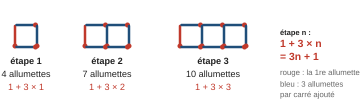
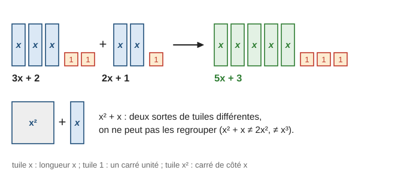
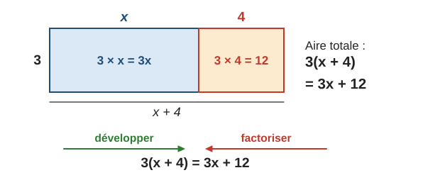
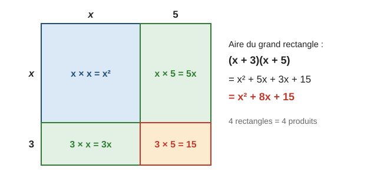
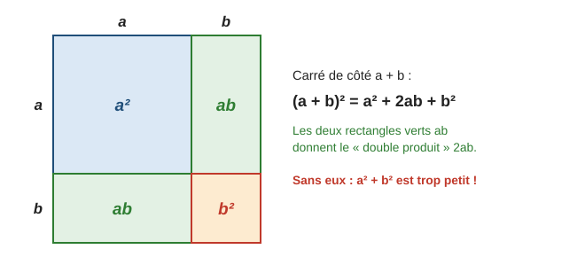
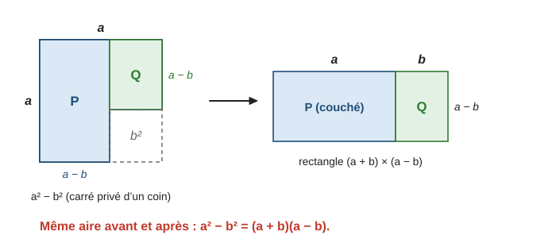
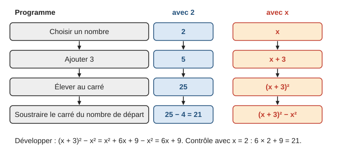

# Calcul littéral

> Compendium collège — chapitre unifié (sans découpage 6e / 5e / 4e / 3e).  
> Cours compact pour un élève de niveau moyen : intuition, méthode, exemples guidés, erreurs fréquentes, puis exercices progressifs (★ facile, ★★ standard, ★★★ approfondissement) avec corrigés détaillés.

---

## 0. Ce qu’on vise

**En une phrase :** une lettre permet de dire en une seule écriture ce qui est vrai **pour tous les nombres** ; le calcul littéral sert à écrire des formules, à transformer des expressions et à **démontrer**.

À la fin de ce chapitre, je sais :

1. **Produire** une expression (formule, motif, programme de calcul) et la **calculer** pour une valeur donnée.
2. **Tester** une égalité pour une valeur ; reconnaître si une expression est une **somme** ou un **produit**.
3. **Réduire** une expression (regrouper les termes semblables).
4. **Développer** avec la distributivité simple et double, et **factoriser** avec un facteur commun.
5. Utiliser les **identités remarquables** $(a+b)^2$, $(a-b)^2$, $(a+b)(a-b)$ dans les deux sens.
6. **Démontrer** une propriété avec des lettres (programmes de calcul, pairs et impairs), ou la réfuter par un **contre-exemple**.

> **Prérequis.** Priorités et règle des signes (chapitre 3, § 3 à 6) ; carrés et puissances (chapitre 4, § 1) ; aire du rectangle et du carré (chapitre 14, § 3).

---

## 1. Pourquoi des lettres ?

### 1.1 Une formule pour toutes les étapes

On construit une rangée de carrés avec des allumettes. Combien faut-il d’allumettes pour $10$ carrés ? pour $100$ ?

Sur le schéma ci-dessus, on voit la structure : une allumette rouge au départ, puis $3$ allumettes bleues par carré. À l’étape $n$, il faut donc $1 + 3 \times n$ allumettes.

**Exemple guidé 1.** Combien faut-il d’allumettes pour $10$ carrés ? pour $100$ carrés ? Avec $61$ allumettes, combien de carrés peut-on faire ?

> Formule : $3n + 1$ allumettes pour $n$ carrés.  
> Pour $n = 10$ : $3 \times 10 + 1 = 31$ allumettes. Pour $n = 100$ : $3 \times 100 + 1 = 301$ allumettes.  
> Avec $61$ allumettes : $61 - 1 = 60$ allumettes bleues, soit $60 \div 3 = 20$ carrés.

**Contrôle.** La formule redonne les cas dessinés : $n = 3$ donne $3 \times 3 + 1 = 10$.

> **Définition.** Une **expression littérale** est une écriture qui contient des nombres, des opérations et des lettres. Chaque lettre désigne un nombre quelconque.

### 1.2 Conventions d’écriture

| On écrit | Cela veut dire | Exemple |
|---|---|---|
| $3x$ | $3 \times x$ | pour $x = 5$ : $3x = 15$ |
| $ab$ | $a \times b$ | |
| $x^2$ | $x \times x$ (« $x$ au carré ») | pour $x = 5$ : $x^2 = 25$ |
| $x$ | $1x$ | $x + x = 2x$ |
| $-x$ | $-1 \times x$ | |

On ne supprime le signe $\times$ que devant une lettre ou une parenthèse : $3 \times 5$ ne s’écrit pas $35$.

> **Erreur fréquente.** Confondre $2x$ et $x^2$. Pour $x = 5$ : $2x = 2 \times 5 = 10$, mais $x^2 = 5 \times 5 = 25$.

---

## 2. Calculer une expression, tester une égalité

> **Méthode — Calculer une expression pour une valeur.**
> 1. Remplacer chaque lettre par sa valeur, en **rétablissant les signes** $\times$.
> 2. Mettre les nombres négatifs **entre parenthèses**.
> 3. Calculer en respectant les priorités : parenthèses, puissances, puis $\times$ et $\div$, puis $+$ et $-$.

**Exemple guidé 2.** Calculer $A = 2x^2 - 3x + 1$ pour $x = 5$, puis pour $x = -2$.

> Pour $x = 5$ : $A = 2 \times 5^2 - 3 \times 5 + 1 = 2 \times 25 - 15 + 1 = 50 - 15 + 1 = 36$.  
> Pour $x = -2$ : $A = 2 \times (-2)^2 - 3 \times (-2) + 1 = 2 \times 4 + 6 + 1 = 15$.

**Contrôle.** $(-2)^2 = 4$ est positif ; $-3 \times (-2) = +6$.

> **Erreur fréquente.** Calculer $2x^2$ comme $(2x)^2$. Pour $x = 5$ : $2x^2 = 2 \times 25 = 50$, mais $(2x)^2 = 10^2 = 100$. Le carré ne porte que sur ce qui est juste avant lui.

**Tester une égalité.** Une égalité avec une lettre peut être vraie pour certaines valeurs et fausse pour d’autres. Pour la tester, on calcule **séparément** chaque membre.

> Égalité $4x - 3 = 2x + 5$. Pour $x = 4$ : à gauche $4 \times 4 - 3 = 13$, à droite $2 \times 4 + 5 = 13$ : vraie.  
> Pour $x = 1$ : à gauche $1$, à droite $7$ : fausse.

Une égalité vraie **pour toutes** les valeurs s’appelle une **identité** (par exemple $2x + 3x = 5x$). Un seul cas où elle est fausse suffit à prouver que ce n’est pas une identité : c’est un **contre-exemple** (§ 8).

---

## 3. Somme ou produit ?

La **nature** d’une expression est donnée par la **dernière opération** qu’on effectuerait pour la calculer.

| Expression | Dernière opération | Nature |
|---|---|---|
| $3x + 2$ | l’addition | somme (de deux **termes**) |
| $5(x + 4)$ | la multiplication | produit (de deux **facteurs**) |
| $(x + 1)(x - 2)$ | la multiplication | produit |
| $x^2 + 1$ | l’addition | somme |
| $2(x + 1) + 3$ | l’addition | somme |

Cette distinction est essentielle : **développer** transforme un produit en somme ; **factoriser** transforme une somme en produit.

---

## 4. Réduire une expression

Réduire, c’est écrire une expression avec **le moins de termes possible**. On regroupe les termes **semblables** (même partie littérale), comme on regroupe des tuiles de même forme.

> **Propriété.** $ax + bx = (a + b)x$ : on additionne les coefficients. Par exemple $5x + 3x = 8x$ et $7x^2 - 2x^2 = 5x^2$. Les termes en $x$, en $x^2$ et les nombres seuls restent séparés.

**Exemple guidé 3.** Réduire $B = 3x^2 + 5x - 7 - x^2 + 2x + 4$.

> On regroupe : termes en $x^2$ : $3x^2 - x^2 = 2x^2$ ; termes en $x$ : $5x + 2x = 7x$ ; nombres : $-7 + 4 = -3$.  
> $B = 2x^2 + 7x - 3$.

**Contrôle.** Pour $x = 1$ : l’expression de départ vaut $3 + 5 - 7 - 1 + 2 + 4 = 6$, la forme réduite $2 + 7 - 3 = 6$.

> **Erreur fréquente.** Écrire $3x + 2 = 5x$. On ne peut pas additionner des $x$ et des unités (tuiles différentes). Contre-exemple : pour $x = 2$, $3x + 2 = 8$ mais $5x = 10$. De même, $x + x = 2x$ mais $x \times x = x^2$.

---

## 5. Développer

### 5.1 La distributivité simple

Le rectangle ci-dessous a pour hauteur $3$ et pour largeur $x + 4$. On calcule son aire de deux façons : d’un coup, $3(x + 4)$ ; ou en deux morceaux, $3x + 12$.

> **Propriété (distributivité simple).** Pour tous nombres $k$, $a$, $b$ :
> $$k(a + b) = ka + kb \qquad k(a - b) = ka - kb$$

**Développer**, c’est transformer un produit en somme. Le facteur devant la parenthèse multiplie **chaque terme** de la parenthèse, **avec son signe**.

> $4(x - 3) = 4x - 12$ ; $\;-2(3x - 5) = -6x + 10$ ; $\;x(x + 7) = x^2 + 7x$.  
> Un signe $-$ devant une parenthèse, c’est $-1 \times$ : $-(5 - 4x) = -5 + 4x$ (on change tous les signes).

> **Erreur fréquente.** Ne multiplier que le premier terme : $3(x + 4) = 3x + 4$ est faux. Contre-exemple : pour $x = 1$, $3 \times 5 = 15$ mais $3 + 4 = 7$. Autre piège : $-2(x - 5) = -2x - 10$ est faux, car $-2 \times (-5) = +10$.

### 5.2 La double distributivité

Le grand rectangle ci-dessous a pour côtés $x + 3$ et $x + 5$. Il est formé de **quatre** rectangles : son aire est la somme de **quatre produits**.

> **Propriété (double distributivité).** Pour tous nombres $a$, $b$, $c$, $d$ :
> $$(a + b)(c + d) = ac + ad + bc + bd$$

**Exemple guidé 4.** Développer et réduire $C = (2x - 1)(x + 3)$.

**Réflexion.** Chaque terme de la première parenthèse ($2x$ et $-1$) multiplie chaque terme de la seconde ($x$ et $3$) : quatre produits, avec leurs signes.

> $C = 2x \times x + 2x \times 3 + (-1) \times x + (-1) \times 3$  
> $C = 2x^2 + 6x - x - 3$  
> $C = 2x^2 + 5x - 3$.

**Contrôle.** Pour $x = 1$ : $(2 - 1)(1 + 3) = 4$ et $2 + 5 - 3 = 4$. On teste toujours avec une valeur simple.

> **Méthode — Développer et réduire.**
> 1. Écrire tous les produits (un facteur simple : autant de produits que de termes ; deux parenthèses de deux termes : $4$ produits).
> 2. Calculer chaque produit **avec son signe**.
> 3. Réduire, puis contrôler avec $x = 1$ (ou $x = 2$).

---

## 6. Factoriser

Factoriser, c’est faire le chemin inverse du développement : transformer une somme en **produit**, en repérant un **facteur commun** à tous les termes.

> **Propriété.** $ka + kb = k(a + b)$ et $ka - kb = k(a - b)$.

**Exemple guidé 5.** Factoriser $D = 6x + 9$, puis $E = 2x^2 + 6x$.

> $D = 3 \times 2x + 3 \times 3 = 3(2x + 3)$.  
> $E = 2x \times x + 2x \times 3 = 2x(x + 3)$.

**Contrôle.** On redéveloppe : $3(2x + 3) = 6x + 9$ ✓ et $2x(x + 3) = 2x^2 + 6x$ ✓.

Le facteur commun peut être une **parenthèse** entière :

> $(x + 1)(2x + 3) + (x + 1)(x - 4) = (x + 1)\big[(2x + 3) + (x - 4)\big] = (x + 1)(3x - 1)$.

> **Erreur fréquente.** Factoriser « à moitié » : $2x + 6 = 2(x + 6)$ est faux, car $2(x + 6) = 2x + 12$. Le bon résultat est $2(x + 3)$. Toujours **redévelopper** pour vérifier.

> **Méthode — Factoriser.**
> 1. Écrire chaque terme comme un produit faisant apparaître le facteur commun (nombre, lettre ou parenthèse).
> 2. Mettre ce facteur en tête, et entre crochets ce qui reste de chaque terme.
> 3. Réduire l’intérieur, puis redévelopper pour contrôler.

---

## 7. Identités remarquables (★★)

Ce sont trois développements, au programme de 3e, qui reviennent si souvent qu’on les apprend par cœur, dans les deux sens.

> **Propriété (identités remarquables).** Pour tous nombres $a$ et $b$ :
> $$(a + b)^2 = a^2 + 2ab + b^2 \qquad (a - b)^2 = a^2 - 2ab + b^2 \qquad (a + b)(a - b) = a^2 - b^2$$

Pourquoi $2ab$ ? Le carré de côté $a + b$ est formé de quatre morceaux : un carré $a^2$, un carré $b^2$ et **deux** rectangles $ab$.

Pour la troisième, on enlève à un carré de côté $a$ un petit carré de côté $b$, puis on recolle les deux morceaux en un rectangle de côtés $a + b$ et $a - b$ : l’aire n’a pas changé.

**Exemple guidé 6.** a) Développer $(2x - 3)^2$. b) Factoriser $x^2 - 25$ et $4x^2 + 12x + 9$.

**Réflexion.** a) C’est $(a - b)^2$ avec $a = 2x$ et $b = 3$. b) $x^2 - 25 = x^2 - 5^2$ est une différence de deux carrés ; $4x^2 + 12x + 9 = (2x)^2 + 2 \times 2x \times 3 + 3^2$.

> a) $(2x - 3)^2 = (2x)^2 - 2 \times 2x \times 3 + 3^2 = 4x^2 - 12x + 9$.  
> b) $x^2 - 25 = x^2 - 5^2 = (x + 5)(x - 5)$.  
> $\phantom{b)}$ $4x^2 + 12x + 9 = (2x)^2 + 2 \times 2x \times 3 + 3^2 = (2x + 3)^2$.

**Contrôle.** Pour $x = 1$ : $(2 - 3)^2 = 1$ et $4 - 12 + 9 = 1$ ✓ ; $1 - 25 = -24$ et $6 \times (-4) = -24$ ✓.

> **Erreur fréquente.** $(a + b)^2 = a^2 + b^2$ est **faux**. Contre-exemple : $(3 + 4)^2 = 49$, alors que $3^2 + 4^2 = 25$. Il manque $2 \times 3 \times 4 = 24$ (les deux rectangles verts du schéma). De même, $(a - b)^2 \neq a^2 - b^2$.

> **Astuce (calcul mental).** $101^2 = (100 + 1)^2 = 10\,000 + 200 + 1 = 10\,201$ ; $\;99 \times 101 = (100 - 1)(100 + 1) = 10\,000 - 1 = 9\,999$.

---

## 8. Programmes de calcul et démonstrations

### 8.1 Tester, conjecturer, prouver

Un **programme de calcul** est une suite d’instructions appliquée à un nombre. Avec une lettre, on peut prévoir le résultat **pour tous les nombres**.

**Exemple guidé 7.** On applique le programme ci-dessus. a) Quel résultat obtient-on avec $2$ ? avec $5$ ? b) Montrer que le résultat est toujours égal à $6x + 9$, où $x$ est le nombre choisi. c) Quel nombre faut-il choisir pour obtenir $45$ ?

> a) Avec $2$ : $2 + 3 = 5$ ; $5^2 = 25$ ; $25 - 2^2 = 21$. Avec $5$ : $8^2 - 5^2 = 64 - 25 = 39$.  
> b) Avec $x$ : $(x + 3)^2 - x^2 = x^2 + 6x + 9 - x^2 = 6x + 9$. Le résultat est toujours $6x + 9$.  
> c) $6x + 9 = 45$ donne $6x = 36$, donc $x = 6$ (voir le chapitre 7). Contrôle : $9^2 - 6^2 = 81 - 36 = 45$.

**Contrôle.** $6 \times 2 + 9 = 21$ et $6 \times 5 + 9 = 39$ : on retrouve les résultats du a).

> **Erreur fréquente.** Croire qu’essayer quelques nombres suffit à prouver. Des exemples permettent de **conjecturer** ; seule l’écriture avec une lettre **prouve** pour tous les nombres.

### 8.2 Pairs, impairs, multiples

> **À retenir.** Si $n$ est un nombre entier : un nombre **pair** s’écrit $2n$ ; un nombre **impair** s’écrit $2n + 1$ ; deux entiers **consécutifs** s’écrivent $n$ et $n + 1$ ; un **multiple de 3** s’écrit $3n$.

**Exemple guidé 8.** Montrer que la somme de trois entiers consécutifs est toujours un multiple de $3$.

> Trois entiers consécutifs s’écrivent $n$, $n + 1$ et $n + 2$, où $n$ est un entier.  
> Leur somme vaut $n + (n + 1) + (n + 2) = 3n + 3 = 3(n + 1)$.  
> C’est $3$ fois un entier : c’est un multiple de $3$.

**Contrôle.** $7 + 8 + 9 = 24 = 3 \times 8$, et $8 = 7 + 1$ ✓.

**Le contre-exemple.** Pour montrer qu’une affirmation est **fausse**, un seul exemple qui ne marche pas suffit. « Le carré d’un nombre est toujours plus grand que ce nombre » est faux : $0{,}5^2 = 0{,}25$, plus petit que $0{,}5$.

---

## 9. Mini-synthèse

> **À retenir.**
> - $3x = 3 \times x$ ; $x^2 = x \times x$ ; on remplace une lettre par un nombre en rétablissant les $\times$ et les parenthèses.
> - Réduire : on regroupe les termes semblables ($5x + 3x = 8x$), jamais des $x$ avec des $x^2$ ou des nombres.
> - Développer : $k(a + b) = ka + kb$ ; $(a + b)(c + d) = ac + ad + bc + bd$ ; signes compris ; contrôle avec $x = 1$.
> - Factoriser : repérer le facteur commun, $ka + kb = k(a + b)$ ; redévelopper pour contrôler.
> - Identités : $(a + b)^2 = a^2 + 2ab + b^2$ ; $(a - b)^2 = a^2 - 2ab + b^2$ ; $(a + b)(a - b) = a^2 - b^2$.
> - Prouver : avec une lettre (pair $2n$, impair $2n + 1$) ; réfuter : un contre-exemple.

---

## 10. Exercices types

### A. Produire et calculer (★)

**A1.** Un rectangle a pour longueur $x$ et pour largeur $3$. Écrire son périmètre et son aire en fonction de $x$, puis les calculer pour $x = 7$.

**A2.** Calculer $3x - 5$ pour $x = 4$ ; pour $x = -2$ ; pour $x = \dfrac{1}{3}$.

**A3.** Calculer $x^2 - 2x + 1$ pour $x = 5$, puis pour $x = -1$.

**A4.** Traduire par une expression : a) le triple d’un nombre $x$, diminué de $7$ ; b) le carré de la somme de $a$ et de $2$ ; c) la somme du carré de $a$ et de $2$.

**A5.** L’égalité $4x - 3 = 2x + 5$ est-elle vraie pour $x = 4$ ? pour $x = 1$ ?

### B. Réduire, reconnaître (★)

**B1.** Réduire : a) $5x + 3x - 2x$ ; b) $4a - 7 + 2a + 1$ ; c) $3x^2 + 5x - x^2 + 2x$.

**B2.** Écrire plus simplement : a) $x + x$ ; b) $x \times x$ ; c) $3x \times 2x$ ; d) $2 \times x \times 5$.

**B3.** Dire si chaque expression est une somme ou un produit : a) $3x + 2$ ; b) $5(x + 4)$ ; c) $(x + 1)(x - 2)$ ; d) $x^2 + 1$ ; e) $2(x + 1) + 3$.

### C. Développer (★ → ★★)

**C1.** Développer : a) $4(x - 3)$ ; b) $-5(2x + 1)$ ; c) $x(x + 7)$.

**C2.** Développer et réduire : a) $2(x + 3) + 5x$ ; b) $7 - 3(2x - 1)$ ; c) $-(5 - 4x)$.

**C3.** Développer et réduire : a) $(x + 2)(x + 6)$ ; b) $(2x - 1)(x + 3)$ ; c) $(3x - 2)(2x - 5)$.

**C4.** Un rectangle a pour côtés $x + 2$ et $x + 5$. Exprimer son aire sous forme développée et réduite, puis la calculer pour $x = 3$ de deux façons.

### D. Factoriser (★ → ★★)

**D1.** Factoriser : a) $6x + 9$ ; b) $10a - 15$ ; c) $x^2 + 4x$.

**D2.** Factoriser : a) $2x^2 + 6x$ ; b) $5x^3 - 10x^2$.

**D3.** Factoriser avec un facteur commun entre parenthèses : a) $(x + 1)(2x + 3) + (x + 1)(x - 4)$ ; b) $(2x - 1)^2 - (2x - 1)(x + 5)$.

### E. Identités remarquables (★★)

**E1.** Développer : a) $(x + 5)^2$ ; b) $(x - 3)^2$ ; c) $(2x + 1)(2x - 1)$.

**E2.** Développer : a) $(2x - 3)^2$ ; b) $(3x + 4)^2$.

**E3.** Factoriser : a) $x^2 - 16$ ; b) $9x^2 - 1$ ; c) $x^2 - 6x + 9$ ; d) $4x^2 + 20x + 25$.

**E4.** Calculer de tête avec une identité : a) $101^2$ ; b) $99^2$ ; c) $98 \times 102$.

### F. Programmes de calcul (★★)

**F1.** Programme : choisir un nombre ; ajouter $3$ ; multiplier par $4$ ; soustraire $12$. a) Appliquer le programme à $5$, puis à $-2$. b) Que remarque-t-on ? c) Le démontrer.

**F2.** Programme : choisir un nombre ; le multiplier par $2$ ; ajouter $5$ ; multiplier le résultat par $3$ ; soustraire $15$. a) Montrer que le résultat est $6x$ si on choisit $x$. b) Quel nombre faut-il choisir pour obtenir $42$ ?

**F3.** Programme A : choisir un nombre, ajouter $1$, élever au carré, soustraire le carré du nombre de départ. Programme B : choisir un nombre, le doubler, ajouter $1$. Montrer que les deux programmes donnent toujours le même résultat.

### G. Démontrer ou réfuter (★★)

**G1.** Montrer que la somme de deux entiers consécutifs est toujours impaire.

**G2.** Montrer que la somme de deux nombres impairs est toujours paire.

**G3.** « Le double d’un nombre est toujours plus grand que ce nombre. » Vrai ou faux ? Justifier.

---

## 11. Exercices atypiques

### H. Trouver l’erreur (★★)

**H1.** Inès écrit : $(x + 3)^2 = x^2 + 9$. Trouver l’erreur et corriger.

**H2.** Tom écrit : $x^2 - 9 = (x - 3)^2$. Trouver l’erreur et corriger.

**H3.** Léo écrit : $3(x + 4) = 3x + 4$ et $-2(x - 5) = -2x - 10$. Trouver les deux erreurs.

**H4.** Sofia écrit : $2x + 6 = 2(x + 6)$. Comment peut-elle vérifier elle-même que c’est faux ?

**H5.** Noé calcule $-x^2$ pour $x = -3$ et trouve $9$. Trouver l’erreur.

**H6.** Un élève écrit $3x + 2 = 5x$. Montrer avec un nombre que c’est faux. Pour quelle valeur de $x$ l’égalité est-elle quand même vraie ?

### I. Comprendre et raisonner (★★ → ★★★)

**I1.** Expliquer pourquoi $2x + 3x = 5x$ est vrai pour toutes les valeurs de $x$ (utiliser la distributivité).

**I2.** Peut-on réduire $x + y$ ? Pourquoi ?

**I3.** Trouver deux nombres $a$ et $b$ tels que $(x + a)(x + b) = x^2 + 5x + 6$ pour tout $x$.

**I4.** Comparer $n(n + 1)$ et $n^2$ pour un entier $n$ positif : lequel est le plus grand, et de combien ?

**I5.** (★★★) Factoriser $x^2 - 2x + 1 - y^2$. (Indice : commencer par reconnaître une identité dans les trois premiers termes.)

### J. Aires et figures (★★)

**J1.** Dans un carré de côté $x + 2$, on découpe un petit carré de côté $2$ dans un coin. Exprimer l’aire restante de deux façons et montrer qu’on obtient la même expression que $x(x + 4)$.

**J2.** Une photo carrée de côté $x$ (en cm) est entourée d’un cadre de $1\,\mathrm{cm}$ de large. Montrer que l’aire du cadre seul est $4x + 4$. Calculer cette aire pour une photo de $10\,\mathrm{cm}$ de côté.

### K. Problèmes en plusieurs étapes (★★ → ★★★)

**K1.** Programme A : choisir un nombre, soustraire $1$, élever au carré. Programme B : choisir un nombre, l’élever au carré, soustraire le double du nombre de départ, ajouter $1$. a) Appliquer les deux programmes à $3$. b) Démontrer que les deux programmes donnent toujours le même résultat. c) Quel nombre faut-il choisir pour obtenir $0$ ?

**K2.** a) Développer $(n + 1)^2 - (n - 1)^2$. b) En déduire, sans calculatrice, $1\,001^2 - 999^2$.

### L. Situations ouvertes (★★)

**L1.** Inventer un programme de calcul de quatre étapes qui donne toujours $5$, quel que soit le nombre choisi. Le démontrer.

**L2.** Proposer une fausse factorisation « crédible » et expliquer comment la démasquer.

---

## 12. Corrigés

### Exercices types

**A1.** Périmètre : $2(x + 3) = 2x + 6$ ; aire : $3x$. Pour $x = 7$ : périmètre $20$, aire $21$.

**A2.** $3 \times 4 - 5 = 7$ ; $3 \times (-2) - 5 = -11$ ; $3 \times \dfrac{1}{3} - 5 = 1 - 5 = -4$.

**A3. (modèle)**

> Pour $x = 5$ : $5^2 - 2 \times 5 + 1 = 25 - 10 + 1 = 16$.  
> Pour $x = -1$ : $(-1)^2 - 2 \times (-1) + 1 = 1 + 2 + 1 = 4$.

**A4.** a) $3x - 7$ ; b) $(a + 2)^2$ ; c) $a^2 + 2$.

**A5.** Pour $x = 4$ : $13$ et $13$, vraie. Pour $x = 1$ : $1$ et $7$, fausse.

**B1. (modèle)**

> a) $5x + 3x - 2x = (5 + 3 - 2)x = 6x$.  
> b) $4a + 2a - 7 + 1 = 6a - 6$.  
> c) $3x^2 - x^2 + 5x + 2x = 2x^2 + 7x$.

**B2.** a) $2x$ ; b) $x^2$ ; c) $6x^2$ ; d) $10x$.

**B3.** a) somme ; b) produit ; c) produit ; d) somme ; e) somme (on ajoute $3$ en dernier).

**C1.** a) $4x - 12$ ; b) $-10x - 5$ ; c) $x^2 + 7x$.

**C2.** a) $2x + 6 + 5x = 7x + 6$ ; b) $7 - 6x + 3 = 10 - 6x$ ; c) $-5 + 4x$.

**C3. (modèle)**

> a) $(x + 2)(x + 6) = x^2 + 6x + 2x + 12 = x^2 + 8x + 12$.  
> b) $(2x - 1)(x + 3) = 2x^2 + 6x - x - 3 = 2x^2 + 5x - 3$.  
> c) $(3x - 2)(2x - 5) = 6x^2 - 15x - 4x + 10 = 6x^2 - 19x + 10$.  
> Contrôle de c) pour $x = 1$ : $1 \times (-3) = -3$ et $6 - 19 + 10 = -3$ ✓.

**C4.** Aire $= (x + 2)(x + 5) = x^2 + 7x + 10$. Pour $x = 3$ : $5 \times 8 = 40$ et $9 + 21 + 10 = 40$.

**D1. (modèle)**

> a) $6x + 9 = 3 \times 2x + 3 \times 3 = 3(2x + 3)$.  
> b) $10a - 15 = 5 \times 2a - 5 \times 3 = 5(2a - 3)$.  
> c) $x^2 + 4x = x \times x + x \times 4 = x(x + 4)$.

**D2.** a) $2x(x + 3)$ ; b) $5x^2(x - 2)$.

**D3.** a) $(x + 1)\big[(2x + 3) + (x - 4)\big] = (x + 1)(3x - 1)$. b) $(2x - 1)\big[(2x - 1) - (x + 5)\big] = (2x - 1)(x - 6)$.

**E1. (modèle)**

> a) $(x + 5)^2 = x^2 + 2 \times x \times 5 + 5^2 = x^2 + 10x + 25$.  
> b) $(x - 3)^2 = x^2 - 2 \times x \times 3 + 3^2 = x^2 - 6x + 9$.  
> c) $(2x + 1)(2x - 1) = (2x)^2 - 1^2 = 4x^2 - 1$.

**E2.** a) $4x^2 - 12x + 9$ ; b) $9x^2 + 24x + 16$.

**E3.** a) $(x - 4)(x + 4)$ ; b) $(3x - 1)(3x + 1)$ ; c) $(x - 3)^2$ ; d) $(2x + 5)^2$.

**E4.** a) $(100 + 1)^2 = 10\,201$ ; b) $(100 - 1)^2 = 10\,000 - 200 + 1 = 9\,801$ ; c) $(100 - 2)(100 + 2) = 10\,000 - 4 = 9\,996$.

**F1. (modèle)**

> a) Avec $5$ : $5 + 3 = 8$ ; $8 \times 4 = 32$ ; $32 - 12 = 20$. Avec $-2$ : $1$ ; $4$ ; $4 - 12 = -8$.  
> b) On obtient $4$ fois le nombre de départ ($20 = 4 \times 5$ et $-8 = 4 \times (-2)$).  
> c) Avec $x$ : $4(x + 3) - 12 = 4x + 12 - 12 = 4x$. Le résultat est toujours $4$ fois le nombre choisi.

**F2.** a) $3(2x + 5) - 15 = 6x + 15 - 15 = 6x$. b) $6x = 42$ pour $x = 7$.

**F3.** A : $(x + 1)^2 - x^2 = x^2 + 2x + 1 - x^2 = 2x + 1$. B : $2x + 1$. Mêmes résultats pour tout $x$.

**G1. (modèle)**

> Deux entiers consécutifs s’écrivent $n$ et $n + 1$ ($n$ entier).  
> Leur somme vaut $n + n + 1 = 2n + 1$ : c’est un nombre impair.

**G2.** Deux impairs s’écrivent $2n + 1$ et $2p + 1$ ($n$ et $p$ entiers, pas forcément égaux). Somme : $2n + 2p + 2 = 2(n + p + 1)$, un nombre pair.

**G3.** Faux. Contre-exemple : le double de $-3$ est $-6$, plus petit que $-3$ (et le double de $0$ est égal à $0$). C’est vrai seulement pour les nombres strictement positifs.

### Exercices atypiques

**H1.** Il manque le double produit $2 \times x \times 3 = 6x$ : $(x + 3)^2 = x^2 + 6x + 9$. Contre-exemple de l’écriture d’Inès : pour $x = 1$, $16 \neq 10$.

**H2.** $(x - 3)^2 = x^2 - 6x + 9$, ce n’est pas $x^2 - 9$. La bonne factorisation est $x^2 - 9 = (x - 3)(x + 3)$.

**H3.** $3(x + 4) = 3x + 12$ (le $3$ multiplie aussi le $4$). $-2(x - 5) = -2x + 10$, car $-2 \times (-5) = +10$.

**H4.** En redéveloppant : $2(x + 6) = 2x + 12 \neq 2x + 6$. Ou avec $x = 0$ : $6 \neq 12$. Correct : $2(x + 3)$.

**H5.** $-x^2 = -(x^2)$ : le carré se calcule d’abord. $-(-3)^2 = -9$. (C’est $(-x)^2$ qui vaudrait $9$.)

**H6.** Pour $x = 2$ : $3 \times 2 + 2 = 8$ et $5 \times 2 = 10$. Ce n’est donc pas une identité. L’égalité est vraie seulement pour $x = 1$ ($5 = 5$) : $3x + 2 = 5x$ revient à $2 = 2x$.

**I1.** Par distributivité, $2x + 3x = (2 + 3) \times x = 5x$ : c’est la règle $ka + kb = k(a + b)$ lue à l’envers, valable pour tout $x$.

**I2.** Non : $x$ et $y$ sont deux nombres qui peuvent être différents (ce ne sont pas des termes semblables). Pour $x = 1$ et $y = 10$, $x + y = 11$, qu’aucune écriture du type $2x$ ou $2y$ ne donne en général.

**I3.** $(x + a)(x + b) = x^2 + (a + b)x + ab$. Il faut $a + b = 5$ et $ab = 6$ : $a = 2$ et $b = 3$ (ou l’inverse). Contrôle : $(x + 2)(x + 3) = x^2 + 5x + 6$.

**I4.** $n(n + 1) = n^2 + n$ : c’est $n^2$ plus $n$. Pour $n > 0$, $n(n + 1)$ est plus grand que $n^2$, de $n$.

**I5.** $x^2 - 2x + 1 = (x - 1)^2$, donc l’expression vaut $(x - 1)^2 - y^2 = (x - 1 - y)(x - 1 + y)$.

**J1.** Aire restante $= (x + 2)^2 - 2^2 = x^2 + 4x + 4 - 4 = x^2 + 4x = x(x + 4)$. (On peut aussi découper la zone restante en deux rectangles : $x(x + 2) + 2x = x^2 + 4x$.)

**J2.** Grand carré de côté $x + 2$ moins la photo : $(x + 2)^2 - x^2 = x^2 + 4x + 4 - x^2 = 4x + 4$. Pour $x = 10$ : $44\,\mathrm{cm}^2$ (contrôle : $144 - 100 = 44$).

**K1. (modèle)**

> a) A : $3 - 1 = 2$, $2^2 = 4$. B : $3^2 = 9$, $9 - 6 = 3$, $3 + 1 = 4$. Même résultat : $4$.  
> b) A donne $(x - 1)^2 = x^2 - 2x + 1$. B donne $x^2 - 2x + 1$. Les deux expressions sont égales pour tout $x$.  
> c) $(x - 1)^2 = 0$ seulement si $x - 1 = 0$, c’est-à-dire $x = 1$.

**K2.** a) $(n^2 + 2n + 1) - (n^2 - 2n + 1) = 4n$. b) Avec $n = 1\,000$ : $1\,001^2 - 999^2 = 4 \times 1\,000 = 4\,000$.

**L1.** Exemple : choisir $x$ ; ajouter $5$ ; multiplier par $2$ ; soustraire le double du nombre de départ ; diviser par $2$. Preuve : $\big(2(x + 5) - 2x\big) \div 2 = 10 \div 2 = 5$.

**L2.** Exemple : « $x^2 + 4 = (x + 2)^2$ ». On la démasque en redéveloppant ($x^2 + 4x + 4$) ou en testant $x = 1$ ($5 \neq 9$).

---

## 13. Liens avec les autres chapitres

- **Chapitre 3** (relatifs) : règles des signes pour développer.
- **Chapitre 4** (puissances) : $x^2$, $x^3$, carrés parfaits.
- **Chapitre 7** (équations) : on réduit, on développe ou on factorise avant de résoudre ; équation produit nul.
- **Chapitre 8** (fonctions) : une expression de $x$ définit une fonction.
- **Chapitre 14** (aires) : les modèles d’aire de ce chapitre ; formules d’aires et de volumes.

---

## 14. Fiche-synthèse

| Je dois savoir… | Comment | Exemple express | S’entraîner |
|---|---|---|---|
| Calculer une expression | remplacer la lettre, rétablir les $\times$ et les parenthèses | $3x^2$ pour $x = -2$ : $3 \times (-2)^2 = 12$ | série A |
| Réduire | regrouper les termes semblables | $5x + 3 - 2x + 4 = 3x + 7$ | série B |
| Développer | $k(a + b) = ka + kb$ ; chaque terme par chaque terme | $(x + 2)(x - 5) = x^2 - 3x - 10$ | série C |
| Factoriser | repérer le facteur commun | $6x + 9 = 3(2x + 3)$ | série D |
| Identités remarquables | $(a + b)^2$, $(a - b)^2$, $(a + b)(a - b)$ | $(x + 3)^2 = x^2 + 6x + 9$ | série E |
| Prouver ou réfuter | une lettre pour prouver ; un contre-exemple pour réfuter | $(n + 1)^2 - n^2 = 2n + 1$ pour tout $n$ | séries F et G |

**Pièges à éviter :** $(x + 3)^2 \neq x^2 + 9$ ; $-(x - 4) = -x + 4$ ; $3x + 2$ ne se réduit pas en $5x$.

---

*Version v0.3 — relecture (prérequis harmonisés, fiche-synthèse, corrections : voir `PLAN-REVISION.md`, § 10). Base : v0.2 — révision vague 3 (cours développé : motifs et formules, conventions, calcul et test d’égalité, somme ou produit, réduction avec tuiles, distributivité simple et double par les aires, factorisation, identités remarquables illustrées par découpage, programmes de calcul, pairs et impairs, contre-exemple ; 8 exemples guidés ; 7 figures SVG ; 42 exercices corrigés). Ancienne version : `cours-et-exercices.md.bak`.*
