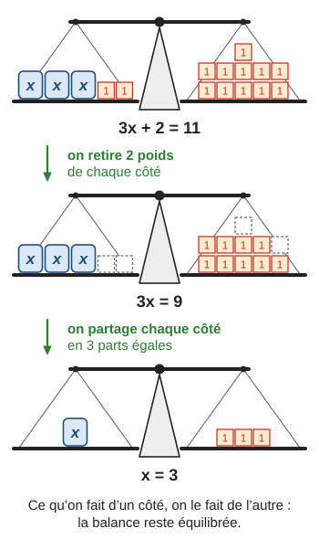
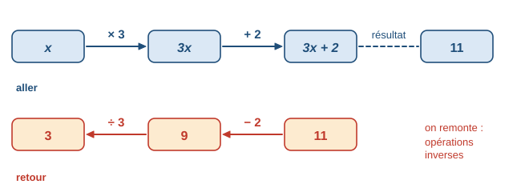
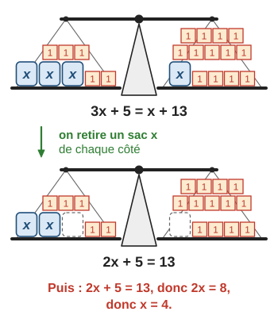
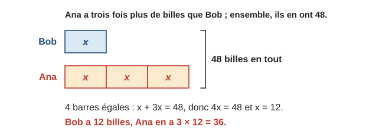
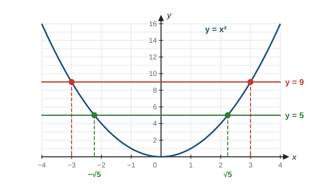
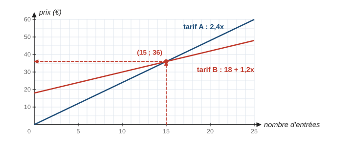
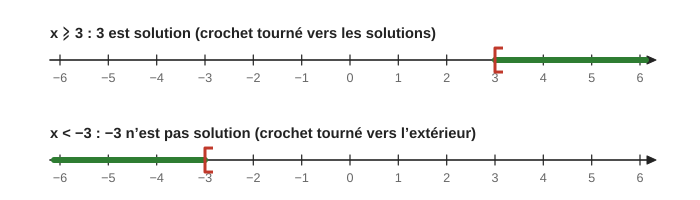
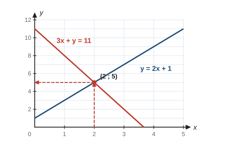

# Équations et inéquations

> Compendium collège — chapitre unifié (sans découpage 6e / 5e / 4e / 3e).  
> Cours compact pour un élève de niveau moyen : intuition, méthode, exemples guidés, erreurs fréquentes, puis exercices progressifs (★ facile, ★★ standard, ★★★ approfondissement) avec corrigés détaillés.

---

## 0. Ce qu’on vise

**En une phrase :** une équation est une **question** (« quel nombre rend cette égalité vraie ? ») ; on y répond en transformant l’égalité **comme une balance** qu’on garde en équilibre.

À la fin de ce chapitre, je sais :

1. Utiliser le vocabulaire (inconnue, membre, solution) et **tester** si un nombre est solution.
2. Résoudre $x + b = c$ et $ax = c$, puis $ax + b = cx + d$ (avec parenthèses, puis fractions).
3. **Mettre en équation** un problème, le résoudre et **vérifier** la réponse dans le contexte.
4. Résoudre une **équation produit nul** et une équation $x^2 = a$.
5. Résoudre une équation **graphiquement** ou avec un **tableur**.
6. Résoudre une **inéquation** simple $ax \geqslant b$ et représenter ses solutions sur une droite graduée.

> **Prérequis.** Nombres relatifs (chapitre 3) ; réduire, développer, factoriser (chapitre 6, § 4 à 6) ; racine carrée (chapitre 4, § 6) ; lecture d’une courbe (chapitre 8, § 2), utile au § 5.

*Calibrage.* Les **systèmes** de deux équations et les inéquations plus générales ne figurent pas au programme du collège : ils sont regroupés au § 8 en ★★★. L’inéquation du type $ax \geqslant b$, elle, reste dans le cœur du chapitre (§ 6, ★★).

---

## 1. Équation, solution

> **Définition.** Une **équation** est une égalité qui contient un nombre inconnu, désigné par une lettre (l’**inconnue**). Une **solution** est une valeur de l’inconnue qui rend l’égalité **vraie**. **Résoudre** l’équation, c’est trouver **toutes** ses solutions.

Dans $3x + 2 = 11$ : l’inconnue est $x$ ; $3x + 2$ est le **membre de gauche** ; $11$ est le **membre de droite**.

**Exemple guidé 1.** Les nombres $3$ et $4$ sont-ils solutions de $3x + 2 = 11$ ?

> Pour $x = 3$ : $3 \times 3 + 2 = 11$. L’égalité est vraie : $3$ est solution.  
> Pour $x = 4$ : $3 \times 4 + 2 = 14 \neq 11$. $4$ n’est pas solution.

**Contrôle.** On calcule **chaque membre séparément** puis on compare.

> **Erreur fréquente.** Croire qu’une équation a toujours une seule solution. $x^2 = 9$ en a deux ($3$ et $-3$) ; $x + 1 = x + 2$ n’en a aucune ; $2(x + 1) = 2x + 2$ est vraie pour tous les nombres.

---

## 2. Résoudre comme une balance

### 2.1 Les deux règles

Une équation est comme une balance en équilibre : les deux plateaux « pèsent » autant. On garde l’équilibre si on fait **la même chose des deux côtés**.

> **Propriété (règles de résolution).** On obtient une équation qui a les **mêmes solutions** si :
> 1. on **ajoute** ou on **soustrait** un même nombre (ou une même expression) aux deux membres ;
> 2. on **multiplie** ou on **divise** les deux membres par un même nombre **non nul**.

**Exemple guidé 2.** Résoudre $3x + 2 = 11$ (la balance ci-dessus).

> $3x + 2 = 11$  
> $3x + 2 - 2 = 11 - 2$ (on soustrait $2$ aux deux membres)  
> $3x = 9$  
> $x = \dfrac{9}{3}$ (on divise les deux membres par $3$)  
> $x = 3$. La solution est $3$.

**Contrôle.** $3 \times 3 + 2 = 11$ ✓.

### 2.2 Remonter les opérations

On peut aussi lire $3x + 2 = 11$ comme un programme de calcul : « je multiplie par $3$, j’ajoute $2$, j’obtiens $11$ ». Pour retrouver le nombre de départ, on **remonte** avec les opérations **inverses**, dans l’ordre inverse.

> **Erreur fréquente.** Utiliser la mauvaise opération inverse : $3x = 12$ ne donne pas $x = 12 - 3 = 9$. Le $3$ **multiplie** $x$ : on **divise** par $3$, donc $x = 4$. De même, $2x + 5 = 13$ donne $2x = 13 - 5 = 8$ (on **soustrait** $5$), pas $13 + 5$.

### 2.3 L’inconnue des deux côtés

Quand $x$ apparaît dans les deux membres, on commence par **regrouper les $x$ d’un même côté** : on retire le même nombre de sacs sur chaque plateau.

**Exemple guidé 3.** Résoudre $3x + 5 = x + 13$.

> $3x + 5 - x = x + 13 - x$ (on soustrait $x$ aux deux membres)  
> $2x + 5 = 13$  
> $2x = 8$ (on soustrait $5$)  
> $x = 4$ (on divise par $2$).

**Contrôle.** À gauche : $3 \times 4 + 5 = 17$ ; à droite : $4 + 13 = 17$ ✓.

> **Méthode — Résoudre une équation du premier degré.**
> 1. Si besoin, **développer** et **réduire** chaque membre (chapitre 6).
> 2. Regrouper les termes en $x$ dans un membre et les nombres dans l’autre (en ajoutant ou soustrayant).
> 3. Diviser par le coefficient de $x$.
> 4. **Vérifier** en remplaçant $x$ par la valeur trouvée dans l’équation **de départ**.

### 2.4 Avec des parenthèses, avec des fractions (★★)

**Exemple guidé 4.** Résoudre $2(x - 3) = 5x + 1$.

> $2x - 6 = 5x + 1$ (on développe)  
> $2x - 6 - 5x = 1$ puis $-3x - 6 = 1$  
> $-3x = 7$  
> $x = \dfrac{7}{-3} = -\dfrac{7}{3}$.

**Contrôle.** À gauche : $2\left(-\dfrac{7}{3} - 3\right) = 2 \times \left(-\dfrac{16}{3}\right) = -\dfrac{32}{3}$. À droite : $-\dfrac{35}{3} + \dfrac{3}{3} = -\dfrac{32}{3}$ ✓. Une solution peut être négative ou fractionnaire : on la laisse sous forme de fraction (pas d’arrondi).

**Exemple guidé 5.** Résoudre $\dfrac{x}{3} + \dfrac{x}{2} = 10$.

**Réflexion.** On multiplie les deux membres par $6$, multiple commun de $3$ et $2$, pour faire disparaître les dénominateurs.

> $6 \times \dfrac{x}{3} + 6 \times \dfrac{x}{2} = 6 \times 10$  
> $2x + 3x = 60$, donc $5x = 60$ et $x = 12$.

**Contrôle.** $\dfrac{12}{3} + \dfrac{12}{2} = 4 + 6 = 10$ ✓.

> **Erreur fréquente.** Ne multiplier qu’un seul terme par $6$ : $2x + \dfrac{x}{2} = 60$. Il faut multiplier **chaque terme des deux membres**.

---

## 3. Mettre un problème en équation

Le modèle en barres ci-dessous aide à traduire l’énoncé avant d’écrire l’équation.

> **Méthode — Mettre en équation.**
> 1. **Choisir l’inconnue** et écrire ce qu’elle représente (avec l’unité) : « Soit $x$ le nombre de billes de Bob. »
> 2. **Traduire** chaque information par une expression de $x$.
> 3. **Écrire l’équation**, puis la résoudre.
> 4. **Revenir au problème** : répondre par une phrase et vérifier avec l’énoncé (pas seulement dans l’équation).

**Exemple guidé 6.** Un rectangle a une longueur qui dépasse sa largeur de $5\,\mathrm{cm}$. Son périmètre est $50\,\mathrm{cm}$. Quelles sont ses dimensions ?

> Soit $x$ la largeur en cm. La longueur est $x + 5$.  
> Périmètre : $2\big(x + (x + 5)\big) = 50$, soit $2(2x + 5) = 50$, donc $4x + 10 = 50$.  
> $4x = 40$, donc $x = 10$.  
> Le rectangle mesure $10\,\mathrm{cm}$ de large et $15\,\mathrm{cm}$ de long.

**Contrôle.** $15 - 10 = 5$ ✓ et $2 \times (10 + 15) = 50$ ✓.

> **Erreur fréquente.** S’arrêter à « $x = 10$ ». La question demande **les deux dimensions**, avec l’unité. Autre piège : une solution absurde dans le contexte (nombre de personnes négatif, âge non entier) signale une erreur de mise en équation.

---

## 4. Équations produit nul et équations $x^2 = a$ (★★)

### 4.1 Produit nul

> **Propriété.** Un produit est nul **si et seulement si** l’un au moins de ses facteurs est nul : $A \times B = 0$ équivaut à $A = 0$ ou $B = 0$.

**Exemple guidé 7.** Résoudre $(x - 3)(2x + 5) = 0$.

> Un produit est nul si l’un de ses facteurs est nul :  
> $x - 3 = 0$ ou $2x + 5 = 0$  
> $x = 3$ ou $2x = -5$, soit $x = -\dfrac{5}{2}$.  
> L’équation a deux solutions : $3$ et $-\dfrac{5}{2}$.

**Contrôle.** Pour $x = 3$, le premier facteur vaut $0$ ; pour $x = -2{,}5$, le second vaut $2 \times (-2{,}5) + 5 = 0$ ✓.

Pour une équation comme $x^2 + 5x = 0$, on **factorise** d’abord : $x(x + 5) = 0$, d’où $x = 0$ ou $x = -5$.

> **Erreur fréquente.** Diviser par $x$ : de $x^2 + 5x = 0$ on tire $x + 5 = 0$ et on **perd** la solution $x = 0$. On ne divise jamais par une expression qui peut valoir $0$ : on factorise.

### 4.2 Équations $x^2 = a$

La racine carrée est définie au chapitre 4 : pour $a \geqslant 0$, $\sqrt{a}$ est le nombre **positif** dont le carré vaut $a$.

> **Propriété.** L’équation $x^2 = a$ a :
> - **deux** solutions, $\sqrt{a}$ et $-\sqrt{a}$, si $a > 0$ ;
> - **une** solution, $0$, si $a = 0$ ;
> - **aucune** solution si $a < 0$ (un carré n’est jamais négatif).

Graphiquement, on cherche les points de la courbe $y = x^2$ à la hauteur $a$ : la droite horizontale $y = 9$ coupe la courbe en $x = -3$ et $x = 3$ ; la droite $y = 5$ la coupe en $-\sqrt{5}$ et $\sqrt{5}$.

> $x^2 = 49$ : $x = 7$ ou $x = -7$. $\quad x^2 = 7$ : $x = \sqrt{7} \approx 2{,}65$ ou $x = -\sqrt{7}$. $\quad x^2 = -4$ : aucune solution.

---

## 5. Résoudre graphiquement ou avec un tableur

Deux tarifs de piscine : A coûte $2{,}40$ € l’entrée ; B coûte $18$ € d’abonnement puis $1{,}20$ € l’entrée (chapitre 5, exercice J2). Pour quel nombre d’entrées les deux tarifs sont-ils égaux ?

- **Par le calcul :** $2{,}4x = 18 + 1{,}2x$, donc $1{,}2x = 18$ et $x = 15$.
- **Graphiquement :** on trace les deux droites ; l’**abscisse** de leur point d’intersection est la solution.

On lit aussi : à gauche de $15$, la droite A est **sous** la droite B : le tarif A est moins cher pour moins de $15$ entrées.

- **Au tableur :** on écrit des valeurs de $x$ en colonne A, la formule `=3*A2-7` en colonne B et `=8-2*A2` en colonne C, puis on cherche la ligne où les deux colonnes sont égales (exercice F2). La lecture graphique et le tableur donnent souvent une valeur **approchée** ; le calcul donne la valeur **exacte**.

---

## 6. Inéquations (★★)

### 6.1 Vocabulaire et représentation

> **Définition.** Une **inéquation** est une inégalité ($<$, $>$, $\leqslant$, $\geqslant$) qui contient une inconnue. Ses solutions sont **toutes** les valeurs qui rendent l’inégalité vraie ; il y en a en général une infinité.

On représente les solutions sur une droite graduée. Le **crochet** est tourné **vers les solutions** si la borne est incluse ($\leqslant$, $\geqslant$), **vers l’extérieur** si elle est exclue ($<$, $>$).

### 6.2 Résoudre $ax \geqslant b$

> **Propriété.** On peut ajouter ou soustraire un même nombre aux deux membres d’une inégalité. On peut multiplier ou diviser par un même nombre **positif** sans changer le sens. Si on multiplie ou divise par un nombre **négatif**, on **change le sens** de l’inégalité.

**Exemple guidé 8.** Résoudre $3x - 4 \geqslant 5$, puis $-2x > 6$.

> $3x - 4 \geqslant 5$ donne $3x \geqslant 9$, puis $x \geqslant 3$ (division par $3$, positif : même sens).  
> $-2x > 6$ donne $x < \dfrac{6}{-2}$, soit $x < -3$ (division par $-2$, négatif : **on change le sens**).

**Contrôle.** On teste une valeur : $x = 4$ donne $3 \times 4 - 4 = 8 \geqslant 5$ ✓ ; $x = -4$ donne $-2 \times (-4) = 8 > 6$ ✓, alors que $x = 0$ donne $0 > 6$, faux ✓.

> **Erreur fréquente.** Garder le sens en divisant par un négatif : $-2x > 6$ ne donne pas $x > -3$. Contre-exemple : $x = 0$ vérifie $x > -3$, mais $-2 \times 0 = 0$ n’est pas supérieur à $6$.

---

## 7. Mini-synthèse

> **À retenir.**
> - Une solution rend l’égalité vraie : on la **teste** en calculant chaque membre séparément.
> - Mêmes opérations des deux côtés (balance) : $+$, $-$, et $\times$, $\div$ par un nombre non nul. Opérations inverses dans l’ordre inverse.
> - Méthode : développer, réduire, regrouper les $x$, diviser par le coefficient, **vérifier**.
> - Mise en équation : choisir l’inconnue, traduire, résoudre, **répondre par une phrase** et vérifier dans l’énoncé.
> - $A \times B = 0$ : $A = 0$ ou $B = 0$. $x^2 = a$ : $\pm\sqrt{a}$ si $a > 0$, $0$ si $a = 0$, aucune si $a < 0$.
> - Inéquation : diviser par un **négatif** change le sens ; crochet tourné vers les solutions si la borne est incluse.

---

## 8. Pour aller plus loin (★★★) : inéquations générales et systèmes

**Inéquations du type $ax + b < cx + d$.** Même méthode que pour les équations, avec la règle du sens. Par exemple $3x - 5 < x + 7$ donne $2x < 12$, puis $x < 6$.

**Systèmes de deux équations à deux inconnues.** On cherche un couple $(x\,;y)$ qui vérifie **les deux** équations à la fois.

> $\begin{cases} y = 2x + 1 \\ 3x + y = 11 \end{cases}$ Par **substitution** : on remplace $y$ par $2x + 1$ dans la seconde équation : $3x + 2x + 1 = 11$, donc $5x = 10$, $x = 2$, puis $y = 2 \times 2 + 1 = 5$. Solution : $(2\,;5)$.

Chaque équation est celle d’une droite (chapitre 8) ; la solution est le **point d’intersection** des deux droites.

On peut aussi procéder par **combinaison** : dans $\begin{cases} 2x + 3y = 8 \\ x - 3y = 1 \end{cases}$, on additionne membre à membre : $3x = 9$, donc $x = 3$, puis $3 - 3y = 1$, soit $y = \dfrac{2}{3}$.

---

## 9. Exercices types

### A. Vocabulaire, tester (★)

**A1.** Le nombre $4$ est-il solution de $2x - 3 = 5$ ? de $3x + 1 = 12$ ?

**A2.** Le nombre $-2$ est-il solution de $x^2 + x = 2$ ? de $3x + 4 = x$ ?

**A3.** Trouver par essais une solution entière de $2x + 1 = 13$.

### B. Équations simples (★)

**B1.** Résoudre : a) $x + 7 = 12$ ; b) $x - 4 = -9$ ; c) $5x = 35$ ; d) $-3x = 12$ ; e) $\dfrac{x}{4} = 3$.

**B2.** Résoudre : a) $3x + 2 = 11$ ; b) $5x - 4 = 21$ ; c) $7 - 2x = 15$.

**B3.** « Je pense à un nombre. Je le multiplie par $4$, puis je retire $3$ : j’obtiens $25$. » Retrouver le nombre en remontant les opérations, puis par une équation.

### C. Équations du premier degré (★ → ★★)

**C1.** Résoudre : a) $3x + 5 = 2x + 12$ ; b) $7x - 3 = 4x + 9$ ; c) $2x + 9 = 5x - 6$.

**C2.** Résoudre : a) $2(x - 3) = 5x + 1$ ; b) $4(x + 2) - 3 = 2x + 11$ ; c) $5(x - 1) = 3(x + 3)$.

**C3.** Résoudre : a) $\dfrac{x}{2} + 1 = \dfrac{5}{4}$ ; b) $\dfrac{x}{3} + \dfrac{x}{2} = 10$ ; c) $\dfrac{x + 1}{3} = \dfrac{x - 1}{2}$.

**C4.** Combien de solutions ont les équations : a) $5x + 2 = 5x + 7$ ? b) $4(x - 1) = 4x - 4$ ?

### D. Mettre en équation (★★)

**D1.** Ana a trois fois plus de billes que Bob. Ensemble, ils en ont $48$. Combien chacun en a-t-il ?

**D2.** La somme de trois entiers consécutifs est $87$. Quels sont ces entiers ?

**D3.** Un rectangle a une longueur qui dépasse sa largeur de $5\,\mathrm{cm}$ et un périmètre de $50\,\mathrm{cm}$. Retrouver ses dimensions sans regarder l’exemple guidé 6.

**D4.** Piscine : tarif A à $2{,}40$ € l’entrée ; tarif B à $18$ € d’abonnement puis $1{,}20$ € l’entrée. Pour combien d’entrées les deux tarifs coûtent-ils la même somme ?

**D5.** Un père a $41$ ans et son fils $9$ ans. Dans combien d’années l’âge du père sera-t-il le triple de celui du fils ?

### E. Produit nul et $x^2 = a$ (★★)

**E1.** Résoudre : a) $(x - 3)(2x + 5) = 0$ ; b) $x(x + 4) = 0$.

**E2.** Résoudre : a) $x^2 = 49$ ; b) $x^2 = 7$ (valeurs exactes, puis arrondies au centième) ; c) $x^2 = -4$ ; d) $x^2 = 0$.

**E3.** Factoriser, puis résoudre : a) $x^2 - 9 = 0$ ; b) $x^2 + 5x = 0$ ; c) $(x + 1)^2 - 16 = 0$.

### F. Graphique et tableur (★★)

**F1.** Avec le graphique du § 5 : a) lire la solution de $2{,}4x = 18 + 1{,}2x$ ; b) pour quels nombres d’entrées le tarif A est-il le moins cher ? c) Combien coûte alors chaque tarif pour $15$ entrées ?

**F2.** Un tableur affiche :

| $x$ | $0$ | $1$ | $2$ | $3$ | $4$ | $5$ |
|---|---|---|---|---|---|---|
| $3x - 7$ | $-7$ | $-4$ | $-1$ | $2$ | $5$ | $8$ |
| $8 - 2x$ | $8$ | $6$ | $4$ | $2$ | $0$ | $-2$ |

a) Quelle équation peut-on résoudre avec ce tableau ? Quelle est sa solution ? b) Le vérifier par le calcul.

### G. Inéquations (★★)

**G1.** Les nombres $4$ et $3$ sont-ils solutions de $3x - 2 > 9$ ?

**G2.** Résoudre et représenter les solutions sur une droite graduée : a) $3x \geqslant 12$ ; b) $3x - 4 \geqslant 5$.

**G3.** Résoudre : a) $2x + 1 < 7$ ; b) $-2x > 6$.

---

## 10. Exercices atypiques

### H. Trouver l’erreur (★★)

**H1.** Hugo écrit : « $3x = 12$, donc $x = 12 - 3 = 9$. » Trouver l’erreur.

**H2.** Lina écrit : « $2x + 5 = 13$, donc $2x = 13 + 5 = 18$, donc $x = 9$. » Trouver l’erreur et vérifier.

**H3.** Sami écrit : « $x^2 = 25$, donc $x = 5$. » Qu’a-t-il oublié ?

**H4.** Jade écrit : « $-2x > 6$, donc $x > -3$. » Trouver l’erreur avec un contre-exemple.

**H5.** (★★★) Pour résoudre $x(x - 2) = x$, Paul divise les deux membres par $x$ : $x - 2 = 1$, donc $x = 3$. Quelle solution a-t-il perdue ? Résoudre correctement.

### I. Comprendre et raisonner (★★ → ★★★)

**I1.** Inventer deux équations différentes, de la forme $ax + b = cx + d$, dont la solution est $4$.

**I2.** Pourquoi l’équation $0 \times x = 5$ n’a-t-elle aucune solution ? Et $0 \times x = 0$ ?

**I3.** « Je pense à un nombre. Si je le double et que j’ajoute $10$, j’obtiens la même chose que si je le triple. » Quel est ce nombre ?

**I4.** Pour quelles valeurs de $x$ le périmètre d’un carré de côté $x$ est-il plus grand que celui d’un rectangle de côtés $x$ et $6$ ?

### J. Problèmes en plusieurs étapes (★★ → ★★★)

**J1.** Programme A : choisir un nombre, ajouter $3$, élever au carré, soustraire le carré du nombre de départ. Programme B : choisir un nombre, le multiplier par $3$, ajouter $18$. a) Montrer que A donne $6x + 9$ (chapitre 6). b) Quel nombre faut-il choisir pour que A et B donnent le même résultat ?

**J2.** Location de vélos : tarif A à $8$ € par jour ; tarif B à $20$ € de frais fixes puis $5$ € par jour. a) Écrire le prix de chaque tarif pour $x$ jours. b) Résoudre $20 + 5x = 8x$. c) À partir de combien de jours entiers le tarif B est-il le moins cher ?

**J3.** Trois frères se partagent $85$ €. Le deuxième reçoit $5$ € de plus que le premier, et le troisième le double du premier. Combien reçoit chacun ?

**J4.** Dans un triangle $ABC$, l’angle $\widehat{B}$ mesure $20^\circ$ de plus que $\widehat{A}$, et $\widehat{C}$ mesure le triple de $\widehat{A}$. Calculer les trois angles (chapitre 9 : somme des angles).

### K. Pour aller plus loin (★★★)

**K1.** Résoudre le système $\begin{cases} y = 2x + 1 \\ 3x + y = 11 \end{cases}$ par substitution, puis vérifier avec le graphique du § 8.

**K2.** $2$ cahiers et $3$ stylos coûtent $8{,}50$ € ; $1$ cahier et $1$ stylo coûtent $3{,}20$ €. Trouver le prix d’un cahier et celui d’un stylo.

**K3.** Résoudre l’inéquation $3x - 5 < x + 7$ et représenter ses solutions.

### L. Situations ouvertes (★★)

**L1.** Écrire l’énoncé d’un problème concret dont la mise en équation donne une équation de solution $12$. Le résoudre.

**L2.** Écrire une équation sans solution et une équation vraie pour tous les nombres. Expliquer comment on le voit pendant la résolution.

---

## 11. Corrigés

### Exercices types

**A1.** $2 \times 4 - 3 = 5$ : oui. $3 \times 4 + 1 = 13 \neq 12$ : non.

**A2.** $(-2)^2 + (-2) = 4 - 2 = 2$ : oui. $3 \times (-2) + 4 = -2$, et le membre de droite vaut $-2$ : oui.

**A3.** $x = 6$, car $2 \times 6 + 1 = 13$.

**B1.** a) $x = 12 - 7 = 5$ ; b) $x = -9 + 4 = -5$ ; c) $x = 35 \div 5 = 7$ ; d) $x = 12 \div (-3) = -4$ ; e) $x = 3 \times 4 = 12$.

**B2. (modèle)**

> a) $3x + 2 = 11$ ; $3x = 11 - 2 = 9$ ; $x = 3$. Vérification : $3 \times 3 + 2 = 11$ ✓.  
> b) $5x - 4 = 21$ ; $5x = 25$ ; $x = 5$.  
> c) $7 - 2x = 15$ ; $-2x = 15 - 7 = 8$ ; $x = \dfrac{8}{-2} = -4$. Vérification : $7 - 2 \times (-4) = 15$ ✓.

**B3.** En remontant : $25 + 3 = 28$, puis $28 \div 4 = 7$. Équation : $4x - 3 = 25$, $4x = 28$, $x = 7$.

**C1. (modèle)**

> a) $3x - 2x = 12 - 5$, donc $x = 7$.  
> b) $7x - 4x = 9 + 3$, donc $3x = 12$ et $x = 4$.  
> c) $9 + 6 = 5x - 2x$, donc $15 = 3x$ et $x = 5$. Vérification : $2 \times 5 + 9 = 19$ et $5 \times 5 - 6 = 19$ ✓.

**C2.** a) $x = -\dfrac{7}{3}$ (exemple guidé 4). b) $4x + 8 - 3 = 2x + 11$, soit $4x + 5 = 2x + 11$, $2x = 6$, $x = 3$. c) $5x - 5 = 3x + 9$, $2x = 14$, $x = 7$.

**C3.** a) On multiplie par $4$ : $2x + 4 = 5$, $2x = 1$, $x = \dfrac{1}{2}$. b) $x = 12$ (exemple guidé 5). c) On multiplie par $6$ : $2(x + 1) = 3(x - 1)$, soit $2x + 2 = 3x - 3$, donc $x = 5$. Vérification : $\dfrac{6}{3} = 2$ et $\dfrac{4}{2} = 2$ ✓.

**C4.** a) En soustrayant $5x$ : $2 = 7$, toujours faux : **aucune** solution. b) En développant : $4x - 4 = 4x - 4$, toujours vrai : **tous les nombres** sont solutions.

**D1. (modèle)**

> Soit $x$ le nombre de billes de Bob. Ana en a $3x$.  
> $x + 3x = 48$, donc $4x = 48$ et $x = 12$.  
> Bob a $12$ billes et Ana $36$ billes. Vérification : $36 = 3 \times 12$ et $12 + 36 = 48$ ✓.

**D2.** Soit $n$ le plus petit : $n + (n + 1) + (n + 2) = 87$, soit $3n + 3 = 87$, $3n = 84$, $n = 28$. Les entiers sont $28$, $29$ et $30$.

**D3.** Largeur $x$, longueur $x + 5$ : $2(2x + 5) = 50$, $4x + 10 = 50$, $x = 10$. Dimensions : $10\,\mathrm{cm}$ et $15\,\mathrm{cm}$.

**D4.** $2{,}4x = 18 + 1{,}2x$, donc $1{,}2x = 18$ et $x = 15$. Pour $15$ entrées, les deux tarifs coûtent $36$ €.

**D5.** Soit $x$ le nombre d’années. $41 + x = 3(9 + x)$, soit $41 + x = 27 + 3x$, donc $14 = 2x$ et $x = 7$. Dans $7$ ans : le père aura $48$ ans et le fils $16$ ans ; $48 = 3 \times 16$ ✓.

**E1. (modèle)**

> a) Un produit est nul si l’un de ses facteurs est nul : $x - 3 = 0$ ou $2x + 5 = 0$, soit $x = 3$ ou $x = -\dfrac{5}{2}$.  
> b) $x = 0$ ou $x + 4 = 0$ : les solutions sont $0$ et $-4$.

**E2.** a) $7$ et $-7$. b) $\sqrt{7}$ et $-\sqrt{7}$, soit environ $2{,}65$ et $-2{,}65$. c) Aucune solution (un carré est positif). d) Une seule solution : $0$.

**E3.** a) $(x - 3)(x + 3) = 0$ : $3$ et $-3$. b) $x(x + 5) = 0$ : $0$ et $-5$. c) $(x + 1 - 4)(x + 1 + 4) = 0$, soit $(x - 3)(x + 5) = 0$ : $3$ et $-5$.

**F1.** a) $15$. b) Pour moins de $15$ entrées (la droite A est sous la droite B). c) $36$ € pour chacun des deux tarifs.

**F2.** a) $3x - 7 = 8 - 2x$ : les deux lignes sont égales pour $x = 3$ (elles valent $2$). b) $5x = 15$, donc $x = 3$ ✓.

**G1.** $3 \times 4 - 2 = 10 > 9$ : $4$ est solution. $3 \times 3 - 2 = 7$, pas supérieur à $9$ : $3$ n’est pas solution.

**G2. (modèle)**

> a) $3x \geqslant 12$ ; on divise par $3$, positif : $x \geqslant 4$. Sur la droite graduée : demi-droite à partir de $4$, crochet tourné vers les solutions ($4$ est solution).  
> b) $3x \geqslant 9$, donc $x \geqslant 3$ : demi-droite à partir de $3$ inclus (premier dessin du § 6.1).

**G3.** a) $2x < 6$, donc $x < 3$. b) On divise par $-2$, négatif : on change le sens, $x < -3$ (second dessin du § 6.1).

### Exercices atypiques

**H1.** Le $3$ multiplie $x$ : il faut diviser par $3$. $x = 12 \div 3 = 4$.

**H2.** Pour isoler $2x$, on **soustrait** $5$ : $2x = 13 - 5 = 8$, donc $x = 4$. Vérification : $2 \times 4 + 5 = 13$ ✓ (alors que $2 \times 9 + 5 = 23$).

**H3.** La solution négative : $(-5)^2 = 25$ aussi. Les solutions sont $5$ et $-5$.

**H4.** On a divisé par $-2$, négatif : il fallait changer le sens, $x < -3$. Contre-exemple de la réponse de Jade : $x = 0$ vérifie $x > -3$, mais $-2 \times 0 = 0$ n’est pas supérieur à $6$.

**H5.** Il a perdu $x = 0$ (on ne divise pas par $x$, qui peut être nul). Correctement : $x(x - 2) - x = 0$, soit $x(x - 3) = 0$, donc $x = 0$ ou $x = 3$.

**I1.** Exemples : $2x + 1 = x + 5$ et $3x - 4 = x + 4$. (Vérification : pour $x = 4$, $9 = 9$ et $8 = 8$.)

**I2.** $0 \times x$ vaut toujours $0$, jamais $5$ : aucune solution. $0 \times x = 0$ est vrai pour tout $x$ : tous les nombres sont solutions.

**I3.** $2x + 10 = 3x$, donc $x = 10$. Vérification : $2 \times 10 + 10 = 30 = 3 \times 10$ ✓.

**I4.** $4x > 2(x + 6)$, soit $4x > 2x + 12$, $2x > 12$, $x > 6$. Le carré a un plus grand périmètre dès que son côté dépasse $6$.

**J1. (modèle)**

> a) $(x + 3)^2 - x^2 = x^2 + 6x + 9 - x^2 = 6x + 9$.  
> b) B donne $3x + 18$. On résout $6x + 9 = 3x + 18$ : $3x = 9$, donc $x = 3$.  
> Vérification : A donne $6^2 - 3^2 = 27$ et B donne $3 \times 3 + 18 = 27$ ✓.

**J2.** a) A : $8x$ ; B : $20 + 5x$. b) $20 = 3x$, donc $x = \dfrac{20}{3} \approx 6{,}67$. c) Pour $6$ jours : A $48$ €, B $50$ € ; pour $7$ jours : A $56$ €, B $55$ €. Le tarif B est le moins cher à partir de $7$ jours.

**J3.** Soit $x$ la part du premier : $x + (x + 5) + 2x = 85$, soit $4x + 5 = 85$, $x = 20$. Parts : $20$ €, $25$ € et $40$ € (total $85$ € ✓).

**J4.** $x + (x + 20) + 3x = 180$, soit $5x + 20 = 180$, $x = 32$. Angles : $\widehat{A} = 32^\circ$, $\widehat{B} = 52^\circ$, $\widehat{C} = 96^\circ$ (total $180^\circ$ ✓).

**K1.** $3x + (2x + 1) = 11$, $5x = 10$, $x = 2$, puis $y = 5$. Solution $(2\,;5)$ : c’est bien le point d’intersection des deux droites.

**K2.** Soit $c$ le prix d’un cahier et $s$ celui d’un stylo. De la seconde équation : $c = 3{,}20 - s$. Dans la première : $2(3{,}20 - s) + 3s = 8{,}50$, soit $6{,}40 + s = 8{,}50$, donc $s = 2{,}10$ et $c = 1{,}10$. Un cahier coûte $1{,}10$ € et un stylo $2{,}10$ €. Vérification : $2{,}20 + 6{,}30 = 8{,}50$ ✓.

**K3.** $2x < 12$, donc $x < 6$ : demi-droite à gauche de $6$, crochet tourné vers l’extérieur ($6$ exclu).

**L1.** Exemple : « Un livre coûte $8$ € de plus qu’un cahier ; ensemble, ils coûtent $32$ €. Prix du cahier ? » $x + (x + 8) = 32$, $2x = 24$, $x = 12$ : le cahier coûte $12$ €, le livre $20$ €.

**L2.** Sans solution : $x + 1 = x + 3$ (on arrive à $1 = 3$, toujours faux). Vraie pour tout $x$ : $3(x + 2) = 3x + 6$ (on arrive à $6 = 6$, toujours vrai). Quand les $x$ disparaissent, on regarde si l’égalité restante est vraie ou fausse.

---

## 12. Liens avec les autres chapitres

- **Chapitre 4** (racine carrée) : définition de $\sqrt{a}$, utilisée pour $x^2 = a$.
- **Chapitre 5** (proportionnalité) : quatrième proportionnelle, comparaison de tarifs.
- **Chapitre 6** (calcul littéral) : développer, réduire, factoriser avant de résoudre.
- **Chapitre 8** (fonctions) : antécédent, intersection de deux droites, résolution graphique.
- **Chapitres 9 et 11** (géométrie) : somme des angles, Pythagore ($x^2 = a$).

---

## 13. Fiche-synthèse

| Je dois savoir… | Comment | Exemple express | S’entraîner |
|---|---|---|---|
| Tester une solution | calculer chaque membre séparément | $x = 2$ dans $3x + 1 = 7$ : $7 = 7$, c’est une solution | série A |
| Résoudre $ax + b = c$ | soustraire $b$, puis diviser par $a$ | $3x + 5 = 20$ donne $3x = 15$, $x = 5$ | séries B et C |
| Inconnue des deux côtés | regrouper les $x$ d’un côté, les nombres de l’autre | $5x - 2 = 2x + 7$ donne $3x = 9$, $x = 3$ | série C |
| Mettre en équation | choisir l’inconnue, traduire, résoudre, conclure par une phrase | trois entiers consécutifs de somme $54$ : $n + (n + 1) + (n + 2) = 54$, $n = 17$ | série D |
| Produit nul, $x^2 = a$ | $A = 0$ ou $B = 0$ ; $x = \sqrt{a}$ ou $x = -\sqrt{a}$ si $a > 0$ | $(x - 2)(x + 5) = 0$ : $x = 2$ ou $x = -5$ | série E |
| Résoudre une inéquation | comme une équation, mais diviser par un négatif change le sens | $-2x < 6$ donne $x > -3$ | série G |

**Pièges à éviter :** toujours vérifier la solution trouvée ; $x^2 = 9$ a deux solutions, $3$ et $-3$ ; diviser par un nombre négatif change le sens de l’inégalité.

---

*Version v0.3 — relecture (prérequis harmonisés, fiche-synthèse, corrections : voir `PLAN-REVISION.md`, § 10). Base : v0.2 — révision vague 3 (cours développé : équation et solution, balance et opérations inverses, inconnue des deux côtés, parenthèses et fractions, mise en équation avec modèle en barres, produit nul, x² = a avec renvoi au chapitre 4, résolution graphique et tableur, inéquations ax ⩾ b avec droite graduée ; systèmes et inéquations générales en ★★★ ; 8 exemples guidés ; 8 figures SVG ; 41 exercices corrigés). Ancienne version : `cours-et-exercices.md.bak`.*
