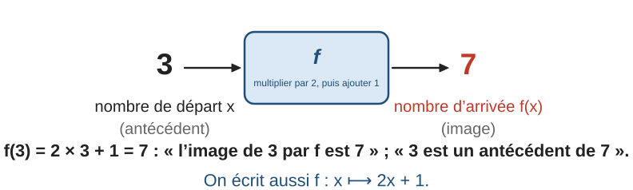
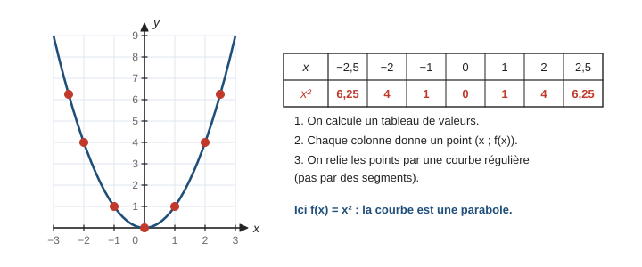
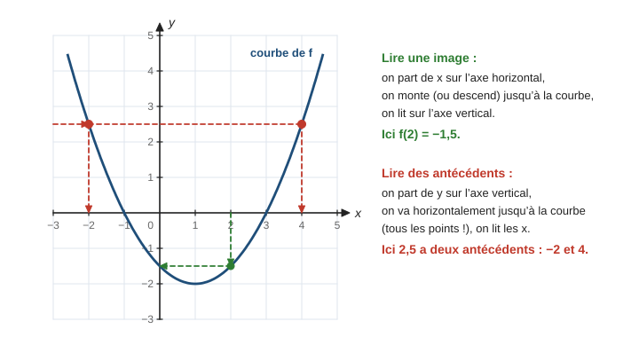
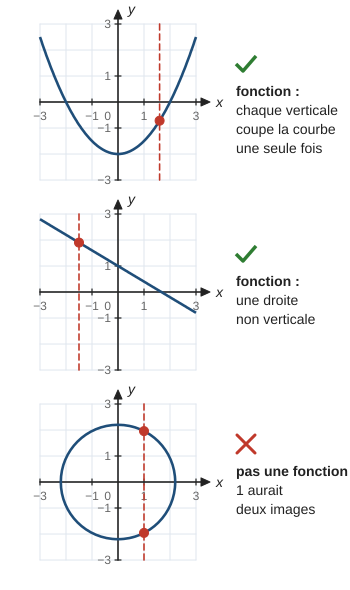
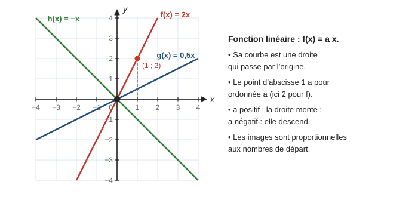
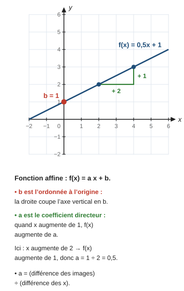
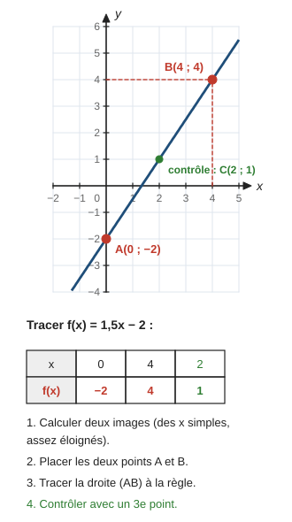
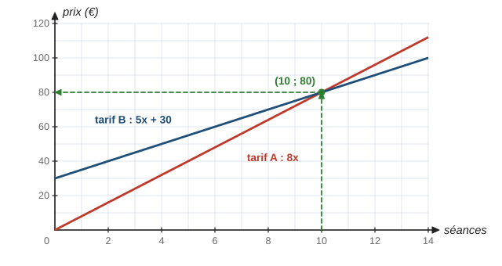
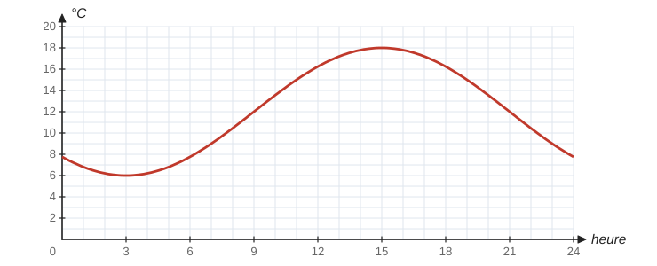
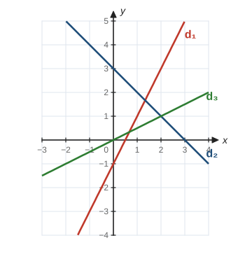

# Fonctions

> Compendium collège — chapitre unifié (sans découpage 6e / 5e / 4e / 3e).  
> Cours compact pour un élève de niveau moyen : intuition, méthode, exemples guidés, erreurs fréquentes, puis exercices progressifs (★ facile, ★★ standard, ★★★ approfondissement) avec corrigés détaillés.

---

## 0. Ce qu’on vise

**En une phrase :** une fonction est une **machine** qui, à chaque nombre de départ, associe **un seul** nombre d’arrivée. On peut la décrire par une formule, un tableau, un programme de calcul ou un **graphique**, et passer de l’un à l’autre.

À la fin de ce chapitre, je sais :

1. Utiliser le vocabulaire **image**, **antécédent** et la notation $f(x)$.
2. Calculer une image et chercher un antécédent à partir d’une formule.
3. Construire un **tableau de valeurs** et tracer une **courbe**.
4. **Lire** sur un graphique une image et des antécédents.
5. Reconnaître, tracer et déterminer une fonction **linéaire** ($f(x) = ax$) et une fonction **affine** ($f(x) = ax + b$).
6. Utiliser des fonctions pour **modéliser** et comparer deux situations (tarifs, remplissage).

> **Prérequis.** Calculer une expression (chapitre 6, § 2) ; résoudre une équation du premier degré (chapitre 7, § 2) ; proportionnalité (chapitre 5, § 1) ; relatifs (chapitre 3) ; placer un point de coordonnées $(x\,;y)$ dans un repère (abscisse sur l’axe horizontal, ordonnée sur l’axe vertical).

---

## 1. La notion de fonction

### 1.1 Une machine à transformer les nombres

La machine $f$ ci-dessus suit le programme : « multiplier par $2$, puis ajouter $1$ ». Si on y met $3$, il sort $2 \times 3 + 1 = 7$. Si on y met $x$, il sort $2x + 1$.

> **Définition.** Une **fonction** $f$ associe à chaque nombre $x$ (de départ) **un unique** nombre, noté $f(x)$ (on lit « $f$ de $x$ »).
>
> - $f(x)$ est l’**image** de $x$ par $f$.
> - $x$ est **un antécédent** de $f(x)$.
>
> On note $f : x \longmapsto 2x + 1$ ou $f(x) = 2x + 1$.

Un nombre a **toujours une seule image**. En revanche, un nombre peut avoir **plusieurs antécédents**, un seul, ou **aucun**.

> **Erreur fréquente.** Confondre image et antécédent. Moyen de s’en souvenir : l’**image** est ce qui **sort** de la machine ; l’**antécédent** est ce qui était **avant** (« anté » veut dire « avant »). Dans $f(3) = 7$ : $7$ est l’image, $3$ est l’antécédent.

### 1.2 Exemple guidé 1 — image et antécédents par le calcul

**Énoncé.** Soit $f(x) = x^2 - 3$. a) Calculer l’image de $-2$. b) Chercher les antécédents de $6$.

**Réflexion.** a) Image : on remplace $x$ par $-2$ (avec des parenthèses !). b) Antécédent : on cherche les $x$ tels que $f(x) = 6$ ; c’est une **équation**.

**Rédaction.**

> a) $f(-2) = (-2)^2 - 3 = 4 - 3 = 1$. L’image de $-2$ est $1$.
>
> b) On résout $x^2 - 3 = 6$, soit $x^2 = 9$. Les solutions sont $x = 3$ et $x = -3$.  
> Le nombre $6$ a deux antécédents : $3$ et $-3$.

**Contrôle.** $f(3) = 9 - 3 = 6$ et $f(-3) = 9 - 3 = 6$.

> **Méthode — image ou antécédent ?**
> - **Image** de $a$ : on **calcule** $f(a)$ en remplaçant $x$ par $a$, entre parenthèses.
> - **Antécédent(s)** de $b$ : on **résout** l’équation $f(x) = b$ (chapitre 7).

### 1.3 Quatre façons de décrire une fonction

| Représentation | Exemple pour $f(x) = 2x + 1$ | Pratique pour… |
|:--|:--|:--|
| Formule | $f(x) = 2x + 1$ | calculer exactement |
| Programme de calcul | « multiplier par $2$, ajouter $1$ » | expliquer en mots |
| Tableau de valeurs | $x = 0, 1, 2$ donne $1, 3, 5$ | avoir quelques valeurs d’un coup |
| Graphique | une droite | voir l’allure, lire des valeurs approchées |

Avec un **tableur**, on écrit les valeurs de $x$ dans la colonne A et, dans la cellule B2, la formule `=2*A2+1`. En recopiant la formule vers le bas, on obtient tout le tableau de valeurs.

---

## 2. La représentation graphique

### 2.1 Construire une courbe

> **Définition.** Dans un repère, la **courbe représentative** de $f$ est formée de tous les points de coordonnées $(x\,;f(x))$. Un point $M(x\,;y)$ est sur la courbe si et seulement si $y = f(x)$.

> **Erreur fréquente.** Relier les points par des segments à la règle. Entre deux points calculés, la courbe continue de manière **régulière** : on trace à main levée une courbe « arrondie », sauf si l’on sait que c’est une droite (fonctions affines, § 4).

**Exemple guidé 2.** Les points $A(-2\,;7)$ et $B(1\,;2)$ sont-ils sur la courbe de $f(x) = 2x^2 - 1$ ?

> $f(-2) = 2 \times (-2)^2 - 1 = 8 - 1 = 7$ : c’est l’ordonnée de $A$, donc $A$ est sur la courbe.
>
> $f(1) = 2 \times 1^2 - 1 = 1 \neq 2$ : $B$ n’est pas sur la courbe.

### 2.2 Lire une image et des antécédents

> **Méthode — lecture graphique.**
> - **Image** de $a$ : on part de $a$ sur l’axe **horizontal** (axe des abscisses), on va verticalement jusqu’à la courbe, puis on lit l’ordonnée sur l’axe **vertical**.
> - **Antécédents** de $b$ : on part de $b$ sur l’axe **vertical**, on trace la droite horizontale à cette hauteur, on repère **tous** les points d’intersection avec la courbe, et on lit leurs abscisses.
>
> Une lecture graphique donne des valeurs **approchées** : on écrit « environ » si le point n’est pas sur un nœud du quadrillage.

**Exemple guidé 3.** Avec la courbe ci-dessus : a) image de $2$ ; b) antécédents de $2{,}5$ ; c) antécédents de $-2$ et de $-3$.

> a) On part de $2$ sur l’axe des abscisses, on descend jusqu’à la courbe : on lit $f(2) = -1{,}5$.
>
> b) La droite horizontale d’ordonnée $2{,}5$ coupe la courbe en deux points, d’abscisses $-2$ et $4$. Le nombre $2{,}5$ a deux antécédents : $-2$ et $4$.
>
> c) La droite d’ordonnée $-2$ touche la courbe en un seul point (le plus bas), d’abscisse $1$ : un seul antécédent, $1$. La droite d’ordonnée $-3$ ne coupe pas la courbe : $-3$ n’a **aucun** antécédent.

**Contrôle.** La courbe est celle de $f(x) = 0{,}5(x - 1)^2 - 2$ : $f(2) = 0{,}5 - 2 = -1{,}5$ et $f(4) = 0{,}5 \times 9 - 2 = 2{,}5$.

> **Erreur fréquente.** Lire sur le mauvais axe. « Image de $2$ » : le $2$ est sur l’axe **horizontal**. « Antécédents de $2$ » : le $2$ est sur l’axe **vertical**.

### 2.3 Toutes les courbes ne sont pas des fonctions

Comme un nombre n’a qu’**une** image, une droite verticale ne peut couper la courbe d’une fonction qu’en un point au plus.

---

## 3. Les fonctions linéaires

### 3.1 Définition et proportionnalité

> **Définition.** Une fonction **linéaire** est une fonction de la forme $f(x) = ax$, où $a$ est un nombre fixé, appelé **coefficient**.

Les images sont proportionnelles aux nombres de départ, et $a$ est le coefficient de proportionnalité (chapitre 5). Toute situation de proportionnalité se traduit par une fonction linéaire.

### 3.2 Représentation graphique

> **Propriété.** La représentation graphique d’une fonction linéaire $f(x) = ax$ est une **droite qui passe par l’origine** du repère. Le point d’abscisse $1$ a pour ordonnée $a$.
>
> Réciproquement, une droite (non verticale) qui passe par l’origine représente une fonction linéaire.

### 3.3 Exemple guidé 4 — trouver le coefficient

**Énoncé.** a) Des pommes coûtent $2{,}40$ € le kilogramme. Exprimer le prix $p(x)$ de $x$ kilogrammes, puis calculer $p(3{,}5)$. b) Un magasin fait une remise de $20\,\%$. Exprimer le prix après remise $r(x)$ d’un article qui coûtait $x$ euros. Un article coûte $64$ € après remise : quel était son prix ?

**Réflexion.** Dans les deux cas, le résultat est proportionnel au nombre de départ : fonctions linéaires. Une remise de $20\,\%$ revient à multiplier par $1 - 0{,}20 = 0{,}8$.

**Rédaction.**

> a) Le prix est proportionnel à la masse : $p(x) = 2{,}4x$. Donc $p(3{,}5) = 2{,}4 \times 3{,}5 = 8{,}4$ : $3{,}5\,\mathrm{kg}$ coûtent $8{,}40$ €.
>
> b) $r(x) = 0{,}8x$. On cherche l’antécédent de $64$ : $0{,}8x = 64$, donc $x = 64 \div 0{,}8 = 80$. L’article coûtait $80$ €.

**Contrôle.** $20\,\%$ de $80$ font $16$, et $80 - 16 = 64$.

> **Méthode — déterminer une fonction linéaire.** Si l’on connaît une image, $f(x_0) = y_0$ avec $x_0 \neq 0$, alors $a = \dfrac{y_0}{x_0}$. Exemple : $f(5) = 20$ donne $a = \dfrac{20}{5} = 4$ et $f(x) = 4x$.

---

## 4. Les fonctions affines

### 4.1 Définition

> **Définition.** Une fonction **affine** est une fonction de la forme $f(x) = ax + b$, où $a$ et $b$ sont deux nombres fixés.
>
> - Si $b = 0$ : $f(x) = ax$, la fonction est **linéaire** (cas particulier).
> - Si $a = 0$ : $f(x) = b$, la fonction est **constante**.

Exemples : $f(x) = 3x - 5$ ($a = 3$, $b = -5$) ; $g(x) = 7 - 2x$ ($a = -2$, $b = 7$) ; $h(x) = x^2 + 1$ n’est **pas** affine (à cause de $x^2$).

### 4.2 Représentation graphique : le rôle de $a$ et de $b$

> **Propriété.** La représentation graphique d’une fonction affine $f(x) = ax + b$ est une **droite**.
>
> - $b = f(0)$ est l’**ordonnée à l’origine** : la droite coupe l’axe vertical au point $(0\,;b)$.
> - $a$ est le **coefficient directeur** : quand $x$ augmente de $1$, $f(x)$ augmente de $a$. Si $a > 0$, la droite « monte » ; si $a < 0$, elle « descend » ; si $a = 0$, elle est horizontale.

> **Propriété (accroissements).** Les accroissements des images sont proportionnels aux accroissements des nombres de départ :
>
> $$a = \dfrac{f(x_2) - f(x_1)}{x_2 - x_1}$$

### 4.3 Exemple guidé 5 — tracer une droite

**Énoncé.** Tracer la représentation graphique de $f(x) = 1{,}5x - 2$.

**Réflexion.** C’est une fonction affine : sa courbe est une droite, deux points suffisent. On choisit des abscisses simples et assez éloignées.

**Rédaction.**

> $f$ est affine, donc sa représentation graphique est une droite.  
> $f(0) = -2$ et $f(4) = 1{,}5 \times 4 - 2 = 4$. Je place $A(0\,;-2)$ et $B(4\,;4)$ et je trace la droite $(AB)$.

**Contrôle.** $f(2) = 1$ : le point $C(2\,;1)$ doit être sur la droite, et il l’est.

### 4.4 Exemple guidé 6 — retrouver $a$ et $b$

**Énoncé.** $f$ est une fonction affine telle que $f(2) = 7$ et $f(5) = 13$. Déterminer $f(x)$.

**Réflexion.** On calcule d’abord $a$ avec les accroissements, puis $b$ en utilisant une des deux valeurs.

**Rédaction.**

> $f$ est affine : $f(x) = ax + b$.
>
> $$a = \dfrac{f(5) - f(2)}{5 - 2} = \dfrac{13 - 7}{3} = 2$$
>
> Donc $f(x) = 2x + b$. Comme $f(2) = 7$ : $2 \times 2 + b = 7$, donc $b = 3$.  
> Conclusion : $f(x) = 2x + 3$.

**Contrôle.** $f(5) = 2 \times 5 + 3 = 13$. ✓

> **Erreur fréquente.** Inverser le quotient : $\dfrac{5 - 2}{13 - 7}$. Le coefficient directeur se calcule « **différence des images** sur **différence des $x$** », et dans le même ordre en haut et en bas.

---

## 5. Modéliser et comparer

Beaucoup de situations de la vie courante se modélisent par des fonctions affines : un **montant fixe** (abonnement, prise en charge) plus un **montant proportionnel** (prix par séance, par kilomètre).

**Exemple guidé 7.** Un cinéma propose deux tarifs. Tarif A : $8$ € la séance. Tarif B : abonnement de $30$ € par an, puis $5$ € la séance. a) Exprimer le prix annuel pour $x$ séances avec chaque tarif. b) Pour combien de séances les deux tarifs coûtent-ils la même chose ? c) Quel tarif choisir ?

**Réflexion.** A est proportionnel au nombre de séances (linéaire) ; B a une partie fixe (affine). L’égalité des prix est une équation ; graphiquement, c’est l’intersection des droites.

**Rédaction.**

> a) $A(x) = 8x$ et $B(x) = 5x + 30$.
>
> b) On résout $8x = 5x + 30$, soit $3x = 30$, donc $x = 10$. Pour $10$ séances, les deux tarifs coûtent $8 \times 10 = 80$ €.
>
> c) Sur le graphique, la droite de A est **en dessous** de celle de B avant $10$ séances, au-dessus après. Le tarif A est plus avantageux pour moins de $10$ séances, le tarif B pour plus de $10$ séances.

**Contrôle.** Pour $12$ séances : A coûte $96$ €, B coûte $5 \times 12 + 30 = 90$ €. B est bien moins cher.

> **Méthode — comparer deux situations.**
> 1. Nommer la variable ($x$ = nombre de séances…) et écrire chaque fonction.
> 2. Résoudre l’équation $f(x) = g(x)$ : c’est le point de bascule.
> 3. Conclure avec une phrase, en s’aidant du graphique (quelle droite est en dessous ?).

---

## 6. Mini-synthèse

> **À retenir.**
>
> - Une fonction associe à chaque $x$ **une seule** image $f(x)$. Un nombre peut avoir $0$, $1$ ou plusieurs antécédents.
> - Image : on **calcule** $f(a)$ ou on lit à partir de l’axe horizontal. Antécédents : on **résout** $f(x) = b$ ou on lit à partir de l’axe vertical.
> - $M(x\,;y)$ est sur la courbe de $f$ si et seulement si $y = f(x)$.
> - Linéaire : $f(x) = ax$, droite passant par l’origine, situation de proportionnalité ; $a = \dfrac{f(x_0)}{x_0}$.
> - Affine : $f(x) = ax + b$, droite ; $b$ = ordonnée à l’origine, $a$ = coefficient directeur $= \dfrac{f(x_2) - f(x_1)}{x_2 - x_1}$.
> - Pour tracer une droite : deux points (et un troisième pour contrôler).

---

## 7. Exercices types

> Objectif : automatismes. Difficulté croissante dans chaque série. Corrigés détaillés au § 9.

### A. Image, antécédent, notation (★)

**A1.** Soit $f(x) = 3x - 5$. Calculer $f(0)$, $f(2)$, $f(-1)$ et $f\left(\dfrac{5}{3}\right)$.

**A2.** Soit $f(x) = 3x - 5$. Trouver l’antécédent de $4$, de $-5$ et de $0$.

**A3.** Soit $g(x) = x^2$. Calculer les images de $-3$ et de $3$. Chercher les antécédents de $9$, puis de $-1$.

**A4.** Programme de calcul : « Choisir un nombre ; ajouter $3$ ; multiplier le résultat par $2$. » On note $f(x)$ le résultat obtenu avec le nombre $x$. a) Exprimer $f(x)$ et le développer. b) Calculer l’image de $4$ et celle de $-5$. c) Quel nombre faut-il choisir pour obtenir $0$ ? Pour obtenir $20$ ?

**A5.** Traduire chaque phrase par une égalité : a) l’image de $2$ par $f$ est $7$ ; b) $-1$ a pour image $4$ par $g$ ; c) un antécédent de $0$ par $h$ est $5$. Puis traduire en phrase : d) $f(-3) = 1$.

### B. Tableaux et graphiques (★ → ★★)

**B1.** Compléter le tableau de valeurs de $f(x) = 2x + 1$ pour $x = -2$, $-1$, $0$, $1$, $2$.

**B2.** Le graphique ci-dessous donne la température (en °C) relevée dans une ville au cours d’une journée.

a) Quelle température faisait-il à $3\,\mathrm{h}$ ? à $15\,\mathrm{h}$ ? b) À quelles heures faisait-il $12$ °C ? $15$ °C ? c) Quelle a été la température maximale, et à quelle heure ? d) Dans cette situation, quel est le nombre de départ ? l’image ?

**B3.** (★★) Soit $h(x) = x^2 - 4x + 3$. a) Compléter un tableau de valeurs pour $x = 0$, $1$, $2$, $3$, $4$. b) Placer les points et tracer l’allure de la courbe. c) Lire les antécédents de $0$.

**B4.** Soit $f(x) = x^2 - 3$. Les points $A(2\,;1)$, $B(-1\,;-1)$ et $C(-3\,;6)$ sont-ils sur la courbe de $f$ ?

### C. Fonctions linéaires (★ → ★★)

**C1.** $f(x) = -0{,}5x$. a) Calculer $f(8)$ et $f(-2)$. b) Trouver l’antécédent de $3$. c) La droite qui représente $f$ monte-t-elle ou descend-elle ?

**C2.** $f$ est linéaire et $f(5) = 20$. Exprimer $f(x)$, puis calculer $f(3)$ et l’antécédent de $30$.

**C3.** Les situations suivantes peuvent-elles être modélisées par une fonction linéaire ? a) Le prix payé en fonction de la masse de fruits achetés (prix au kilo fixé). b) Le prix d’une course de taxi (prise en charge + prix au kilomètre) en fonction de la distance. c) Le périmètre d’un carré en fonction de son côté. d) L’aire d’un carré en fonction de son côté.

**C4.** Associer chaque droite à sa fonction : $f_1(x) = 0{,}5x$ ; $f_2(x) = -x + 3$ ; $f_3(x) = 2x - 1$. Laquelle de ces fonctions est linéaire ?

**C5.** (★★) Le prix d’un abonnement augmente de $15\,\%$. a) Exprimer le nouveau prix $f(x)$ en fonction de l’ancien prix $x$. b) Un abonnement coûtait $80$ € : nouveau prix ? c) Un abonnement coûte maintenant $69$ € : quel était son prix avant ?

### D. Fonctions affines (★ → ★★)

**D1.** $f(x) = 2x + 3$. Donner le coefficient directeur et l’ordonnée à l’origine. Calculer $f(0)$ et $f(-2)$.

**D2.** Déterminer la fonction affine $f$ dont la droite passe par $A(0\,;4)$ et $B(2\,;0)$.

**D3.** Déterminer la fonction affine $f$ telle que $f(1) = 5$ et $f(3) = 1$.

**D4.** Tracer dans un repère la droite qui représente $g(x) = -0{,}5x + 2$. Indiquer les deux points utilisés et un point de contrôle.

**D5.** (★★) a) Résoudre l’équation $2x + 3 = 7$. b) Expliquer comment on peut trouver cette solution avec la droite qui représente $f(x) = 2x + 3$.

### E. Problèmes (★★)

**E1.** Un forfait téléphonique coûte $8$ € par mois, plus $0{,}12$ € par SMS envoyé. a) Exprimer le coût $C(n)$ pour $n$ SMS. b) Calculer le coût pour $50$ SMS. c) Combien de SMS a-t-on envoyés si l’on paie $20$ € ?

**E2.** Une fonction affine vérifie $f(2) = 5$ et $f(6) = 13$. Calculer $f(0)$ et $f(10)$.

**E3.** Une cuve se vide : sa hauteur d’eau, en cm, est $h(t) = 80 - 4t$, où $t$ est le temps en minutes. a) Que représentent $80$ et $-4$ ? b) Calculer $h(5)$. c) Au bout de combien de temps la cuve est-elle vide ?

**E4.** Un taxi facture $4$ € de prise en charge et $1{,}50$ € par kilomètre. a) Exprimer le prix $P(d)$ pour $d$ kilomètres. b) Prix d’une course de $10\,\mathrm{km}$ ? c) Quelle distance a-t-on parcourue pour $25$ € ?

---

## 8. Exercices atypiques

> Objectif : comprendre, raisonner, rédiger. Plusieurs étapes, erreurs à trouver, questions ouvertes.

### F. Trouver l’erreur (★★)

**F1.** Pour $f(x) = x^2$, Tom écrit : « $f(-3) = -3^2 = -9$. » Trouver l’erreur.

**F2.** Avec la courbe du § 2.2, Léo écrit : « L’image de $2{,}5$ est $-2$ et $4$. » Qu’a-t-il confondu ? Que vaut réellement l’image de $2{,}5$ (calculer avec $f(x) = 0{,}5(x - 1)^2 - 2$) ?

**F3.** Pour la droite passant par $A(1\,;2)$ et $B(3\,;8)$, Nina calcule : « $a = \dfrac{3 - 1}{8 - 2} = \dfrac{1}{3}$. » Corriger.

**F4.** Sami affirme : « $f(x) = 3x + 2$ est linéaire, puisque sa courbe est une droite. » Qu’en penser ? Donner deux arguments.

**F5.** Lina écrit : « $f$ est linéaire et $f(2) = 6$. De $2$ à $5$, on ajoute $3$, donc $f(5) = 6 + 3 = 9$. » Trouver l’erreur et calculer $f(5)$.

### G. Comprendre et raisonner (★★ → ★★★)

**G1.** Dans chaque cas, définit-on une fonction (chaque élément de départ a-t-il une seule image) ? a) À chaque élève de la classe, on associe sa date de naissance. b) À chaque date de l’année, on associe les élèves de la classe nés ce jour-là. c) À chaque nombre, on associe son carré. d) À chaque nombre positif, on associe les nombres dont il est le carré.

**G2.** Avec $g(x) = x^2$ : a) un nombre peut-il avoir deux images ? b) un nombre peut-il avoir deux antécédents ? aucun ? Donner des exemples.

**G3.** a) Les tableaux suivants peuvent-ils être ceux d’une fonction affine ? Tableau 1 : $x = 0, 1, 2, 3$ donne $4, 7, 10, 13$. Tableau 2 : $x = 0, 1, 2, 3$ donne $0, 1, 4, 9$. b) (★★★) Expliquer pourquoi, pour une fonction affine, $f(2) - f(1) = f(1) - f(0)$.

**G4.** (★★★) $f(x) = ax + b$. Pour quelles valeurs de $a$ et $b$ a-t-on $f(x_1 + x_2) = f(x_1) + f(x_2)$ pour tous les nombres $x_1$ et $x_2$ ?

### H. Plusieurs étapes (★★★)

**H1.** Salle de sport A : $15$ € par mois plus $3$ € par séance. Salle B : $6$ € par séance, sans abonnement. a) Exprimer le prix mensuel $A(x)$ et $B(x)$ pour $x$ séances. b) Comparer les prix pour $4$ séances. c) Pour combien de séances les prix sont-ils égaux ? d) Conseiller une personne qui va $8$ fois par mois à la salle.

**H2.** Soit $f(x) = x^2$ et $g(x) = 2x$. a) Calculer $f(x)$ et $g(x)$ pour $x = 0$, $1$, $2$, $3$. b) Trouver les points communs aux deux courbes en résolvant $x^2 = 2x$ (factoriser).

**H3.** La cuve A se vide : $h_A(t) = 80 - 4t$. La cuve B se remplit : $h_B(t) = 2t + 20$ (hauteurs en cm, $t$ en minutes). a) Quelle cuve contient le plus d’eau au départ ? b) À quel instant les hauteurs sont-elles égales ? Quelle est alors la hauteur ? c) Interpréter graphiquement.

**H4.** Dans un tableur, la colonne A contient les nombres de $-3$ à $3$ (cellules A2 à A8) et on tape en B2 la formule `=3*A2-5`, recopiée vers le bas. a) Quelle fonction calcule-t-on ? b) Qu’affiche B2 ? Qu’afficherait une cellule de la colonne B en face du nombre $4$ ? c) Quelle formule taper en C2 pour calculer $g(x) = x^2 - 1$ ? d) Quel nombre a pour image $10$ par la fonction de la colonne B ?

### I. Ouvert (★★)

**I1.** Inventer un programme de calcul qui correspond à une fonction affine non linéaire. Écrire $f(x)$, un tableau de quatre valeurs, et tracer la droite.

**I2.** Dessiner une courbe qui n’est pas la représentation graphique d’une fonction, et expliquer pourquoi avec le vocabulaire « image ».

**I3.** Trouver deux points d’une droite dont le coefficient directeur est $-\dfrac{1}{2}$ et l’ordonnée à l’origine $3$. Écrire la fonction affine correspondante.

**I4.** À l’aide du graphique de température (exercice B2), raconter la journée en quatre phrases, en utilisant les mots « augmente », « diminue », « maximum » et « minimum ».

---

## 9. Corrigés

> Les corrigés marqués **(modèle)** montrent la rédaction attendue. Les autres donnent les étapes clés.

### Exercices types

**A1.** $f(0) = -5$ ; $f(2) = 6 - 5 = 1$ ; $f(-1) = -3 - 5 = -8$ ; $f\left(\dfrac{5}{3}\right) = 5 - 5 = 0$.

**A2. (modèle)**
> On résout $f(x) = 4$ : $3x - 5 = 4$, donc $3x = 9$ et $x = 3$. L’antécédent de $4$ est $3$.  
> $3x - 5 = -5$ donne $3x = 0$, donc $x = 0$.  
> $3x - 5 = 0$ donne $3x = 5$, donc $x = \dfrac{5}{3}$.

**A3.** $g(-3) = (-3)^2 = 9$ et $g(3) = 9$. Antécédents de $9$ : $3$ et $-3$. $-1$ n’a pas d’antécédent : un carré n’est jamais négatif.

**A4.** a) $f(x) = (x + 3) \times 2 = 2x + 6$. b) $f(4) = 14$ ; $f(-5) = -4$. c) $2x + 6 = 0$ donne $x = -3$ ; $2x + 6 = 20$ donne $x = 7$.

**A5.** a) $f(2) = 7$. b) $g(-1) = 4$. c) $h(5) = 0$. d) « L’image de $-3$ par $f$ est $1$ » ou « $-3$ est un antécédent de $1$ par $f$ ».

**B1.** $f(-2) = -3$ ; $f(-1) = -1$ ; $f(0) = 1$ ; $f(1) = 3$ ; $f(2) = 5$.

**B2. (modèle)**
> a) On part de $3$ sur l’axe des heures et on lit : il faisait $6$ °C à $3\,\mathrm{h}$, et $18$ °C à $15\,\mathrm{h}$.  
> b) La droite horizontale d’ordonnée $12$ coupe la courbe en deux points : il faisait $12$ °C à $9\,\mathrm{h}$ et à $21\,\mathrm{h}$. De même, il faisait $15$ °C à $11\,\mathrm{h}$ et à $19\,\mathrm{h}$.  
> c) Le point le plus haut de la courbe a pour coordonnées $(15\,;18)$ : la température maximale est $18$ °C, à $15\,\mathrm{h}$.  
> d) Le nombre de départ est l’heure ; l’image est la température à cette heure.

**B3.** a) $h(0) = 3$ ; $h(1) = 0$ ; $h(2) = -1$ ; $h(3) = 0$ ; $h(4) = 3$. b) Courbe « en U » (parabole) dont le point le plus bas est $(2\,;-1)$. c) Les antécédents de $0$ sont $1$ et $3$.

**B4.** $f(2) = 4 - 3 = 1$ : $A$ est sur la courbe. $f(-1) = 1 - 3 = -2 \neq -1$ : $B$ n’y est pas. $f(-3) = 9 - 3 = 6$ : $C$ est sur la courbe.

**C1.** a) $f(8) = -4$ ; $f(-2) = 1$. b) $-0{,}5x = 3$ donne $x = -6$. c) $a = -0{,}5$ est négatif : la droite descend.

**C2.** $a = \dfrac{20}{5} = 4$, donc $f(x) = 4x$. $f(3) = 12$. $4x = 30$ donne $x = 7{,}5$.

**C3.** a) Oui : le prix est proportionnel à la masse. b) Non : à cause de la prise en charge, la distance $0$ ne coûte pas $0$ € (fonction affine). c) Oui : $P = 4c$. d) Non : $\mathcal{A} = c^2$ n’est pas proportionnelle à $c$ (doubler le côté multiplie l’aire par $4$).

**C4. (modèle)**
> $d_3$ passe par l’origine : c’est la droite de la fonction linéaire $f_1(x) = 0{,}5x$ (contrôle : elle passe par $(2\,;1)$).  
> $d_2$ descend et coupe l’axe vertical en $3$ : $f_2(x) = -x + 3$.  
> $d_1$ monte fortement et coupe l’axe vertical en $-1$ : $f_3(x) = 2x - 1$ (contrôle : elle passe par $(1\,;1)$).  
> Seule $f_1$ est linéaire.

**C5.** a) Augmenter de $15\,\%$ revient à multiplier par $1{,}15$ : $f(x) = 1{,}15x$. b) $f(80) = 92$ €. c) $1{,}15x = 69$ donne $x = 69 \div 1{,}15 = 60$ €.

**D1.** $a = 2$ ; $b = 3$ ; $f(0) = 3$ ; $f(-2) = -1$.

**D2.** $b = f(0) = 4$ ; $a = \dfrac{0 - 4}{2 - 0} = -2$. Donc $f(x) = -2x + 4$.

**D3. (modèle)**
> $f$ est affine : $f(x) = ax + b$, avec $a = \dfrac{f(3) - f(1)}{3 - 1} = \dfrac{1 - 5}{2} = -2$.  
> Donc $f(x) = -2x + b$. Comme $f(1) = 5$ : $-2 + b = 5$, donc $b = 7$.  
> Conclusion : $f(x) = -2x + 7$. Contrôle : $f(3) = -6 + 7 = 1$.

**D4.** $g(0) = 2$ et $g(4) = 0$ : on trace la droite passant par $(0\,;2)$ et $(4\,;0)$. Contrôle : $g(2) = 1$, le point $(2\,;1)$ est sur la droite.

**D5.** a) $2x = 4$, donc $x = 2$. b) On cherche l’antécédent de $7$ par $f$ : on trace la droite horizontale d’ordonnée $7$ ; elle coupe la droite de $f$ au point d’abscisse $2$.

**E1.** a) $C(n) = 0{,}12n + 8$. b) $C(50) = 6 + 8 = 14$ €. c) $0{,}12n + 8 = 20$, donc $0{,}12n = 12$ et $n = 100$ SMS.

**E2. (modèle)**
> $a = \dfrac{13 - 5}{6 - 2} = \dfrac{8}{4} = 2$. Avec $f(2) = 5$ : $4 + b = 5$, donc $b = 1$ et $f(x) = 2x + 1$.  
> $f(0) = 1$ et $f(10) = 21$.

**E3.** a) $80$ est la hauteur au départ ($h(0) = 80\,\mathrm{cm}$) ; $-4$ signifie que la hauteur baisse de $4\,\mathrm{cm}$ par minute. b) $h(5) = 60\,\mathrm{cm}$. c) $80 - 4t = 0$ donne $t = 20$ : vide au bout de $20$ minutes.

**E4.** a) $P(d) = 1{,}5d + 4$. b) $P(10) = 19$ €. c) $1{,}5d + 4 = 25$, donc $1{,}5d = 21$ et $d = 14\,\mathrm{km}$.

### Exercices atypiques

**F1. (modèle)**
> Tom a oublié les parenthèses : $-3^2$ signifie $-(3^2) = -9$. Il faut remplacer $x$ par $(-3)$ :
>
> $$f(-3) = (-3)^2 = (-3) \times (-3) = 9$$

**F2.** Léo a confondu image et antécédent : $-2$ et $4$ sont les **antécédents** de $2{,}5$. L’image de $2{,}5$ se lit à partir de $2{,}5$ sur l’axe horizontal : $f(2{,}5) = 0{,}5 \times 1{,}5^2 - 2 = -0{,}875$, soit environ $-0{,}9$.

**F3.** Le coefficient directeur est « différence des images » sur « différence des abscisses » : $a = \dfrac{8 - 2}{3 - 1} = \dfrac{6}{2} = 3$.

**F4.** C’est faux : $f$ est affine mais **pas** linéaire. Premier argument : $f(0) = 2 \neq 0$, la droite ne passe pas par l’origine. Second argument : les images ne sont pas proportionnelles, par exemple $f(1) = 5$ et $f(2) = 8$, alors que $8 \neq 2 \times 5$.

**F5.** Pour une fonction linéaire, on **multiplie** par le coefficient, on n’ajoute pas : $a = \dfrac{6}{2} = 3$, donc $f(5) = 3 \times 5 = 15$.

**G1.** a) Oui : chaque élève a une seule date de naissance. b) Non : une date peut correspondre à plusieurs élèves, ou à aucun. c) Oui. d) Non : $4$ est le carré de $2$ et de $-2$, il aurait deux « images ».

**G2.** a) Non, jamais : c’est la définition d’une fonction ($g(3) = 9$ et seulement $9$). b) Oui : $9$ a deux antécédents, $3$ et $-3$ ; $0$ en a un seul ; $-4$ n’en a aucun.

**G3. (modèle)**
> a) Tableau 1 : de $4$ à $7$, de $7$ à $10$, de $10$ à $13$, les images augmentent toujours de $3$ quand $x$ augmente de $1$. C’est la fonction affine $f(x) = 3x + 4$.  
> Tableau 2 : les images augmentent de $1$, puis $3$, puis $5$ : les accroissements ne sont pas constants, ce n’est pas une fonction affine (c’est $x^2$).  
> b) $f(2) - f(1) = (2a + b) - (a + b) = a$ et $f(1) - f(0) = (a + b) - b = a$. Les deux différences valent $a$.

**G4.** $f(x_1 + x_2) = a x_1 + a x_2 + b$ et $f(x_1) + f(x_2) = a x_1 + a x_2 + 2b$. L’égalité équivaut à $b = 2b$, donc $b = 0$ ($a$ quelconque) : seules les fonctions linéaires conviennent.

**H1. (modèle)**
> a) $A(x) = 3x + 15$ et $B(x) = 6x$.  
> b) $A(4) = 12 + 15 = 27$ € et $B(4) = 24$ € : la salle B est moins chère pour $4$ séances.  
> c) $3x + 15 = 6x$ donne $15 = 3x$, donc $x = 5$. Pour $5$ séances, les deux salles coûtent $30$ €.  
> d) $A(8) = 39$ € et $B(8) = 48$ € : pour $8$ séances, il vaut mieux choisir la salle A. Au-delà de $5$ séances par mois, A est la plus avantageuse.

**H2.** a) $f$ : $0$, $1$, $4$, $9$ ; $g$ : $0$, $2$, $4$, $6$. b) $x^2 = 2x$ équivaut à $x^2 - 2x = 0$, soit $x(x - 2) = 0$ : $x = 0$ ou $x = 2$. Points communs : $(0\,;0)$ et $(2\,;4)$.

**H3.** a) $h_A(0) = 80$ et $h_B(0) = 20$ : la cuve A. b) $80 - 4t = 2t + 20$ donne $60 = 6t$, donc $t = 10$ minutes ; hauteur $h_A(10) = 40\,\mathrm{cm}$. c) Les deux droites (l’une descend, l’autre monte) se coupent au point $(10\,;40)$.

**H4.** a) $f(x) = 3x - 5$. b) B2 contient $f(-3) = -14$ ; en face de $4$, on lirait $f(4) = 7$. c) `=A2^2-1` (ou `=A2*A2-1`). d) $3x - 5 = 10$ donne $x = 5$.

**I1.** Exemple : « Choisir un nombre, le multiplier par $3$, enlever $2$. » $f(x) = 3x - 2$ ; tableau : $x = 0, 1, 2, 3$ donne $-2, 1, 4, 7$ ; la droite passe par $(0\,;-2)$ et $(2\,;4)$.

**I2.** Exemple : un cercle de centre l’origine et de rayon $2$. La droite verticale d’abscisse $1$ le coupe en deux points : le nombre $1$ aurait deux images, ce qui est impossible pour une fonction.

**I3.** $b = 3$ : la droite passe par $(0\,;3)$. Avec $a = -\dfrac{1}{2}$, quand $x$ augmente de $2$, $y$ diminue de $1$ : elle passe par $(2\,;2)$ (et aussi par $(6\,;0)$). Fonction : $f(x) = -0{,}5x + 3$.

**I4.** Exemple : « La nuit, la température diminue et atteint son minimum, $6$ °C, vers $3\,\mathrm{h}$. Elle augmente ensuite toute la matinée et le début d’après-midi. Elle atteint son maximum, $18$ °C, vers $15\,\mathrm{h}$. Puis elle diminue jusqu’à environ $8$ °C à minuit. »

---

## 10. Liens avec les autres chapitres

- **Chapitre 5** (proportionnalité, pourcentages) : fonctions linéaires, coefficient multiplicateur d’une hausse ou d’une baisse (exemple 4, C5).
- **Chapitre 6** (calcul littéral) : programmes de calcul, développement, factorisation (A4, H2).
- **Chapitre 7** (équations) : chercher un antécédent revient à résoudre une équation ; comparer deux fonctions affines (exemple 7, H1, H3).
- **Chapitre 3** (nombres relatifs) : calculs avec des nombres négatifs, points d’abscisse ou d’ordonnée négative.
- **Chapitre 12** (Thalès) : la droite d’une fonction linéaire passe par l’origine ; sur cette droite, $\dfrac{y}{x}$ est constant, comme les rapports de Thalès.
- **Chapitre 16** (statistiques) : lecture de graphiques de données.

---

## 11. Fiche-synthèse

| Je dois savoir… | Comment | Exemple express | S’entraîner |
|---|---|---|---|
| Calculer une image | remplacer $x$ par le nombre | $f(x) = 2x^2 - 1$ : $f(3) = 17$ | série A |
| Trouver un antécédent | résoudre $f(x) = b$, ou lire depuis l’axe vertical | $g(x) = 3x - 4$ ; $g(x) = 11$ donne $x = 5$ | séries A et B |
| Lire un graphique | image : partir de l’axe horizontal ; antécédents : partir de l’axe vertical | $f(2)$ : monter depuis $2$ jusqu’à la courbe, lire l’ordonnée | série B |
| Fonction linéaire | $f(x) = ax$ avec $a = \dfrac{f(x_0)}{x_0}$ | $f(4) = 10$ donne $a = 2{,}5$ | série C |
| Fonction affine | $a = \dfrac{f(x_2) - f(x_1)}{x_2 - x_1}$, puis $b$ | $f(1) = 5$ et $f(3) = 9$ : $a = 2$, $b = 3$ | série D |
| Tracer une droite | deux points, et un troisième pour contrôler | $f(x) = -x + 3$ : $(0\,;3)$ et $(3\,;0)$ | séries D et E |

**Pièges à éviter :** ne pas confondre image et antécédent ; $f(3)$ n’est pas « $f \times 3$ » ; un point s’écrit $(x\,;y)$, abscisse d’abord.

---

*Version v0.3 — relecture (prérequis harmonisés, fiche-synthèse, corrections : voir `PLAN-REVISION.md`, § 10). Base : v0.2 — révision vague 2 (cours développé : notion de fonction, lecture graphique, linéaire, affine, modélisation ; 10 graphiques SVG ; 40 exercices corrigés). Ancienne version : `cours-et-exercices.md.bak` (et `cours-et-exercices.md.phase0.bak` après les corrections ponctuelles).*
