# Géométrie plane — droites, angles, triangles, quadrilatères, cercle

> Compendium collège — chapitre unifié (sans découpage 6e / 5e / 4e / 3e).  
> Cours compact pour un élève de niveau moyen : intuition, méthode, exemples guidés, erreurs fréquentes, puis exercices progressifs (★ facile, ★★ standard, ★★★ approfondissement) avec corrigés détaillés.

---

## 0. Ce qu’on vise

**En une phrase :** en géométrie, on ne « voit » pas un résultat sur le dessin, on le **démontre** à partir de propriétés connues ; le dessin sert à chercher, la propriété sert à prouver.

À la fin de ce chapitre, je sais :

1. Utiliser le vocabulaire (droite, segment, demi-droite, distance) et les **propriétés des parallèles et des perpendiculaires**.
2. Reconnaître des **paires d’angles** (complémentaires, supplémentaires, opposés par le sommet, alternes-internes, correspondants) et m’en servir pour calculer un angle ou prouver un parallélisme.
3. Savoir si un triangle est **constructible** (inégalité triangulaire) et le construire à la règle et au compas.
4. Utiliser la **somme des angles** d’un triangle ($180^\circ$) et les propriétés des triangles particuliers.
5. Construire et utiliser les **droites remarquables** : médiatrice (cercle circonscrit), hauteur, bissectrice, médiane (qui partage le triangle en deux triangles de même aire) ; utiliser la **droite des milieux**.
6. Reconnaître un **parallélogramme**, un rectangle, un losange, un carré.
7. Utiliser le cercle : tangente, triangle inscrit dans un demi-cercle, angle inscrit (★★★).
8. Rédiger une démonstration courte : « **On sait que** … **Or** … **Donc** … ».

> **Prérequis.** Savoir utiliser la règle, l’équerre, le compas et le rapporteur. Le théorème de Pythagore (chapitre 11, § 3) sert dans l’exemple guidé 10 et dans quelques exercices ★★.

---

## 1. Droites

### 1.1 Vocabulaire et notations

| Objet | Notation | Ce que c’est |
|:-:|:-:|---|
| Droite | $(AB)$ | illimitée des deux côtés, passe par $A$ et $B$ |
| Segment | $[AB]$ | la portion de droite entre $A$ et $B$ |
| Demi-droite | $[AB)$ | part de $A$ (origine) et passe par $B$, illimitée d’un côté |
| Longueur | $AB$ | un **nombre** : la longueur du segment $[AB]$ |

> **Erreur fréquente.** Écrire « $[AB] = 5\,\mathrm{cm}$ ». Un segment est un objet, pas un nombre : on écrit $AB = 5\,\mathrm{cm}$.

### 1.2 Positions de deux droites

Deux droites du plan sont soit **sécantes** (un seul point commun), soit **parallèles** (aucun point commun, ou confondues). Deux droites sécantes qui forment un angle droit sont **perpendiculaires**.

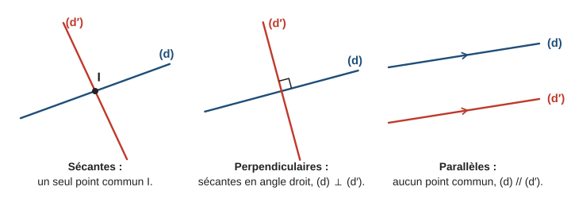

> **Erreur fréquente.** Deux droites qui ne se coupent pas **sur la feuille** ne sont pas forcément parallèles : prolongées, elles peuvent se couper plus loin. Le parallélisme se **prouve**, il ne se constate pas.

### 1.3 Trois propriétés à connaître par cœur

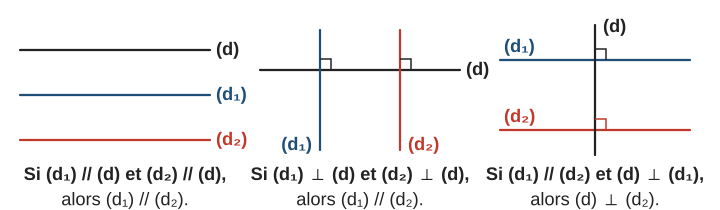

> **À retenir.**
> - **P1.** Si deux droites sont parallèles à une même troisième, alors elles sont parallèles entre elles.
> - **P2.** Si deux droites sont perpendiculaires à une même troisième, alors elles sont parallèles entre elles.
> - **P3.** Si deux droites sont parallèles et si une troisième est perpendiculaire à l’une, alors elle est perpendiculaire à l’autre.

**Exemple guidé 1.** Les droites $(AB)$ et $(CD)$ sont toutes deux perpendiculaires à une droite $(d)$. La droite $(EF)$ est perpendiculaire à $(CD)$. Que peut-on dire de $(AB)$ et $(CD)$ ? Puis de $(EF)$ et $(AB)$ ?

**Réflexion.** Deux perpendiculaires à une même droite : c’est P2. Ensuite, on a deux parallèles et une perpendiculaire à l’une d’elles : c’est P3.

**Rédaction.**

> On sait que $(AB) \perp (d)$ et $(CD) \perp (d)$. Or, si deux droites sont perpendiculaires à une même droite, alors elles sont parallèles. Donc $(AB) \parallel (CD)$.
>
> On sait que $(AB) \parallel (CD)$ et $(EF) \perp (CD)$. Or, si deux droites sont parallèles, toute perpendiculaire à l’une est perpendiculaire à l’autre. Donc $(EF) \perp (AB)$.

**Contrôle.** Un dessin à main levée confirme : $(AB)$ et $(CD)$ « verticales », $(d)$ et $(EF)$ « horizontales ».

### 1.4 Distance d’un point à une droite

La **distance** du point $A$ à la droite $(d)$ est la longueur $AH$, où $H$ est le **pied de la perpendiculaire** à $(d)$ passant par $A$. C’est la plus courte distance entre $A$ et un point de $(d)$ : pour tout autre point $M$ de $(d)$, $AM > AH$ (dans le triangle $AHM$ rectangle en $H$, l’hypoténuse $[AM]$ est le plus grand côté).

---

## 2. Angles

### 2.1 Mesurer et nommer

L’angle $\widehat{xOy}$ (ou $\widehat{AOB}$) a pour **sommet** $O$ ; la lettre du sommet est toujours **au milieu**. Il est **aigu** (moins de $90^\circ$), **droit** ($90^\circ$), **obtus** (entre $90^\circ$ et $180^\circ$) ou **plat** ($180^\circ$).

### 2.2 Paires d’angles

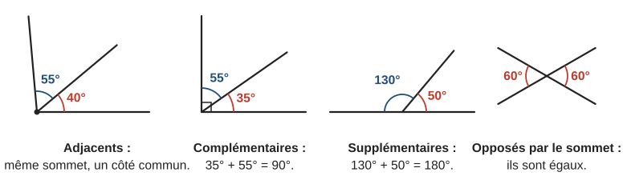

| Paire | Définition | Ce qu’on en tire |
|---|---|---|
| Adjacents | même sommet, un côté commun, de part et d’autre de ce côté | leurs mesures s’**ajoutent** |
| Complémentaires | somme $90^\circ$ | l’un $= 90^\circ -$ l’autre |
| Supplémentaires | somme $180^\circ$ | l’un $= 180^\circ -$ l’autre |
| Opposés par le sommet | formés par deux droites sécantes, « face à face » | ils sont **égaux** |

**Exemple guidé 2.** Deux droites sécantes en $O$ forment quatre angles. L’un mesure $35^\circ$. Trouver les trois autres.

**Réflexion.** Deux angles voisins forment un angle plat : ils sont supplémentaires. Deux angles « face à face » sont opposés par le sommet.

**Rédaction.**

> L’angle opposé par le sommet à l’angle de $35^\circ$ mesure aussi $35^\circ$.
>
> Les deux autres sont supplémentaires de celui-ci : $180^\circ - 35^\circ = 145^\circ$ chacun.

**Contrôle.** $35 + 145 + 35 + 145 = 360$ : on retrouve le tour complet.

### 2.3 Deux droites coupées par une sécante

Une droite $(t)$, la **sécante**, coupe deux droites $(d)$ et $(d')$ en $A$ et $B$. Deux angles sont :

- **alternes-internes** s’ils sont **entre** $(d)$ et $(d')$, **de part et d’autre** de $(t)$, avec des sommets différents ;
- **correspondants** s’ils sont **du même côté** de $(t)$ et occupent la **même position** par rapport à $(d)$ et à $(d')$ (par exemple « au-dessus à droite » tous les deux).

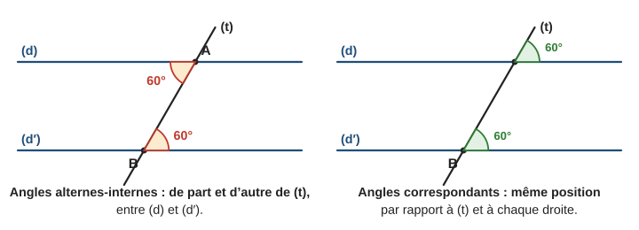

> **À retenir — parallèles et angles.**
> - **Propriété.** Si deux droites **parallèles** sont coupées par une sécante, alors les angles alternes-internes sont égaux et les angles correspondants sont égaux.
> - **Réciproque.** Si une sécante forme avec deux droites deux angles alternes-internes égaux (ou deux angles correspondants égaux), alors ces deux droites sont **parallèles**.
> - **Conséquence.** Avec deux parallèles, deux angles **intérieurs du même côté** de la sécante sont supplémentaires.

> **Erreur fréquente.** Dire « ces angles sont alternes-internes, donc égaux » sans savoir que les droites sont parallèles. Des angles alternes-internes existent toujours ; ils ne sont **égaux** que si les droites sont parallèles.

**Exemple guidé 3.** Une sécante $(t)$ coupe $(d)$ et $(d')$. Deux angles alternes-internes mesurent $47^\circ$ et $47^\circ$. Puis, dans une autre figure, $47^\circ$ et $48^\circ$. Les droites sont-elles parallèles ?

**Réflexion.** Pour prouver un parallélisme : réciproque. Pour prouver un non-parallélisme : si les droites étaient parallèles, les angles seraient égaux.

**Rédaction.**

> Cas 1. Les angles alternes-internes sont égaux. Or, si deux droites forment avec une sécante des angles alternes-internes égaux, alors elles sont parallèles. Donc $(d) \parallel (d')$.
>
> Cas 2. Si $(d)$ et $(d')$ étaient parallèles, ces angles alternes-internes seraient égaux. Or $47^\circ \neq 48^\circ$. Donc $(d)$ et $(d')$ ne sont pas parallèles.

**Contrôle.** Un degré d’écart ne se voit pas sur un dessin, mais suffit : les droites se coupent… très loin.

> **Méthode — trouver un angle sur une figure.**
> 1. Repérer les droites parallèles (codage ou énoncé).
> 2. Chercher une paire connue : opposés par le sommet, angle plat, alternes-internes, correspondants.
> 3. Écrire la propriété utilisée à chaque étape.

---

## 3. Triangles

### 3.1 Inégalité triangulaire et construction

Le chemin le plus court entre deux points est le segment qui les joint : passer par un troisième point rallonge (ou au mieux ne change pas) le trajet.

> **À retenir — inégalité triangulaire.** [[Programme 2020]] Pour trois points $A$, $B$, $C$ : $AB \leqslant AC + CB$. L’égalité $AB = AC + CB$ a lieu **seulement** si $C$ est sur le segment $[AB]$.  
> **Test pratique.** Un triangle de côtés donnés est constructible si et seulement si le **plus grand** côté est **strictement** inférieur à la somme des deux autres.

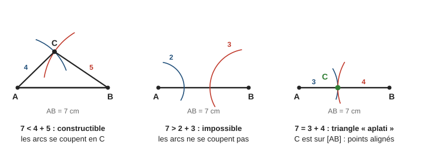

> **Méthode — construire un triangle de côtés donnés** (exemple : $AB = 7\,\mathrm{cm}$, $AC = 4\,\mathrm{cm}$, $BC = 5\,\mathrm{cm}$).
> 1. Tracer le plus grand côté $[AB]$ à la règle.
> 2. Tracer un arc de cercle de centre $A$ et de rayon $4\,\mathrm{cm}$.
> 3. Tracer un arc de cercle de centre $B$ et de rayon $5\,\mathrm{cm}$.
> 4. Le point d’intersection des arcs est $C$ : tracer $[AC]$ et $[BC]$.

**Exemple guidé 4.** Peut-on construire un triangle de côtés : a) $6$, $8$, $11\,\mathrm{cm}$ ? b) $3$, $5$, $9\,\mathrm{cm}$ ? c) $4{,}5$, $2{,}5$, $7\,\mathrm{cm}$ ?

**Réflexion.** On compare le plus grand côté à la somme des deux autres.

**Rédaction.**

> a) $11 < 6 + 8 = 14$ : le triangle est constructible.
>
> b) $9 > 3 + 5 = 8$ : les arcs ne se coupent pas, le triangle n’est pas constructible.
>
> c) $7 = 4{,}5 + 2{,}5$ : les trois points sont alignés, le « triangle » est aplati.

**Contrôle.** Il est inutile de tester les deux petits côtés : un petit côté est toujours inférieur à la somme des deux autres.

### 3.2 La somme des angles d’un triangle

> **À retenir.** Dans tout triangle $ABC$ : $\widehat{A} + \widehat{B} + \widehat{C} = 180^\circ$.

**Pourquoi ?** On trace la parallèle à $(BC)$ passant par $A$. Les angles $b$ et $c$ se retrouvent en $A$ (angles alternes-internes, égaux car les droites sont parallèles). En $A$, les trois angles $b$, $a$, $c$ forment un angle plat.

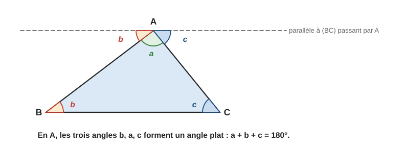

**Exemple guidé 5.** Dans le triangle $ABC$, $\widehat{A} = 62^\circ$ et $\widehat{B} = 49^\circ$. Calculer $\widehat{C}$.

**Rédaction.**

> On sait que la somme des angles d’un triangle vaut $180^\circ$.
>
> Donc $\widehat{C} = 180^\circ - 62^\circ - 49^\circ = 69^\circ$.

**Contrôle.** $62 + 49 + 69 = 180$.

Conséquences : un triangle a au plus **un** angle droit ou obtus ; dans un triangle rectangle, les deux angles aigus sont **complémentaires**.

### 3.3 Triangles particuliers

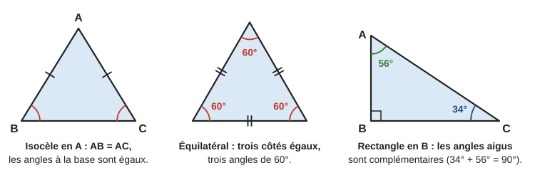

| Triangle | Définition | Propriété des angles |
|---|---|---|
| Isocèle en $A$ | $AB = AC$ ; $A$ est le **sommet principal**, $[BC]$ la **base** | $\widehat{B} = \widehat{C}$ (et réciproquement) |
| Équilatéral | trois côtés égaux | trois angles de $60^\circ$ |
| Rectangle en $A$ | $\widehat{A} = 90^\circ$ ; $[BC]$ est l’**hypoténuse** | $\widehat{B} + \widehat{C} = 90^\circ$ |
| Rectangle isocèle | les deux à la fois | $90^\circ$, $45^\circ$, $45^\circ$ |

**Exemple guidé 6.** $ABC$ est isocèle en $A$ et $\widehat{B} = 35^\circ$. Calculer $\widehat{C}$ et $\widehat{A}$.

**Rédaction.**

> Le triangle est isocèle en $A$, donc ses angles à la base sont égaux : $\widehat{C} = \widehat{B} = 35^\circ$.
>
> Somme des angles : $\widehat{A} = 180^\circ - 2 \times 35^\circ = 110^\circ$.

**Contrôle.** Le sommet principal est le seul angle qui peut être obtus : c’est bien $\widehat{A}$.

> **Erreur fréquente.** Mettre l’angle égal au mauvais endroit. Les deux angles égaux sont ceux de la **base**, opposés aux côtés égaux ; jamais l’angle au sommet principal (sauf si le triangle est équilatéral).

### 3.4 Triangles égaux (★★) [[Programme 2020]]

Deux triangles sont **égaux** s’ils sont superposables (par glissement ou retournement). Pour l’affirmer, il suffit de l’un des trois cas suivants :

1. leurs trois côtés sont égaux deux à deux ;
2. un angle égal compris entre deux côtés égaux deux à deux ;
3. un côté égal compris entre deux angles égaux deux à deux.

Attention : trois angles égaux ne suffisent pas (un triangle et son agrandissement ont les mêmes angles, voir chapitre 12).

---

## 4. Droites remarquables

### 4.1 La médiatrice d’un segment

> **À retenir.** La **médiatrice** d’un segment $[AB]$ est la droite perpendiculaire à $[AB]$ en son milieu.  
> **Propriété clé.** Un point est sur la médiatrice de $[AB]$ **si et seulement si** il est à égale distance de $A$ et de $B$ : $MA = MB$.

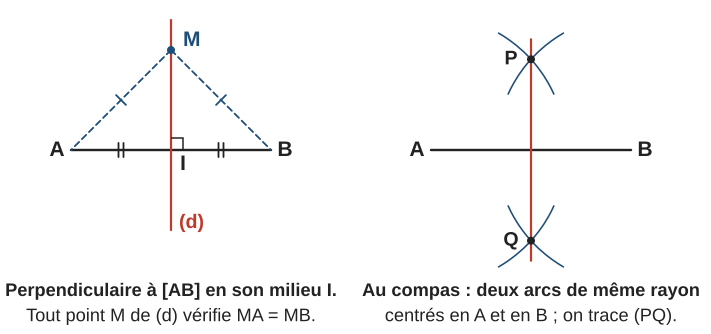

C’est ce qui justifie la construction au compas : les points $P$ et $Q$ sont à la même distance de $A$ et de $B$ (même rayon), donc tous deux sur la médiatrice, qui est la droite $(PQ)$.

### 4.2 Le cercle circonscrit

Le point $O$ où se coupent deux médiatrices d’un triangle $ABC$ vérifie $OA = OB$ et $OB = OC$, donc $OA = OC$ : il est aussi sur la troisième médiatrice.

> **À retenir.** Les trois médiatrices d’un triangle sont **concourantes** en un point $O$, centre du **cercle circonscrit** (le cercle qui passe par les trois sommets).  
> **Triangle rectangle.** Si $ABC$ est rectangle en $A$, le centre de son cercle circonscrit est le **milieu de l’hypoténuse** $[BC]$ ; le rayon vaut $\dfrac{BC}{2}$.

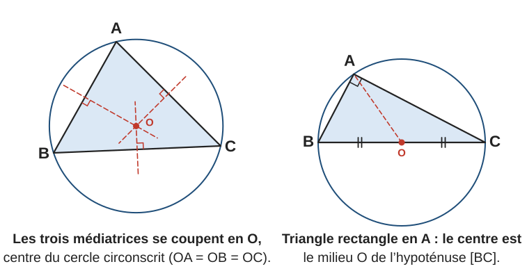

**Exemple guidé 7.** $ABC$ est rectangle en $A$ avec $AB = 5\,\mathrm{cm}$, $AC = 12\,\mathrm{cm}$ et $BC = 13\,\mathrm{cm}$. Où est le centre $O$ de son cercle circonscrit ? Quel est son rayon ? Combien mesure $OA$ ?

**Rédaction.**

> Le triangle est rectangle en $A$, donc le centre de son cercle circonscrit est le milieu $O$ de l’hypoténuse $[BC]$.
>
> Rayon : $\dfrac{13}{2} = 6{,}5\,\mathrm{cm}$. Comme $A$ est sur le cercle, $OA = 6{,}5\,\mathrm{cm}$.

**Contrôle.** $OA = OB = OC = 6{,}5$ : $O$ est bien à égale distance des trois sommets.

### 4.3 Hauteurs, bissectrices, médianes

- Une **hauteur** est la droite issue d’un sommet et perpendiculaire au côté opposé. Elle sert à calculer l’aire : $\mathcal{A} = \dfrac{\text{base} \times \text{hauteur}}{2}$ (chapitre 14). Les trois hauteurs sont concourantes.
- La **bissectrice** d’un angle est la demi-droite qui le partage en deux angles égaux. Construction : un arc de centre $O$ coupe les côtés en $M$ et $N$ ; deux arcs de même rayon, centrés en $M$ et $N$, se coupent en $P$ ; $[OP)$ est la bissectrice.
- (★★) Une **médiane** joint un sommet au milieu du côté opposé. Les trois médianes sont concourantes en un point, le **centre de gravité** : un triangle en carton tient en équilibre sur une pointe placée en ce point.

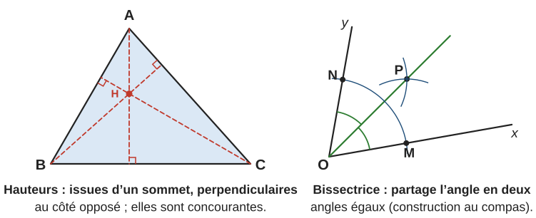

> **Erreur fréquente.** Confondre médiatrice et médiane. La **médiatrice** de $[BC]$ passe par le milieu de $[BC]$ **perpendiculairement** et ne passe pas forcément par $A$ ; la **médiane** issue de $A$ passe par $A$ et par le milieu de $[BC]$, sans angle droit en général.

> **À retenir — triangle isocèle.** Dans un triangle isocèle en $A$, la médiatrice de la base, la hauteur, la médiane et la bissectrice issues de $A$ sont **une seule et même droite** : l’axe de symétrie du triangle.

> **Propriété — médiane et aires.** [[Programme 2026 · 5e]] Une médiane partage un triangle en **deux triangles de même aire**.

![La médiane [AM] partage le triangle ABC en deux triangles ABM et AMC de même aire : leurs bases BM et MC sont égales et ils ont la même hauteur AH](figures/mediane-aires.svg)

**Démonstration.** Soit $M$ le milieu de $[BC]$ et $H$ le pied de la hauteur issue de $A$.

> On sait que $M$ est le milieu de $[BC]$, donc $BM = MC$.  
> Les triangles $ABM$ et $AMC$ ont leurs bases $[BM]$ et $[MC]$ sur la même droite $(BC)$ : ils ont donc la **même hauteur** $AH$.  
> Donc $\mathcal{A}(ABM) = \dfrac{BM \times AH}{2} = \dfrac{MC \times AH}{2} = \mathcal{A}(AMC)$.

**Contrôle.** Avec $BC = 8\,\mathrm{cm}$ et $AH = 5\,\mathrm{cm}$ : $\mathcal{A}(ABC) = 20\,\mathrm{cm}^2$, et chaque moitié mesure $\dfrac{4 \times 5}{2} = 10\,\mathrm{cm}^2$.

> **Erreur fréquente.** Croire que la médiane partage aussi le triangle en deux triangles **superposables** (égaux). C’est faux en général : les deux triangles ont la même aire, mais pas la même forme (sauf si le triangle est isocèle en $A$).

### 4.4 La droite des milieux [[Programme 2026 · 4e]]

Sur les figures, $ABC$ est un triangle, $I$ est un point de $[AB]$ et $J$ un point de $[AC]$.

> **Théorème 1.** Dans un triangle, la droite qui passe par les **milieux de deux côtés** est **parallèle** au troisième côté.

> **Théorème 2.** Dans un triangle, le segment qui joint les **milieux de deux côtés** mesure **la moitié** du troisième côté.

> **Théorème 3.** Dans un triangle, la droite qui passe par le **milieu d’un côté** et qui est **parallèle à un deuxième côté** coupe le troisième côté **en son milieu**.

![Les trois théorèmes de la droite des milieux : si I et J sont les milieux de [AB] et [AC], alors (IJ) est parallèle à (BC) et IJ est la moitié de BC ; si I est le milieu de [AB] et si la droite (d) passant par I est parallèle à (BC), elle coupe [AC] en son milieu J](figures/droite-milieux.svg)

| On sait… | On veut… | Théorème |
|---|---|---|
| deux milieux | prouver un parallélisme | 1 |
| deux milieux | calculer une longueur | 2 |
| un milieu et une parallèle | prouver qu’un point est un milieu | 3 |

**Exemple guidé 7 bis.** $ABC$ est un triangle avec $BC = 9\,\mathrm{cm}$ ; $I$ et $J$ sont les milieux de $[AB]$ et $[AC]$. Montrer que $(IJ) \parallel (BC)$ et calculer $IJ$.

**Rédaction.**

> On sait que $I$ est le milieu de $[AB]$ et $J$ le milieu de $[AC]$.  
> Or, dans un triangle, la droite qui passe par les milieux de deux côtés est parallèle au troisième côté, et le segment qui les joint mesure la moitié du troisième côté.  
> Donc $(IJ) \parallel (BC)$ et $IJ = \dfrac{BC}{2} = \dfrac{9}{2} = 4{,}5\,\mathrm{cm}$.

**Contrôle.** Le « petit » triangle $AIJ$ est une réduction de moitié du triangle $ABC$ : c’est aussi ce que dira le théorème de Thalès (chapitre 12), avec le rapport $\dfrac{AI}{AB} = \dfrac{1}{2}$.

> **Pourquoi (★★★).** Soit $K$ le symétrique de $I$ par rapport à $J$. Les diagonales $[AC]$ et $[IK]$ du quadrilatère $AICK$ ont le même milieu $J$ : $AICK$ est un parallélogramme, donc $(CK) \parallel (AI)$ et $CK = AI = IB$. Le quadrilatère $IBCK$ a deux côtés opposés $[IB]$ et $[CK]$ parallèles et de même longueur : c’est un parallélogramme. Donc $(IK) \parallel (BC)$ et $IK = BC$, d’où $(IJ) \parallel (BC)$ et $IJ = \dfrac{IK}{2} = \dfrac{BC}{2}$.

> **Erreur fréquente.** Utiliser le théorème 1 avec **un seul** milieu. Si l’on sait seulement que $I$ est le milieu de $[AB]$, il faut en plus une parallèle (théorème 3) pour conclure.

---

## 5. Quadrilatères

### 5.1 Le parallélogramme

> **À retenir.** Un **parallélogramme** est un quadrilatère dont les côtés opposés sont parallèles deux à deux. Dans un parallélogramme $ABCD$ :
> - les côtés opposés ont la même longueur : $AB = DC$ et $AD = BC$ ;
> - les angles opposés sont égaux ; deux angles consécutifs sont supplémentaires ;
> - les **diagonales se coupent en leur milieu**.

Pour **prouver** qu’un quadrilatère est un parallélogramme, il suffit de l’une de ces conditions :

1. ses côtés opposés sont parallèles deux à deux (définition) ;
2. ses diagonales se coupent en leur milieu ;
3. ses côtés opposés ont la même longueur deux à deux (s’il n’est pas croisé) ;
4. deux côtés opposés sont parallèles **et** de même longueur.

### 5.2 Rectangle, losange, carré

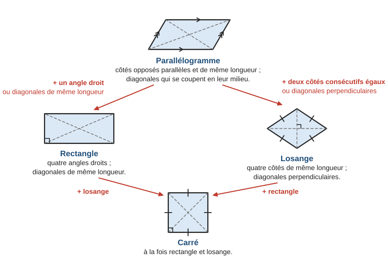

| Figure | Définition | Propriétés en plus | Pour le reconnaître parmi les parallélogrammes |
|---|---|---|---|
| Rectangle | quatre angles droits | diagonales de même longueur | un angle droit, ou diagonales de même longueur |
| Losange | quatre côtés égaux | diagonales perpendiculaires | deux côtés consécutifs égaux, ou diagonales perpendiculaires |
| Carré | rectangle et losange | toutes les propriétés précédentes | rectangle + losange |

**Exemple guidé 8.** Les diagonales $[AC]$ et $[BD]$ d’un quadrilatère $ABCD$ se coupent en $O$, avec $OA = OB = OC = OD = 4\,\mathrm{cm}$. Quelle est la nature de $ABCD$ ?

**Réflexion.** $O$ est le milieu des deux diagonales, et $AC = BD = 8\,\mathrm{cm}$.

**Rédaction.**

> On sait que $OA = OC$ et $OB = OD$ : les diagonales se coupent en leur milieu. Or un quadrilatère dont les diagonales se coupent en leur milieu est un parallélogramme. Donc $ABCD$ est un parallélogramme.
>
> De plus $AC = BD = 8\,\mathrm{cm}$. Or un parallélogramme dont les diagonales ont la même longueur est un rectangle. Donc $ABCD$ est un rectangle.

**Contrôle.** Rien ne dit que les diagonales sont perpendiculaires : on ne peut pas conclure « carré ».

> **Erreur fréquente.** « Les diagonales sont perpendiculaires, donc c’est un losange. » Un cerf-volant a des diagonales perpendiculaires sans être un losange : il faut **d’abord** savoir que c’est un parallélogramme.

---

## 6. Le cercle

### 6.1 Vocabulaire

Le **cercle** de centre $O$ et de rayon $r$ est formé des points $M$ tels que $OM = r$ ; le **disque** est formé des points tels que $OM \leqslant r$. Une **corde** joint deux points du cercle ; un **diamètre** est une corde qui passe par le centre (longueur $2r$). Un **arc** est une portion de cercle.

**Tangente.** La tangente au cercle en un point $A$ du cercle est la droite perpendiculaire au rayon $[OA]$ en $A$ ; elle « frôle » le cercle en un seul point.

### 6.2 Triangle inscrit dans un demi-cercle

> **À retenir.**
> - Si un triangle est inscrit dans un cercle **et** a pour côté un diamètre, alors il est rectangle, et ce diamètre est son hypoténuse.
> - Réciproquement, si un triangle est rectangle, son hypoténuse est un diamètre de son cercle circonscrit (§ 4.2).

### 6.3 Angle inscrit et angle au centre (★★★)

Soit $A$ et $B$ deux points d’un cercle de centre $O$, et $M$ un autre point du cercle. L’**angle au centre** $\widehat{AOB}$ et l’**angle inscrit** $\widehat{AMB}$ interceptent le même arc $\overset{\frown}{AB}$ (celui qui ne contient pas $M$).

> **À retenir (★★★).** Un angle inscrit mesure la **moitié** de l’angle au centre qui intercepte le même arc : $\widehat{AOB} = 2 \times \widehat{AMB}$. Deux angles inscrits qui interceptent le même arc sont donc égaux.

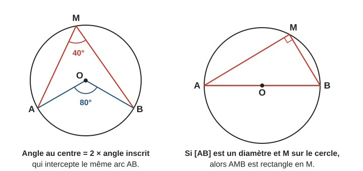

Le demi-cercle en est un cas particulier : si $[AB]$ est un diamètre, $\widehat{AOB} = 180^\circ$, donc $\widehat{AMB} = 90^\circ$.

**Exemple guidé 9 (★★★).** $A$, $B$, $M$ sont sur un cercle de centre $O$, et $\widehat{AOB} = 100^\circ$ (avec $M$ sur le grand arc). Calculer $\widehat{AMB}$, puis $\widehat{OAB}$.

**Rédaction.**

> $\widehat{AMB}$ est un angle inscrit qui intercepte le même arc que l’angle au centre $\widehat{AOB}$, donc $\widehat{AMB} = \dfrac{100^\circ}{2} = 50^\circ$.
>
> $OA = OB$ (rayons), donc $AOB$ est isocèle en $O$ : $\widehat{OAB} = \dfrac{180^\circ - 100^\circ}{2} = 40^\circ$.

**Contrôle.** Le triangle $AOB$ : $100 + 40 + 40 = 180$.

---

## 7. Rédiger une démonstration

Une démonstration enchaîne des étapes de la forme :

> **On sait que** (les données de l’énoncé ou un résultat déjà prouvé).  
> **Or** (une propriété du cours, énoncée en entier : « si …, alors … »).  
> **Donc** (la conclusion, qui peut servir de donnée à l’étape suivante).

> **Méthode — démontrer.**
> 1. Faire une figure soignée et la **coder** (longueurs égales, angles droits, parallèles).
> 2. Partir de la conclusion : « pour montrer que …, il me suffit de savoir que … ».
> 3. Rédiger dans l’ordre inverse, une étape « on sait que / or / donc » par propriété.
> 4. Ne jamais utiliser une mesure lue sur le dessin comme argument.

**Exemple guidé 10.** $A$, $B$, $C$ sont sur un cercle de diamètre $[BC]$, avec $AB = 6\,\mathrm{cm}$ et $AC = 8\,\mathrm{cm}$. Calculer le rayon du cercle.

**Réflexion.** Pour utiliser Pythagore, il faut un angle droit ; le diamètre le fournit.

**Rédaction.**

> On sait que le triangle $ABC$ est inscrit dans le cercle de diamètre $[BC]$. Or, si un triangle est inscrit dans un cercle et a pour côté un diamètre, alors il est rectangle. Donc $ABC$ est rectangle en $A$.
>
> D’après le théorème de Pythagore : $BC^2 = AB^2 + AC^2 = 36 + 64 = 100$, donc $BC = 10\,\mathrm{cm}$.
>
> Le rayon vaut $\dfrac{BC}{2} = 5\,\mathrm{cm}$.

**Contrôle.** Triangle $6$-$8$-$10$ : c’est le triangle $3$-$4$-$5$ agrandi deux fois.

---

## 8. Mini-synthèse

> **À retenir.**
> - Parallèles / perpendiculaires : P1, P2, P3. Distance d’un point à une droite = longueur de la perpendiculaire.
> - Opposés par le sommet : égaux. Complémentaires : $90^\circ$. Supplémentaires : $180^\circ$.
> - Parallèles + sécante : alternes-internes et correspondants **égaux** ; réciproque pour prouver un parallélisme.
> - Constructible : plus grand côté **<** somme des deux autres ; égalité = points alignés.
> - Somme des angles d’un triangle : $180^\circ$. Isocèle : angles à la base égaux. Équilatéral : $60^\circ$.
> - Médiatrice : $MA = MB$ ; les trois médiatrices → centre du cercle circonscrit ; triangle rectangle → milieu de l’hypoténuse.
> - Une médiane partage un triangle en deux triangles de même aire.
> - Droite des milieux : deux milieux → parallèle au troisième côté et moitié de sa longueur ; un milieu + une parallèle → le milieu du troisième côté.
> - Parallélogramme : diagonales qui se coupent en leur milieu. Rectangle : diagonales égales. Losange : diagonales perpendiculaires. Carré : les deux.
> - Cercle : tangente ⟂ rayon ; diamètre côté d’un triangle inscrit → angle droit ; (★★★) angle au centre = $2 \times$ angle inscrit.

---

## 9. Exercices types

> Faire une figure à main levée codée avant de calculer. Justifier chaque réponse par une propriété.

### A. Droites (★)

**A1.** Compléter avec $(AB)$, $[AB]$, $[AB)$ ou $AB$ : a) la droite qui passe par $A$ et $B$ ; b) le segment d’extrémités $A$ et $B$ ; c) la demi-droite d’origine $A$ qui passe par $B$ ; d) la longueur du segment d’extrémités $A$ et $B$.

**A2.** Que peut-on dire des droites $(d_1)$ et $(d_2)$ ? Justifier. a) $(d_1) \perp (d)$ et $(d_2) \perp (d)$. b) $(d_1) \parallel (d)$ et $(d_2) \parallel (d)$. c) $(d_1) \parallel (d_3)$ et $(d_2) \perp (d_3)$.

**A3.** Vrai ou faux ? a) Deux droites perpendiculaires sont sécantes. b) Si $(d) \perp (d')$ et $(d') \perp (d'')$, alors $(d) \perp (d'')$. c) Deux droites qui ne se coupent pas sur la feuille sont parallèles.

**A4.** Le point $A$ est à $3\,\mathrm{cm}$ de la droite $(d)$ ; $H$ est le pied de la perpendiculaire à $(d)$ passant par $A$. a) Que vaut $AH$ ? b) $M$ est un autre point de $(d)$ : comparer $AM$ et $3\,\mathrm{cm}$. c) Combien de points de $(d)$ sont à $3\,\mathrm{cm}$ de $A$ ?

### B. Angles et parallèles (★ → ★★)

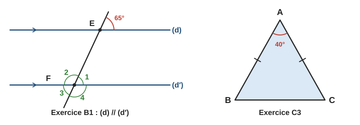

**B1.** Sur la figure de gauche, $(d) \parallel (d')$ et l’angle marqué en $E$ mesure $65^\circ$. Calculer les angles numérotés $1$, $2$, $3$, $4$ en $F$.

**B2.** a) Quel est le complémentaire d’un angle de $37^\circ$ ? b) Son supplémentaire ? c) Le supplémentaire d’un angle de $126^\circ$ ? d) Deux angles sont opposés par le sommet ; l’un mesure $48^\circ$ : et l’autre ?

**B3.** Deux droites sécantes forment quatre angles ; l’un mesure $72^\circ$. Calculer les trois autres.

**B4.** Une sécante coupe deux droites $(d)$ et $(d')$. a) Deux angles correspondants mesurent $54^\circ$ et $54^\circ$. b) Dans une autre figure, deux angles alternes-internes mesurent $54^\circ$ et $56^\circ$. Les droites sont-elles parallèles ?

**B5.** $(d) \parallel (d')$ et une sécante les coupe en $A$ et $B$. Entre les deux droites et du même côté de la sécante, l’angle en $A$ mesure $110^\circ$. Combien mesure l’angle en $B$ ?

### C. Triangles (★ → ★★)

**C1.** Peut-on construire un triangle de côtés : a) $5$, $6$, $10\,\mathrm{cm}$ ? b) $3$, $4$, $8\,\mathrm{cm}$ ? c) $4$, $6$, $10\,\mathrm{cm}$ ? d) $7$, $7$, $7\,\mathrm{cm}$ ?

**C2.** Calculer le troisième angle : a) $ABC$ avec $\widehat{A} = 52^\circ$ et $\widehat{B} = 71^\circ$ ; b) $DEF$ rectangle en $D$ avec $\widehat{E} = 38^\circ$ ; c) un triangle équilatéral.

**C3.** (Figure de droite.) a) $ABC$ est isocèle en $A$ et $\widehat{A} = 40^\circ$. Calculer $\widehat{B}$ et $\widehat{C}$. b) Un autre triangle isocèle a un angle à la base de $40^\circ$ : calculer son angle au sommet principal.

**C4.** a) Écrire le programme de construction d’un triangle $ABC$ tel que $AB = 6\,\mathrm{cm}$, $AC = 4\,\mathrm{cm}$, $BC = 5\,\mathrm{cm}$. b) On veut maintenant $AB = 6\,\mathrm{cm}$, $\widehat{A} = 50^\circ$, $\widehat{B} = 60^\circ$ : quels instruments utiliser ? Combien mesure $\widehat{C}$ ?

**C5.** ★★ Un triangle peut-il avoir : a) deux angles obtus ? b) deux angles droits ? c) un angle droit et un angle de $45^\circ$ ? Justifier.

**C6.** ★★ Deux côtés d’un triangle mesurent $4\,\mathrm{cm}$ et $9\,\mathrm{cm}$. Le troisième mesure un nombre entier de centimètres. Quelles sont les valeurs possibles ?

### D. Droites remarquables et constructions (★ → ★★)

**D1.** a) $M$ est sur la médiatrice de $[AB]$ et $MA = 4{,}5\,\mathrm{cm}$. Combien vaut $MB$ ? b) $NA = 3\,\mathrm{cm}$ et $NB = 5\,\mathrm{cm}$ : $N$ est-il sur la médiatrice de $[AB]$ ?

**D2.** Décrire la construction au compas de la médiatrice d’un segment $[AB]$ de $6\,\mathrm{cm}$, puis expliquer pourquoi elle est juste.

**D3.** $ABC$ est rectangle en $A$ et $BC = 10\,\mathrm{cm}$. $M$ est le milieu de $[BC]$. a) Où est le centre du cercle circonscrit ? Quel est son rayon ? b) Calculer $AM$.

**D4.** Dans un triangle $ABC$, nommer : a) la droite qui passe par $A$ et est perpendiculaire à $(BC)$ ; b) la droite qui passe par $A$ et par le milieu de $[BC]$ ; c) la droite perpendiculaire à $[BC]$ en son milieu ; d) la demi-droite qui partage $\widehat{BAC}$ en deux angles égaux.

**D5.** $\widehat{xOy} = 74^\circ$ et $[Oz)$ est sa bissectrice. Calculer $\widehat{xOz}$.

**D6.** ★★ Dans un triangle $ABC$, $BC = 8\,\mathrm{cm}$ et la hauteur issue de $A$ mesure $5\,\mathrm{cm}$. a) Calculer l’aire de $ABC$. b) Sachant que $AB = 10\,\mathrm{cm}$, calculer la hauteur issue de $C$.

**D7.** [[Programme 2026 · 5e]] Un triangle $ABC$ a une aire de $36\,\mathrm{cm}^2$ ; $M$ est le milieu de $[BC]$. a) Quelle est l’aire du triangle $ABM$ ? Justifier. b) $N$ est le milieu de $[BM]$. Quelle est l’aire du triangle $ABN$ ?

**D8.** [[Programme 2026 · 4e]] $ABC$ est un triangle tel que $AB = 7\,\mathrm{cm}$, $AC = 8\,\mathrm{cm}$ et $BC = 10\,\mathrm{cm}$. $I$, $J$ et $K$ sont les milieux de $[AB]$, $[AC]$ et $[BC]$. a) Calculer $IJ$, $JK$ et $IK$. b) Calculer le périmètre du triangle $IJK$ et le comparer à celui de $ABC$.

**D9.** ★★ [[Programme 2026 · 4e]] $ABC$ est un triangle, $I$ est le milieu de $[AB]$. La parallèle à $(BC)$ passant par $I$ coupe $[AC]$ en $J$. On sait que $AC = 11\,\mathrm{cm}$ et $BC = 6\,\mathrm{cm}$. Calculer $AJ$ et $IJ$ en justifiant.

### E. Quadrilatères (★ → ★★)

**E1.** $ABCD$ est un parallélogramme de centre $O$ avec $AB = 7\,\mathrm{cm}$, $BC = 4\,\mathrm{cm}$, $\widehat{A} = 65^\circ$ et $AC = 10\,\mathrm{cm}$. Donner $CD$, $AD$, les trois autres angles et $AO$.

**E2.** Quelle est la nature du quadrilatère ? a) Ses diagonales se coupent en leur milieu et ont la même longueur. b) Ses diagonales se coupent en leur milieu et sont perpendiculaires. c) C’est un parallélogramme avec un angle droit et deux côtés consécutifs égaux. d) Ses quatre côtés ont la même longueur.

**E3.** ★★ $ABCD$ est un losange de côté $5\,\mathrm{cm}$ avec $\widehat{A} = 60^\circ$. a) Calculer les trois autres angles. b) Montrer que le triangle $ABD$ est équilatéral et en déduire $BD$.

**E4.** ★★ Les diagonales d’un quadrilatère $ABCD$ se coupent en $O$, avec $OA = OC = 3\,\mathrm{cm}$ et $OB = OD = 5\,\mathrm{cm}$. a) Montrer que $ABCD$ est un parallélogramme. b) Est-ce un rectangle ?

### F. Cercle (★ → ★★★)

**F1.** Un cercle a pour centre $O$ et pour rayon $4\,\mathrm{cm}$. a) Longueur d’un diamètre ? b) Les points $M$, $N$, $P$ vérifient $OM = 3\,\mathrm{cm}$, $ON = 4\,\mathrm{cm}$, $OP = 5\,\mathrm{cm}$ : situer chacun par rapport au cercle.

**F2.** ★★ Un cercle de centre $O$ a pour rayon $3\,\mathrm{cm}$. $A$ est sur le cercle, $(T)$ est la tangente en $A$, et $P$ est un point de $(T)$ tel que $AP = 4\,\mathrm{cm}$. Calculer $OP$.

**F3.** ★★ $[AB]$ est un diamètre d’un cercle et $C$ un point du cercle, avec $AC = 6\,\mathrm{cm}$ et $BC = 8\,\mathrm{cm}$. a) Quelle est la nature du triangle $ABC$ ? b) Calculer le rayon du cercle.

**F4.** ★★★ $A$, $B$, $M$, $N$ sont sur un cercle de centre $O$ ; $M$ et $N$ sont sur le même arc. a) $\widehat{AOB} = 110^\circ$ : calculer $\widehat{AMB}$. b) Un angle inscrit mesure $35^\circ$ : combien mesure l’angle au centre qui intercepte le même arc ? c) Comparer $\widehat{AMB}$ et $\widehat{ANB}$.

---

## 10. Exercices atypiques

> Ici, il faut chercher, expliquer, enchaîner plusieurs propriétés.

### G. Trouver l’erreur (★★)

**G1.** « Les côtés mesurent $3$, $5$ et $8\,\mathrm{cm}$. On a $3 < 5 + 8$ et $5 < 3 + 8$, donc le triangle est constructible. » Trouver l’erreur.

**G2.** « Une sécante coupe $(d)$ et $(d')$. Les angles $1$ et $2$ sont alternes-internes, donc ils sont égaux. » Qu’est-ce qui manque ?

**G3.** « Les diagonales de $ABCD$ sont perpendiculaires, donc $ABCD$ est un losange. » Trouver l’erreur et proposer un contre-exemple.

**G4.** « $ABC$ est isocèle en $A$ et $\widehat{B} = 50^\circ$, donc $\widehat{A} = 50^\circ$ et $\widehat{C} = 80^\circ$. » Corriger.

### H. Comprendre et raisonner (★★ → ★★★)

**H1.** ★★ Dans un triangle $ABC$, on prolonge $[BC]$ au-delà de $C$ jusqu’à un point $D$. Montrer que l’angle $\widehat{ACD}$ (angle « extérieur ») est égal à $\widehat{A} + \widehat{B}$.

**H2.** ★★ Expliquer, à l’aide de la propriété des triangles isocèles, pourquoi les trois angles d’un triangle équilatéral mesurent $60^\circ$.

**H3.** ★★ Quelle est la somme des angles d’un quadrilatère ? D’un pentagone ? (Découper en triangles à partir d’un sommet.)

**H4.** ★★★ Deux angles adjacents et supplémentaires $\widehat{xOy}$ et $\widehat{yOz}$ ont pour bissectrices $[Ou)$ et $[Ov)$. Montrer que $\widehat{uOv} = 90^\circ$.

**H5.** ★★★ Par trois points $A$, $B$, $C$ non alignés, combien de cercles passent ? Et si $A$, $B$, $C$ sont alignés ?

### I. Plusieurs étapes (★★★)

**I1.** Dans un triangle $ABC$, $\widehat{A} = 50^\circ$ et $\widehat{B} = 70^\circ$. La bissectrice de $\widehat{A}$ coupe $[BC]$ en $D$. Calculer $\widehat{ADB}$ et $\widehat{ADC}$.

**I2.** $ABCD$ est un rectangle avec $AB = 8\,\mathrm{cm}$ et $BC = 6\,\mathrm{cm}$ ; ses diagonales se coupent en $O$. a) Calculer $AC$. b) Montrer que $A$, $B$, $C$, $D$ sont sur un même cercle dont on donnera le centre et le rayon.

**I3.** Sur la figure, $(d) \parallel (d')$. Calculer l’angle $\widehat{APB}$. (Indication : tracer la parallèle à $(d)$ passant par $P$.)

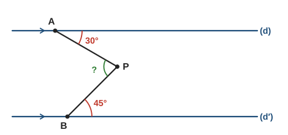

**I4.** $ABC$ est isocèle en $A$ avec $\widehat{A} = 36^\circ$. La bissectrice de $\widehat{B}$ coupe $[AC]$ en $D$. Montrer que les triangles $ABD$ et $BCD$ sont isocèles.

### J. Situations ouvertes (★★)

**J1.** On a tracé un cercle avec une assiette, sans marquer le centre. Comment retrouver le centre à la règle et au compas ?

**J2.** Trois villages $A$, $B$, $C$ veulent construire un château d’eau à la même distance des trois. Où le placer ? Peut-il se trouver en dehors du triangle $ABC$ ?

**J3.** Construire un carré dont la diagonale mesure $6\,\mathrm{cm}$ : décrire la construction et calculer une valeur approchée du côté.

---

## 11. Corrigés

> Les corrigés marqués **(modèle)** montrent la rédaction attendue. Les autres donnent les étapes clés.

### Exercices types

**A1.** a) $(AB)$ ; b) $[AB]$ ; c) $[AB)$ ; d) $AB$.

**A2. (modèle)**
> a) On sait que $(d_1) \perp (d)$ et $(d_2) \perp (d)$. Or, si deux droites sont perpendiculaires à une même droite, alors elles sont parallèles. Donc $(d_1) \parallel (d_2)$.  
> b) On sait que $(d_1) \parallel (d)$ et $(d_2) \parallel (d)$. Or, si deux droites sont parallèles à une même droite, alors elles sont parallèles. Donc $(d_1) \parallel (d_2)$.  
> c) On sait que $(d_1) \parallel (d_3)$ et $(d_2) \perp (d_3)$. Or, si deux droites sont parallèles, toute perpendiculaire à l’une est perpendiculaire à l’autre. Donc $(d_2) \perp (d_1)$.

**A3.** a) Vrai (elles se coupent en formant un angle droit). b) Faux : $(d)$ et $(d'')$ sont perpendiculaires à la même droite $(d')$, donc **parallèles** (P2). c) Faux : prolongées, elles peuvent se couper hors de la feuille.

**A4.** a) $AH = 3\,\mathrm{cm}$ (c’est la définition de la distance). b) Le triangle $AHM$ est rectangle en $H$, son plus grand côté est l’hypoténuse : $AM > 3\,\mathrm{cm}$. c) Un seul : le point $H$.

**B1. (modèle)**
> L’angle $1$ et l’angle de $65^\circ$ en $E$ sont correspondants (tous deux au-dessus de leur droite, à droite de la sécante). Or $(d) \parallel (d')$, et deux droites parallèles coupées par une sécante forment des angles correspondants égaux. Donc l’angle $1$ mesure $65^\circ$.  
> Les angles $1$ et $2$ forment un angle plat, donc l’angle $2$ mesure $180^\circ - 65^\circ = 115^\circ$.  
> L’angle $3$ est opposé par le sommet à l’angle $1$ : $65^\circ$. L’angle $4$ est opposé par le sommet à l’angle $2$ : $115^\circ$.

**B2.** a) $90 - 37 = 53^\circ$. b) $180 - 37 = 143^\circ$. c) $180 - 126 = 54^\circ$. d) $48^\circ$ (angles opposés par le sommet égaux).

**B3.** $72^\circ$ (opposé par le sommet), puis $180 - 72 = 108^\circ$ et $108^\circ$.

**B4.** a) Les angles correspondants sont égaux ; d’après la réciproque, $(d) \parallel (d')$. b) Si les droites étaient parallèles, les angles alternes-internes seraient égaux ; or $54 \neq 56$ : les droites ne sont pas parallèles.

**B5.** Avec deux parallèles, deux angles intérieurs du même côté de la sécante sont supplémentaires : $180 - 110 = 70^\circ$.

**C1.** a) $10 < 5 + 6 = 11$ : oui. b) $8 > 3 + 4 = 7$ : non. c) $10 = 4 + 6$ : points alignés, triangle aplati (pas de vrai triangle). d) $7 < 14$ : oui (équilatéral).

**C2.** a) $180 - 52 - 71 = 57^\circ$. b) Les angles aigus sont complémentaires : $\widehat{F} = 90 - 38 = 52^\circ$. c) $60^\circ$.

**C3. (modèle)**
> a) Le triangle $ABC$ est isocèle en $A$, donc ses angles à la base sont égaux : $\widehat{B} = \widehat{C}$.  
> La somme des angles d’un triangle vaut $180^\circ$, donc $\widehat{B} + \widehat{C} = 180^\circ - 40^\circ = 140^\circ$.  
> Donc $\widehat{B} = \widehat{C} = \dfrac{140^\circ}{2} = 70^\circ$.  
> b) Les deux angles à la base mesurent $40^\circ$ ; l’angle au sommet principal vaut $180^\circ - 2 \times 40^\circ = 100^\circ$.

**C4.** a) Tracer $[AB]$ de $6\,\mathrm{cm}$ ; arc de centre $A$, rayon $4\,\mathrm{cm}$ ; arc de centre $B$, rayon $5\,\mathrm{cm}$ ; $C$ est un point d’intersection des arcs ; tracer $[AC]$ et $[BC]$. b) Règle (pour $[AB]$) et rapporteur (angles de $50^\circ$ en $A$ et $60^\circ$ en $B$) ; les deux demi-droites se coupent en $C$. $\widehat{C} = 180 - 50 - 60 = 70^\circ$.

**C5.** a) Non : deux angles obtus dépassent déjà $180^\circ$. b) Non : $90 + 90 = 180$, le troisième angle vaudrait $0^\circ$. c) Oui : le troisième angle vaut $180 - 90 - 45 = 45^\circ$ (triangle rectangle isocèle).

**C6.** Notons $c$ le troisième côté. Il faut $c < 4 + 9 = 13$ et $9 < 4 + c$, soit $c > 5$. Valeurs entières : $6$, $7$, $8$, $9$, $10$, $11$, $12$ ($7$ valeurs).

**D1.** a) $MB = MA = 4{,}5\,\mathrm{cm}$. b) Non, car $NA \neq NB$.

**D2.** Avec un écartement de compas supérieur à $3\,\mathrm{cm}$ (la moitié de $AB$), tracer deux arcs centrés en $A$, puis deux arcs de même rayon centrés en $B$ ; ils se coupent en $P$ (au-dessus) et $Q$ (au-dessous) ; tracer $(PQ)$. Justification : $PA = PB$ et $QA = QB$ (même rayon), donc $P$ et $Q$ sont sur la médiatrice ; deux points suffisent à tracer une droite.

**D3. (modèle)**
> a) Le triangle $ABC$ est rectangle en $A$. Or le centre du cercle circonscrit à un triangle rectangle est le milieu de son hypoténuse. Donc le centre est $M$, milieu de $[BC]$, et le rayon vaut $\dfrac{10}{2} = 5\,\mathrm{cm}$.  
> b) $A$ est sur ce cercle, donc $AM$ est un rayon : $AM = 5\,\mathrm{cm}$.

**D4.** a) La hauteur issue de $A$. b) La médiane issue de $A$. c) La médiatrice de $[BC]$. d) La bissectrice de $\widehat{BAC}$.

**D5.** $\widehat{xOz} = \dfrac{74}{2} = 37^\circ$.

**D6.** a) $\mathcal{A} = \dfrac{8 \times 5}{2} = 20\,\mathrm{cm}^2$. b) Avec la base $[AB]$ : $\dfrac{10 \times h}{2} = 20$, donc $h = 4\,\mathrm{cm}$.

**D7.** a) $[AM]$ est une médiane du triangle $ABC$ ; or une médiane partage un triangle en deux triangles de même aire, donc $\mathcal{A}(ABM) = \dfrac{36}{2} = 18\,\mathrm{cm}^2$. b) Dans le triangle $ABM$, $[AN]$ est la médiane issue de $A$ : $\mathcal{A}(ABN) = \dfrac{18}{2} = 9\,\mathrm{cm}^2$.

**D8. (modèle)**
> a) $I$ et $J$ sont les milieux de $[AB]$ et $[AC]$. Or le segment qui joint les milieux de deux côtés d’un triangle mesure la moitié du troisième côté. Donc $IJ = \dfrac{BC}{2} = 5\,\mathrm{cm}$.  
> De même, $J$ et $K$ sont les milieux de $[AC]$ et $[BC]$ : $JK = \dfrac{AB}{2} = 3{,}5\,\mathrm{cm}$ ; $I$ et $K$ sont les milieux de $[AB]$ et $[BC]$ : $IK = \dfrac{AC}{2} = 4\,\mathrm{cm}$.  
> b) Périmètre de $IJK$ : $5 + 3{,}5 + 4 = 12{,}5\,\mathrm{cm}$ ; périmètre de $ABC$ : $7 + 8 + 10 = 25\,\mathrm{cm}$. Le périmètre de $IJK$ est la moitié de celui de $ABC$.

**D9.** $I$ est le milieu de $[AB]$ et $(IJ) \parallel (BC)$. Or, dans un triangle, la droite qui passe par le milieu d’un côté et est parallèle à un deuxième côté coupe le troisième en son milieu : $J$ est le milieu de $[AC]$, donc $AJ = \dfrac{11}{2} = 5{,}5\,\mathrm{cm}$. Alors $I$ et $J$ sont les milieux de deux côtés : $IJ = \dfrac{BC}{2} = 3\,\mathrm{cm}$.

**E1. (modèle)**
> Dans un parallélogramme, les côtés opposés ont la même longueur : $CD = AB = 7\,\mathrm{cm}$ et $AD = BC = 4\,\mathrm{cm}$.  
> Les angles opposés sont égaux : $\widehat{C} = \widehat{A} = 65^\circ$. Deux angles consécutifs sont supplémentaires : $\widehat{B} = \widehat{D} = 180^\circ - 65^\circ = 115^\circ$.  
> Les diagonales se coupent en leur milieu $O$ : $AO = \dfrac{AC}{2} = 5\,\mathrm{cm}$.

**E2.** a) Rectangle. b) Losange. c) Carré. d) Losange.

**E3.** a) Un losange est un parallélogramme : $\widehat{C} = 60^\circ$ et $\widehat{B} = \widehat{D} = 120^\circ$. b) $AB = AD = 5\,\mathrm{cm}$, donc $ABD$ est isocèle en $A$ ; ses angles à la base valent $\dfrac{180 - 60}{2} = 60^\circ$ : ses trois angles mesurent $60^\circ$, il est équilatéral. Donc $BD = 5\,\mathrm{cm}$.

**E4.** a) $O$ est le milieu de $[AC]$ et de $[BD]$ : les diagonales se coupent en leur milieu, donc $ABCD$ est un parallélogramme. b) $AC = 6\,\mathrm{cm}$ et $BD = 10\,\mathrm{cm}$ : les diagonales n’ont pas la même longueur, ce n’est pas un rectangle.

**F1.** a) $8\,\mathrm{cm}$. b) $M$ est à l’intérieur ($3 < 4$), $N$ sur le cercle, $P$ à l’extérieur ($5 > 4$).

**F2.** La tangente est perpendiculaire au rayon : $OAP$ est rectangle en $A$. Pythagore : $OP^2 = 3^2 + 4^2 = 25$, donc $OP = 5\,\mathrm{cm}$.

**F3. (modèle)**
> a) On sait que $C$ est sur le cercle de diamètre $[AB]$. Or, si un triangle est inscrit dans un cercle et a pour côté un diamètre, alors il est rectangle. Donc $ABC$ est rectangle en $C$.  
> b) D’après le théorème de Pythagore : $AB^2 = AC^2 + BC^2 = 36 + 64 = 100$, donc $AB = 10\,\mathrm{cm}$ et le rayon vaut $5\,\mathrm{cm}$.

**F4.** a) $\widehat{AMB} = \dfrac{110}{2} = 55^\circ$. b) $2 \times 35 = 70^\circ$. c) Ils interceptent le même arc, ils valent tous deux la moitié de $\widehat{AOB}$ : $\widehat{AMB} = \widehat{ANB}$.

### Exercices atypiques

**G1. (modèle)**
> L’élève a testé les deux **petits** côtés, ce qui ne sert à rien. Il faut tester le **plus grand** : $8 = 3 + 5$.  
> Il y a égalité : les trois points sont alignés et le « triangle » est aplati. Avec ces longueurs, on ne peut pas construire un vrai triangle.

**G2.** Il manque l’hypothèse « $(d) \parallel (d')$ ». Sans elle, des angles alternes-internes ne sont pas égaux en général.

**G3.** Il faut d’abord que $ABCD$ soit un parallélogramme (diagonales qui se coupent en leur milieu). Contre-exemple : un cerf-volant dont les diagonales sont perpendiculaires mais dont une seule est coupée en son milieu ; ses côtés ne sont pas tous égaux.

**G4.** Les angles égaux sont ceux de la base : $\widehat{C} = \widehat{B} = 50^\circ$, et $\widehat{A} = 180 - 50 - 50 = 80^\circ$.

**H1. (modèle)**
> $B$, $C$, $D$ sont alignés, donc $\widehat{ACB} + \widehat{ACD} = 180^\circ$ (angle plat) ; ainsi $\widehat{ACD} = 180^\circ - \widehat{ACB}$.  
> Dans le triangle $ABC$ : $\widehat{A} + \widehat{B} + \widehat{ACB} = 180^\circ$, donc $\widehat{A} + \widehat{B} = 180^\circ - \widehat{ACB}$.  
> Les deux quantités sont égales à $180^\circ - \widehat{ACB}$ : $\widehat{ACD} = \widehat{A} + \widehat{B}$.

**H2.** $AB = AC$ : isocèle en $A$, donc $\widehat{B} = \widehat{C}$. $BA = BC$ : isocèle en $B$, donc $\widehat{A} = \widehat{C}$. Les trois angles sont égaux et leur somme vaut $180^\circ$ : chacun mesure $60^\circ$.

**H3.** Une diagonale découpe un quadrilatère en $2$ triangles : $2 \times 180 = 360^\circ$. Un pentagone se découpe en $3$ triangles depuis un sommet : $3 \times 180 = 540^\circ$.

**H4.** Notons $\widehat{xOy} = a$ ; alors $\widehat{yOz} = 180^\circ - a$. Les bissectrices donnent $\widehat{uOy} = \dfrac{a}{2}$ et $\widehat{yOv} = \dfrac{180^\circ - a}{2}$. Donc $\widehat{uOv} = \dfrac{a}{2} + \dfrac{180^\circ - a}{2} = \dfrac{180^\circ}{2} = 90^\circ$.

**H5.** Non alignés : un seul cercle, celui de centre le point de concours des médiatrices (cercle circonscrit). Alignés : aucun, car les médiatrices de $[AB]$ et $[BC]$ sont perpendiculaires à la même droite, donc parallèles : elles ne se coupent pas, aucun point n’est à égale distance des trois.

**I1. (modèle)**
> $[AD)$ est la bissectrice de $\widehat{A}$, donc $\widehat{BAD} = \dfrac{50^\circ}{2} = 25^\circ$.  
> Dans le triangle $ABD$ : $\widehat{ADB} = 180^\circ - 25^\circ - 70^\circ = 85^\circ$.  
> $B$, $D$, $C$ sont alignés, donc $\widehat{ADC} = 180^\circ - 85^\circ = 95^\circ$.  
> Contrôle dans le triangle $ADC$ : $\widehat{C} = 180 - 50 - 70 = 60^\circ$ et $25 + 95 + 60 = 180$.

**I2.** a) $ABC$ est rectangle en $B$ : $AC^2 = 8^2 + 6^2 = 100$, donc $AC = 10\,\mathrm{cm}$. b) Les diagonales d’un rectangle se coupent en leur milieu et ont la même longueur, donc $OA = OB = OC = OD = 5\,\mathrm{cm}$ : les quatre sommets sont sur le cercle de centre $O$ et de rayon $5\,\mathrm{cm}$.

**I3.** Par $P$, on trace la parallèle $(\Delta)$ à $(d)$ ; elle est aussi parallèle à $(d')$ (P1). L’angle entre $[PA]$ et $(\Delta)$ est alterne-interne avec l’angle de $30^\circ$ en $A$ : il mesure $30^\circ$. De même, l’angle entre $(\Delta)$ et $[PB]$ mesure $45^\circ$. Ces deux angles sont adjacents : $\widehat{APB} = 30^\circ + 45^\circ = 75^\circ$.

**I4.** $\widehat{B} = \widehat{C} = \dfrac{180 - 36}{2} = 72^\circ$ ; la bissectrice donne $\widehat{ABD} = \widehat{DBC} = 36^\circ$. Triangle $ABD$ : $\widehat{A} = \widehat{ABD} = 36^\circ$, il est isocèle en $D$ ($DA = DB$). Triangle $BCD$ : $\widehat{BDC} = 180 - 36 - 72 = 72^\circ = \widehat{C}$, il est isocèle en $B$ ($BD = BC$).

**J1.** Tracer deux cordes non parallèles, puis leurs médiatrices au compas. Chaque médiatrice passe par le centre (le centre est à égale distance des extrémités de chaque corde) : le centre est leur point d’intersection.

**J2. (modèle)**
> Le point cherché est à égale distance de $A$ et $B$ : il est sur la médiatrice de $[AB]$. Il est aussi à égale distance de $B$ et $C$ : il est sur la médiatrice de $[BC]$.  
> On le place donc à l’intersection des médiatrices : c’est le centre du cercle circonscrit au triangle $ABC$.  
> Oui, il peut être hors du triangle : c’est le cas quand le triangle a un angle obtus (pour un triangle rectangle, il est au milieu de l’hypoténuse).

**J3.** Les diagonales d’un carré ont la même longueur, sont perpendiculaires et se coupent en leur milieu. Tracer $[AC]$ de $6\,\mathrm{cm}$ et son milieu $O$ ; tracer la perpendiculaire à $(AC)$ en $O$ ; y placer $B$ et $D$ à $3\,\mathrm{cm}$ de $O$, de part et d’autre. Côté : $AOB$ est rectangle en $O$, $AB^2 = 3^2 + 3^2 = 18$, donc $AB = \sqrt{18} \approx 4{,}24\,\mathrm{cm}$.

---

## 12. Liens avec les autres chapitres

- **Chapitre 10** (transformations) : symétries axiale et centrale ; la médiatrice est l’axe de symétrie d’un segment, le centre d’un parallélogramme est un centre de symétrie.
- **Chapitre 11** (Pythagore) : calculs de longueurs dans les triangles rectangles (F2, F3, I2, J3, exemple 10) ; réciproque pour prouver un angle droit.
- **Chapitre 12** (Thalès) : parallèles et proportionnalité des longueurs ; triangles semblables (mêmes angles).
- **Chapitre 13** (trigonométrie) : angles aigus complémentaires d’un triangle rectangle.
- **Chapitre 14** (aires) : la hauteur d’un triangle, d’un parallélogramme (D6).
- **Chapitre 15** (espace) : les faces des solides sont des figures planes ; sections planes.

---

## 13. Fiche-synthèse

| Je dois savoir… | Comment | Exemple express | S’entraîner |
|---|---|---|---|
| Calculer des angles avec des parallèles | alternes-internes et correspondants sont égaux | $(d) \parallel (d')$ : le correspondant d’un angle de $65^\circ$ mesure $65^\circ$ | série B |
| Utiliser la somme des angles | $180^\circ$ dans tout triangle | angles de $50^\circ$ et $70^\circ$ : le troisième mesure $60^\circ$ | série C |
| Savoir si un triangle existe | plus grand côté inférieur à la somme des deux autres | $3$, $4$, $8$ : $8 > 3 + 4$, impossible | série C |
| Utiliser une médiane [[Programme 2026 · 5e]] | elle partage le triangle en deux triangles de même aire | aire de $ABC$ : $36$ ; aire de $ABM$ : $18$ | série D |
| Droite des milieux [[Programme 2026 · 4e]] | deux milieux : parallèle et moitié ; un milieu + une parallèle : milieu | $BC = 9$ : $IJ = 4{,}5$ | série D |
| Médiatrice, cercle circonscrit | $MA = MB$ ; centre à l’intersection des médiatrices | triangle rectangle : centre au milieu de l’hypoténuse | série D |
| Reconnaître un quadrilatère | regarder les diagonales | diagonales de même milieu et perpendiculaires : losange | série E |
| Rédiger une démonstration | données, propriété, conclusion | $(d) \perp (\Delta)$ et $(d') \perp (\Delta)$, donc $(d) \parallel (d')$ | séries G et H |

**Pièges à éviter :** un dessin ne prouve rien : on démontre ; ne pas confondre une propriété et sa réciproque ; « mesurer » n’est pas « calculer ».

---

*Version v0.3 — relecture (prérequis harmonisés, fiche-synthèse, corrections : voir `PLAN-REVISION.md`, § 10). Base : v0.2 — révision vague 2 (cours développé : droites et propriétés P1-P3, distance à une droite, paires d’angles, parallèles et sécante avec réciproque, inégalité triangulaire et construction au compas, somme des angles avec preuve, triangles particuliers et triangles égaux, médiatrice et cercle circonscrit, hauteurs, bissectrice, médianes, famille des quadrilatères, cercle, tangente, angle inscrit ★★★, rédaction d’une démonstration ; 14 figures SVG ; 45 exercices corrigés). Ancienne version : `cours-et-exercices.md.bak` (anciennes figures dans `figures-v01.bak/`).*
