# Transformations du plan — symétries, translation, rotation, homothétie

> Compendium collège — chapitre unifié (sans découpage 6e / 5e / 4e / 3e).  
> Cours compact pour un élève de niveau moyen : intuition, méthode, exemples guidés, erreurs fréquentes, puis exercices progressifs (★ facile, ★★ standard, ★★★ approfondissement) avec corrigés détaillés.

---

## 0. Ce qu’on vise

**En une phrase :** une transformation déplace **tous** les points d’une figure selon la même règle : on peut **retourner** la figure (symétrie axiale), lui faire faire un **demi-tour** (symétrie centrale), la faire **glisser** (translation), la faire **tourner** (rotation) ou l’**agrandir / réduire** (homothétie).

À la fin de ce chapitre, je sais :

1. Construire l’image d’un point et d’une figure par chacune des cinq transformations, sur quadrillage et à la règle, à l’équerre et au compas.
2. Dire ce que chaque transformation **conserve** : longueurs, angles, alignement, parallélisme, aires.
3. Trouver les **axes** et le **centre de symétrie** d’une figure.
4. **Reconnaître** la transformation qui envoie une figure sur une autre.
5. Utiliser une homothétie de rapport $k$ : longueurs multipliées par $k$ (ou par $-k$ si $k$ est négatif), aires par $k^2$.
6. Décrire une frise, une rosace, un pavage à l’aide de transformations.
7. Utiliser les **vecteurs** : vecteurs égaux, vecteur nul, opposé, somme et **relation de Chasles** (3e).

> **Prérequis.** Médiatrice, parallélogramme, angles (chapitre 9, § 2, 4.1 et 5.1) ; proportionnalité (chapitre 5, § 1) pour l’homothétie ; carré d’un nombre (chapitre 4, § 1).

---

## 1. Transformer une figure

On note $M'$ l’**image** du point $M$ : c’est le point où « arrive » $M$. La figure formée par les images de tous les points est l’**image de la figure**. Un point qui ne bouge pas ($M' = M$) est dit **invariant**.

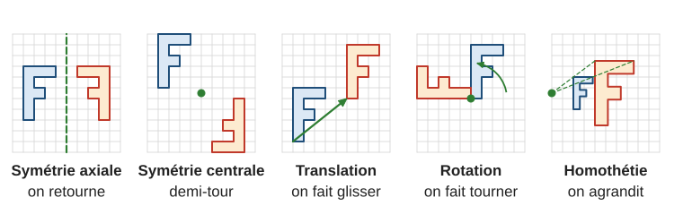

La lettre F est choisie exprès : elle n’a aucune symétrie, donc on voit tout de suite si l’image est **retournée** (symétrie axiale) ou seulement **déplacée** (les autres).

---

## 2. La symétrie axiale

### 2.1 Définition et construction

> **À retenir.** Le symétrique du point $M$ par rapport à la droite $(d)$ est le point $M'$ tel que $(d)$ soit la **médiatrice** de $[MM']$ : $(MM') \perp (d)$ et $(d)$ coupe $[MM']$ en son milieu. Si $M$ est sur $(d)$, alors $M' = M$.

C’est l’effet d’un **pliage** le long de $(d)$, ou d’un miroir posé sur $(d)$.

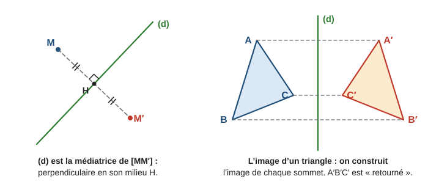

> **Méthode — construire le symétrique d’un point $M$ par rapport à $(d)$.**
> - **Équerre et règle :** tracer la perpendiculaire à $(d)$ passant par $M$ ; elle coupe $(d)$ en $H$ ; placer $M'$ de l’autre côté avec $HM' = HM$.
> - **Compas seul :** choisir deux points $P$ et $Q$ sur $(d)$ ; tracer l’arc de centre $P$ passant par $M$, puis l’arc de centre $Q$ passant par $M$ ; ils se recoupent en $M'$ (car $PM' = PM$ et $QM' = QM$).
> - **Quadrillage** (axe sur une ligne du quadrillage) : compter les carreaux jusqu’à l’axe et en reporter autant de l’autre côté.
> - **Figure :** construire l’image de chaque sommet, puis relier dans le même ordre.

> **Erreur fréquente.** Reporter la même distance de l’autre côté de l’axe, mais « en biais ». Le segment $[MM']$ doit être **perpendiculaire** à l’axe.

### 2.2 Ce qui est conservé

La symétrie axiale conserve les **longueurs**, les **angles**, l’**alignement**, le **parallélisme**, les **aires** : l’image d’un segment est un segment de même longueur, l’image d’un cercle est un cercle de même rayon. Mais elle **retourne** la figure (le sens de parcours A → B → C s’inverse).

### 2.3 Axes de symétrie d’une figure

Une droite est un **axe de symétrie** d’une figure si la figure est sa propre image par la symétrie par rapport à cette droite (elle se superpose à elle-même par pliage).

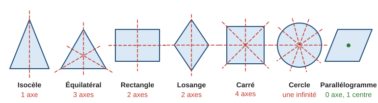

**Exemple guidé 1.** Combien d’axes de symétrie ont un segment $[AB]$ et un angle $\widehat{xOy}$ ?

**Réflexion.** On cherche les pliages qui superposent la figure à elle-même.

**Rédaction.**

> Segment : deux axes, sa **médiatrice** (elle échange $A$ et $B$) et la **droite** $(AB)$ elle-même (chaque point du segment est invariant).
>
> Angle : un axe, sa **bissectrice** (elle échange les deux côtés).

**Contrôle.** Plier une bande de papier le long de la médiatrice : les extrémités coïncident.

---

## 3. La symétrie centrale

### 3.1 Définition et construction

> **À retenir.** Le symétrique du point $M$ par rapport au point $O$ est le point $M'$ tel que $O$ soit le **milieu** de $[MM']$. Le seul point invariant est $O$.

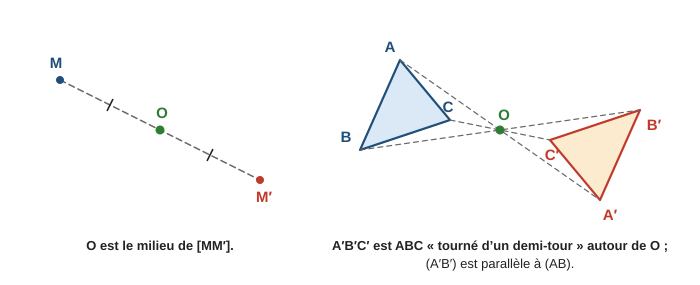

> **Méthode — construire $M'$.** Tracer la demi-droite $[MO)$ ; au compas, reporter la longueur $OM$ au-delà de $O$. Sur quadrillage : si l’on va de $M$ à $O$ en faisant « $3$ carreaux à droite et $2$ vers le bas », on fait encore la même chose de $O$ à $M'$.

### 3.2 Propriétés

- Elle conserve les longueurs, les angles, l’alignement, les aires ; elle ne retourne pas la figure : c’est un **demi-tour** autour de $O$ (rotation de $180^\circ$).
- L’image d’une droite est une droite **parallèle** : $(A'B') \parallel (AB)$.

### 3.3 Centre de symétrie d’une figure

Un point $O$ est **centre de symétrie** d’une figure si la figure est sa propre image par la symétrie de centre $O$. Exemples : le centre d’un cercle ; le point d’intersection des diagonales d’un **parallélogramme** (donc aussi d’un rectangle, d’un losange, d’un carré). Un triangle n’a jamais de centre de symétrie.

**Exemple guidé 2.** $ABCD$ est un parallélogramme de centre $O$. Quelle est l’image de $A$, de $B$, du segment $[AB]$ par la symétrie de centre $O$ ?

**Réflexion.** Les diagonales d’un parallélogramme se coupent en leur milieu $O$.

**Rédaction.**

> $O$ est le milieu de $[AC]$, donc l’image de $A$ est $C$. $O$ est le milieu de $[BD]$, donc l’image de $B$ est $D$.
>
> L’image du segment $[AB]$ est le segment $[CD]$ : on retrouve que $CD = AB$ et $(CD) \parallel (AB)$.

**Contrôle.** Un demi-tour du parallélogramme autour de $O$ le ramène sur lui-même.

---

## 4. La translation

> **À retenir.** La **translation qui envoie $A$ sur $B$** fait glisser chaque point $M$ en un point $M'$ dans la **même direction**, le **même sens** et sur la **même longueur** que de $A$ vers $B$. Autrement dit, $ABM'M$ est un **parallélogramme** (éventuellement aplati). Aucun point n’est invariant (sauf si $A = B$).

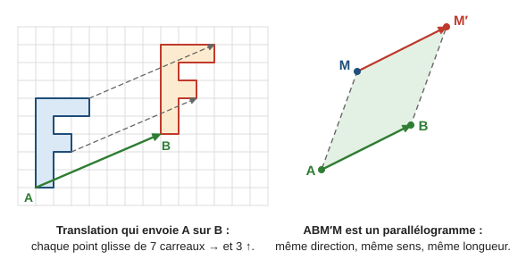

- Sur quadrillage, on compte le déplacement de $A$ à $B$ (par exemple $7$ carreaux à droite, $3$ vers le haut) et on l’applique à chaque sommet.
- La translation conserve les longueurs, les angles, les aires ; elle ne retourne pas et ne tourne pas la figure ; l’image d’une droite est une droite **parallèle**.

> **Erreur fréquente.** Écrire « $ABMM'$ est un parallélogramme ». L’ordre des lettres compte : on fait le tour $A \to B \to M' \to M$, et ce sont $[AM']$ et $[BM]$ les diagonales qui se coupent en leur milieu.

**Exemple guidé 3.** $ABCD$ est un parallélogramme. Par la translation qui envoie $A$ sur $B$, quelle est l’image de $D$ ?

**Rédaction.**

> On cherche le point $D'$ tel que $ABD'D$ soit un parallélogramme. Or $ABCD$ est un parallélogramme, donc $D' = C$.

**Contrôle.** Faire glisser $[AD]$ le long de $[AB]$ amène bien $[AD]$ sur $[BC]$.

### 4.1 Vecteurs [[Programme 2026 · 3e]]

La translation qui envoie $A$ sur $B$ s’appelle aussi la **translation de vecteur** $\overrightarrow{AB}$. Le vecteur $\overrightarrow{AB}$ décrit le déplacement de $A$ vers $B$ ; on le représente par une **flèche** d’origine $A$ et d’extrémité $B$.

> **Définition.** Le **vecteur** $\overrightarrow{AB}$ est défini par :
> - une **direction** : celle de la droite $(AB)$ ;
> - un **sens** : de $A$ vers $B$ ;
> - une **longueur** : la longueur $AB$.

> **Définition (vecteurs égaux).** Deux vecteurs sont **égaux** quand ils définissent la même translation, c’est-à-dire quand ils ont même direction, même sens et même longueur. On note $\overrightarrow{AB} = \overrightarrow{CD}$.

> **Propriété (caractéristique).** $\overrightarrow{AB} = \overrightarrow{CD}$ si et seulement si $ABDC$ est un parallélogramme (éventuellement aplati), c’est-à-dire si et seulement si $[AD]$ et $[BC]$ ont le même milieu.

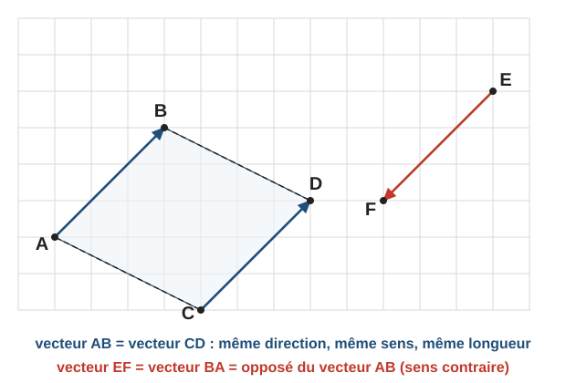

> **Définition (vecteur nul, vecteur opposé).**
> - Le vecteur $\overrightarrow{AA}$ (origine et extrémité confondues) est le **vecteur nul**, noté $\vec{0}$ : la translation de vecteur nul ne déplace aucun point.
> - L’**opposé** du vecteur $\overrightarrow{AB}$ est le vecteur $\overrightarrow{BA}$ : même direction, même longueur, **sens contraire**. On note $\overrightarrow{BA} = -\overrightarrow{AB}$.

Un même vecteur peut être dessiné à partir de n’importe quel point : on le note souvent avec une seule lettre, $\vec{u}$. Sur quadrillage, un vecteur se décrit par un déplacement (« $3$ carreaux à droite, $3$ vers le haut ») : deux vecteurs sont égaux quand ils correspondent au même déplacement.

**Exemple guidé 3 bis.** $ABCD$ est un parallélogramme de centre $O$. Citer un vecteur égal à $\overrightarrow{AB}$, un vecteur égal à $\overrightarrow{AO}$, et l’opposé de $\overrightarrow{AD}$.

**Rédaction.**

> $ABCD$ est un parallélogramme, donc $\overrightarrow{AB} = \overrightarrow{DC}$ : les côtés opposés $[AB]$ et $[DC]$ sont parallèles, de même longueur, et parcourus dans le même sens.  
> Les diagonales se coupent en leur milieu $O$, donc $\overrightarrow{AO} = \overrightarrow{OC}$.  
> L’opposé de $\overrightarrow{AD}$ est $\overrightarrow{DA}$, qui est aussi égal à $\overrightarrow{CB}$.

**Contrôle.** Sur la figure, les flèches $\overrightarrow{AB}$ et $\overrightarrow{DC}$ sont parallèles, de même longueur et vont dans le même sens.

> **Erreur fréquente.** Écrire $\overrightarrow{AB} = \overrightarrow{CD}$ pour le parallélogramme $ABCD$. Les flèches $\overrightarrow{AB}$ et $\overrightarrow{CD}$ ont des sens contraires : $\overrightarrow{CD} = -\overrightarrow{AB}$. De même, $AB = CD$ (longueurs égales) ne suffit pas pour avoir des vecteurs égaux.

### 4.2 Somme de deux vecteurs, relation de Chasles [[Programme 2026 · 3e]]

On applique la translation de vecteur $\vec{u}$, puis la translation de vecteur $\vec{v}$. On admet que le résultat est encore une translation.

> **Définition.** La **somme** $\vec{u} + \vec{v}$ est le vecteur de la translation obtenue en **enchaînant** la translation de vecteur $\vec{u}$ puis celle de vecteur $\vec{v}$.

Si $\vec{u} = \overrightarrow{AB}$, on dessine $\vec{v}$ à partir de $B$ : $\vec{v} = \overrightarrow{BC}$. La première translation envoie $A$ sur $B$, la seconde envoie $B$ sur $C$ : l’enchaînement envoie $A$ sur $C$.

> **Propriété (relation de Chasles).** Pour tous points $A$, $B$, $C$ :
>
> $$\overrightarrow{AB} + \overrightarrow{BC} = \overrightarrow{AC}$$

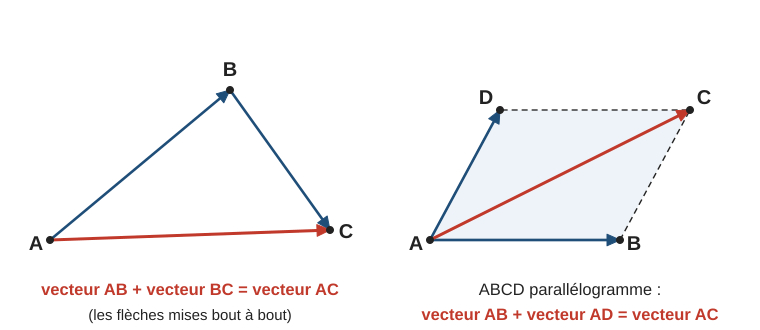

> **Méthode — additionner deux vecteurs.**
> 1. Mettre les flèches **bout à bout** : l’origine de la seconde à l’extrémité de la première.
> 2. La somme va de l’origine de la première à l’extrémité de la seconde.
> 3. Avec des lettres : quand l’extrémité du premier vecteur est l’origine du second (la lettre $B$ dans $\overrightarrow{AB} + \overrightarrow{BC}$), cette lettre « disparaît » : on obtient $\overrightarrow{AC}$.

Conséquences :

- $\overrightarrow{AB} + \overrightarrow{BA} = \overrightarrow{AA} = \vec{0}$ : la somme d’un vecteur et de son opposé est le vecteur nul.
- **Règle du parallélogramme.** Si $ABCD$ est un parallélogramme, $\overrightarrow{AD} = \overrightarrow{BC}$, donc $\overrightarrow{AB} + \overrightarrow{AD} = \overrightarrow{AB} + \overrightarrow{BC} = \overrightarrow{AC}$.

**Exemple guidé 3 ter.** Simplifier $\vec{w} = \overrightarrow{CA} + \overrightarrow{BC} + \overrightarrow{AB}$.

**Rédaction.**

> On change l’ordre des termes pour mettre les flèches bout à bout : $\vec{w} = \overrightarrow{BC} + \overrightarrow{CA} + \overrightarrow{AB}$.  
> Relation de Chasles : $\overrightarrow{BC} + \overrightarrow{CA} = \overrightarrow{BA}$, puis $\overrightarrow{BA} + \overrightarrow{AB} = \overrightarrow{BB} = \vec{0}$.  
> Donc $\vec{w} = \vec{0}$.

**Contrôle.** Partir de $B$, aller en $C$, puis en $A$, puis revenir en $B$ : on est revenu au point de départ.

> **Erreur fréquente.** Confondre vecteurs et longueurs. On a toujours $\overrightarrow{AB} + \overrightarrow{BC} = \overrightarrow{AC}$, mais $AB + BC = AC$ seulement si $B$ est sur le segment $[AC]$ (sinon $AB + BC > AC$, voir chapitre 9, § 3.1).

---

## 5. La rotation [[Programme 2020]]

> **À retenir.** La rotation de **centre** $O$, d’**angle** $\alpha$ et de **sens** donné (sens des aiguilles d’une montre, ou sens inverse) envoie $M$ sur $M'$ tel que $OM' = OM$ et $\widehat{MOM'} = \alpha$, en tournant dans le sens indiqué. Le centre $O$ est invariant.

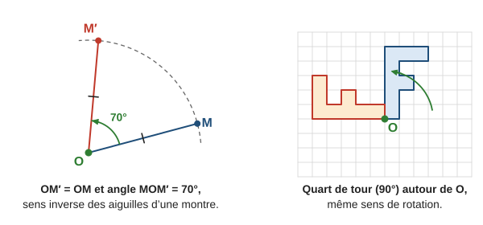

> **Méthode — construire l’image de $M$ par une rotation.**
> 1. Tracer $[OM]$.
> 2. Avec le rapporteur centré en $O$, tracer la demi-droite qui fait l’angle $\alpha$ avec $[OM)$, dans le bon sens.
> 3. Au compas (pointe en $O$, écartement $OM$), placer $M'$ sur cette demi-droite.

Une rotation conserve les longueurs, les angles, les aires et ne retourne pas la figure. La rotation de $180^\circ$ autour de $O$ est la **symétrie de centre $O$**. Un **quart de tour** est une rotation de $90^\circ$ : sur quadrillage, ce qui était « horizontal » devient « vertical ».

**Exemple guidé 4.** La rotation de centre $A$ et d’angle $60^\circ$ envoie $B$ sur $C$. Quelle est la nature du triangle $ABC$ ?

**Réflexion.** Une rotation de centre $A$ conserve la distance à $A$ et fait tourner de l’angle donné.

**Rédaction.**

> $C$ est l’image de $B$ par la rotation de centre $A$, donc $AC = AB$ : le triangle est isocèle en $A$.
>
> De plus $\widehat{BAC} = 60^\circ$. Les angles à la base valent $\dfrac{180^\circ - 60^\circ}{2} = 60^\circ$. Les trois angles mesurent $60^\circ$ : $ABC$ est **équilatéral**.

**Contrôle.** Inversement, dans un triangle équilatéral, la rotation de $60^\circ$ autour d’un sommet envoie un sommet sur un autre.

---

## 6. L’homothétie [[Programme 2020]]

### 6.1 Définition

> **À retenir.** L’homothétie de **centre** $O$ et de **rapport** $k$ (un nombre non nul) envoie $M$ sur $M'$ tel que $O$, $M$, $M'$ soient alignés et :
> - si $k > 0$ : $M'$ est sur la demi-droite $[OM)$ et $OM' = k \times OM$ ;
> - si $k < 0$ : $M'$ est **de l’autre côté** de $O$ et $OM' = (-k) \times OM$.

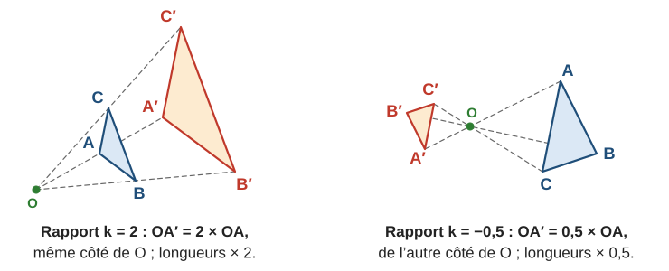

| Rapport | Effet |
|:-:|---|
| $k > 1$ | agrandissement, du même côté de $O$ |
| $0 < k < 1$ | réduction, du même côté de $O$ |
| $k = -1$ | c’est la symétrie de centre $O$ |
| $k < 0$ | la figure passe de l’autre côté de $O$ (agrandie si $k < -1$, réduite si $-1 < k < 0$) |

### 6.2 Propriétés

> **À retenir.** Une homothétie de rapport $k$ :
> - multiplie les **longueurs** par $k$ si $k > 0$, par $-k$ si $k < 0$ ;
> - multiplie les **aires** par $k^2$ ;
> - conserve les **angles**, l’alignement et le parallélisme ; l’image d’une droite est une droite **parallèle**.

C’est exactement l’agrandissement-réduction du chapitre 12 : la configuration de Thalès est une homothétie de centre le point commun aux deux droites.

**Exemple guidé 5.** Un triangle $ABC$ a pour aire $6\,\mathrm{cm}^2$, avec $AB = 4\,\mathrm{cm}$ et $\widehat{A} = 35^\circ$. Par l’homothétie de centre $O$ et de rapport $-2{,}5$, son image est $A'B'C'$. Calculer $A'B'$, $\widehat{A'}$ et l’aire de $A'B'C'$.

**Réflexion.** Rapport négatif : longueurs multipliées par $2{,}5$ ; angles conservés ; aires multipliées par $(-2{,}5)^2$.

**Rédaction.**

> $A'B' = 2{,}5 \times 4 = 10\,\mathrm{cm}$.
>
> Les angles sont conservés : $\widehat{A'} = 35^\circ$.
>
> Aire : $(-2{,}5)^2 = 6{,}25$, donc $6{,}25 \times 6 = 37{,}5\,\mathrm{cm}^2$.

**Contrôle.** Le signe « $-$ » indique seulement que l’image est de l’autre côté de $O$ : une longueur ou une aire n’est jamais négative.

> **Erreur fréquente.** Multiplier l’aire par $k$. Les aires sont multipliées par $k^2$ : un carré de côté $1$ agrandi deux fois devient un carré de côté $2$, qui contient **quatre** carrés de côté $1$.

---

## 7. Bilan : conserver, reconnaître, décorer

### 7.1 Ce qui est conservé

| Transformation | Longueurs | Angles | Aires | Retourne la figure ? | Points invariants |
|---|:-:|:-:|:-:|:-:|---|
| Symétrie axiale | oui | oui | oui | **oui** | les points de l’axe |
| Symétrie centrale | oui | oui | oui | non | le centre |
| Translation | oui | oui | oui | non | aucun |
| Rotation | oui | oui | oui | non | le centre |
| Homothétie de rapport $k$ | $\times k$ ou $\times (-k)$ | oui | $\times k^2$ | non | le centre (si $k \neq 1$) |

Les quatre premières sont des **isométries** : elles conservent les longueurs, donc la figure image est **superposable** à la figure de départ.

> **Méthode — reconnaître une transformation.**
> 1. L’image est-elle **retournée** ? → symétrie axiale (l’axe est la médiatrice de $[AA']$).
> 2. Sinon, a-t-elle **la même taille** ? Si non → homothétie (le centre est l’intersection des droites $(AA')$, $(BB')$).
> 3. Même taille, non retournée : les côtés sont-ils **parallèles** à ceux de départ ? Si oui → translation (même orientation : la F « regarde » dans le même sens) ou symétrie centrale (la F est « tête en bas »). Si non → rotation.

**Exemple guidé 6.** Sur quadrillage, la lettre F a pour image une lettre F « tête en bas », non retournée, de même taille. De quelle transformation peut-il s’agir ?

**Rédaction.**

> Même taille et non retournée : ce n’est ni une homothétie (de rapport différent de $\pm 1$), ni une symétrie axiale.
>
> « Tête en bas » : la figure a fait un demi-tour. C’est une symétrie centrale (rotation de $180^\circ$) ; son centre est le milieu de $[AA']$ pour n’importe quel sommet $A$.

**Contrôle.** Vérifier sur deux sommets que les milieux de $[AA']$ et de $[BB']$ sont le même point.

### 7.2 Frises, rosaces, pavages

Une **frise** répète un motif le long d’une bande ; une **rosace** répète un motif autour d’un point ; un **pavage** recouvre le plan sans trou ni chevauchement.

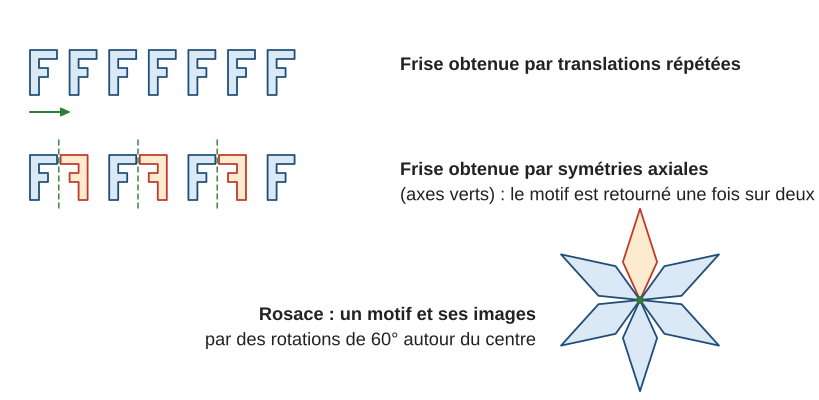

Dans une rosace à $n$ motifs identiques, on passe d’un motif au suivant par une rotation de $\dfrac{360^\circ}{n}$.

---

## 8. Mini-synthèse

> **À retenir.**
> - Symétrie axiale : $(d)$ médiatrice de $[MM']$ ; elle **retourne** la figure.
> - Symétrie centrale : $O$ milieu de $[MM']$ ; demi-tour ; droite image parallèle.
> - Translation de $A$ vers $B$ : $ABM'M$ parallélogramme ; glissement.
> - Vecteurs (3e) : $\overrightarrow{AB} = \overrightarrow{CD}$ si et seulement si $ABDC$ est un parallélogramme ; $\overrightarrow{BA} = -\overrightarrow{AB}$ ; Chasles : $\overrightarrow{AB} + \overrightarrow{BC} = \overrightarrow{AC}$.
> - Rotation de centre $O$, d’angle $\alpha$ : $OM' = OM$, $\widehat{MOM'} = \alpha$, sens précisé.
> - Ces quatre transformations conservent longueurs, angles, aires.
> - Homothétie de rapport $k$ : $O$, $M$, $M'$ alignés ; longueurs $\times k$ (ou $\times(-k)$), aires $\times k^2$, angles conservés.
> - Axes et centres de symétrie : la figure est sa propre image.

---

## 9. Exercices types

> Sur quadrillage, compter les carreaux ; sans quadrillage, utiliser règle, équerre, compas, rapporteur. Justifier par une propriété.

### A. Reconnaître (★)

**A1.** Combien d’axes de symétrie ont : a) un segment ; b) un angle ; c) un cercle ; d) un rectangle non carré ; e) un carré ; f) un triangle équilatéral ; g) un parallélogramme qui n’est ni un rectangle ni un losange ?

**A2.** Écrites en capitales d’imprimerie simples, parmi les lettres A, E, H, N, O, S, X, Z : lesquelles ont au moins un axe de symétrie ? Lesquelles ont un centre de symétrie ?

**A3.** Vrai ou faux ? a) Une symétrie axiale conserve les longueurs. b) Une homothétie de rapport $3$ conserve les longueurs. c) Une translation retourne la figure. d) La symétrie de centre $O$ est la rotation de centre $O$ d’angle $180^\circ$. e) Une rotation conserve les aires.

**A4.** Sur la figure, la lettre F numéro $0$ a quatre images numérotées $1$ à $4$. Pour chacune, nommer la transformation et préciser son élément (axe, centre et angle, ou déplacement).

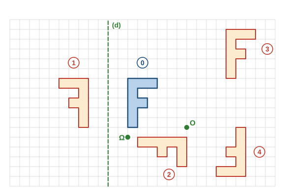

### B. Construire (★ → ★★)

**B1.** Reproduire la figure sur un quadrillage. Construire : $1$) l’image du triangle $ABC$ par la symétrie d’axe $(d)$ ; $2$) son image par la symétrie de centre $O$ ; $3$) son image par la translation de $11$ carreaux vers la droite et $2$ carreaux vers le bas.

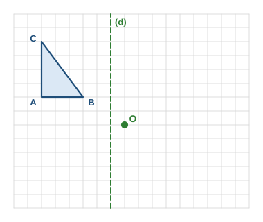

**B2.** Décrire deux méthodes pour construire, sans quadrillage, le symétrique d’un point $M$ par rapport à une droite $(d)$.

**B3.** [[Programme 2020]] Écrire le programme de construction de l’image d’un point $M$ par la rotation de centre $O$, d’angle $50^\circ$, dans le sens des aiguilles d’une montre.

**B4.** Quelle est l’image d’un cercle de centre $I$ et de rayon $3\,\mathrm{cm}$ par la symétrie de centre $O$ ? Par la translation qui envoie $I$ sur $J$ ?

**B5.** ★★ $ABCD$ est un parallélogramme. Quelle est l’image : a) de $A$ par la translation qui envoie $D$ sur $C$ ? b) de $D$ par la translation qui envoie $A$ sur $B$ ? c) de $C$ par la symétrie de centre le milieu de $[AC]$ ?

### C. Utiliser les propriétés (★ → ★★)

**C1.** $A'B'C'$ est l’image du triangle $ABC$ par une symétrie axiale. On sait que $AB = 5\,\mathrm{cm}$, $BC = 7\,\mathrm{cm}$, $AC = 6\,\mathrm{cm}$, $\widehat{ABC} = 57^\circ$ et que l’aire de $ABC$ vaut $14{,}7\,\mathrm{cm}^2$. Donner $A'B'$, $\widehat{A'B'C'}$, le périmètre et l’aire de $A'B'C'$.

**C2.** [[Programme 2020]] La rotation de centre $O$ et d’angle $90^\circ$ envoie $A$ sur $A'$, avec $OA = 4\,\mathrm{cm}$. a) Quelle est la nature du triangle $OAA'$ ? b) Calculer $AA'$ (arrondir au dixième).

**C3.** $A'$ et $B'$ sont les images de $A$ et $B$ par la symétrie de centre $O$ ($O$ n’est pas sur $(AB)$). Montrer que $ABA'B'$ est un parallélogramme.

**C4.** La grande aiguille d’une horloge tourne autour du centre du cadran. De quel angle tourne-t-elle en $20$ minutes ? En $45$ minutes ? De quel angle tourne la petite aiguille en $1$ heure ?

**C5.** ★★ Une translation envoie la droite $(AB)$ sur une droite $(d')$. Que peut-on dire de $(d')$ et $(AB)$ ? Peuvent-elles être sécantes ?

**C6.** [[Programme 2026 · 3e]] $ABCD$ est un parallélogramme de centre $O$. Compléter avec un vecteur dont les extrémités sont des points de la figure : a) $\overrightarrow{AB} = \overrightarrow{D\ldots}$ ; b) $\overrightarrow{BC} = \overrightarrow{\ldots D}$ ; c) $\overrightarrow{OC} = \overrightarrow{A\ldots}$ ; d) $-\overrightarrow{OB} = \overrightarrow{O\ldots}$.

**C7.** [[Programme 2026 · 3e]] Simplifier : a) $\overrightarrow{AB} + \overrightarrow{BC}$ ; b) $\overrightarrow{MN} + \overrightarrow{NP} + \overrightarrow{PQ}$ ; c) $\overrightarrow{EF} + \overrightarrow{FE}$ ; d) $\overrightarrow{BC} + \overrightarrow{AB}$ ; e) $\overrightarrow{AC} + \overrightarrow{CB} + \overrightarrow{BA}$.

**C8.** ★★ [[Programme 2026 · 3e]] On donne trois points $A$, $B$, $C$ non alignés. a) Construire le point $D$ tel que $\overrightarrow{AD} = \overrightarrow{AB} + \overrightarrow{AC}$. b) Quelle est la nature du quadrilatère $ABDC$ ? Justifier.

**C9.** ★★ [[Programme 2026 · 3e]] Vrai ou faux ? Justifier. a) Si $\overrightarrow{AB} = \overrightarrow{CD}$, alors $AB = CD$. b) Si $AB = CD$, alors $\overrightarrow{AB} = \overrightarrow{CD}$. c) Si $\overrightarrow{AM} = \overrightarrow{MB}$, alors $M$ est le milieu de $[AB]$.

### D. Homothétie (★ → ★★★) [[Programme 2020]]

**D1.** Homothétie de centre $I$ et de rapport $3$. Si $IM = 2\,\mathrm{cm}$, combien vaut $IM'$ ? Lequel des points $M$, $M'$ est entre les deux autres ?

**D2.** Même question avec le rapport $-\dfrac{1}{2}$ et $IM = 6\,\mathrm{cm}$.

**D3.** Une homothétie de rapport $2{,}5$ envoie le triangle $ABC$ sur $A'B'C'$. On sait que $AB = 4\,\mathrm{cm}$, $\widehat{B} = 72^\circ$ et que l’aire de $ABC$ est $6\,\mathrm{cm}^2$. Calculer $A'B'$, $\widehat{B'}$ et l’aire de $A'B'C'$.

**D4.** $O$, $A$, $A'$ sont alignés, $OA = 3\,\mathrm{cm}$. Trouver le rapport de l’homothétie de centre $O$ qui envoie $A$ sur $A'$ : a) si $OA' = 7{,}5\,\mathrm{cm}$ et $A'$ est sur $[OA)$ ; b) si $OA' = 1{,}5\,\mathrm{cm}$ et $A'$ est de l’autre côté de $O$.

**D5.** Une homothétie transforme un triangle d’aire $10\,\mathrm{cm}^2$ en un triangle d’aire $40\,\mathrm{cm}^2$. Quels sont les rapports possibles ?

**D6.** ★★★ L’homothétie de centre $O$ et de rapport $1{,}5$ envoie $A$ sur $A'$ et $B$ sur $B'$ ($O$ n’est pas sur $(AB)$). a) Montrer, avec la réciproque du théorème de Thalès, que $(A'B') \parallel (AB)$. b) Si $AB = 4\,\mathrm{cm}$, combien vaut $A'B'$ ?

### E. Frises, rosaces, pavages (★ → ★★)

**E1.** Une rosace est formée de $8$ pétales identiques régulièrement répartis. Quel est le plus petit angle de rotation qui envoie un pétale sur un autre ? Même question avec $5$ pétales.

**E2.** Sur la figure du § 7.2, quelle transformation envoie le premier motif de la frise du haut sur le deuxième ? Et le premier motif de la frise du bas sur le deuxième ?

**E3.** ★★ Un carrelage est formé de carrés identiques. Citer quatre transformations différentes qui envoient un carreau sur un carreau voisin (qui partage un côté avec lui).

---

## 10. Exercices atypiques

### F. Trouver l’erreur (★★)

**F1.** « Pour construire le symétrique de $M$ par rapport à $(d)$, j’ai placé $M'$ de l’autre côté de $(d)$, à la même distance de la droite, un peu plus loin à droite. » Qu’est-ce qui ne va pas ?

**F2.** « Une homothétie de rapport $3$ multiplie l’aire par $3$. »

**F3.** « Un parallélogramme a deux axes de symétrie : ses diagonales. »

**F4.** « Par la symétrie de centre $O$, l’image de la droite $(AB)$ est une droite perpendiculaire à $(AB)$. »

### G. Comprendre et raisonner (★★ → ★★★)

**G1.** ★★★ Sur quadrillage, tracer deux axes verticaux $(d_1)$ et $(d_2)$ distants de $3$ carreaux. Construire l’image $M_1$ d’un point $M$ par la symétrie d’axe $(d_1)$, puis l’image $M_2$ de $M_1$ par la symétrie d’axe $(d_2)$. Recommencer avec d’autres points. Quelle transformation envoie directement $M$ sur $M_2$ ?

**G2.** ★★★ Même question avec deux axes **perpendiculaires** qui se coupent en $O$.

**G3.** ★★ Que se passe-t-il si l’on applique deux fois de suite la même symétrie axiale ? Et deux fois la même symétrie centrale ?

**G4.** ★★ $M'$ est le symétrique de $M$ par rapport à $(d)$, et $P$ est un point de $(d)$. Pourquoi a-t-on $PM = PM'$ ?

**G5.** [[Programme 2020]] ★★★ On donne deux points distincts $M$ et $M'$. Où peut se trouver le centre d’une rotation qui envoie $M$ sur $M'$ ? Combien de telles rotations existe-t-il ?

### H. Plusieurs étapes (★★ → ★★★)

**H1.** [[Programme 2020]] ★★ $ABCD$ est un carré de centre $O$, ses sommets étant nommés dans le sens inverse des aiguilles d’une montre. a) Quelle est l’image de $A$, $B$, $C$, $D$ par la rotation de centre $O$, d’angle $90^\circ$, dans le sens inverse des aiguilles d’une montre ? b) Citer toutes les rotations de centre $O$ (d’angle entre $0^\circ$ et $360^\circ$ exclus) qui laissent le carré globalement invariant.

**H2.** ★★ Un triangle rectangle a pour côtés $3$, $4$ et $5\,\mathrm{cm}$. On lui applique une homothétie de rapport $-2$. Calculer les côtés, le périmètre et l’aire de l’image.

**H3.** [[Programme 2020]] ★★★ $ABC$ est un triangle équilatéral de côté $4\,\mathrm{cm}$. La rotation de centre $A$ et d’angle $60^\circ$ qui envoie $B$ sur $C$ envoie $C$ sur un point $D$. a) Quelle est la nature du triangle $ACD$ ? b) Calculer $\widehat{BAD}$. c) Calculer $BD$ (valeur exacte, puis arrondi au centième). (Indice pour la question c : la hauteur issue de $A$ coupe le triangle $ABD$ en deux triangles rectangles ; chacun est la moitié d’un triangle équilatéral de côté $4\,\mathrm{cm}$.)

**H4.** ★★ Une photo de $10\,\mathrm{cm}$ sur $15\,\mathrm{cm}$ est agrandie pour que son grand côté mesure $30\,\mathrm{cm}$. a) Quel est le rapport d’agrandissement ? b) Dimensions de la photo agrandie ? c) Par combien son aire est-elle multipliée ?

### I. Situations ouvertes (★★ → ★★★)

**I1.** ★★ Inventer une frise qui utilise à la fois des translations et des symétries axiales. Décrire les transformations utilisées.

**I2.** [[Programme 2020]] ★★★ Deux segments $[AB]$ et $[A'B']$ ont la même longueur et ne sont pas parallèles. Comment trouver le centre d’une rotation qui envoie $A$ sur $A'$ et $B$ sur $B'$ ?

**I3.** ★★ Pourquoi dit-on qu’un miroir « inverse la gauche et la droite » mais pas le haut et le bas ? Répondre en termes de symétrie axiale.

---

## 11. Corrigés

> Les corrigés marqués **(modèle)** montrent la rédaction attendue. Les autres donnent les étapes clés.

### Exercices types

**A1.** a) $2$ (la médiatrice et la droite qui porte le segment). b) $1$ (la bissectrice). c) Une infinité (toute droite passant par le centre). d) $2$. e) $4$. f) $3$. g) $0$ (mais un centre de symétrie).

**A2.** Au moins un axe : A, E, H, O, X. Un centre de symétrie : H, N, O, S, X, Z.

**A3.** a) Vrai. b) Faux : elles sont multipliées par $3$. c) Faux : seule la symétrie axiale retourne. d) Vrai. e) Vrai.

**A4. (modèle)**
> Image $1$ : elle est retournée et de même taille → symétrie axiale. Chaque sommet et son image sont à la même distance de $(d)$, de part et d’autre : c’est la symétrie d’axe $(d)$.  
> Image $2$ : même taille, non retournée, les côtés verticaux sont devenus horizontaux → rotation. Le centre est $\Omega$ et c’est un quart de tour ($90^\circ$) dans le sens des aiguilles d’une montre.  
> Image $3$ : même taille, même orientation, côtés parallèles → translation de $10$ carreaux vers la droite et $5$ vers le haut.  
> Image $4$ : même taille, « tête en bas », côtés parallèles → symétrie centrale ; $O$ est le milieu du segment qui joint chaque sommet à son image : symétrie de centre $O$.

**B1. (modèle)**
> $1$) $A$ est à $5$ carreaux à gauche de $(d)$ : son image est à $5$ carreaux à droite, sur la même ligne. De même pour $B$ ($2$ carreaux) et $C$ ($5$ carreaux). L’image est retournée.  
> $2$) Pour aller de $A$ à $O$ : $6$ carreaux à droite, $2$ vers le bas ; on recommence à partir de $O$ pour obtenir l’image de $A$. De même pour $B$ et $C$. L’image est le triangle « tête en bas ».  
> $3$) On déplace chaque sommet de $11$ carreaux vers la droite et $2$ vers le bas.

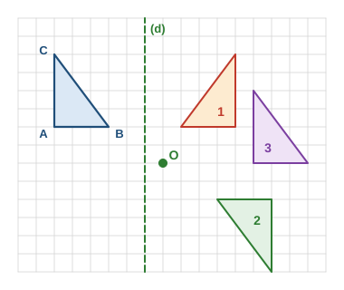

**B2.** Équerre et règle : perpendiculaire à $(d)$ passant par $M$, qui coupe $(d)$ en $H$ ; reporter $HM' = HM$ de l’autre côté. Compas seul : deux points $P$, $Q$ de $(d)$ ; arcs de centre $P$ de rayon $PM$ et de centre $Q$ de rayon $QM$ ; leur second point d’intersection est $M'$.

**B3.** Tracer $[OM]$ ; avec le rapporteur centré en $O$, tracer la demi-droite $[Ox)$ telle que $\widehat{MOx} = 50^\circ$, en tournant dans le sens des aiguilles d’une montre ; placer $M'$ sur $[Ox)$ tel que $OM' = OM$ (compas).

**B4.** Le cercle de centre $I'$ (symétrique de $I$ par rapport à $O$) et de rayon $3\,\mathrm{cm}$. Par la translation : le cercle de centre $J$ et de rayon $3\,\mathrm{cm}$.

**B5.** a) $B$, car $DCBA$ (le parallélogramme $ABCD$ parcouru dans l’autre sens) est un parallélogramme. b) $C$. c) $A$ (le milieu de $[AC]$ est le centre du parallélogramme).

**C1.** Une symétrie conserve longueurs, angles et aires : $A'B' = 5\,\mathrm{cm}$ ; $\widehat{A'B'C'} = 57^\circ$ ; périmètre $5 + 7 + 6 = 18\,\mathrm{cm}$ ; aire $14{,}7\,\mathrm{cm}^2$.

**C2. (modèle)**
> a) La rotation conserve les distances au centre : $OA' = OA = 4\,\mathrm{cm}$. L’angle de la rotation donne $\widehat{AOA'} = 90^\circ$. Donc $OAA'$ est rectangle isocèle en $O$.  
> b) D’après le théorème de Pythagore : $AA'^2 = 4^2 + 4^2 = 32$, donc $AA' = \sqrt{32} \approx 5{,}7\,\mathrm{cm}$.

**C3.** $O$ est le milieu de $[AA']$ et de $[BB']$. Les diagonales $[AA']$ et $[BB']$ du quadrilatère $ABA'B'$ se coupent en leur milieu : c’est un parallélogramme.

**C4.** La grande aiguille fait un tour ($360^\circ$) en $60$ minutes, soit $6^\circ$ par minute : $20 \times 6 = 120^\circ$ ; $45 \times 6 = 270^\circ$. La petite aiguille fait un tour en $12$ heures : $\dfrac{360}{12} = 30^\circ$ en $1$ heure.

**C5.** L’image d’une droite par une translation est une droite parallèle : $(d') \parallel (AB)$. Elles ne peuvent pas être sécantes (elles peuvent être confondues si la translation glisse le long de $(AB)$).

**C6.** a) $\overrightarrow{AB} = \overrightarrow{DC}$ ; b) $\overrightarrow{BC} = \overrightarrow{AD}$ ; c) $O$ est le milieu de $[AC]$, donc $\overrightarrow{OC} = \overrightarrow{AO}$ ; d) $-\overrightarrow{OB} = \overrightarrow{BO} = \overrightarrow{OD}$ ($O$ est aussi le milieu de $[BD]$).

**C7.** a) $\overrightarrow{AC}$ ; b) $\overrightarrow{MQ}$ ; c) $\overrightarrow{EE} = \vec{0}$ ; d) on change l’ordre : $\overrightarrow{AB} + \overrightarrow{BC} = \overrightarrow{AC}$ ; e) $\overrightarrow{AC} + \overrightarrow{CB} = \overrightarrow{AB}$, puis $\overrightarrow{AB} + \overrightarrow{BA} = \vec{0}$.

**C8. (modèle)**
> a) On trace la flèche $\overrightarrow{AC}$ à partir de $B$ : on obtient un point $D$ tel que $\overrightarrow{BD} = \overrightarrow{AC}$. Alors $\overrightarrow{AB} + \overrightarrow{AC} = \overrightarrow{AB} + \overrightarrow{BD} = \overrightarrow{AD}$ (relation de Chasles).  
> b) $\overrightarrow{BD} = \overrightarrow{AC}$ signifie que $BDCA$ est un parallélogramme ; en partant de $A$, c’est le même quadrilatère que $ABDC$. Donc $ABDC$ est un parallélogramme (non aplati, car $A$, $B$, $C$ ne sont pas alignés).

**C9.** a) Vrai : deux vecteurs égaux ont la même longueur. b) Faux : par exemple $\overrightarrow{BA}$ a la même longueur que $\overrightarrow{AB}$, mais pas le même sens ($\overrightarrow{BA} = -\overrightarrow{AB}$ ; ils ne sont égaux que si $A = B$). c) Vrai : $\overrightarrow{AM}$ et $\overrightarrow{MB}$ ont la même direction, donc $A$, $M$, $B$ sont alignés ; le même sens, donc $M$ est entre $A$ et $B$ ; la même longueur, donc $AM = MB$. Ainsi $M$ est le milieu de $[AB]$.

**D1.** $IM' = 3 \times 2 = 6\,\mathrm{cm}$, sur $[IM)$ : $M$ est entre $I$ et $M'$.

**D2.** $IM' = \dfrac{1}{2} \times 6 = 3\,\mathrm{cm}$, de l’autre côté de $I$ : c’est $I$ qui est entre $M$ et $M'$.

**D3. (modèle)**
> Les longueurs sont multipliées par $2{,}5$ : $A'B' = 2{,}5 \times 4 = 10\,\mathrm{cm}$.  
> Les angles sont conservés : $\widehat{B'} = 72^\circ$.  
> Les aires sont multipliées par $2{,}5^2 = 6{,}25$ : $6{,}25 \times 6 = 37{,}5\,\mathrm{cm}^2$.

**D4.** a) $\dfrac{7{,}5}{3} = 2{,}5$, même côté : $k = 2{,}5$. b) $\dfrac{1{,}5}{3} = 0{,}5$, de l’autre côté : $k = -0{,}5$.

**D5.** $k^2 = \dfrac{40}{10} = 4$, donc $k = 2$ ou $k = -2$.

**D6.** a) $A' \in [OA)$, $B' \in [OB)$ et $\dfrac{OA'}{OA} = \dfrac{OB'}{OB} = 1{,}5$ ; les points $O, A, A'$ et $O, B, B'$ sont alignés dans le même ordre. D’après la réciproque du théorème de Thalès, $(A'B') \parallel (AB)$. b) $A'B' = 1{,}5 \times 4 = 6\,\mathrm{cm}$.

**E1.** $\dfrac{360}{8} = 45^\circ$ ; $\dfrac{360}{5} = 72^\circ$.

**E2.** Frise du haut : une translation (vers la droite). Frise du bas : une symétrie axiale (axe vert entre les deux motifs).

**E3. (modèle)**
> Les deux carreaux voisins ont un côté commun $[PQ]$, de milieu $I$.  
> La symétrie d’axe $(PQ)$ (pliage le long du côté commun).  
> La symétrie de centre $I$ (demi-tour autour du milieu du côté commun).  
> La translation qui envoie un carreau sur l’autre (glissement d’une longueur de côté).  
> La rotation de centre $P$ (ou $Q$) et d’angle $90^\circ$, dans le bon sens.

### Exercices atypiques

**F1. (modèle)**
> Le point $M'$ doit être sur la **perpendiculaire** à $(d)$ passant par $M$. « Un peu plus loin à droite », il ne l’est plus : $(d)$ n’est alors pas la médiatrice de $[MM']$.  
> Correction : tracer la perpendiculaire à $(d)$ passant par $M$, qui coupe $(d)$ en $H$, puis placer $M'$ sur cette perpendiculaire avec $HM' = HM$.

**F2.** Les aires sont multipliées par $k^2 = 9$.

**F3.** Faux en général : en pliant un parallélogramme quelconque le long d’une diagonale, les deux moitiés ne se superposent pas. Il n’a aucun axe de symétrie (sauf si c’est un rectangle ou un losange), mais il a un centre de symétrie.

**F4.** L’image d’une droite par une symétrie centrale est une droite **parallèle** (ou la même droite si $O$ est sur $(AB)$).

**G1. (modèle)**
> On constate que $M_2$ est toujours obtenu à partir de $M$ par le même glissement horizontal de $6$ carreaux (le double de la distance entre les axes), dans le sens de $(d_1)$ vers $(d_2)$.  
> Explication : numérotons les colonnes du quadrillage, $(d_1)$ sur la colonne $0$ et $(d_2)$ sur la colonne $3$. Le symétrique par rapport à $(d_1)$ d’un point de la colonne $x$ est sur la colonne $-x$ ; le symétrique par rapport à $(d_2)$ d’un point de la colonne $y$ est sur la colonne $6 - y$. Donc $M$ (colonne $x$) donne $M_1$ (colonne $-x$), puis $M_2$ (colonne $6 - (-x) = x + 6$), sur la même ligne.  
> C’est la translation de $6$ carreaux, perpendiculairement aux axes.

**G2.** La symétrie de centre $O$ : la première symétrie change le côté gauche/droite, la seconde le côté haut/bas ; au total, $O$ est le milieu de $[MM_2]$.

**G3.** On revient au point de départ : chaque point est sa propre image (c’est vrai pour les deux).

**G4.** $(d)$ est la médiatrice de $[MM']$, et tout point de la médiatrice est à égale distance des extrémités du segment.

**G5.** Le centre $O$ vérifie $OM = OM'$ : il est sur la médiatrice de $[MM']$. Tout point de cette médiatrice convient (l’angle est alors $\widehat{MOM'}$) : il y a une infinité de rotations.

**H1.** a) $A \to B$, $B \to C$, $C \to D$, $D \to A$. b) $90^\circ$, $180^\circ$, $270^\circ$.

**H2.** Longueurs multipliées par $2$ : $6$, $8$, $10\,\mathrm{cm}$ ; périmètre $24\,\mathrm{cm}$. Aire de départ $\dfrac{3 \times 4}{2} = 6\,\mathrm{cm}^2$, multipliée par $(-2)^2 = 4$ : $24\,\mathrm{cm}^2$ (ou directement $\dfrac{6 \times 8}{2} = 24$).

**H3. (modèle)**
> a) $D$ est l’image de $C$ par la rotation de centre $A$ d’angle $60^\circ$ : $AD = AC$ et $\widehat{CAD} = 60^\circ$. Comme dans l’exemple guidé 4, $ACD$ est équilatéral.  
> b) $\widehat{BAD} = \widehat{BAC} + \widehat{CAD} = 60^\circ + 60^\circ = 120^\circ$.  
> c) Le triangle $ABD$ est isocèle en $A$ ($AB = AD = 4\,\mathrm{cm}$). Sa hauteur issue de $A$ est aussi médiane ; elle coupe $[BD]$ en $H$, milieu de $[BD]$, et partage l’angle de $120^\circ$ en deux angles de $60^\circ$. Dans le triangle $ABH$ rectangle en $H$, l’angle $\widehat{ABH} = 30^\circ$, donc $AH = \dfrac{AB}{2} = 2\,\mathrm{cm}$ (moitié d’un triangle équilatéral). Pythagore : $BH^2 = 4^2 - 2^2 = 12$, $BH = \sqrt{12}$.  
> $BD = 2\sqrt{12} = 4\sqrt{3} \approx 6{,}93\,\mathrm{cm}$.

**H4.** a) $\dfrac{30}{15} = 2$. b) $20\,\mathrm{cm}$ sur $30\,\mathrm{cm}$. c) Par $2^2 = 4$ ($150 \to 600\,\mathrm{cm}^2$).

**I1.** Exemple : un motif F, son symétrique par rapport à un axe vertical, puis ce couple répété par translations (c’est la frise du bas du § 7.2). Toute réponse décrivant correctement ses transformations est juste.

**I2. (modèle)**
> Le centre $O$ doit vérifier $OA = OA'$ : il est sur la médiatrice de $[AA']$. Il doit aussi vérifier $OB = OB'$ : il est sur la médiatrice de $[BB']$.  
> On trace ces deux médiatrices : leur point d’intersection est le centre cherché. L’angle de la rotation est alors $\widehat{AOA'}$ (on vérifie qu’il est égal à $\widehat{BOB'}$).

**I3.** Le miroir réalise une symétrie par rapport à son plan (l’équivalent, dans l’espace, de la symétrie axiale) : chaque point passe « derrière » le miroir, sur la perpendiculaire au miroir, sans monter ni descendre et sans aller à gauche ou à droite. Ce qui change, c’est l’avant et l’arrière ; mais comme la figure est **retournée**, une main droite devient une main gauche, et c’est ce retournement qu’on interprète comme une inversion gauche-droite.

---

## 12. Liens avec les autres chapitres

- **Chapitre 9** (géométrie plane) : médiatrice (symétrie axiale), parallélogramme (symétrie centrale, translation), triangle équilatéral (rotation de $60^\circ$).
- **Chapitre 11** (Pythagore) : longueurs après une rotation (C2, H3).
- **Chapitre 12** (Thalès) : l’homothétie est la transformation de l’agrandissement-réduction ; réciproque de Thalès (D6).
- **Chapitre 14** (aires et volumes) : aires multipliées par $k^2$ ; volumes par $k^3$ dans l’espace.
- **Chapitre 15** (espace) : plans de symétrie des solides.

---

## 13. Fiche-synthèse

| Je dois savoir… | Comment | Exemple express | S’entraîner |
|---|---|---|---|
| Construire par symétrie axiale | l’axe est la médiatrice de $[MM']$ | compter les carreaux de part et d’autre de l’axe | série B |
| Construire par symétrie centrale | $O$ est le milieu de $[MM']$ | de $A$ à $O$ : $6$ à droite, $2$ en bas ; on recommence depuis $O$ | série B |
| Construire par translation | même déplacement pour tous les points | $11$ carreaux à droite et $2$ vers le bas | série B |
| Vecteurs égaux [[Programme 2026 · 3e]] | $\overrightarrow{AB} = \overrightarrow{CD}$ si et seulement si $ABDC$ est un parallélogramme | $ABCD$ parallélogramme : $\overrightarrow{AB} = \overrightarrow{DC}$ | série C |
| Relation de Chasles [[Programme 2026 · 3e]] | flèches bout à bout : la lettre du milieu disparaît | $\overrightarrow{MN} + \overrightarrow{NP} = \overrightarrow{MP}$ | série C |
| Construire par rotation [[Programme 2020]] | même distance au centre, même angle, sens précisé | quart de tour dans le sens des aiguilles d’une montre | séries A et C |
| Reconnaître une transformation | retournée ? tournée ? simplement glissée ? | retournée et de même taille : symétrie axiale | série A |
| Utiliser une homothétie [[Programme 2020]] | $O$, $M$, $M'$ alignés ; longueurs $\times k$, aires $\times k^2$ | $k = 3$ : un côté de $2$ devient $6$, une aire est multipliée par $9$ | série D |

**Pièges à éviter :** toujours préciser le sens d’une rotation ; une symétrie centrale n’est pas une symétrie axiale ; une homothétie ne conserve pas les longueurs (si $k \neq 1$ et $k \neq -1$).

---

*Version v0.3 — relecture (prérequis harmonisés, fiche-synthèse, corrections : voir `PLAN-REVISION.md`, § 10). Base : v0.2 — révision vague 2 (cours développé : symétrie axiale et axes de symétrie, symétrie centrale et centre de symétrie, translation, rotation, homothétie de rapport positif ou négatif, tableau de ce qui est conservé, méthode pour reconnaître une transformation, frises et rosaces ; 11 figures SVG dont exercices sur quadrillage et corrigé ; 39 exercices corrigés). Ancienne version : `cours-et-exercices.md.bak` (anciennes figures dans `figures-v01.bak/`).*
