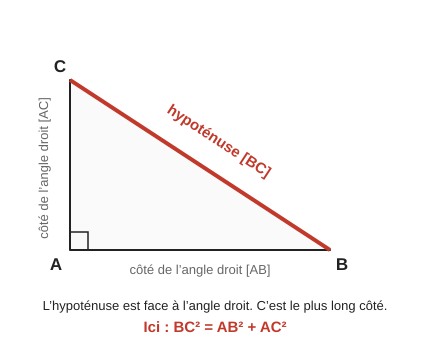
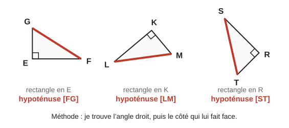
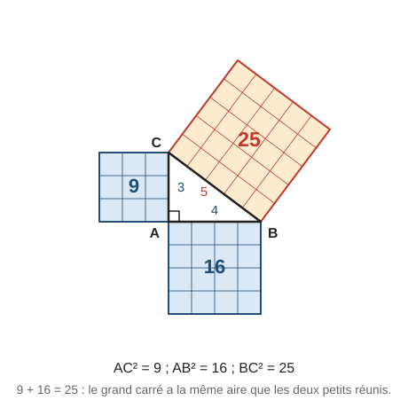
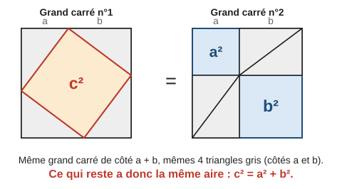
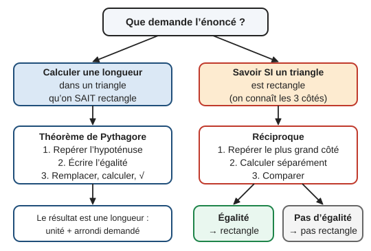
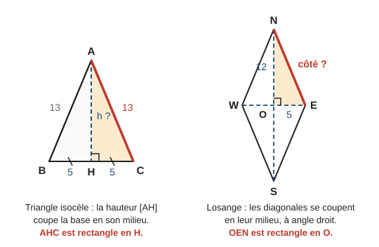
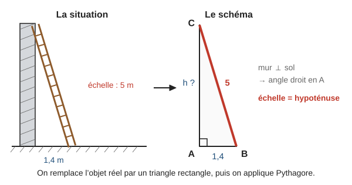
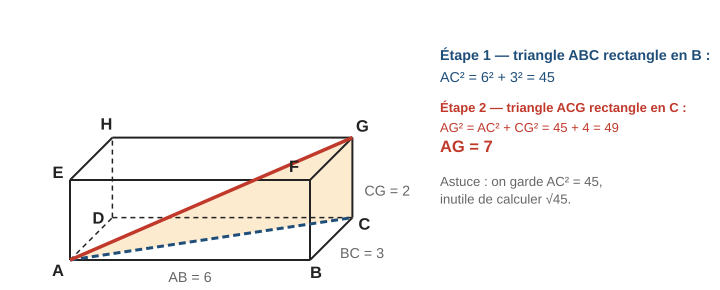
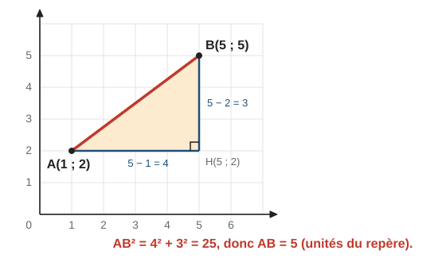

# Théorème de Pythagore

> Compendium collège — chapitre unifié (sans découpage 6e / 5e / 4e / 3e).  
> Cours compact pour un élève de niveau moyen : intuition, méthode, exemples guidés, erreurs fréquentes, puis exercices progressifs (★ facile, ★★ standard, ★★★ approfondissement) avec corrigés détaillés.

---

## 0. Ce qu’on vise

**En une phrase :** dans un triangle rectangle, les trois côtés sont liés par une égalité. Si on connaît deux côtés, on calcule le troisième. Et dans l’autre sens, cette égalité permet de **prouver** qu’un angle est droit.

À la fin de ce chapitre, je sais :

1. Repérer l’**hypoténuse** d’un triangle rectangle, même quand la figure est tournée.
2. Calculer une longueur avec le **théorème de Pythagore** (hypoténuse ou côté de l’angle droit).
3. Prouver qu’un triangle est rectangle (ou ne l’est pas) avec la **réciproque**.
4. **Rédiger** proprement ces deux raisonnements.
5. Repérer un triangle rectangle « caché » dans une figure ou une situation concrète.

> **Prérequis.** Carrés et racine carrée (chapitre 4, § 6), rappelés au § 1 ; vocabulaire du triangle (chapitre 9, § 3).

---

## 1. Rappel : carrés et racine carrée

Ce chapitre utilise sans cesse les **carrés** et la **racine carrée**, définis au **chapitre 4, § 6** : carrés parfaits de $1^2$ à $15^2$, définition de $\sqrt{a}$ (le nombre **positif** dont le carré vaut $a$), encadrement entre deux entiers, valeur approchée à la calculatrice et arrondi. Les revoir avant de commencer si besoin.

> **Pourquoi on en a besoin.** Pythagore donne d’abord le **carré** d’une longueur (par exemple $BC^2 = 25$). Pour obtenir la longueur elle-même, on prend la racine carrée : $BC = \sqrt{25} = 5$.

> **Erreur fréquente.** $\sqrt{9 + 16} = \sqrt{25} = 5$, mais $\sqrt{9} + \sqrt{16} = 3 + 4 = 7$. La racine d’une somme n’est **pas** la somme des racines.

---

## 2. Le triangle rectangle et son hypoténuse

Un triangle **rectangle** a un angle droit. Ses côtés n’ont pas tous le même rôle :

- l’**hypoténuse** est le côté **face à l’angle droit** ;
- les deux autres côtés sont les **côtés de l’angle droit** (ils forment l’angle droit).

L’hypoténuse est toujours le **plus long** des trois côtés.

**Repérer l’hypoténuse quand le triangle est tourné.** On ne se fie pas à la position sur la feuille. On cherche l’angle droit (le petit carré, ou la phrase « rectangle en … »), puis le côté qui ne touche pas ce sommet.

> **Astuce de lecture.** « $EFG$ rectangle en $E$ » : l’angle droit est en $E$. L’hypoténuse est le côté formé par les **deux autres lettres** : $[FG]$.

---

## 3. Le théorème de Pythagore

### 3.1 Énoncé

> **Théorème de Pythagore.** Si un triangle $ABC$ est rectangle en $A$, alors le carré de l’hypoténuse est égal à la somme des carrés des deux autres côtés :
>
> $$BC^2 = AB^2 + AC^2$$

Avec des lettres neutres : si l’hypoténuse mesure $c$ et les côtés de l’angle droit $a$ et $b$, alors $c^2 = a^2 + b^2$.

On l’utilise quand on **sait** que le triangle est rectangle et qu’on cherche une **longueur**.

### 3.2 Ce que l’égalité veut dire : des aires

$BC^2$ est l’aire du carré construit sur $[BC]$. Le théorème dit donc : **l’aire du carré construit sur l’hypoténuse est égale à la somme des aires des carrés construits sur les deux autres côtés.**

Sur un triangle de côtés 3, 4 et 5, on peut compter les petits carreaux : $9 + 16 = 25$.

### 3.3 Pourquoi c’est vrai : une preuve par puzzle

On dessine deux grands carrés identiques, de côté $a + b$. Dans chacun, on place **quatre** triangles rectangles identiques (côtés de l’angle droit $a$ et $b$, hypoténuse $c$).

- Dans le premier, il reste un carré de côté $c$ : aire $c^2$.
- Dans le second, il reste deux carrés : aires $a^2$ et $b^2$.

Les grands carrés ont la même aire et on a enlevé la même chose. Les restes sont donc égaux : $c^2 = a^2 + b^2$.

### 3.4 Exemple guidé 1 — calculer l’hypoténuse

**Énoncé.** $ABC$ est rectangle en $A$, avec $AB = 5\,\mathrm{cm}$ et $AC = 12\,\mathrm{cm}$. Calculer $BC$.

**Réflexion.** Le triangle est rectangle en $A$, donc l’hypoténuse est $[BC]$. C’est justement la longueur cherchée.

**Rédaction.**

> Le triangle $ABC$ est rectangle en $A$. D’après le théorème de Pythagore :
>
> $$BC^2 = AB^2 + AC^2$$
> $$BC^2 = 5^2 + 12^2 = 25 + 144 = 169$$
>
> Donc $BC = \sqrt{169} = 13\,\mathrm{cm}$.

**Contrôle.** $13$ est bien plus grand que $5$ et que $12$ : c’est cohérent pour une hypoténuse.

### 3.5 Exemple guidé 2 — calculer un côté de l’angle droit

**Énoncé.** $EFG$ est rectangle en $F$, avec $EG = 10\,\mathrm{cm}$ et $EF = 6\,\mathrm{cm}$. Calculer $FG$.

**Réflexion.** Rectangle en $F$, donc l’hypoténuse est $[EG]$. Cette fois, on connaît l’hypoténuse : la longueur cherchée est un côté de l’angle droit. On va devoir **soustraire**.

**Rédaction.**

> Le triangle $EFG$ est rectangle en $F$. D’après le théorème de Pythagore :
>
> $$EG^2 = EF^2 + FG^2$$
> $$10^2 = 6^2 + FG^2$$
> $$100 = 36 + FG^2$$
> $$FG^2 = 100 - 36 = 64$$
>
> Donc $FG = \sqrt{64} = 8\,\mathrm{cm}$.

**Contrôle.** $8 < 10$ : un côté de l’angle droit est plus court que l’hypoténuse. C’est cohérent.

### 3.6 Exemple guidé 3 — quand le résultat n’est pas entier

**Énoncé.** $RST$ est rectangle en $S$, avec $RS = 3\,\mathrm{cm}$ et $ST = 5\,\mathrm{cm}$. Calculer $RT$, arrondi au millimètre.

> Le triangle $RST$ est rectangle en $S$. D’après le théorème de Pythagore :
>
> $$RT^2 = RS^2 + ST^2 = 3^2 + 5^2 = 9 + 25 = 34$$
>
> Donc $RT = \sqrt{34} \approx 5{,}8\,\mathrm{cm}$ (arrondi au millimètre).

Au millimètre près, avec des longueurs en centimètres, on garde **un** chiffre après la virgule. La valeur exacte est $\sqrt{34}$.

### 3.7 Méthode en 4 étapes

> **Méthode — calculer une longueur avec Pythagore.**
>
> 1. **Justifier** : écrire que le triangle est rectangle, et en quel sommet.
> 2. **Repérer** l’hypoténuse (face à l’angle droit) et écrire l’égalité avec les lettres de la figure : « hypoténuse² = côté² + côté² ».
> 3. **Remplacer** par les valeurs connues, puis calculer le carré cherché (addition si on cherche l’hypoténuse, soustraction sinon).
> 4. **Conclure** avec la racine carrée, l’unité et l’arrondi demandé. Vérifier que l’hypoténuse reste le plus grand côté.

### 3.8 Erreurs fréquentes

> **Erreur 1 — se tromper d’hypoténuse.** Dans $ABC$ rectangle en $A$ avec $AB = 5$ et $BC = 13$, écrire $AC^2 = 5^2 + 13^2$ est faux : $[BC]$ est l’hypoténuse. On trouverait $AC \approx 13{,}9$, plus long que l’hypoténuse : impossible.

> **Erreur 2 — oublier la racine.** $BC^2 = 25$ ne donne pas $BC = 25$ mais $BC = 5$.

> **Erreur 3 — « simplifier » la racine.** $\sqrt{6^2 + 8^2}$ ne vaut pas $6 + 8 = 14$. On calcule d’abord : $\sqrt{36 + 64} = \sqrt{100} = 10$.

> **Erreur 4 — appliquer Pythagore sans angle droit.** Le théorème ne marche **que** dans un triangle rectangle. Sans angle droit, l’égalité est fausse.

> **Erreur 5 — mélanger les unités.** Toutes les longueurs doivent être dans la même unité **avant** de calculer.

---

## 4. La réciproque : prouver qu’un triangle est rectangle

### 4.1 Énoncé

> **Réciproque du théorème de Pythagore.** Si, dans un triangle $ABC$, on a $BC^2 = AB^2 + AC^2$, alors le triangle est rectangle en $A$.

Le sommet de l’angle droit est **en face du plus grand côté**.

**Le théorème et sa réciproque ne servent pas à la même chose :**

| | On sait… | On veut… | Outil |
|---|---|---|---|
| Cas 1 | le triangle est rectangle | calculer une longueur | Théorème de Pythagore |
| Cas 2 | les trois longueurs | savoir s’il est rectangle | Réciproque (égalité vraie) ou contraposée (égalité fausse) |

**Et si l’égalité est fausse ?** On utilise alors la **contraposée** du théorème.

> **Contraposée du théorème de Pythagore.** [[Programme 2026 · 4e]] Si, dans un triangle $ABC$, $BC^2 \neq AB^2 + AC^2$, alors le triangle $ABC$ **n’est pas** rectangle en $A$.

Comme l’hypoténuse est toujours le plus grand côté, il suffit de tester le **plus grand côté** : si $[BC]$ est le plus grand côté et $BC^2 \neq AB^2 + AC^2$, le triangle n’est rectangle en **aucun** sommet.

> **Pourquoi — théorème, réciproque, contraposée.** [[Programme 2026 · 4e]] Un théorème s’écrit « si **P**, alors **Q** ». Ici, **P** : « $ABC$ est rectangle en $A$ » ; **Q** : « $BC^2 = AB^2 + AC^2$ ».
> - La **réciproque** échange les rôles : « si **Q**, alors **P** ». Elle peut être vraie ou fausse : il faut la démontrer à part (pour Pythagore, elle est vraie).
> - La **contraposée** s’écrit « si **non Q**, alors **non P** ». Elle est **toujours vraie** quand le théorème est vrai : si $ABC$ était rectangle en $A$, le théorème donnerait l’égalité ; comme l’égalité est fausse, $ABC$ n’est pas rectangle en $A$.
>
> Exemple hors des maths : « s’il pleut, alors le sol est mouillé ». Contraposée (vraie) : « si le sol n’est pas mouillé, alors il ne pleut pas ». Réciproque (fausse) : « si le sol est mouillé, alors il pleut » (on a pu l’arroser).

### 4.2 Méthode : calculer séparément, puis comparer

> **Méthode — tester si un triangle est rectangle.**
>
> 1. Repérer le **plus grand côté**.
> 2. Calculer **son carré** d’un côté.
> 3. Calculer **la somme des carrés** des deux autres côtés, de l’autre côté.
> 4. **Comparer** les deux résultats et conclure :
>    - égaux → d’après la réciproque, le triangle est rectangle, l’angle droit est face au plus grand côté ;
>    - différents → d’après la contraposée, le triangle n’est pas rectangle.

### 4.3 Exemple guidé 4 — le triangle est rectangle

**Énoncé.** $MNP$ a pour côtés $MN = 8\,\mathrm{cm}$, $NP = 17\,\mathrm{cm}$ et $MP = 15\,\mathrm{cm}$. Est-il rectangle ?

> Le plus grand côté est $[NP]$.
>
> D’une part : $NP^2 = 17^2 = 289$.  
> D’autre part : $MN^2 + MP^2 = 8^2 + 15^2 = 64 + 225 = 289$.
>
> On constate que $NP^2 = MN^2 + MP^2$. D’après la réciproque du théorème de Pythagore, le triangle $MNP$ est rectangle en $M$.

(L’angle droit est en $M$ : c’est le sommet qui n’appartient pas à $[NP]$.)

### 4.4 Exemple guidé 5 — le triangle n’est pas rectangle

**Énoncé.** $DEF$ a pour côtés $DE = 6\,\mathrm{cm}$, $EF = 9\,\mathrm{cm}$ et $DF = 7\,\mathrm{cm}$. Est-il rectangle ?

> Le plus grand côté est $[EF]$.
>
> D’une part : $EF^2 = 9^2 = 81$.  
> D’autre part : $DE^2 + DF^2 = 6^2 + 7^2 = 36 + 49 = 85$.
>
> On constate que $EF^2 \neq DE^2 + DF^2$. D’après la contraposée du théorème de Pythagore, le triangle $DEF$ n’est pas rectangle (s’il l’était, d’après le théorème de Pythagore, on aurait l’égalité).

### 4.5 Erreurs fréquentes

> **Erreur 1 — écrire l’égalité avant de l’avoir vérifiée.** Commencer par « $EF^2 = DE^2 + DF^2$ » revient à affirmer ce qu’on veut prouver. On calcule les deux membres **séparément** (« d’une part… d’autre part… »), puis on compare.

> **Erreur 2 — ne pas prendre le plus grand côté.** Avec $8$, $15$, $17$, tester $15^2 = 8^2 + 17^2$ n’a aucun sens : seul le plus grand côté peut être l’hypoténuse.

> **Erreur 3 — se tromper de sommet.** L’angle droit est **en face** du plus grand côté, pas à une de ses extrémités.

> **Erreur 4 — conclure avec des valeurs arrondies.** Si les longueurs sont des valeurs approchées (mesures sur une figure), l’égalité peut « presque » marcher. On conclut seulement avec des valeurs exactes.

*Pour aller plus loin (★★★, hors programme) :* si le carré du plus grand côté est **plus petit** que la somme des deux autres carrés, les trois angles sont aigus ; s’il est **plus grand**, l’angle face au plus grand côté est obtus.

---

## 5. Applications : trouver le triangle rectangle

Dans la plupart des problèmes, le triangle rectangle n’est pas donné tout fait. Il faut le **trouver** (ou le tracer), puis appliquer la méthode.

### 5.1 Diagonale d’un rectangle ou d’un carré

Une diagonale coupe un rectangle en deux triangles rectangles. Pour un rectangle de longueur $L$ et de largeur $\ell$ :

$$d^2 = L^2 + \ell^2$$

*Exemple :* rectangle $8\,\mathrm{cm}$ sur $6\,\mathrm{cm}$ : $d^2 = 64 + 36 = 100$, donc $d = 10\,\mathrm{cm}$.

Pour un carré de côté $c$ : $d^2 = c^2 + c^2 = 2c^2$, donc $d = \sqrt{2c^2}$ (valeur exacte $c\sqrt{2}$ : chapitre 4, § 6, ★★★).  
*Exemple :* carré de côté $4\,\mathrm{cm}$ : $d^2 = 32$, $d = \sqrt{32} \approx 5{,}7\,\mathrm{cm}$.

### 5.2 Hauteur d’un triangle isocèle, côté d’un losange

**Triangle isocèle.** Dans $ABC$ isocèle en $A$, la hauteur $[AH]$ tombe au **milieu** de la base. Avec $AB = AC = 13$ et $BC = 10$ : $HC = 5$. Dans $AHC$ rectangle en $H$ :

$$AC^2 = AH^2 + HC^2 \quad\text{donc}\quad 169 = AH^2 + 25 \quad\text{donc}\quad AH^2 = 144,\ AH = 12.$$

**Losange.** Les diagonales se coupent **en leur milieu** et **à angle droit**. Avec des diagonales de $10$ et $24$ : $OE = 5$ et $ON = 12$. Dans $OEN$ rectangle en $O$ :

$$EN^2 = OE^2 + ON^2 = 25 + 144 = 169 \quad\text{donc}\quad EN = 13.$$

**Triangle équilatéral** de côté $a$ : même idée que l’isocèle (la hauteur coupe la base en deux moitiés de $\dfrac{a}{2}$).

### 5.3 Situations concrètes : modéliser

Méthode : (1) faire un **schéma** à main levée ; (2) repérer l’angle droit (mur vertical et sol horizontal, coin d’une pièce, directions nord et est…) ; (3) nommer les points ; (4) appliquer la méthode du § 3.7.

**Exemple guidé 6.** Une échelle de $5\,\mathrm{m}$ est appuyée contre un mur vertical. Son pied est à $1{,}4\,\mathrm{m}$ du mur. À quelle hauteur touche-t-elle le mur ?

> Le mur est perpendiculaire au sol : le triangle $ABC$ est rectangle en $A$ (schéma ci-dessus). L’échelle $[BC]$ est l’hypoténuse. D’après le théorème de Pythagore :
>
> $$BC^2 = AB^2 + AC^2 \quad\text{donc}\quad 5^2 = 1{,}4^2 + AC^2$$
> $$25 = 1{,}96 + AC^2 \quad\text{donc}\quad AC^2 = 23{,}04$$
>
> $AC = \sqrt{23{,}04} = 4{,}8$. L’échelle touche le mur à $4{,}8\,\mathrm{m}$ de hauteur.

### 5.4 Pythagore deux fois : diagonale d’un pavé (★★★)

Pour la grande diagonale $[AG]$ d’un pavé droit, on enchaîne **deux** triangles rectangles : d’abord sur la base, puis dans un plan vertical.

Pavé de dimensions $AB = 6$, $BC = 3$, $CG = 2$ :

- dans $ABC$ rectangle en $B$ : $AC^2 = 6^2 + 3^2 = 45$ ;
- dans $ACG$ rectangle en $C$ (l’arête $[CG]$ est verticale) : $AG^2 = AC^2 + CG^2 = 45 + 4 = 49$, donc $AG = 7$.

> **Astuce.** On n’a jamais calculé $AC$ : on a gardé $AC^2 = 45$. Garder le carré évite les arrondis en cascade.

### 5.5 Distance dans un repère (pour aller plus loin, ★★★)

Dans un repère orthonormé, pour aller de $A$ à $B$, on avance horizontalement puis verticalement. Ces deux déplacements forment un angle droit.

Avec $A(1\,;2)$ et $B(5\,;5)$ : écart horizontal $5 - 1 = 4$, écart vertical $5 - 2 = 3$, donc $AB^2 = 4^2 + 3^2 = 25$ et $AB = 5$.

Formule générale (vue au lycée) : $AB^2 = (x_B - x_A)^2 + (y_B - y_A)^2$. Un écart négatif ne pose pas de problème : son carré est positif.

---

## 6. Mini-synthèse

> **À retenir.**
>
> - Hypoténuse = côté **face à l’angle droit** = **plus long** côté.
> - **Théorème** (on sait que c’est rectangle → on calcule une longueur) : hypoténuse² = côté² + côté².
> - On cherche l’hypoténuse → on **additionne** ; on cherche un autre côté → on **soustrait**. Puis on prend la **racine carrée**.
> - **Réciproque** (on connaît les 3 côtés → rectangle ou pas ?) : carré du plus grand côté d’une part, somme des deux autres carrés d’autre part, puis on compare.
> - Égalité fausse → **contraposée** : le triangle n’est pas rectangle. Une contraposée est vraie dès que le théorème l’est ; une réciproque doit être démontrée à part.
> - Dans un problème : schéma, angle droit, triangle nommé, puis méthode.
> - Triplets utiles : $3$-$4$-$5$ ; $5$-$12$-$13$ ; $8$-$15$-$17$ ; $7$-$24$-$25$, et leurs multiples ($6$-$8$-$10$, $9$-$12$-$15$…).

---

## 7. Exercices types

> Objectif : automatismes. Difficulté croissante dans chaque série. Corrigés détaillés au § 9.

### A. Repérer et écrire l’égalité (★)

**A1.** Pour chaque triangle, nommer l’hypoténuse et écrire l’égalité de Pythagore.  
a) $ABC$ rectangle en $A$ ; b) $EFG$ rectangle en $G$ ; c) $RST$ rectangle en $S$.

**A2.** Un triangle rectangle a des côtés de $6\,\mathrm{cm}$, $8\,\mathrm{cm}$ et $10\,\mathrm{cm}$. Sans figure, quelle est la longueur de l’hypoténuse ? Pourquoi ?

**A3.** Vrai ou faux ? Dans $MNP$ rectangle en $N$, on a $MN^2 = NP^2 + MP^2$.

**A4.** Calculer sans calculatrice : $\sqrt{49}$ ; $\sqrt{144}$ ; $\sqrt{2{,}25}$. Puis, à la calculatrice, arrondir $\sqrt{30}$ et $\sqrt{75}$ au dixième.

### B. Calculer une longueur (★ → ★★)

**B1.** $ABC$ est rectangle en $A$, $AB = 6\,\mathrm{cm}$, $AC = 8\,\mathrm{cm}$. Calculer $BC$.

**B2.** $DEF$ est rectangle en $E$, $DE = 5\,\mathrm{cm}$, $EF = 12\,\mathrm{cm}$. Calculer $DF$.

**B3.** $KLM$ est rectangle en $L$, $KM = 13\,\mathrm{cm}$, $KL = 5\,\mathrm{cm}$. Calculer $LM$.

**B4.** $RST$ est rectangle en $R$, $RS = 4\,\mathrm{cm}$, $RT = 7\,\mathrm{cm}$. Calculer $ST$, arrondi au millimètre.

**B5.** $XYZ$ est rectangle en $Z$, $XY = 9\,\mathrm{cm}$, $YZ = 5{,}4\,\mathrm{cm}$. Calculer $XZ$.

**B6.** $GHK$ est rectangle en $H$, $GH = 2{,}5\,\mathrm{m}$, $GK = 65\,\mathrm{dm}$. Calculer $HK$ en mètres. (Attention aux unités.)

### C. Rectangle ou pas ? (★★)

**C1.** $AB = 9\,\mathrm{cm}$, $BC = 15\,\mathrm{cm}$, $AC = 12\,\mathrm{cm}$. Le triangle $ABC$ est-il rectangle ? Si oui, en quel sommet ?

**C2.** $DE = 7\,\mathrm{cm}$, $EF = 9\,\mathrm{cm}$, $DF = 11\,\mathrm{cm}$. Le triangle $DEF$ est-il rectangle ?

**C3.** $GH = 2{,}8\,\mathrm{cm}$, $HI = 4{,}5\,\mathrm{cm}$, $GI = 5{,}3\,\mathrm{cm}$. Le triangle $GHI$ est-il rectangle ?

**C4.** $JK = 20\,\mathrm{m}$, $KL = 21\,\mathrm{m}$, $JL = 30\,\mathrm{m}$. Le triangle $JKL$ est-il rectangle ?

**C5.** Un menuisier veut vérifier qu’un cadre a un angle droit. Sur les deux montants, il fait une marque à $60\,\mathrm{cm}$ et à $80\,\mathrm{cm}$ du coin. Il mesure $1\,\mathrm{m}$ entre les deux marques. L’angle est-il droit ?

### D. Figures usuelles (★★)

**D1.** Calculer la longueur d’une diagonale d’un rectangle de $9\,\mathrm{cm}$ sur $12\,\mathrm{cm}$.

**D2.** Un carré a pour côté $5\,\mathrm{cm}$. Calculer la longueur de sa diagonale, arrondie au millimètre.

**D3.** $ABC$ est isocèle en $A$ avec $AB = AC = 13\,\mathrm{cm}$ et $BC = 10\,\mathrm{cm}$. Calculer la hauteur $AH$, puis l’aire du triangle.

**D4.** Un losange a des diagonales de $12\,\mathrm{cm}$ et $16\,\mathrm{cm}$. Calculer son côté, puis son périmètre.

**D5.** Un triangle équilatéral a pour côté $6\,\mathrm{cm}$. Calculer sa hauteur, arrondie au millimètre.

### E. Problèmes concrets (★★ → ★★★)

**E1.** Une échelle de $5\,\mathrm{m}$ est posée contre un mur vertical, son pied à $3\,\mathrm{m}$ du mur. À quelle hauteur touche-t-elle le mur ?

**E2.** Un écran mesure $88\,\mathrm{cm}$ de large et $50\,\mathrm{cm}$ de haut. La taille d’un écran est donnée par sa diagonale, en pouces ($1$ pouce $= 2{,}54\,\mathrm{cm}$). Quelle est la taille de cet écran, arrondie au pouce ?

**E3.** Léa tient un cerf-volant au bout d’un fil tendu de $50\,\mathrm{m}$. Le cerf-volant est exactement au-dessus d’un arbre situé à $30\,\mathrm{m}$ de Léa. Sa main est à $1\,\mathrm{m}$ du sol. À quelle hauteur vole le cerf-volant ?

**E4.** Un terrain rectangulaire mesure $40\,\mathrm{m}$ sur $30\,\mathrm{m}$. Tom va d’un coin au coin opposé. Combien de mètres gagne-t-il en traversant en diagonale plutôt qu’en longeant deux côtés ?

**E5.** Un bateau quitte le port, parcourt $12\,\mathrm{km}$ vers le nord, puis $5\,\mathrm{km}$ vers l’est. À quelle distance du port se trouve-t-il ?

**E6.** Un poteau vertical de $8\,\mathrm{m}$ est maintenu par trois câbles tendus, attachés à son sommet et fixés au sol à $6\,\mathrm{m}$ de son pied. Quelle longueur totale de câble faut-il ?

---

## 8. Exercices atypiques

> Objectif : comprendre, repérer les pièges, raisonner, enchaîner plusieurs étapes.

### F. Trouver l’erreur (★★)

**F1.** Léo écrit : « $ABC$ est rectangle en $A$, $AB = 5$, $BC = 13$. $AC^2 = 5^2 + 13^2 = 194$, donc $AC \approx 13{,}9$. » Trouver l’erreur, l’expliquer, corriger.

**F2.** Inès écrit : « $AB^2 = 3^2 + 4^2 = 9 + 16 = 25$, donc $AB = 25$. » Trouver l’erreur.

**F3.** Sami écrit : « $AC = \sqrt{6^2 + 8^2} = 6 + 8 = 14$. » Trouver l’erreur.

**F4.** Nora rédige : « On a $NP^2 = MN^2 + MP^2$, donc $17^2 = 8^2 + 15^2$, donc $289 = 289$, donc le triangle est rectangle. » Le résultat est juste, mais la rédaction ne convient pas. Pourquoi ? Réécrire correctement.

### G. Comprendre et raisonner (★★ → ★★★)

**G1.** Un triangle rectangle peut-il avoir trois côtés de même longueur ? Justifier avec l’égalité de Pythagore.

**G2.** Sur les côtés d’un triangle rectangle, on construit trois carrés. Le carré construit sur l’hypoténuse a une aire de $50\,\mathrm{cm}^2$. Un autre a une aire de $18\,\mathrm{cm}^2$. Quelle est l’aire du troisième ? En déduire les longueurs des trois côtés (arrondies au millimètre).

**G3.** a) Vérifier que $6$-$8$-$10$, $9$-$12$-$15$ et $30$-$40$-$50$ vérifient l’égalité de Pythagore. Quel lien avec $3$-$4$-$5$ ?  
b) Trouver un triangle rectangle à côtés entiers dont l’hypoténuse mesure $26$.

**G4.** (★★★, lien avec le calcul littéral) Pour un entier $n \geqslant 2$, on pose $a = n^2 - 1$, $b = 2n$ et $c = n^2 + 1$.  
a) Calculer $a$, $b$, $c$ pour $n = 2$, $n = 3$, $n = 4$, et vérifier que $c^2 = a^2 + b^2$.  
b) Démontrer que c’est vrai pour tout $n$, en développant $a^2 + b^2$ et $c^2$.

**G5.** [[Programme 2026 · 4e]] a) On considère la propriété vraie : « Si un triangle est équilatéral, alors ses trois angles mesurent $60^\circ$. » Écrire sa réciproque et sa contraposée. Sont-elles vraies ?  
b) Même question avec la propriété vraie : « Si un nombre entier se termine par $5$, alors il est divisible par $5$. »  
c) Rédiger avec la contraposée du théorème de Pythagore : le triangle $RST$ tel que $RS = 5$, $ST = 6$ et $RT = 8$ (en cm) est-il rectangle ?

### H. Plusieurs étapes (★★★)

**H1.** $ABCD$ est un quadrilatère. Le triangle $ABC$ est rectangle en $B$, avec $AB = 6\,\mathrm{cm}$ et $BC = 8\,\mathrm{cm}$. Le triangle $ACD$ est rectangle en $C$, avec $CD = 24\,\mathrm{cm}$. Calculer $AD$.

**H2.** Un triangle a pour côtés $7\,\mathrm{cm}$, $24\,\mathrm{cm}$ et $25\,\mathrm{cm}$.  
a) Montrer qu’il est rectangle.  
b) Calculer son aire.  
c) En déduire la hauteur relative à l’hypoténuse.

**H3.** Une canne à pêche rigide de $1{,}28\,\mathrm{m}$ peut-elle tenir dans un carton (pavé droit) de $30\,\mathrm{cm}$ sur $40\,\mathrm{cm}$ sur $120\,\mathrm{cm}$ ? (Penser à la grande diagonale, § 5.4.)

**H4.** Un cube a pour arête $2\,\mathrm{cm}$. Calculer la longueur d’une diagonale d’une face, puis d’une grande diagonale du cube (valeurs exactes, puis arrondies au millimètre).

### I. Dans un repère (pour aller plus loin, ★★★)

**I1.** Calculer la distance entre $A(1\,;2)$ et $B(5\,;5)$.

**I2.** Calculer la distance entre $C(-2\,;5)$ et $D(1\,;1)$.

**I3.** On donne $E(0\,;0)$, $F(3\,;4)$ et $G(-1\,;7)$. Calculer $EF$, $FG$ et $EG$. Le triangle $EFG$ est-il rectangle ? Quelle est sa nature exacte ?

### J. Ouvert (★★)

**J1.** Inventer un problème concret (avec un schéma) dont la réponse est $10\,\mathrm{m}$ et qui utilise le théorème de Pythagore.

**J2.** Expliquer en trois phrases à un camarade la différence entre le théorème de Pythagore et sa réciproque. Donner un exemple de chaque.

**J3.** Les bâtisseurs de l’Antiquité utilisaient une corde fermée avec $12$ nœuds régulièrement espacés pour tracer un angle droit. Expliquer comment.

---

## 9. Corrigés

> Les corrigés marqués **(modèle)** montrent la rédaction attendue. Les autres donnent les étapes clés.

### Exercices types

**A1.** a) Hypoténuse $[BC]$ : $BC^2 = AB^2 + AC^2$.  
b) Hypoténuse $[EF]$ : $EF^2 = EG^2 + GF^2$.  
c) Hypoténuse $[RT]$ : $RT^2 = RS^2 + ST^2$.

**A2.** $10\,\mathrm{cm}$ : l’hypoténuse est le plus long côté. (Vérification : $10^2 = 100 = 36 + 64$.)

**A3.** Faux. Rectangle en $N$, donc l’hypoténuse est $[MP]$ : $MP^2 = MN^2 + NP^2$.

**A4.** $7$ ; $12$ ; $1{,}5$. $\sqrt{30} \approx 5{,}5$ et $\sqrt{75} \approx 8{,}7$.

**B1. (modèle)**
> Le triangle $ABC$ est rectangle en $A$. D’après le théorème de Pythagore :  
> $BC^2 = AB^2 + AC^2 = 6^2 + 8^2 = 36 + 64 = 100$.  
> Donc $BC = \sqrt{100} = 10\,\mathrm{cm}$.

**B2.** Hypoténuse $[DF]$ : $DF^2 = 25 + 144 = 169$, donc $DF = 13\,\mathrm{cm}$.

**B3. (modèle)**
> Le triangle $KLM$ est rectangle en $L$. D’après le théorème de Pythagore :  
> $KM^2 = KL^2 + LM^2$, soit $13^2 = 5^2 + LM^2$, soit $169 = 25 + LM^2$.  
> Donc $LM^2 = 169 - 25 = 144$ et $LM = \sqrt{144} = 12\,\mathrm{cm}$.

**B4.** Hypoténuse $[ST]$ : $ST^2 = 16 + 49 = 65$, donc $ST = \sqrt{65} \approx 8{,}1\,\mathrm{cm}$.

**B5.** Hypoténuse $[XY]$ : $81 = 29{,}16 + XZ^2$, donc $XZ^2 = 51{,}84$ et $XZ = 7{,}2\,\mathrm{cm}$.

**B6.** On convertit : $GK = 65\,\mathrm{dm} = 6{,}5\,\mathrm{m}$. Hypoténuse $[GK]$ : $6{,}5^2 = 2{,}5^2 + HK^2$, soit $42{,}25 = 6{,}25 + HK^2$. Donc $HK^2 = 36$ et $HK = 6\,\mathrm{m}$.

**C1. (modèle)**
> Le plus grand côté est $[BC]$.  
> D’une part : $BC^2 = 15^2 = 225$.  
> D’autre part : $AB^2 + AC^2 = 9^2 + 12^2 = 81 + 144 = 225$.  
> On constate que $BC^2 = AB^2 + AC^2$. D’après la réciproque du théorème de Pythagore, le triangle $ABC$ est rectangle en $A$.

**C2. (modèle)**
> Le plus grand côté est $[DF]$.  
> D’une part : $DF^2 = 11^2 = 121$.  
> D’autre part : $DE^2 + EF^2 = 7^2 + 9^2 = 49 + 81 = 130$.  
> On constate que $DF^2 \neq DE^2 + EF^2$. D’après la contraposée du théorème de Pythagore, le triangle $DEF$ n’est pas rectangle.

**C3.** Plus grand côté $[GI]$ : $GI^2 = 28{,}09$ et $GH^2 + HI^2 = 7{,}84 + 20{,}25 = 28{,}09$. Égalité : rectangle en $H$.

**C4.** Plus grand côté $[JL]$ : $JL^2 = 900$ et $JK^2 + KL^2 = 400 + 441 = 841$. Pas d’égalité : pas rectangle.

**C5.** En mètres : $1^2 = 1$ et $0{,}6^2 + 0{,}8^2 = 0{,}36 + 0{,}64 = 1$. Égalité : d’après la réciproque, l’angle est droit. (C’est le triplet $3$-$4$-$5$ multiplié par $20\,\mathrm{cm}$.)

**D1.** La diagonale coupe le rectangle en deux triangles rectangles : $d^2 = 81 + 144 = 225$, donc $d = 15\,\mathrm{cm}$.

**D2.** $d^2 = 25 + 25 = 50$, donc $d = \sqrt{50} \approx 7{,}1\,\mathrm{cm}$ (valeur exacte $5\sqrt{2}$).

**D3.** $H$ est le milieu de $[BC]$ : $HC = 5$. Dans $AHC$ rectangle en $H$ : $169 = AH^2 + 25$, donc $AH^2 = 144$ et $AH = 12\,\mathrm{cm}$. Aire : $\dfrac{10 \times 12}{2} = 60\,\mathrm{cm}^2$.

**D4.** Demi-diagonales : $6$ et $8$, perpendiculaires. Côté : $c^2 = 36 + 64 = 100$, donc $c = 10\,\mathrm{cm}$. Périmètre : $40\,\mathrm{cm}$.

**D5.** La hauteur coupe la base en deux segments de $3\,\mathrm{cm}$. $36 = h^2 + 9$, donc $h^2 = 27$ et $h = \sqrt{27} \approx 5{,}2\,\mathrm{cm}$.

**E1.** Triangle rectangle au pied du mur, hypoténuse = échelle : $25 = 9 + h^2$, donc $h^2 = 16$ et $h = 4\,\mathrm{m}$.

**E2.** $d^2 = 88^2 + 50^2 = 7\,744 + 2\,500 = 10\,244$, donc $d \approx 101{,}2\,\mathrm{cm}$. En pouces : $101{,}2 \div 2{,}54 \approx 39{,}8$, soit environ $40$ pouces.

**E3.** Triangle rectangle : main de Léa, point du fil à la verticale de l’arbre à hauteur de main, cerf-volant. Hypoténuse = fil ($50\,\mathrm{m}$), côté horizontal $30\,\mathrm{m}$. $2\,500 = 900 + h^2$, donc $h^2 = 1\,600$ et $h = 40\,\mathrm{m}$. On ajoute la hauteur de la main : le cerf-volant vole à $41\,\mathrm{m}$.

**E4.** Diagonale : $d^2 = 1\,600 + 900 = 2\,500$, donc $d = 50\,\mathrm{m}$. En longeant : $40 + 30 = 70\,\mathrm{m}$. Gain : $20\,\mathrm{m}$.

**E5.** Nord et est sont perpendiculaires : $d^2 = 144 + 25 = 169$, donc $d = 13\,\mathrm{km}$.

**E6.** Un câble : $\ell^2 = 8^2 + 6^2 = 100$, donc $\ell = 10\,\mathrm{m}$. Trois câbles : $30\,\mathrm{m}$.

### Exercices atypiques

**F1.** Léo s’est trompé d’hypoténuse : rectangle en $A$, c’est $[BC]$. Indice : il trouve $AC \approx 13{,}9 > 13$, plus long que l’hypoténuse, ce qui est impossible. Correct : $169 = 25 + AC^2$, donc $AC^2 = 144$ et $AC = 12$.

**F2.** Elle a oublié la racine carrée : $AB^2 = 25$ donne $AB = \sqrt{25} = 5$.

**F3.** La racine d’une somme n’est pas la somme des racines. Correct : $\sqrt{36 + 64} = \sqrt{100} = 10$.

**F4.** Elle commence par affirmer l’égalité qu’elle veut prouver. Il faut calculer séparément :
> Le plus grand côté est $[NP]$. D’une part $NP^2 = 289$ ; d’autre part $MN^2 + MP^2 = 64 + 225 = 289$. On constate l’égalité : d’après la réciproque du théorème de Pythagore, $MNP$ est rectangle en $M$.

**G1.** Non. Si les trois côtés valaient $a$, on aurait $a^2 = a^2 + a^2$, soit $a^2 = 2a^2$, ce qui impose $a = 0$. Plus simplement : l’hypoténuse est strictement plus longue que chacun des deux autres côtés.

**G2.** Aire du troisième carré : $50 - 18 = 32\,\mathrm{cm}^2$. Côtés : $\sqrt{18} \approx 4{,}2\,\mathrm{cm}$, $\sqrt{32} \approx 5{,}7\,\mathrm{cm}$, $\sqrt{50} \approx 7{,}1\,\mathrm{cm}$.

**G3.** a) $36 + 64 = 100$ ; $81 + 144 = 225$ ; $900 + 1\,600 = 2\,500$. Ce sont les côtés $3$-$4$-$5$ multipliés par $2$, $3$ et $10$. Quand on multiplie les côtés par $k$, chaque carré est multiplié par $k^2$ : l’égalité reste vraie.  
b) $26 = 2 \times 13$ : on double $5$-$12$-$13$, ce qui donne $10$-$24$-$26$. Vérification : $100 + 576 = 676 = 26^2$.

**G4.** a) $n = 2$ : $3$-$4$-$5$ ; $n = 3$ : $8$-$6$-$10$ ; $n = 4$ : $15$-$8$-$17$ ($225 + 64 = 289$).  
b) $a^2 + b^2 = (n^2 - 1)^2 + (2n)^2 = n^4 - 2n^2 + 1 + 4n^2 = n^4 + 2n^2 + 1$.  
Et $c^2 = (n^2 + 1)^2 = n^4 + 2n^2 + 1$. Les deux sont égaux : c’est vrai pour tout $n$.

**G5.** a) Réciproque : « Si les trois angles d’un triangle mesurent $60^\circ$, alors il est équilatéral. » Vraie : ses angles sont égaux deux à deux, donc il est isocèle en chacun de ses sommets, et ses trois côtés sont égaux. Contraposée : « Si les angles d’un triangle ne mesurent pas tous $60^\circ$, alors il n’est pas équilatéral. » Vraie, comme toute contraposée d’une propriété vraie.  
b) Réciproque : « Si un entier est divisible par $5$, alors il se termine par $5$. » Fausse : $10$ est divisible par $5$ et se termine par $0$. Contraposée : « Si un entier n’est pas divisible par $5$, alors il ne se termine pas par $5$. » Vraie.  
c) Le plus grand côté est $[RT]$. D’une part : $RT^2 = 8^2 = 64$. D’autre part : $RS^2 + ST^2 = 25 + 36 = 61$. On constate que $RT^2 \neq RS^2 + ST^2$. D’après la contraposée du théorème de Pythagore, le triangle $RST$ n’est pas rectangle.

**H1.** Dans $ABC$ rectangle en $B$ : $AC^2 = 36 + 64 = 100$, donc $AC = 10$. Dans $ACD$ rectangle en $C$ : $AD^2 = AC^2 + CD^2 = 100 + 576 = 676$, donc $AD = 26\,\mathrm{cm}$.

**H2.** a) Plus grand côté $25$ : $25^2 = 625$ et $7^2 + 24^2 = 49 + 576 = 625$. Égalité : rectangle (angle droit entre les côtés $7$ et $24$).  
b) Les côtés de l’angle droit sont base et hauteur : aire $= \dfrac{7 \times 24}{2} = 84\,\mathrm{cm}^2$.  
c) Avec l’hypoténuse comme base : $\dfrac{25 \times h}{2} = 84$, donc $h = \dfrac{168}{25} = 6{,}72\,\mathrm{cm}$.

**H3.** Diagonale du fond : $30^2 + 40^2 = 2\,500$ (soit $50\,\mathrm{cm}$). Grande diagonale : $2\,500 + 120^2 = 2\,500 + 14\,400 = 16\,900$, donc $130\,\mathrm{cm}$. Comme $128 < 130$, la canne tient, placée selon la grande diagonale. (Elle ne tient dans aucune face : la plus grande diagonale de face mesure $\sqrt{40^2 + 120^2} = \sqrt{16\,000} \approx 126{,}5\,\mathrm{cm}$.)

**H4.** Diagonale de face : $d^2 = 4 + 4 = 8$, $d = \sqrt{8} \approx 2{,}8\,\mathrm{cm}$. Grande diagonale : $D^2 = d^2 + 2^2 = 8 + 4 = 12$, $D = \sqrt{12} \approx 3{,}5\,\mathrm{cm}$.

**I1.** Écarts $4$ et $3$ : $AB^2 = 16 + 9 = 25$, donc $AB = 5$.

**I2.** Écarts $1 - (-2) = 3$ et $1 - 5 = -4$ : $CD^2 = 9 + 16 = 25$, donc $CD = 5$.

**I3.** $EF^2 = 9 + 16 = 25$, $EF = 5$. $FG^2 = (-4)^2 + 3^2 = 25$, $FG = 5$. $EG^2 = 1 + 49 = 50$. Le plus grand côté est $[EG]$ et $EF^2 + FG^2 = 50 = EG^2$ : rectangle en $F$. Comme $EF = FG$, il est **rectangle isocèle** en $F$.

**J1.** Exemple : « Un mât de $8\,\mathrm{m}$ est tenu par un câble fixé au sol à $6\,\mathrm{m}$ de son pied. Longueur du câble ? » Toute proposition juste est acceptée si le schéma montre l’angle droit.

**J2.** Exemple : « Le théorème part d’un triangle qu’on sait rectangle et sert à calculer une longueur. La réciproque part de trois longueurs connues et sert à savoir si le triangle est rectangle. Les deux utilisent la même égalité, mais pas dans le même sens. »

**J3.** $12$ intervalles égaux : on tend la corde en triangle avec des côtés de $3$, $4$ et $5$ intervalles. Comme $3^2 + 4^2 = 5^2$, d’après la réciproque, l’angle entre les côtés $3$ et $4$ est droit.

---

## 10. Liens avec les autres chapitres

- **Chapitre 4** (puissances et racine carrée) : carrés parfaits, définition et valeurs approchées de $\sqrt{a}$ (chapitre 4, § 6).
- **Chapitre 9** (géométrie plane) : propriétés du rectangle, du losange, du triangle isocèle, utilisées au § 5.2.
- **Chapitre 6** (calcul littéral) : exercice G4.
- **Chapitre 13** (trigonométrie) : autre outil du triangle rectangle, quand un **angle** intervient.
- **Chapitre 14** (aires et volumes) : aires des carrés, hauteurs utiles pour les aires.
- **Chapitre 15** (espace) : diagonales de pavés et de cubes.

---

## 11. Fiche-synthèse

| Je dois savoir… | Comment | Exemple express | S’entraîner |
|---|---|---|---|
| Repérer l’hypoténuse | côté face à l’angle droit, le plus long | $ABC$ rectangle en $A$ : hypoténuse $[BC]$ | série A |
| Calculer l’hypoténuse | additionner les carrés, puis prendre la racine carrée | côtés $3$ et $4$ : $\sqrt{9 + 16} = 5$ | série B |
| Calculer un côté de l’angle droit | soustraire les carrés, puis prendre la racine carrée | hypoténuse $13$, côté $5$ : $\sqrt{169 - 25} = 12$ | série B |
| Rectangle ou pas ? | carré du plus grand côté d’une part, somme des deux autres carrés d’autre part ; égalité : réciproque, sinon contraposée [[Programme 2026 · 4e]] | $6$, $8$, $10$ : $100 = 36 + 64$, rectangle | série C |
| Trouver le triangle rectangle caché | diagonale, hauteur, échelle contre un mur… | rectangle de $5$ sur $12$ : diagonale $13$ | séries D et E |

**Pièges à éviter :** $\sqrt{9 + 16} = 5$, pas $3 + 4$ ; quand on cherche un côté de l’angle droit, on soustrait ; on arrondit seulement à la fin.

---

*Version v0.3 — relecture (prérequis harmonisés, fiche-synthèse, corrections : voir `PLAN-REVISION.md`, § 10). Base : v0.2 — révision pilote (cours développé, 9 figures SVG, corrigés détaillés). Ancienne version : `cours-et-exercices.md.bak`.*
