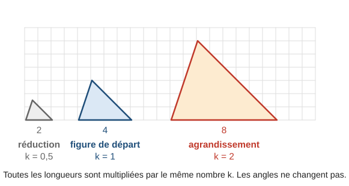
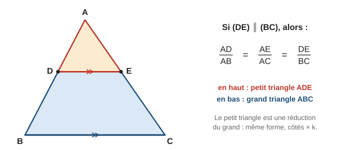
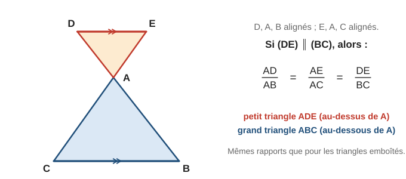
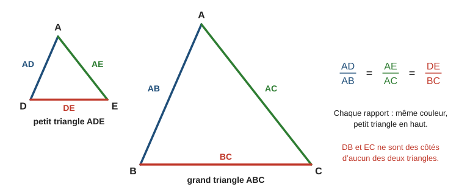
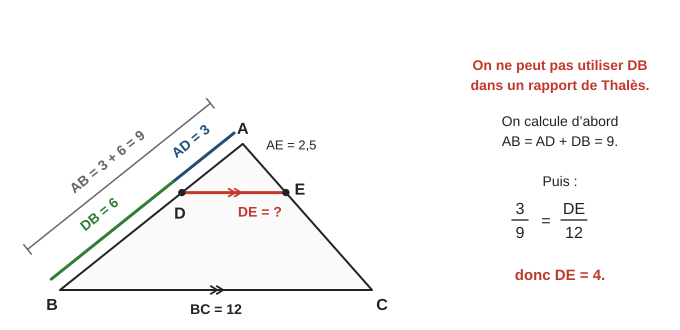
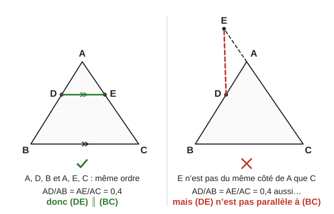
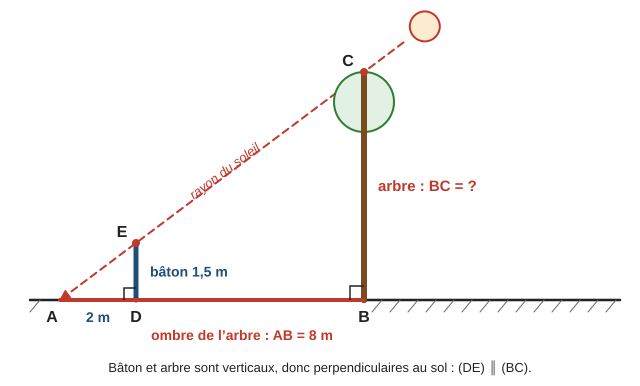
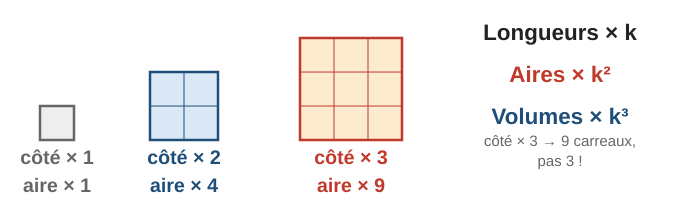
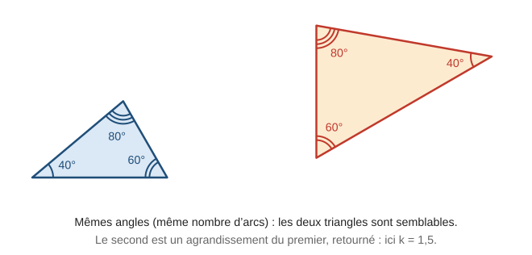

# Théorème de Thalès

> Compendium collège — chapitre unifié (sans découpage 6e / 5e / 4e / 3e).  
> Cours compact pour un élève de niveau moyen : intuition, méthode, exemples guidés, erreurs fréquentes, puis exercices progressifs (★ facile, ★★ standard, ★★★ approfondissement) avec corrigés détaillés.

---

## 0. Ce qu’on vise

**En une phrase :** quand une droite parallèle à un côté coupe un triangle, elle découpe un petit triangle qui est une **réduction** du grand. Les longueurs des deux triangles sont alors **proportionnelles**, ce qui permet de calculer des longueurs inaccessibles. Dans l’autre sens, des longueurs proportionnelles permettent de **prouver** que deux droites sont parallèles.

À la fin de ce chapitre, je sais :

1. Reconnaître une configuration de Thalès : triangles **emboîtés** ou **papillon**.
2. Écrire les **trois rapports égaux** sans me tromper (petit triangle en haut, grand en bas).
3. Calculer une longueur avec le **théorème de Thalès**, y compris quand il faut d’abord calculer un segment.
4. Prouver que deux droites sont parallèles (ou ne le sont pas) avec la **réciproque**.
5. Utiliser un **agrandissement** ou une **réduction** de rapport $k$ : longueurs $\times k$, aires $\times k^2$, volumes $\times k^3$.
6. Reconnaître des **triangles semblables**.

> **Prérequis.** Égalité de quotients et produit en croix (chapitre 5, § 2.2, rappelés au § 1.1) ; fractions (chapitre 1, § 2) ; droites parallèles et angles (chapitre 9, § 1.3 et 2.3).

---

## 1. Rappels express

### 1.1 Égalité de deux quotients et produit en croix

Dans tout le chapitre, on résout des égalités du type $\dfrac{x}{12} = \dfrac{5}{8}$.

> **Propriété (produit en croix).** Si $\dfrac{a}{b} = \dfrac{c}{d}$ (avec $b$ et $d$ non nuls), alors $a \times d = b \times c$.

**Exemple.** $\dfrac{x}{12} = \dfrac{5}{8}$ donne $8 \times x = 12 \times 5$, donc $x = \dfrac{12 \times 5}{8} = \dfrac{60}{8} = 7{,}5$.

**Exemple.** $\dfrac{3}{x} = \dfrac{4}{10}$ donne $4 \times x = 3 \times 10$, donc $x = \dfrac{30}{4} = 7{,}5$.

> **Astuce.** L’inconnue est égale au **produit des deux nombres « en diagonale »**, divisé par le **nombre restant**. Dans $\dfrac{x}{12} = \dfrac{5}{8}$, la diagonale de $x$ contient $8$ ; l’autre diagonale contient $12$ et $5$ : $x = \dfrac{12 \times 5}{8}$.

### 1.2 Agrandissement et réduction

Agrandir une figure, c’est multiplier **toutes** ses longueurs par un même nombre $k > 1$. Réduire, c’est les multiplier par un nombre $k$ compris entre $0$ et $1$. Le nombre $k$ s’appelle le **rapport** (ou le coefficient).

Les **angles ne changent pas** : la figure garde la même forme. Sur le schéma ci-dessous, la base mesure $4$ carreaux sur la figure de départ, $2$ sur la réduction ($k = 0{,}5$) et $8$ sur l’agrandissement ($k = 2$).

Pour trouver $k$, on divise une longueur de la nouvelle figure par la longueur **correspondante** de la figure de départ : $k = \dfrac{8}{4} = 2$.

---

## 2. Le théorème de Thalès

### 2.1 L’idée : un petit triangle dans un grand

On part d’un triangle $ABC$. On trace une droite **parallèle** à $(BC)$. Elle coupe $[AB]$ en $D$ et $[AC]$ en $E$. Le petit triangle $ADE$ a exactement la **même forme** que le grand triangle $ABC$ : c’est une réduction (schéma ci-dessous).

Ses côtés sont donc tous multipliés par le même nombre $k$. Par exemple, si $AD$ est la moitié de $AB$, alors $AE$ est la moitié de $AC$ et $DE$ est la moitié de $BC$.

### 2.2 Énoncé

> **Théorème de Thalès.** Soit un triangle $ABC$, un point $D$ de la droite $(AB)$ et un point $E$ de la droite $(AC)$, distincts de $A$. Si les droites $(DE)$ et $(BC)$ sont **parallèles**, alors :
>
> $$\dfrac{AD}{AB} = \dfrac{AE}{AC} = \dfrac{DE}{BC}$$

On l’utilise quand on **sait** que deux droites sont parallèles et qu’on cherche une **longueur**.

### 2.3 La configuration « papillon »

Le point $D$ peut aussi être de l’autre côté de $A$ : $D$, $A$, $B$ sont alignés dans cet ordre, ainsi que $E$, $A$, $C$. Les deux triangles sont alors « tête-bêche » et forment un papillon. Le théorème s’applique **avec exactement les mêmes rapports** (schéma ci-dessous).

### 2.4 Écrire les rapports sans se tromper

Chaque rapport compare deux côtés **homologues** : un côté du petit triangle et le côté qui lui correspond dans le grand. Pour ne pas se tromper :

1. On nomme les deux triangles : le petit $ADE$, le grand $ABC$ (le sommet commun $A$ en premier).
2. On écrit **en haut** les côtés du petit triangle, **en bas** ceux du grand, dans le même ordre.

| Petit triangle $ADE$ | $AD$ | $AE$ | $DE$ |
|---|---|---|---|
| Grand triangle $ABC$ | $AB$ | $AC$ | $BC$ |

Ce tableau est un **tableau de proportionnalité** : on passe de la première ligne à la seconde en divisant par $k$. Sur le schéma ci-dessous, chaque paire de côtés homologues a la même couleur.

### 2.5 Exemple guidé 1 — triangles emboîtés

**Énoncé.** Sur la figure du § 2.1, $(DE) \parallel (BC)$, $AD = 4\,\mathrm{cm}$, $AB = 6\,\mathrm{cm}$, $AE = 5\,\mathrm{cm}$ et $BC = 9\,\mathrm{cm}$. Calculer $AC$ et $DE$.

**Réflexion.** On sait que les droites sont parallèles et on cherche des longueurs : c’est le théorème. On écrit les trois rapports, puis on garde à chaque fois **deux** rapports : celui qu’on connaît complètement ($\dfrac{AD}{AB} = \dfrac{4}{6}$) et celui qui contient l’inconnue.

**Rédaction.**

> Les points $A$, $D$, $B$ sont alignés, ainsi que $A$, $E$, $C$, et les droites $(DE)$ et $(BC)$ sont parallèles. D’après le théorème de Thalès :
>
> $$\dfrac{AD}{AB} = \dfrac{AE}{AC} = \dfrac{DE}{BC} \quad \text{soit} \quad \dfrac{4}{6} = \dfrac{5}{AC} = \dfrac{DE}{9}$$
>
> Calcul de $AC$ : $AC = \dfrac{6 \times 5}{4} = 7{,}5\,\mathrm{cm}$.  
> Calcul de $DE$ : $DE = \dfrac{4 \times 9}{6} = 6\,\mathrm{cm}$.

**Contrôle.** Le petit triangle est une réduction : $AC > AE$ et $DE < BC$. Le rapport vaut $k = \dfrac{4}{6} \approx 0{,}67$, et on retrouve $\dfrac{6}{9} \approx 0{,}67$.

### 2.6 Exemple guidé 2 — papillon

**Énoncé.** Les points $D$, $A$, $B$ sont alignés, ainsi que $E$, $A$, $C$. Les droites $(DE)$ et $(BC)$ sont parallèles. On donne $AD = 2\,\mathrm{cm}$, $AB = 5\,\mathrm{cm}$, $AE = 1{,}6\,\mathrm{cm}$ et $BC = 6\,\mathrm{cm}$. Calculer $DE$ et $AC$.

**Réflexion.** Configuration papillon (schéma du § 2.3). Les rapports s’écrivent exactement comme pour les triangles emboîtés.

**Rédaction.**

> Les droites $(DB)$ et $(EC)$ sont sécantes en $A$, et $(DE) \parallel (BC)$. D’après le théorème de Thalès :
>
> $$\dfrac{AD}{AB} = \dfrac{AE}{AC} = \dfrac{DE}{BC} \quad \text{soit} \quad \dfrac{2}{5} = \dfrac{1{,}6}{AC} = \dfrac{DE}{6}$$
>
> Donc $DE = \dfrac{2 \times 6}{5} = 2{,}4\,\mathrm{cm}$ et $AC = \dfrac{5 \times 1{,}6}{2} = 4\,\mathrm{cm}$.

**Contrôle.** $k = \dfrac{2}{5} = 0{,}4$ : on a bien $\dfrac{1{,}6}{4} = 0{,}4$ et $\dfrac{2{,}4}{6} = 0{,}4$.

### 2.7 Exemple guidé 3 — quand on donne un segment « restant »

**Énoncé.** $D$ est sur $[AB]$, $E$ sur $[AC]$, $(DE) \parallel (BC)$. On donne $AD = 3\,\mathrm{cm}$, $DB = 6\,\mathrm{cm}$, $AE = 2{,}5\,\mathrm{cm}$ et $BC = 12\,\mathrm{cm}$. Calculer $DE$, puis $EC$.

**Réflexion.** $DB$ n’est un côté d’**aucun** des deux triangles $ADE$ et $ABC$. On calcule d’abord $AB = AD + DB$ (schéma ci-dessous).

**Rédaction.**

> $D$ est sur $[AB]$, donc $AB = AD + DB = 3 + 6 = 9\,\mathrm{cm}$.  
> Les points $A$, $D$, $B$ sont alignés, ainsi que $A$, $E$, $C$, et $(DE) \parallel (BC)$. D’après le théorème de Thalès :
>
> $$\dfrac{AD}{AB} = \dfrac{AE}{AC} = \dfrac{DE}{BC} \quad \text{soit} \quad \dfrac{3}{9} = \dfrac{2{,}5}{AC} = \dfrac{DE}{12}$$
>
> Donc $DE = \dfrac{3 \times 12}{9} = 4\,\mathrm{cm}$ et $AC = \dfrac{9 \times 2{,}5}{3} = 7{,}5\,\mathrm{cm}$.  
> Enfin $EC = AC - AE = 7{,}5 - 2{,}5 = 5\,\mathrm{cm}$.

**Contrôle.** $AD$ est le tiers de $AB$ : $DE$ est bien le tiers de $BC$ et $AE$ le tiers de $AC$.

### 2.8 Méthode en 4 étapes

> **Méthode — calculer une longueur avec Thalès.**
>
> 1. **Justifier** : citer les points alignés (ou les droites sécantes en $A$) et les droites **parallèles**.
> 2. **Écrire** les trois rapports : petit triangle en haut, grand triangle en bas, sommet commun en premier.
> 3. **Remplacer** par les valeurs connues. Si l’énoncé donne un segment « restant » ($DB$, $EC$), calculer d’abord $AB$ ou $AC$.
> 4. **Calculer** avec deux rapports (produit en croix), puis conclure avec l’unité. Contrôler : le petit triangle a les plus petits côtés.

### 2.9 Erreurs fréquentes

> **Erreur 1 — utiliser un segment « restant ».** Avec les données de l’exemple 3, écrire $\dfrac{AD}{DB} = \dfrac{DE}{BC}$, soit $\dfrac{3}{6} = \dfrac{DE}{12}$, donne $DE = 6$. C’est faux : le bon résultat est $DE = 4$. Le rapport doit utiliser $AB = 9$.

> **Erreur 2 — mélanger les triangles.** Écrire $\dfrac{AD}{AB} = \dfrac{BC}{DE}$ (rapport retourné). Avec $AD = 2$, $AB = 6$ et $BC = 9$, on trouverait $DE = 27$, plus grand que $BC$ : impossible pour le petit triangle. Le bon résultat est $DE = 3$.

> **Erreur 3 — oublier les parallèles.** Le théorème ne s’applique **que** si on sait que les droites sont parallèles (c’est donné, ou on l’a démontré). « Elles ont l’air parallèles sur le dessin » ne suffit pas.

---

## 3. La réciproque : prouver que deux droites sont parallèles

### 3.1 Énoncé

> **Réciproque du théorème de Thalès.** Soit des points $A$, $D$, $B$ alignés et des points $A$, $E$, $C$ alignés, **dans le même ordre**. Si $\dfrac{AD}{AB} = \dfrac{AE}{AC}$, alors les droites $(DE)$ et $(BC)$ sont **parallèles**.

« Dans le même ordre » signifie : $D$ est du même côté de $A$ que $B$ **et** $E$ est du même côté de $A$ que $C$ (triangles emboîtés) ; ou bien $D$ et $E$ sont tous les deux de l’autre côté (papillon). Le schéma ci-dessous montre pourquoi cette condition est indispensable : à droite, les rapports sont égaux mais les droites ne sont pas parallèles.

On l’utilise quand on connaît des **longueurs** et qu’on se demande si deux droites sont **parallèles**. Seuls deux rapports servent : $\dfrac{AD}{AB}$ et $\dfrac{AE}{AC}$.

### 3.2 Méthode : calculer séparément, puis comparer

> **Méthode — parallèles ou pas ?**
>
> 1. Calculer **séparément** $\dfrac{AD}{AB}$ et $\dfrac{AE}{AC}$ (sans écrire « $=$ » entre eux avant de savoir).
> 2. Comparer : valeurs décimales **exactes**, fractions simplifiées, ou produits en croix. Jamais avec des valeurs arrondies.
> 3. Si les rapports sont égaux **et** les points dans le même ordre : d’après la réciproque du théorème de Thalès, les droites sont parallèles.
> 4. Si les rapports sont différents : d’après la **contraposée** du théorème de Thalès, les droites ne sont pas parallèles.

> **Contraposée du théorème de Thalès.** [[Programme 2026 · 3e]] Soit des points $A$, $D$, $B$ alignés et des points $A$, $E$, $C$ alignés. Si $\dfrac{AD}{AB} \neq \dfrac{AE}{AC}$, alors les droites $(DE)$ et $(BC)$ **ne sont pas** parallèles.

Elle est vraie parce que le théorème est vrai : si les droites étaient parallèles, le théorème de Thalès donnerait des rapports égaux. Une contraposée ne demande pas de vérifier l’ordre des points (contrairement à la réciproque).

### 3.3 Exemple guidé 4 — les droites sont parallèles

**Énoncé.** $D$ est sur $[AB]$ et $E$ sur $[AC]$. $AD = 3\,\mathrm{cm}$, $AB = 7{,}5\,\mathrm{cm}$, $AE = 4\,\mathrm{cm}$, $AC = 10\,\mathrm{cm}$. Les droites $(DE)$ et $(BC)$ sont-elles parallèles ?

**Rédaction.**

> D’une part : $\dfrac{AD}{AB} = \dfrac{3}{7{,}5} = 0{,}4$.  
> D’autre part : $\dfrac{AE}{AC} = \dfrac{4}{10} = 0{,}4$.  
> On constate que $\dfrac{AD}{AB} = \dfrac{AE}{AC}$. De plus, les points $A$, $D$, $B$ et $A$, $E$, $C$ sont alignés dans le même ordre.  
> D’après la réciproque du théorème de Thalès, les droites $(DE)$ et $(BC)$ sont parallèles.

**Contrôle.** Produits en croix : $3 \times 10 = 30$ et $7{,}5 \times 4 = 30$. C’est bien égal.

### 3.4 Exemple guidé 5 — les droites ne sont pas parallèles

**Énoncé.** Même configuration avec $AD = 4\,\mathrm{cm}$, $AB = 9\,\mathrm{cm}$, $AE = 5\,\mathrm{cm}$, $AC = 11\,\mathrm{cm}$.

**Réflexion.** $\dfrac{4}{9} \approx 0{,}44$ et $\dfrac{5}{11} \approx 0{,}45$ : les valeurs arrondies ne permettent pas de conclure proprement. On compare avec les produits en croix.

**Rédaction.**

> D’une part : $\dfrac{AD}{AB} = \dfrac{4}{9}$. D’autre part : $\dfrac{AE}{AC} = \dfrac{5}{11}$.  
> Produits en croix : $4 \times 11 = 44$ et $9 \times 5 = 45$. Comme $44 \neq 45$, $\dfrac{AD}{AB} \neq \dfrac{AE}{AC}$.  
> D’après la contraposée du théorème de Thalès, les droites $(DE)$ et $(BC)$ ne sont **pas** parallèles (si elles l’étaient, ces rapports seraient égaux).

### 3.5 Erreurs fréquentes

> **Erreur 1 — écrire la conclusion au début.** « $\dfrac{AD}{AB} = \dfrac{AE}{AC}$ car les droites sont parallèles » : c’est justement ce qu’on veut prouver. On calcule les deux rapports **séparément**, puis on compare.

> **Erreur 2 — comparer des arrondis.** $\dfrac{7}{15} \approx 0{,}47$ et $\dfrac{8}{17} \approx 0{,}47$, pourtant $7 \times 17 = 119$ et $15 \times 8 = 120$ : les rapports sont différents. Les droites ne sont pas parallèles.

> **Erreur 3 — oublier l’ordre des points.** Des rapports égaux ne suffisent pas si $D$ est d’un côté de $A$ et $E$ de l’autre (schéma du § 3.1, à droite).

---

## 4. Thalès en situation : modéliser

### 4.1 Reconnaître des parallèles cachées

Dans un problème, les parallèles sont rarement écrites. On les justifie souvent ainsi :

> **Propriété.** Si deux droites sont **perpendiculaires à une même droite**, alors elles sont **parallèles**.

Exemples : deux poteaux verticaux (perpendiculaires au sol) ; deux barreaux d’une échelle ; deux rayons de soleil (on les considère parallèles, car le soleil est très loin).

### 4.2 Exemple guidé 6 — la hauteur d’un arbre

**Énoncé.** Au même instant, un bâton vertical de $1{,}5\,\mathrm{m}$ a une ombre de $2\,\mathrm{m}$. On place le bâton pour que son ombre se termine au même point $A$ que celle d’un arbre. L’ombre de l’arbre mesure $8\,\mathrm{m}$. Quelle est la hauteur de l’arbre ?

**Réflexion.** On fait un schéma (ci-dessous). Le rayon de soleil passe par le sommet $C$ de l’arbre, le sommet $E$ du bâton et le point $A$. Le bâton et l’arbre sont verticaux : ce sont les parallèles.

**Rédaction.**

> Le bâton $[DE]$ et l’arbre $[BC]$ sont perpendiculaires au sol $(AB)$, donc $(DE) \parallel (BC)$.  
> Les points $A$, $D$, $B$ sont alignés, ainsi que $A$, $E$, $C$. D’après le théorème de Thalès :
>
> $$\dfrac{AD}{AB} = \dfrac{AE}{AC} = \dfrac{DE}{BC} \quad \text{soit} \quad \dfrac{2}{8} = \dfrac{AE}{AC} = \dfrac{1{,}5}{BC}$$
>
> Donc $BC = \dfrac{8 \times 1{,}5}{2} = 6\,\mathrm{m}$. L’arbre mesure $6\,\mathrm{m}$.

**Contrôle.** L’ombre de l’arbre est $4$ fois plus longue que celle du bâton : l’arbre est $4$ fois plus haut ($4 \times 1{,}5 = 6$).

---

## 5. Agrandissement, réduction et triangles semblables [[Programme 2020]]

### 5.1 Effet sur les longueurs, les aires et les volumes

Dans un agrandissement ou une réduction de rapport $k$ :

| Grandeur | Elle est multipliée par |
|---|---|
| Longueurs, périmètres | $k$ |
| Aires | $k^2$ |
| Volumes | $k^3$ |
| Angles | ne changent pas |

**Pourquoi $k^2$ pour les aires ?** Un carré de côté $1$ agrandi avec $k = 3$ a pour côté $3$ : il contient $3 \times 3 = 9$ carrés de départ (schéma ci-dessous). Pour un cube, on obtient $3 \times 3 \times 3 = 27$ petits cubes.

**Exemple.** Un triangle d’aire $18\,\mathrm{cm}^2$ est agrandi avec $k = 3$. Sa nouvelle aire est $18 \times 3^2 = 18 \times 9 = 162\,\mathrm{cm}^2$.

**Exemple.** Une maquette au $\dfrac{1}{50}$ réduit les longueurs avec $k = \dfrac{1}{50}$. Une longueur réelle de $20\,\mathrm{m}$ devient $20 \div 50 = 0{,}4\,\mathrm{m}$, soit $40\,\mathrm{cm}$.

> **Erreur fréquente.** « Les côtés sont doublés, donc l’aire est doublée. » Non : l’aire est multipliée par $2^2 = 4$. Un carré de $3\,\mathrm{cm}$ de côté a une aire de $9\,\mathrm{cm}^2$ ; un carré de $6\,\mathrm{cm}$ de côté a une aire de $36\,\mathrm{cm}^2$, soit $4$ fois plus.

### 5.2 Lien avec Thalès

Dans une configuration de Thalès, le petit triangle $ADE$ est une réduction du grand triangle $ABC$, de rapport $k = \dfrac{AD}{AB}$. Les trois rapports égaux du théorème sont tous égaux à $k$. Par conséquent, l’aire de $ADE$ est égale à $k^2$ fois l’aire de $ABC$.

### 5.3 Triangles semblables

> **Définition.** Deux triangles sont **semblables** quand leurs angles sont deux à deux égaux.

> **Propriété.** Si deux triangles sont semblables, alors les longueurs de leurs côtés sont **proportionnelles** : l’un est un agrandissement ou une réduction de l’autre (éventuellement tourné ou retourné). Réciproquement, si les côtés sont proportionnels, les triangles sont semblables.

Les côtés **homologues** sont face aux angles égaux. **Exemple.** Un triangle de côtés $3$, $4$ et $5\,\mathrm{cm}$ et un triangle de côtés $4{,}5$, $6$ et $7{,}5\,\mathrm{cm}$ sont semblables : $\dfrac{4{,}5}{3} = \dfrac{6}{4} = \dfrac{7{,}5}{5} = 1{,}5$.

Dans une configuration de Thalès, les triangles $ADE$ et $ABC$ sont semblables : l’angle en $A$ est commun, et les autres angles sont égaux grâce aux parallèles (angles correspondants ou alternes-internes, chapitre 9).

---

## 6. Mini-synthèse

> **À retenir.**
>
> - **Théorème** (on sait que c’est parallèle → on calcule une longueur) : $\dfrac{AD}{AB} = \dfrac{AE}{AC} = \dfrac{DE}{BC}$, petit triangle en haut, grand en bas.
> - Mêmes rapports pour les triangles **emboîtés** et le **papillon**.
> - Un segment « restant » ($DB$, $EC$) n’entre jamais dans un rapport : calculer d’abord $AB$ ou $AC$.
> - **Réciproque** (on connaît les longueurs → parallèle ou pas ?) : calculer séparément $\dfrac{AD}{AB}$ et $\dfrac{AE}{AC}$, comparer sans arrondir, vérifier l’ordre des points.
> - Rapports différents → **contraposée** : les droites ne sont pas parallèles.
> - Agrandissement ou réduction de rapport $k$ : longueurs $\times k$, aires $\times k^2$, volumes $\times k^3$.
> - Triangles semblables = mêmes angles = côtés proportionnels.

---

## 7. Exercices types

> Objectif : automatismes. Difficulté croissante dans chaque série. Corrigés détaillés au § 9.

### A. Écrire les rapports (★)

**A1.** Sur la figure du § 2.1, $(DE) \parallel (BC)$. Recopier et compléter : $\dfrac{AD}{\dots} = \dfrac{\dots}{AC} = \dfrac{DE}{\dots}$.

**A2.** Les points $R$, $M$, $S$ sont alignés, ainsi que $R$, $N$, $T$, avec $M$ sur $[RS]$ et $N$ sur $[RT]$. Les droites $(MN)$ et $(ST)$ sont parallèles. Écrire l’égalité des trois rapports.

**A3.** Les points $U$, $O$, $V$ sont alignés dans cet ordre, ainsi que $W$, $O$, $Z$. Les droites $(UW)$ et $(VZ)$ sont parallèles. Quelle est la configuration ? Écrire l’égalité des trois rapports.

**A4.** Vrai ou faux ? Dans la configuration du § 2.1, avec $(DE) \parallel (BC)$, on a $\dfrac{AD}{DB} = \dfrac{DE}{BC}$.

**A5.** Calculer $x$ : a) $\dfrac{x}{12} = \dfrac{5}{8}$ ; b) $\dfrac{3}{x} = \dfrac{4}{10}$ ; c) $\dfrac{2{,}5}{7} = \dfrac{x}{14}$.

### B. Calculer une longueur : triangles emboîtés (★ → ★★)

Dans cette série, $D$ est sur $[AB]$, $E$ est sur $[AC]$ et $(DE) \parallel (BC)$. Les longueurs sont en centimètres.

**B1.** $AD = 3$, $AB = 9$, $AE = 4$ et $BC = 12$. Calculer $AC$ et $DE$.

**B2.** $AD = 4$, $AB = 10$ et $DE = 6$. Calculer $BC$.

**B3.** Avec les notations de A2 : $RM = 5$, $RS = 8$, $RN = 6$ et $ST = 10$. Calculer $RT$ et $MN$.

**B4.** $AB = 12$, $AE = 5$ et $AC = 8$. Calculer $AD$.

**B5.** $AD = 3$, $AB = 7$ et $BC = 14$. Calculer $DE$.

**B6.** $AD = 3$, $AB = 7$ et $AE = 4$. Calculer $AC$, arrondi au millimètre.

### C. Papillon et segments restants (★★)

**C1.** Les points $D$, $A$, $B$ sont alignés dans cet ordre, ainsi que $E$, $A$, $C$. $(DE) \parallel (BC)$. $AD = 3\,\mathrm{cm}$, $AB = 4{,}5\,\mathrm{cm}$, $AE = 2{,}4\,\mathrm{cm}$ et $BC = 6\,\mathrm{cm}$. Calculer $AC$ et $DE$.

**C2.** $D$ est sur $[AB]$, $E$ sur $[AC]$, $(DE) \parallel (BC)$. $AD = 2\,\mathrm{cm}$, $DB = 3\,\mathrm{cm}$ et $BC = 7{,}5\,\mathrm{cm}$. Calculer $DE$.

**C3.** $D$ est sur $[AB]$, $E$ sur $[AC]$, $(DE) \parallel (BC)$. $AD = 2{,}5\,\mathrm{cm}$, $DB = 5\,\mathrm{cm}$ et $AC = 10{,}5\,\mathrm{cm}$. Calculer $AE$, puis $EC$.

**C4.** Avec les notations de A3 : $OU = 4\,\mathrm{cm}$, $OV = 6\,\mathrm{cm}$, $UW = 5\,\mathrm{cm}$ et $OZ = 4{,}5\,\mathrm{cm}$. Calculer $OW$ et $VZ$.

### D. Parallèles ou pas ? (★★)

Dans D1 à D4, $D$ est sur $[AB]$ et $E$ sur $[AC]$. Les longueurs sont en centimètres. Les droites $(DE)$ et $(BC)$ sont-elles parallèles ?

**D1.** $AD = 4$, $AB = 10$, $AE = 6$, $AC = 15$.

**D2.** $AD = 5$, $AB = 8$, $AE = 7$, $AC = 12$.

**D3.** $AD = 3$, $AB = 9$, $AE = 4$, $AC = 10$.

**D4.** $AD = 2{,}1$, $DB = 4{,}9$, $AE = 2{,}4$, $EC = 5{,}6$.

**D5.** Les points $D$, $A$, $B$ sont alignés dans cet ordre, ainsi que $E$, $A$, $C$. $AD = 3$, $AB = 7{,}5$, $AE = 2$ et $AC = 5$. Les droites $(DE)$ et $(BC)$ sont-elles parallèles ?

### E. Agrandissement, réduction, triangles semblables (★ → ★★) [[Programme 2020]]

**E1.** Une maquette est à l’échelle $\dfrac{1}{50}$. Une longueur réelle mesure $20\,\mathrm{m}$. Quelle est sa longueur sur la maquette ?

**E2.** Un triangle d’aire $18\,\mathrm{cm}^2$ est agrandi avec $k = 3$. Quelle est sa nouvelle aire ?

**E3.** Les côtés d’une figure passent de $4\,\mathrm{cm}$ à $10\,\mathrm{cm}$. Quel est le rapport $k$ ? Par combien les aires sont-elles multipliées ?

**E4.** Un triangle rectangle a des côtés de $6$, $8$ et $10\,\mathrm{cm}$. On le réduit avec $k = 0{,}5$. Donner les nouvelles longueurs, le nouveau périmètre, puis la nouvelle aire de deux façons.

**E5.** Un cube d’arête $2\,\mathrm{cm}$ est agrandi avec $k = 3$. Calculer la nouvelle arête, l’aire d’une face et le volume, avant et après. Vérifier les facteurs $k^2$ et $k^3$.

**E6.** Les triangles $ABC$ et $MNP$ sont semblables, $M$ correspondant à $A$, $N$ à $B$ et $P$ à $C$. $AB = 4\,\mathrm{cm}$, $BC = 5\,\mathrm{cm}$, $AC = 6\,\mathrm{cm}$ et $MN = 6\,\mathrm{cm}$. Calculer $NP$ et $MP$.

### F. Problèmes concrets (★★)

**F1.** Au même instant, un bâton vertical de $1{,}2\,\mathrm{m}$ a une ombre de $1{,}5\,\mathrm{m}$ et un arbre a une ombre de $10\,\mathrm{m}$. Les deux ombres se terminent au même point. Quelle est la hauteur de l’arbre ? (Faire un schéma et rédiger complètement.)

**F2.** Au même instant, un poteau vertical de $2\,\mathrm{m}$ a une ombre de $1{,}6\,\mathrm{m}$, et une tour a une ombre de $36\,\mathrm{m}$. Les ombres se terminent au même point. Quelle est la hauteur de la tour ?

**F3.** Une rampe d’accès $[AC]$ part du sol en $A$. Un support vertical $[DE]$ ($D$ au sol, $E$ sur la rampe) mesure $0{,}6\,\mathrm{m}$ et se trouve à $2\,\mathrm{m}$ de $A$. Au bout de la rampe, le sol est à $5\,\mathrm{m}$ de $A$ (point $B$, sous $C$). À quelle hauteur $BC$ la rampe arrive-t-elle ?

**F4.** Deux routes droites $(BD)$ et $(CE)$ se croisent en $A$ ; $D$, $A$, $B$ sont alignés dans cet ordre, ainsi que $E$, $A$, $C$. Les tronçons $[DE]$ et $[BC]$ sont parallèles. $AD = 1{,}2\,\mathrm{km}$, $AE = 0{,}9\,\mathrm{km}$ et $AB = 2\,\mathrm{km}$. Calculer $AC$.

---

## 8. Exercices atypiques

> Objectif : comprendre, raisonner, rédiger. Plusieurs étapes, erreurs à trouver, questions ouvertes.

### G. Trouver l’erreur (★★)

**G1.** Léo écrit : « $(DE) \parallel (BC)$, $AD = 3$, $DB = 6$, $BC = 12$. D’après Thalès, $\dfrac{AD}{DB} = \dfrac{DE}{BC}$, donc $\dfrac{3}{6} = \dfrac{DE}{12}$ et $DE = 6$. » Trouver l’erreur et corriger.

**G2.** Inès écrit : « $(DE) \parallel (BC)$, $AD = 2$, $AB = 6$, $BC = 9$. D’après Thalès, $\dfrac{AD}{AB} = \dfrac{BC}{DE}$, donc $DE = 27$. » Trouver l’erreur. Quel contrôle simple aurait dû l’alerter ?

**G3.** Sami doit savoir si $(DE) \parallel (BC)$, avec $D$ sur $[AB]$, $E$ sur $[AC]$, $AD = 7$, $AB = 15$, $AE = 8$, $AC = 17$. Il écrit : « $\dfrac{7}{15} \approx 0{,}47$ et $\dfrac{8}{17} \approx 0{,}47$, donc les droites sont parallèles. » Que penser de sa réponse ?

**G4.** Nora rédige : « Les droites $(DE)$ et $(BC)$ sont parallèles donc, d’après le théorème de Thalès, $\dfrac{AD}{AB} = \dfrac{AE}{AC}$, soit $\dfrac{4}{10} = \dfrac{6}{15}$. Donc $(DE) \parallel (BC)$. » La question était : « Prouver que $(DE)$ et $(BC)$ sont parallèles. » Qu’est-ce qui ne va pas ? Rédiger correctement.

**G5.** Tom affirme : « Le petit triangle a des côtés deux fois plus petits que le grand, donc son aire est deux fois plus petite. » A-t-il raison ?

### H. Comprendre et raisonner (★★ → ★★★)

**H1.** $D$ est sur $[AB]$ et $\dfrac{AD}{AB} = \dfrac{2}{3}$. Peut-on en déduire que $\dfrac{AD}{DB} = \dfrac{2}{3}$ ? Calculer la vraie valeur de $\dfrac{AD}{DB}$ (on pourra prendre $AB = 3$).

**H2.** Une parallèle à $(BC)$ découpe un petit triangle $ADE$. On veut que son aire soit la **moitié** de celle de $ABC$. Faut-il prendre $k = \dfrac{1}{2}$ ? Sinon, quelle valeur approchée de $k$ ?

**H3.** Une réduction multiplie les aires par $\dfrac{1}{9}$. Quel est son rapport $k$ ? Par combien multiplie-t-elle les volumes ?

**H4.** $D$ est sur la demi-droite $[AB)$ **au-delà** de $B$, $E$ sur $[AC)$ au-delà de $C$, et $(DE) \parallel (BC)$. Le théorème de Thalès s’applique-t-il ? Avec $AB = 4\,\mathrm{cm}$, $AD = 6\,\mathrm{cm}$ et $BC = 5\,\mathrm{cm}$, calculer $DE$. Que vaut $k$ ?

**H5.** (★★★) Les points $D$, $A$, $B$ sont alignés **dans cet ordre**, mais $E$ est sur $[AC]$. On a $AD = 2$, $AB = 4$, $AE = 3$ et $AC = 6$. Les rapports $\dfrac{AD}{AB}$ et $\dfrac{AE}{AC}$ sont-ils égaux ? Les droites $(DE)$ et $(BC)$ sont-elles parallèles ? Expliquer.

### I. Plusieurs étapes (★★★)

**I1.** $ABC$ est rectangle en $A$, avec $AB = 6\,\mathrm{cm}$ et $AC = 8\,\mathrm{cm}$. Le point $D$ est sur $[AB]$ avec $AD = 4{,}5\,\mathrm{cm}$. La parallèle à $(BC)$ passant par $D$ coupe $[AC]$ en $E$.  
a) Calculer $BC$. b) Calculer $DE$ et $AE$. c) Calculer l’aire de $ADE$ de deux façons.

**I2.** Les points $A$, $D$, $B$ sont alignés dans cet ordre, ainsi que $A$, $E$, $C$. $AD = 3\,\mathrm{cm}$, $AB = 5\,\mathrm{cm}$, $AE = 4{,}2\,\mathrm{cm}$, $AC = 7\,\mathrm{cm}$ et $BC = 6\,\mathrm{cm}$.  
a) Démontrer que $(DE) \parallel (BC)$. b) En déduire $DE$.

**I3.** La charpente d’un toit a la forme d’un triangle $ABC$ isocèle en $A$, de base $BC = 8\,\mathrm{m}$ et de hauteur $AH = 3\,\mathrm{m}$ ($H$ milieu de $[BC]$). On pose une poutre horizontale $[DE]$ à $1{,}2\,\mathrm{m}$ sous le sommet ($D$ sur $[AB]$, $E$ sur $[AC]$). Elle coupe $[AH]$ en $K$.  
a) Calculer $AB$. b) Calculer la longueur de la poutre $DE$, puis $AD$.

**I4.** Une pyramide a une hauteur de $9\,\mathrm{cm}$ et un volume de $135\,\mathrm{cm}^3$. On la coupe par un plan parallèle à la base, à $3\,\mathrm{cm}$ du sommet. La petite pyramide obtenue est une réduction de la grande. Calculer son volume.

### J. Ouvert (★★)

**J1.** Inventer un exercice de Thalès (avec un schéma) dont la réponse est $7{,}5\,\mathrm{cm}$.

**J2.** Relier en deux ou trois phrases : théorème de Thalès, agrandissement-réduction et proportionnalité.

**J3.** Critiquer la phrase : « Thalès, c’est quand il y a deux triangles. » Proposer une phrase correcte.

---

## 9. Corrigés

> Les corrigés marqués **(modèle)** montrent la rédaction attendue. Les autres donnent les étapes clés.

### Exercices types

**A1.** $\dfrac{AD}{AB} = \dfrac{AE}{AC} = \dfrac{DE}{BC}$.

**A2. (modèle)**
> Petit triangle $RMN$, grand triangle $RST$, sommet commun $R$ :  
> $\dfrac{RM}{RS} = \dfrac{RN}{RT} = \dfrac{MN}{ST}$.

**A3.** Configuration papillon (le point commun $O$ est entre $U$ et $V$). Petit triangle $OUW$, grand triangle $OVZ$ : $\dfrac{OU}{OV} = \dfrac{OW}{OZ} = \dfrac{UW}{VZ}$. (On peut aussi échanger le rôle des deux triangles : l’important est de garder le même triangle en haut.)

**A4.** Faux. $DB$ n’est un côté d’aucun des deux triangles. La bonne égalité est $\dfrac{AD}{AB} = \dfrac{DE}{BC}$.

**A5.** a) $x = \dfrac{12 \times 5}{8} = 7{,}5$. b) $x = \dfrac{3 \times 10}{4} = 7{,}5$. c) $x = \dfrac{2{,}5 \times 14}{7} = 5$.

**B1. (modèle)**
> Les points $A$, $D$, $B$ sont alignés, ainsi que $A$, $E$, $C$, et $(DE) \parallel (BC)$. D’après le théorème de Thalès :  
> $\dfrac{AD}{AB} = \dfrac{AE}{AC} = \dfrac{DE}{BC}$, soit $\dfrac{3}{9} = \dfrac{4}{AC} = \dfrac{DE}{12}$.  
> Donc $AC = \dfrac{9 \times 4}{3} = 12\,\mathrm{cm}$ et $DE = \dfrac{3 \times 12}{9} = 4\,\mathrm{cm}$.

**B2.** $\dfrac{4}{10} = \dfrac{6}{BC}$, donc $BC = \dfrac{10 \times 6}{4} = 15\,\mathrm{cm}$.

**B3.** $\dfrac{RM}{RS} = \dfrac{RN}{RT} = \dfrac{MN}{ST}$, soit $\dfrac{5}{8} = \dfrac{6}{RT} = \dfrac{MN}{10}$. Donc $RT = \dfrac{8 \times 6}{5} = 9{,}6\,\mathrm{cm}$ et $MN = \dfrac{5 \times 10}{8} = 6{,}25\,\mathrm{cm}$.

**B4.** $\dfrac{AD}{12} = \dfrac{5}{8}$, donc $AD = \dfrac{12 \times 5}{8} = 7{,}5\,\mathrm{cm}$.

**B5.** $\dfrac{3}{7} = \dfrac{DE}{14}$, donc $DE = \dfrac{3 \times 14}{7} = 6\,\mathrm{cm}$.

**B6.** $\dfrac{3}{7} = \dfrac{4}{AC}$, donc $AC = \dfrac{7 \times 4}{3} = \dfrac{28}{3} \approx 9{,}3\,\mathrm{cm}$ (au millimètre près).

**C1. (modèle)**
> Les droites $(DB)$ et $(EC)$ sont sécantes en $A$, et $(DE) \parallel (BC)$. D’après le théorème de Thalès :  
> $\dfrac{AD}{AB} = \dfrac{AE}{AC} = \dfrac{DE}{BC}$, soit $\dfrac{3}{4{,}5} = \dfrac{2{,}4}{AC} = \dfrac{DE}{6}$.  
> Donc $AC = \dfrac{4{,}5 \times 2{,}4}{3} = 3{,}6\,\mathrm{cm}$ et $DE = \dfrac{3 \times 6}{4{,}5} = 4\,\mathrm{cm}$.

**C2.** $AB = 2 + 3 = 5\,\mathrm{cm}$. $\dfrac{2}{5} = \dfrac{DE}{7{,}5}$, donc $DE = \dfrac{2 \times 7{,}5}{5} = 3\,\mathrm{cm}$.

**C3.** $AB = 2{,}5 + 5 = 7{,}5\,\mathrm{cm}$. $\dfrac{2{,}5}{7{,}5} = \dfrac{AE}{10{,}5}$, donc $AE = \dfrac{2{,}5 \times 10{,}5}{7{,}5} = 3{,}5\,\mathrm{cm}$. Puis $EC = 10{,}5 - 3{,}5 = 7\,\mathrm{cm}$.

**C4.** $\dfrac{4}{6} = \dfrac{OW}{4{,}5} = \dfrac{5}{VZ}$. Donc $OW = \dfrac{4 \times 4{,}5}{6} = 3\,\mathrm{cm}$ et $VZ = \dfrac{6 \times 5}{4} = 7{,}5\,\mathrm{cm}$.

**D1. (modèle)**
> D’une part : $\dfrac{AD}{AB} = \dfrac{4}{10} = 0{,}4$. D’autre part : $\dfrac{AE}{AC} = \dfrac{6}{15} = 0{,}4$.  
> On constate que $\dfrac{AD}{AB} = \dfrac{AE}{AC}$, et les points $A$, $D$, $B$ et $A$, $E$, $C$ sont alignés dans le même ordre.  
> D’après la réciproque du théorème de Thalès, les droites $(DE)$ et $(BC)$ sont parallèles.

**D2. (modèle)**
> D’une part : $\dfrac{AD}{AB} = \dfrac{5}{8}$. D’autre part : $\dfrac{AE}{AC} = \dfrac{7}{12}$.  
> Produits en croix : $5 \times 12 = 60$ et $8 \times 7 = 56$. Comme $60 \neq 56$, les rapports sont différents.  
> D’après la contraposée du théorème de Thalès, $(DE)$ et $(BC)$ ne sont pas parallèles.

**D3.** $\dfrac{3}{9} = \dfrac{1}{3}$ et $\dfrac{4}{10} = \dfrac{2}{5}$. Produits en croix : $3 \times 10 = 30$ et $9 \times 4 = 36$. Rapports différents : pas parallèles.

**D4.** D’abord $AB = 2{,}1 + 4{,}9 = 7$ et $AC = 2{,}4 + 5{,}6 = 8$. Puis $\dfrac{2{,}1}{7} = 0{,}3$ et $\dfrac{2{,}4}{8} = 0{,}3$. Rapports égaux, points dans le même ordre : d’après la réciproque, $(DE) \parallel (BC)$.

**D5.** $\dfrac{AD}{AB} = \dfrac{3}{7{,}5} = 0{,}4$ et $\dfrac{AE}{AC} = \dfrac{2}{5} = 0{,}4$. Rapports égaux, et $D$, $A$, $B$ d’une part, $E$, $A$, $C$ d’autre part sont dans le même ordre (papillon) : d’après la réciproque, $(DE) \parallel (BC)$.

**E1.** $20 \div 50 = 0{,}4\,\mathrm{m} = 40\,\mathrm{cm}$.

**E2. (modèle)**
> Dans un agrandissement de rapport $k = 3$, les aires sont multipliées par $k^2 = 9$.  
> Nouvelle aire : $18 \times 9 = 162\,\mathrm{cm}^2$.

**E3.** $k = \dfrac{10}{4} = 2{,}5$. Les aires sont multipliées par $2{,}5^2 = 6{,}25$.

**E4.** Côtés : $3$, $4$ et $5\,\mathrm{cm}$. Périmètre : $12\,\mathrm{cm}$ (au lieu de $24$, donc $\times 0{,}5$). Aire de départ : $\dfrac{6 \times 8}{2} = 24\,\mathrm{cm}^2$ (les côtés de l’angle droit sont $6$ et $8$). Nouvelle aire : $\dfrac{3 \times 4}{2} = 6\,\mathrm{cm}^2$, ou bien $24 \times 0{,}5^2 = 24 \times 0{,}25 = 6\,\mathrm{cm}^2$.

**E5.** Arête : $2 \to 6\,\mathrm{cm}$. Face : $4 \to 36\,\mathrm{cm}^2$, et $36 = 4 \times 9 = 4 \times 3^2$. Volume : $8 \to 216\,\mathrm{cm}^3$, et $216 = 8 \times 27 = 8 \times 3^3$.

**E6.** $k = \dfrac{MN}{AB} = \dfrac{6}{4} = 1{,}5$. $NP = 1{,}5 \times 5 = 7{,}5\,\mathrm{cm}$ et $MP = 1{,}5 \times 6 = 9\,\mathrm{cm}$.

**F1. (modèle)**
> On note $A$ le bout des ombres, $[DE]$ le bâton et $[BC]$ l’arbre ($D$ et $B$ au sol).  
> Le bâton et l’arbre sont perpendiculaires au sol, donc $(DE) \parallel (BC)$. Les points $A$, $D$, $B$ sont alignés, ainsi que $A$, $E$, $C$.  
> D’après le théorème de Thalès : $\dfrac{AD}{AB} = \dfrac{AE}{AC} = \dfrac{DE}{BC}$, soit $\dfrac{1{,}5}{10} = \dfrac{1{,}2}{BC}$.  
> Donc $BC = \dfrac{10 \times 1{,}2}{1{,}5} = 8\,\mathrm{m}$. L’arbre mesure $8\,\mathrm{m}$.

**F2.** Même configuration : $\dfrac{1{,}6}{36} = \dfrac{2}{h}$, donc $h = \dfrac{36 \times 2}{1{,}6} = 45\,\mathrm{m}$.

**F3.** Le support et la hauteur $[BC]$ sont verticaux, donc parallèles. $A$, $D$, $B$ alignés et $A$, $E$, $C$ alignés. D’après Thalès : $\dfrac{AD}{AB} = \dfrac{DE}{BC}$, soit $\dfrac{2}{5} = \dfrac{0{,}6}{BC}$. Donc $BC = \dfrac{5 \times 0{,}6}{2} = 1{,}5\,\mathrm{m}$.

**F4.** Configuration papillon : $\dfrac{AD}{AB} = \dfrac{AE}{AC}$, soit $\dfrac{1{,}2}{2} = \dfrac{0{,}9}{AC}$. Donc $AC = \dfrac{2 \times 0{,}9}{1{,}2} = 1{,}5\,\mathrm{km}$.

### Exercices atypiques

**G1.** Léo a utilisé $DB$, qui n’est un côté d’aucun des deux triangles. Il faut $AB = 3 + 6 = 9$, puis $\dfrac{3}{9} = \dfrac{DE}{12}$, donc $DE = 4$.

**G2.** Le dernier rapport est retourné : le petit triangle doit être en haut dans **tous** les rapports. Correct : $\dfrac{2}{6} = \dfrac{DE}{9}$, donc $DE = 3$. Contrôle : $DE$ est un côté du petit triangle, il doit être plus petit que $BC = 9$ ; $27$ est absurde.

**G3.** Sa conclusion est fausse : il compare des valeurs arrondies. Produits en croix : $7 \times 17 = 119$ et $15 \times 8 = 120$. Les rapports sont différents, donc les droites ne sont **pas** parallèles (sinon, d’après le théorème de Thalès, les rapports seraient égaux).

**G4. (modèle)** Nora utilise la conclusion (« les droites sont parallèles ») pour la démontrer : c’est un raisonnement circulaire, et elle cite le théorème au lieu de la réciproque. Rédaction correcte :
> D’une part, $\dfrac{AD}{AB} = \dfrac{4}{10} = 0{,}4$. D’autre part, $\dfrac{AE}{AC} = \dfrac{6}{15} = 0{,}4$.  
> Les rapports sont égaux et les points sont alignés dans le même ordre. D’après la réciproque du théorème de Thalès, $(DE) \parallel (BC)$.

**G5.** Non. Avec $k = \dfrac{1}{2}$, l’aire est multipliée par $k^2 = \dfrac{1}{4}$ : l’aire du petit triangle est **quatre** fois plus petite.

**H1.** Non. Avec $AB = 3$ : $AD = 2$ et $DB = 1$, donc $\dfrac{AD}{DB} = \dfrac{2}{1} = 2$.

**H2.** Non : avec $k = \dfrac{1}{2}$, l’aire serait divisée par $4$. Il faut $k^2 = \dfrac{1}{2} = 0{,}5$, donc $k = \sqrt{0{,}5} \approx 0{,}71$. (La parallèle passe environ aux $7$ dixièmes de $[AB]$ en partant de $A$.)

**H3.** $k^2 = \dfrac{1}{9}$, donc $k = \dfrac{1}{3}$. Les volumes sont multipliés par $k^3 = \dfrac{1}{27}$.

**H4.** Oui : $D$ est sur la droite $(AB)$ et $E$ sur la droite $(AC)$, c’est l’énoncé du § 2.2. Cette fois, $ADE$ est le **grand** triangle et $ABC$ le petit. $\dfrac{AD}{AB} = \dfrac{DE}{BC}$, soit $\dfrac{6}{4} = \dfrac{DE}{5}$, donc $DE = 7{,}5\,\mathrm{cm}$. Ici $k = \dfrac{AD}{AB} = 1{,}5$ : c’est un agrandissement.

**H5.** $\dfrac{AD}{AB} = \dfrac{2}{4} = 0{,}5$ et $\dfrac{AE}{AC} = \dfrac{3}{6} = 0{,}5$ : les rapports sont égaux. Mais $D$ est de l’autre côté de $A$ par rapport à $B$, alors que $E$ est du même côté que $C$ : les points ne sont pas dans le même ordre, la réciproque ne s’applique pas. En fait, les droites ne sont pas parallèles : la parallèle à $(BC)$ passant par $D$ coupe $(AC)$ de l’autre côté de $A$ (papillon), pas en $E$. C’est la situation du schéma du § 3.1, à droite.

**I1. (modèle)**
> a) Le triangle $ABC$ est rectangle en $A$. D’après le théorème de Pythagore : $BC^2 = AB^2 + AC^2 = 36 + 64 = 100$, donc $BC = 10\,\mathrm{cm}$.  
> b) Les points $A$, $D$, $B$ sont alignés, ainsi que $A$, $E$, $C$, et $(DE) \parallel (BC)$. D’après le théorème de Thalès :  
> $\dfrac{AD}{AB} = \dfrac{AE}{AC} = \dfrac{DE}{BC}$, soit $\dfrac{4{,}5}{6} = \dfrac{AE}{8} = \dfrac{DE}{10}$.  
> Donc $AE = \dfrac{4{,}5 \times 8}{6} = 6\,\mathrm{cm}$ et $DE = \dfrac{4{,}5 \times 10}{6} = 7{,}5\,\mathrm{cm}$.  
> c) $ADE$ est rectangle en $A$ : aire $= \dfrac{4{,}5 \times 6}{2} = 13{,}5\,\mathrm{cm}^2$.  
> Autre méthode : aire de $ABC = \dfrac{6 \times 8}{2} = 24\,\mathrm{cm}^2$ et $k = \dfrac{4{,}5}{6} = 0{,}75$, donc aire de $ADE = 24 \times 0{,}75^2 = 24 \times 0{,}5625 = 13{,}5\,\mathrm{cm}^2$.

**I2.** a) $\dfrac{AD}{AB} = \dfrac{3}{5} = 0{,}6$ et $\dfrac{AE}{AC} = \dfrac{4{,}2}{7} = 0{,}6$. Rapports égaux, points dans le même ordre : d’après la réciproque du théorème de Thalès, $(DE) \parallel (BC)$.  
b) Maintenant que les droites sont parallèles, le théorème de Thalès donne $\dfrac{DE}{BC} = 0{,}6$, donc $DE = 0{,}6 \times 6 = 3{,}6\,\mathrm{cm}$.

**I3.** a) $H$ est le milieu de $[BC]$, donc $HB = 4\,\mathrm{m}$. Le triangle $AHB$ est rectangle en $H$ : $AB^2 = 3^2 + 4^2 = 25$, donc $AB = 5\,\mathrm{m}$.  
b) La poutre et la base sont horizontales, donc perpendiculaires à la hauteur $(AH)$ : $(KD) \parallel (HB)$. Dans le triangle $AHB$, avec $K$ sur $[AH]$ et $D$ sur $[AB]$, d’après le théorème de Thalès : $\dfrac{AK}{AH} = \dfrac{AD}{AB} = \dfrac{KD}{HB}$, soit $\dfrac{1{,}2}{3} = \dfrac{AD}{5} = \dfrac{KD}{4}$. Donc $KD = 1{,}6\,\mathrm{m}$ et, par symétrie, $DE = 2 \times 1{,}6 = 3{,}2\,\mathrm{m}$. Enfin $AD = \dfrac{1{,}2 \times 5}{3} = 2\,\mathrm{m}$.

**I4.** Le rapport de réduction est $k = \dfrac{3}{9} = \dfrac{1}{3}$. Les volumes sont multipliés par $k^3 = \dfrac{1}{27}$ : $135 \div 27 = 5\,\mathrm{cm}^3$.  
Vérification : l’aire de la grande base est $\dfrac{3 \times 135}{9} = 45\,\mathrm{cm}^2$ ; la petite base a une aire de $45 \times \dfrac{1}{9} = 5\,\mathrm{cm}^2$, et $\dfrac{5 \times 3}{3} = 5\,\mathrm{cm}^3$.

**J1.** Exemple : « $D$ est sur $[AB]$, $E$ sur $[AC]$, $(DE) \parallel (BC)$, $AD = 2\,\mathrm{cm}$, $AB = 5\,\mathrm{cm}$, $DE = 3\,\mathrm{cm}$. Calculer $BC$. » Réponse : $BC = \dfrac{5 \times 3}{2} = 7{,}5\,\mathrm{cm}$.

**J2.** Exemple : « Quand une parallèle coupe un triangle, le petit triangle est une réduction du grand, de rapport $k$. Ses côtés sont donc proportionnels à ceux du grand : c’est un tableau de proportionnalité de coefficient $k$. Le théorème de Thalès écrit simplement que les trois rapports sont égaux à $k$. »

**J3.** La phrase est trop vague : il faut deux droites sécantes **et** deux droites **parallèles** qui les coupent. Deux triangles quelconques ne suffisent pas. Phrase correcte : « On utilise Thalès quand deux droites sécantes sont coupées par deux droites parallèles (triangles emboîtés ou papillon). »

---

## 10. Liens avec les autres chapitres

- **Chapitre 1** (fractions) et **chapitre 5** (proportionnalité) : égalité de quotients, produit en croix, échelles.
- **Chapitre 8** (fonctions) : une fonction linéaire modélise une situation de proportionnalité ; sa droite passe par l’origine.
- **Chapitre 9** (géométrie plane) : droites parallèles et perpendiculaires, angles correspondants et alternes-internes.
- **Chapitre 10** (transformations) : l’homothétie est la transformation qui agrandit ou réduit une figure.
- **Chapitre 11** (Pythagore) : souvent combiné avec Thalès dans les problèmes (exercices I1 et I3).
- **Chapitre 14** (aires et volumes) et **chapitre 15** (espace) : effet de $k$ sur les aires et les volumes, sections de pyramides et de cônes.

---

## 11. Fiche-synthèse

| Je dois savoir… | Comment | Exemple express | S’entraîner |
|---|---|---|---|
| Reconnaître une configuration de Thalès | deux sécantes coupées par deux parallèles (emboîtés ou papillon) | $D \in [AB]$, $E \in [AC]$, $(DE) \parallel (BC)$ | série A |
| Calculer une longueur | trois rapports, petit triangle en haut, puis produit en croix | $\dfrac{3}{9} = \dfrac{DE}{12}$ donne $DE = 4$ | séries B et C |
| Gérer un segment « restant » | calculer d’abord $AB = AD + DB$ | $AD = 2$, $DB = 3$ : $AB = 5$ | série C |
| Prouver un parallélisme (ou non) | réciproque : rapports calculés séparément, points dans le même ordre ; rapports différents : contraposée [[Programme 2026 · 3e]] | $\dfrac{4}{10} = \dfrac{6}{15} = 0{,}4$ : parallèles | série D |
| Agrandir, réduire [[Programme 2020]] | longueurs $\times k$, aires $\times k^2$, volumes $\times k^3$ | $k = 3$ : aire $\times 9$, volume $\times 27$ | série E |

**Pièges à éviter :** un rapport retourné donne un résultat absurde ; on compare des rapports exacts, jamais des arrondis ; la réciproque exige des points dans le même ordre.

---

*Version v0.3 — relecture (prérequis harmonisés, fiche-synthèse, corrections : voir `PLAN-REVISION.md`, § 10). Base : v0.2 — révision vague 1 (cours développé, 9 figures SVG, 47 exercices corrigés). Ancienne version : `cours-et-exercices.md.bak`.*
