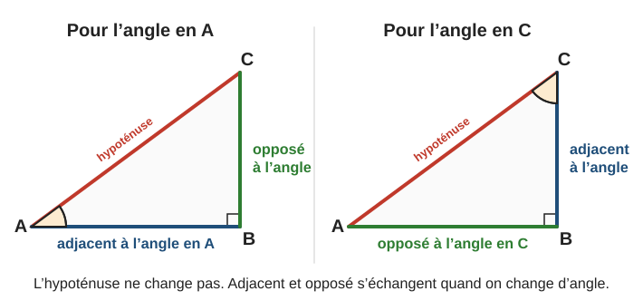
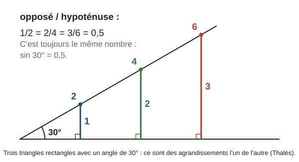
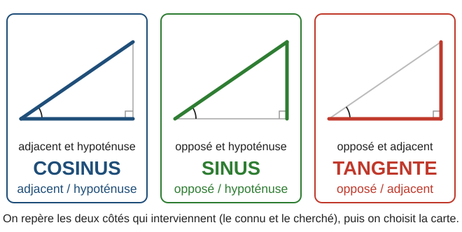
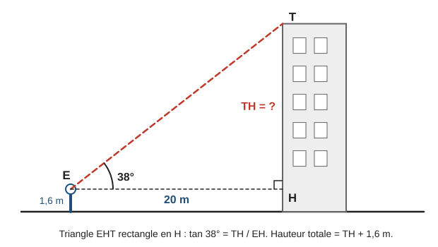
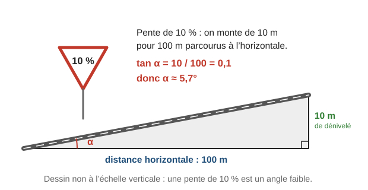
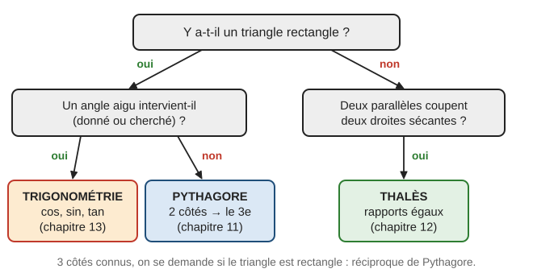
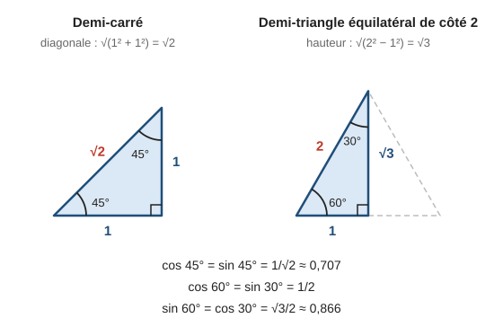

# Trigonométrie dans le triangle rectangle

> Compendium collège — chapitre unifié (sans découpage 6e / 5e / 4e / 3e).  
> Cours compact pour un élève de niveau moyen : intuition, méthode, exemples guidés, erreurs fréquentes, puis exercices progressifs (★ facile, ★★ standard, ★★★ approfondissement) avec corrigés détaillés.

---

## 0. Ce qu’on vise

**En une phrase :** dans un triangle rectangle, un angle aigu fixe la **forme** du triangle, donc les **rapports** entre ses côtés. Ces rapports s’appellent cosinus, sinus et tangente. Ils relient un angle et des longueurs : avec un angle et un côté, on calcule un autre côté ; avec deux côtés, on calcule un angle.

À la fin de ce chapitre, je sais :

1. Repérer, pour un angle aigu donné, l’**hypoténuse**, le côté **adjacent** et le côté **opposé**.
2. Écrire le **cosinus**, le **sinus** et la **tangente** d’un angle aigu.
3. Calculer une **longueur** avec la formule adaptée (inconnue en haut ou en bas du quotient).
4. Calculer un **angle** avec la calculatrice.
5. Choisir le bon outil : **trigonométrie**, **Pythagore** ou **Thalès**.
6. Résoudre des problèmes concrets : angle de visée, pente, échelle.

> **Prérequis.** Triangle rectangle et hypoténuse (chapitre 11, § 2) ; produit en croix (chapitre 12, § 1.1) ; agrandissement et réduction (chapitre 12, § 5) ; arrondis (chapitre 2, § 4).

---

## 1. Le vocabulaire : adjacent, opposé, hypoténuse

### 1.1 Trois côtés, trois noms

Dans un triangle rectangle, on choisit un des deux **angles aigus**. Par rapport à cet angle :

- l’**hypoténuse** est le côté face à l’angle droit (le plus long) ;
- le côté **adjacent** est le côté de l’angle droit qui **touche** l’angle choisi ;
- le côté **opposé** est le côté de l’angle droit qui est **en face** de l’angle choisi.

Sur le schéma ci-dessous, le triangle $ABC$ est rectangle en $B$. Pour l’angle en $A$, le côté adjacent est $[AB]$ et le côté opposé est $[BC]$. Pour l’angle en $C$, c’est l’**inverse**.

> **Erreur fréquente.** Garder les mêmes noms quand on change d’angle. Dans $ABC$ rectangle en $B$, $[AB]$ est adjacent à $\widehat{BAC}$ mais **opposé** à $\widehat{BCA}$. On repère les côtés **à chaque fois** qu’on change d’angle.

### 1.2 Notation des angles

L’angle de sommet $A$ formé par $[AB)$ et $[AC)$ se note $\widehat{BAC}$ (la lettre du sommet au milieu). Quand il n’y a pas d’ambiguïté, on écrit $\widehat{A}$.

---

## 2. Cosinus, sinus et tangente

### 2.1 Pourquoi ces rapports existent

Traçons plusieurs triangles rectangles qui ont tous un angle de $30^\circ$ (schéma ci-dessous). Ce sont des agrandissements les uns des autres (comme dans le chapitre 12). Leurs côtés sont donc proportionnels : le rapport $\dfrac{\text{côté opposé}}{\text{hypoténuse}}$ vaut **toujours** $0{,}5$, quelle que soit la taille du triangle.

Ce rapport ne dépend **que de l’angle**. On lui donne un nom : c’est le **sinus** de $30^\circ$.

### 2.2 Définitions

> **Définition.** Dans un triangle rectangle, pour un angle aigu $\widehat{A}$ :
>
> $$\cos \widehat{A} = \dfrac{\text{côté adjacent}}{\text{hypoténuse}}$$
>
> $$\sin \widehat{A} = \dfrac{\text{côté opposé}}{\text{hypoténuse}}$$
>
> $$\tan \widehat{A} = \dfrac{\text{côté opposé}}{\text{côté adjacent}}$$

On lit « cosinus de $A$ », « sinus de $A$ », « tangente de $A$ ».

> **Astuce.** Pour retenir : **CAH SOH TOA**. **C**osinus = **A**djacent / **H**ypoténuse ; **S**inus = **O**pposé / **H**ypoténuse ; **T**angente = **O**pposé / **A**djacent.

**Exemple.** $ABC$ est rectangle en $B$ avec $AB = 4$, $BC = 3$ et $AC = 5$. Pour l’angle en $A$ : adjacent $AB = 4$, opposé $BC = 3$, hypoténuse $AC = 5$.

$$\cos \widehat{A} = \dfrac{4}{5} = 0{,}8 \qquad \sin \widehat{A} = \dfrac{3}{5} = 0{,}6 \qquad \tan \widehat{A} = \dfrac{3}{4} = 0{,}75$$

### 2.3 Ce qu’il faut savoir sur ces nombres

- L’hypoténuse est le plus long côté. Donc le cosinus et le sinus d’un angle aigu sont **compris entre $0$ et $1$**.
- La tangente peut dépasser $1$ : c’est le cas quand le côté opposé est plus long que le côté adjacent (angle de plus de $45^\circ$).
- À la calculatrice, on obtient ces valeurs avec les touches **cos**, **sin**, **tan**. La calculatrice doit être en mode **degrés** (indication D ou DEG à l’écran). Exemple : $\cos 60^\circ = 0{,}5$ et $\sin 25^\circ \approx 0{,}423$.

> **Erreur fréquente.** Calculatrice en mode radians : elle affiche $\cos 60 \approx -0{,}952$. Un cosinus d’angle aigu n’est jamais négatif : il faut repasser en mode degrés.

---

## 3. Calculer une longueur

### 3.1 Choisir la bonne formule

On repère les **deux côtés** qui interviennent : celui qu’on connaît et celui qu’on cherche. La paire de côtés désigne la formule (schéma ci-dessous).

### 3.2 Exemple guidé 1 — l’inconnue est en haut

**Énoncé.** $ABC$ est rectangle en $B$, $AC = 9\,\mathrm{cm}$ et $\widehat{BAC} = 34^\circ$. Calculer $AB$, arrondi au millimètre.

**Réflexion.** Pour l’angle en $A$ : on connaît l’hypoténuse $AC$ et on cherche le côté adjacent $AB$. Adjacent et hypoténuse : **cosinus**.

**Rédaction.**

> Le triangle $ABC$ est rectangle en $B$. Donc :
>
> $$\cos \widehat{BAC} = \dfrac{AB}{AC} \quad \text{soit} \quad \cos 34^\circ = \dfrac{AB}{9}$$
>
> Donc $AB = 9 \times \cos 34^\circ \approx 7{,}5\,\mathrm{cm}$.

**Contrôle.** $7{,}5 < 9$ : le côté adjacent est bien plus court que l’hypoténuse.

### 3.3 Exemple guidé 2 — l’inconnue est en bas

**Énoncé.** $ABC$ est rectangle en $B$, $AB = 5\,\mathrm{cm}$ et $\widehat{BAC} = 40^\circ$. Calculer $AC$, arrondi au millimètre.

**Réflexion.** On connaît le côté adjacent $AB$, on cherche l’hypoténuse $AC$ : **cosinus**. Cette fois, l’inconnue est au **dénominateur**. On écrit $\cos 40^\circ = \dfrac{\cos 40^\circ}{1}$ et on fait un produit en croix.

**Rédaction.**

> Le triangle $ABC$ est rectangle en $B$. Donc :
>
> $$\cos \widehat{BAC} = \dfrac{AB}{AC} \quad \text{soit} \quad \dfrac{\cos 40^\circ}{1} = \dfrac{5}{AC}$$
>
> Donc $AC = \dfrac{5}{\cos 40^\circ} \approx 6{,}5\,\mathrm{cm}$.

**Contrôle.** $6{,}5 > 5$ : l’hypoténuse est bien le plus long côté.

### 3.4 Exemple guidé 3 — avec la tangente

**Énoncé.** $ABC$ est rectangle en $B$, $AB = 6\,\mathrm{cm}$ et $\widehat{BAC} = 52^\circ$. Calculer $BC$, arrondi au millimètre.

**Réflexion.** On connaît le côté adjacent $AB$, on cherche le côté opposé $BC$. Opposé et adjacent : **tangente**.

**Rédaction.**

> Le triangle $ABC$ est rectangle en $B$. Donc :
>
> $$\tan \widehat{BAC} = \dfrac{BC}{AB} \quad \text{soit} \quad \tan 52^\circ = \dfrac{BC}{6}$$
>
> Donc $BC = 6 \times \tan 52^\circ \approx 7{,}7\,\mathrm{cm}$.

**Contrôle.** L’angle dépasse $45^\circ$ : le côté opposé est plus long que le côté adjacent ($7{,}7 > 6$).

### 3.5 Méthode en 4 étapes

> **Méthode — calculer une longueur avec la trigonométrie.**
>
> 1. **Justifier** : écrire que le triangle est rectangle (et en quel sommet).
> 2. **Repérer**, pour l’angle connu, le côté connu et le côté cherché (adjacent, opposé ou hypoténuse). Choisir cos, sin ou tan.
> 3. **Écrire** la formule avec les lettres, puis remplacer par les valeurs.
> 4. **Calculer** : inconnue en haut, on **multiplie** ; inconnue en bas, on **divise**. Arrondir seulement à la fin, puis contrôler (l’hypoténuse est le plus long côté).

### 3.6 Erreurs fréquentes

> **Erreur 1 — multiplier au lieu de diviser.** Avec les données de l’exemple 2, écrire $AC = 5 \times \cos 40^\circ \approx 3{,}8$ donne une hypoténuse plus courte que $AB = 5$ : impossible. Le bon calcul est $AC = \dfrac{5}{\cos 40^\circ} \approx 6{,}5$.

> **Erreur 2 — se tromper de côté.** Dans $ABC$ rectangle en $B$, écrire $\sin \widehat{A} = \dfrac{AB}{AC}$. Or $[AB]$ est **adjacent** à l’angle en $A$ : c’est $\cos \widehat{A} = \dfrac{AB}{AC}$. Le sinus est $\dfrac{BC}{AC}$.

> **Erreur 3 — arrondir trop tôt.** Calculer d’abord $\cos 40^\circ \approx 0{,}8$, puis $\dfrac{5}{0{,}8} = 6{,}25 \approx 6{,}3$. Le bon résultat est $6{,}5$. On tape le calcul **en une seule fois** à la calculatrice.

---

## 4. Calculer un angle

### 4.1 La touche « inverse »

Si on connaît le cosinus d’un angle, la calculatrice retrouve l’angle avec la touche $\cos^{-1}$ (parfois notée Arccos ou acs ; on l’obtient souvent avec « seconde » puis « cos »). De même pour $\sin^{-1}$ et $\tan^{-1}$.

**Exemple.** $\cos \widehat{A} = 0{,}5$ donne $\widehat{A} = \cos^{-1}(0{,}5) = 60^\circ$.

### 4.2 Exemple guidé 4 — avec le cosinus

**Énoncé.** $ABC$ est rectangle en $B$, $AB = 7\,\mathrm{cm}$ et $AC = 9\,\mathrm{cm}$. Calculer $\widehat{BAC}$, arrondi au degré.

**Réflexion.** Pour l’angle en $A$, on connaît le côté adjacent et l’hypoténuse : cosinus.

**Rédaction.**

> Le triangle $ABC$ est rectangle en $B$. Donc :
>
> $$\cos \widehat{BAC} = \dfrac{AB}{AC} = \dfrac{7}{9}$$
>
> Donc $\widehat{BAC} = \cos^{-1}\left(\dfrac{7}{9}\right) \approx 39^\circ$.

**Contrôle.** Un angle aigu est compris entre $0^\circ$ et $90^\circ$. Le côté adjacent est assez proche de l’hypoténuse : l’angle est plutôt petit, c’est cohérent.

### 4.3 Exemple guidé 5 — avec la tangente, puis l’autre angle

**Énoncé.** $ABC$ est rectangle en $B$, $AB = 5\,\mathrm{cm}$ et $BC = 12\,\mathrm{cm}$. Calculer les deux angles aigus, arrondis au degré.

**Rédaction.**

> Le triangle $ABC$ est rectangle en $B$. Pour l’angle en $A$, $[BC]$ est opposé et $[AB]$ est adjacent :
>
> $$\tan \widehat{BAC} = \dfrac{BC}{AB} = \dfrac{12}{5} = 2{,}4 \quad \text{donc} \quad \widehat{BAC} = \tan^{-1}(2{,}4) \approx 67{,}4^\circ$$
>
> La somme des angles d’un triangle vaut $180^\circ$, donc $\widehat{BCA} = 180^\circ - 90^\circ - 67{,}4^\circ \approx 22{,}6^\circ$.  
> Arrondis au degré : $\widehat{BAC} \approx 67^\circ$ et $\widehat{BCA} \approx 23^\circ$.

> **Astuce.** Dans un triangle rectangle, les deux angles aigus ont pour somme $90^\circ$ (on dit qu’ils sont **complémentaires**). Dès qu’on en connaît un, on a l’autre.

### 4.4 Erreurs fréquentes

> **Erreur 1 — oublier la touche inverse.** Taper $\cos(7 \div 9) \approx 0{,}9999$ au lieu de $\cos^{-1}(7 \div 9) \approx 38{,}9^\circ$. Un angle s’obtient avec $\cos^{-1}$, $\sin^{-1}$ ou $\tan^{-1}$.

> **Erreur 2 — arrondir le rapport.** $\cos \widehat{A} = \dfrac{2}{3} \approx 0{,}7$, puis $\cos^{-1}(0{,}7) \approx 46^\circ$. Le bon résultat est $\cos^{-1}\left(\dfrac{2}{3}\right) \approx 48^\circ$. On garde la fraction.

---

## 5. Modéliser : visée, pente, échelle

### 5.1 Exemple guidé 6 — l’angle de visée

**Énoncé.** Léna se tient à $20\,\mathrm{m}$ d’un immeuble. Elle vise le sommet du toit sous un angle de $38^\circ$ avec l’horizontale. Ses yeux sont à $1{,}6\,\mathrm{m}$ du sol. Quelle est la hauteur de l’immeuble, arrondie au décimètre ?

**Réflexion.** On fait un schéma (ci-dessous). Le triangle utile part des **yeux** $E$, pas des pieds. Dans le triangle $EHT$ rectangle en $H$, on connaît le côté adjacent $EH = 20$ et on cherche le côté opposé $TH$ : tangente. Il faudra ajouter $1{,}6\,\mathrm{m}$.

**Rédaction.**

> Le triangle $EHT$ est rectangle en $H$. Donc :
>
> $$\tan \widehat{HET} = \dfrac{TH}{EH} \quad \text{soit} \quad \tan 38^\circ = \dfrac{TH}{20}$$
>
> Donc $TH = 20 \times \tan 38^\circ \approx 15{,}63\,\mathrm{m}$.  
> Hauteur de l’immeuble : $15{,}63 + 1{,}6 \approx 17{,}2\,\mathrm{m}$.

**Contrôle.** Avec un angle de $45^\circ$, on aurait $TH = 20$ ; l’angle est un peu plus petit, donc $TH$ est un peu moins de $20$.

### 5.2 La pente d’une route

Un panneau « $10\,\%$ » signifie : on monte de $10\,\mathrm{m}$ quand on avance de $100\,\mathrm{m}$ **à l’horizontale**. La pente est donc la tangente de l’angle d’inclinaison (schéma ci-dessous).

$$\tan \alpha = \dfrac{10}{100} = 0{,}1 \quad \text{donc} \quad \alpha = \tan^{-1}(0{,}1) \approx 5{,}7^\circ$$

> **Erreur fréquente.** Une pente de $100\,\%$ n’est **pas** un mur vertical : $\tan \alpha = 1$ donne $\alpha = 45^\circ$.

### 5.3 L’échelle contre un mur

Une échelle de $6\,\mathrm{m}$ fait un angle de $70^\circ$ avec le sol horizontal. Le mur, le sol et l’échelle forment un triangle rectangle : l’échelle est l’hypoténuse. La hauteur atteinte est le côté **opposé** à l’angle de $70^\circ$ : $h = 6 \times \sin 70^\circ \approx 5{,}6\,\mathrm{m}$.

---

## 6. Quel outil choisir ?

Les chapitres 11, 12 et 13 donnent trois outils pour calculer des longueurs. L’organigramme ci-dessous aide à choisir.

| On connaît… | On cherche… | Outil |
|---|---|---|
| deux côtés d’un triangle rectangle | le troisième côté | Pythagore |
| un angle aigu et un côté | un autre côté | trigonométrie |
| deux côtés d’un triangle rectangle | un angle | trigonométrie |
| les trois côtés | « rectangle ou pas ? » | réciproque de Pythagore |
| des parallèles coupant deux sécantes | une longueur | Thalès |

### 6.1 Pour aller plus loin (★★★) : relations et valeurs remarquables

Pour un angle aigu $\widehat{A}$, on peut démontrer avec Pythagore et les définitions :

$$(\cos \widehat{A})^2 + (\sin \widehat{A})^2 = 1 \qquad \text{et} \qquad \tan \widehat{A} = \dfrac{\sin \widehat{A}}{\cos \widehat{A}}$$

Le demi-carré et le demi-triangle équilatéral donnent des valeurs **exactes** (schéma ci-dessous) : $\cos 45^\circ = \sin 45^\circ = \dfrac{1}{\sqrt{2}} \approx 0{,}707$ ; $\cos 60^\circ = \sin 30^\circ = \dfrac{1}{2}$ ; $\sin 60^\circ = \cos 30^\circ = \dfrac{\sqrt{3}}{2} \approx 0{,}866$.

---

## 7. Mini-synthèse

> **À retenir.**
>
> - Pour **un angle aigu** choisi : hypoténuse (face à l’angle droit), adjacent (touche l’angle), opposé (en face). Adjacent et opposé changent avec l’angle.
> - **CAH SOH TOA** : $\cos = \dfrac{\text{adj.}}{\text{hyp.}}$, $\sin = \dfrac{\text{opp.}}{\text{hyp.}}$, $\tan = \dfrac{\text{opp.}}{\text{adj.}}$.
> - Le côté connu et le côté cherché désignent la formule.
> - Longueur : inconnue en haut → on multiplie ; inconnue en bas → on divise. Arrondir à la fin.
> - Angle : rapport exact, puis touche $\cos^{-1}$, $\sin^{-1}$ ou $\tan^{-1}$, calculatrice en **degrés**.
> - Les deux angles aigus d’un triangle rectangle ont pour somme $90^\circ$.

---

## 8. Exercices types

> Objectif : automatismes. Difficulté croissante dans chaque série. Sauf mention contraire, les longueurs sont arrondies au millimètre et les angles au degré. Corrigés détaillés au § 10.

### A. Vocabulaire et rapports (★)

**A1.** $DEF$ est rectangle en $E$. Nommer l’hypoténuse. Pour l’angle en $D$, nommer le côté adjacent et le côté opposé. Même question pour l’angle en $F$.

**A2.** $ABC$ est rectangle en $C$. Écrire $\cos \widehat{A}$, $\sin \widehat{A}$ et $\tan \widehat{A}$, puis $\cos \widehat{B}$, $\sin \widehat{B}$ et $\tan \widehat{B}$, avec les longueurs des côtés.

**A3.** $RST$ est rectangle en $S$, avec $RS = 3\,\mathrm{cm}$, $ST = 4\,\mathrm{cm}$ et $RT = 5\,\mathrm{cm}$. Donner $\cos \widehat{R}$, $\sin \widehat{R}$ et $\tan \widehat{R}$ sous forme de fractions, puis de nombres décimaux (au centième si besoin).

**A4.** À la calculatrice (mode degrés) : $\cos 60^\circ$ ; $\sin 30^\circ$ ; $\tan 45^\circ$ ; $\cos 25^\circ$ et $\sin 72^\circ$ au millième.

**A5.** Vrai ou faux ? a) Le cosinus d’un angle aigu peut valoir $1{,}2$. b) La tangente d’un angle aigu peut valoir $3$. c) Si $ABC$ est rectangle en $A$, alors $\cos \widehat{B} = \dfrac{AB}{BC}$.

### B. Calculer une longueur (★ → ★★)

**B1.** $ABC$ est rectangle en $B$, $AC = 10\,\mathrm{cm}$ et $\widehat{BAC} = 35^\circ$. Calculer $AB$ et $BC$.

**B2.** $DEF$ est rectangle en $E$, $DE = 7\,\mathrm{cm}$ et $\widehat{EDF} = 50^\circ$. Calculer $DF$ et $EF$.

**B3.** $KLM$ est rectangle en $L$, $KM = 12\,\mathrm{cm}$ et $\widehat{LKM} = 28^\circ$. Calculer $LM$.

**B4.** $RST$ est rectangle en $S$, $ST = 4{,}5\,\mathrm{cm}$ et $\widehat{SRT} = 62^\circ$. Calculer $RS$.

**B5.** $XYZ$ est rectangle en $X$, $XY = 9\,\mathrm{cm}$ et $\widehat{XYZ} = 40^\circ$. Calculer $YZ$.

**B6.** $GHI$ est rectangle en $H$, $GI = 15\,\mathrm{cm}$ et $\widehat{HIG} = 23^\circ$. Calculer $GH$.

### C. Calculer un angle (★ → ★★)

**C1.** $ABC$ est rectangle en $B$, $AB = 4\,\mathrm{cm}$ et $AC = 6\,\mathrm{cm}$. Calculer $\widehat{BAC}$.

**C2.** Un triangle rectangle a des côtés de l’angle droit de $5\,\mathrm{cm}$ et $12\,\mathrm{cm}$ (hypoténuse $13\,\mathrm{cm}$). Calculer ses deux angles aigus.

**C3.** $DEF$ est rectangle en $D$, $EF = 10\,\mathrm{cm}$ et $DF = 3\,\mathrm{cm}$. Calculer $\widehat{DEF}$.

**C4.** Un angle aigu $\alpha$ vérifie $\tan \alpha = \dfrac{2}{5}$. Calculer $\alpha$.

**C5.** Un angle aigu $\alpha$ vérifie $\sin \alpha = 0{,}5$. Quelle est la valeur exacte de $\alpha$ ?

**C6.** $ABC$ est rectangle en $A$ avec $AB = AC = 6{,}5\,\mathrm{cm}$. Calculer ses angles aigus, puis expliquer le résultat sans calcul.

### D. Pythagore ou trigonométrie ? (★★)

Dans D1 à D4, $ABC$ est rectangle en $A$. Choisir l’outil, puis calculer.

**D1.** $AB = 6\,\mathrm{cm}$ et $AC = 8\,\mathrm{cm}$. Calculer $BC$.

**D2.** $AB = 6\,\mathrm{cm}$ et $AC = 8\,\mathrm{cm}$. Calculer $\widehat{ABC}$.

**D3.** $BC = 10\,\mathrm{cm}$ et $\widehat{ABC} = 30^\circ$. Calculer $AC$.

**D4.** $BC = 10\,\mathrm{cm}$ et $AC = 5\,\mathrm{cm}$. Calculer $AB$.

**D5.** Sans calculer, dire quel outil utiliser : a) on connaît deux côtés d’un triangle rectangle et on cherche le troisième ; b) on connaît un angle aigu et un côté, on cherche un autre côté ; c) on connaît deux côtés, on cherche un angle ; d) on connaît les trois côtés d’un triangle et on se demande s’il est rectangle.

### E. Problèmes concrets (★★)

**E1.** Une échelle de $6\,\mathrm{m}$ est appuyée contre un mur vertical. Elle fait un angle de $70^\circ$ avec le sol horizontal. À quelle hauteur arrive-t-elle ? À quelle distance du mur est son pied ? (Au décimètre.)

**E2.** D’un balcon situé à $12\,\mathrm{m}$ de hauteur, on voit un chat au sol. La droite balcon-chat fait un angle de $32^\circ$ avec le sol. À quelle distance du pied de l’immeuble est le chat ? (Au décimètre.)

**E3.** Une route a une pente de $8\,\%$. Quel est son angle d’inclinaison, au dixième de degré ?

**E4.** Le fil d’un cerf-volant est tendu et mesure $40\,\mathrm{m}$. Il fait un angle de $55^\circ$ avec l’horizontale. La main qui tient le fil est à $1\,\mathrm{m}$ du sol. À quelle hauteur vole le cerf-volant ? (Au décimètre.)

**E5.** Une rampe doit permettre de monter une marche de $0{,}5\,\mathrm{m}$. Son angle avec le sol ne doit pas dépasser $4^\circ$. Quelle longueur horizontale minimale faut-il prévoir ? (Au décimètre.)

**E6.** Un toboggan rectiligne de $8\,\mathrm{m}$ fait un angle de $35^\circ$ avec le sol. Calculer la hauteur de son sommet et la distance horizontale qu’il couvre. (Au décimètre.)

---

## 9. Exercices atypiques

> Objectif : comprendre, raisonner, rédiger. Plusieurs étapes, erreurs à trouver, questions ouvertes.

### F. Trouver l’erreur (★★)

**F1.** Léo écrit : « $ABC$ est rectangle en $B$, $\widehat{BAC} = 40^\circ$ et $AB = 5$. $\cos 40^\circ = \dfrac{AB}{AC}$, donc $AC = 5 \times \cos 40^\circ \approx 3{,}8$. » Trouver l’erreur et corriger.

**F2.** Inès écrit : « $ABC$ est rectangle en $C$, donc $\sin \widehat{A} = \dfrac{AC}{AB}$. » Trouver l’erreur.

**F3.** Sami tape $\cos(60)$ et lit $-0{,}952$. Il conclut que le cosinus de $60^\circ$ est négatif. Qu’en penser ?

**F4.** Nora écrit : « $\cos \widehat{A} = \dfrac{2}{3} \approx 0{,}7$, donc $\widehat{A} = \cos^{-1}(0{,}7) \approx 46^\circ$. » Son résultat est-il juste ?

### G. Comprendre et raisonner (★★ → ★★★)

**G1.** Expliquer pourquoi le cosinus et le sinus d’un angle aigu sont toujours inférieurs à $1$.

**G2.** La tangente d’un angle aigu peut-elle dépasser $1$ ? Pour quels angles ?

**G3.** $\alpha$ et $\beta$ sont les deux angles aigus d’un triangle rectangle. Montrer que $\sin \alpha = \cos \beta$.

**G4.** Sans calculatrice, ranger dans l’ordre croissant : $\cos 20^\circ$, $\cos 50^\circ$, $\cos 80^\circ$. Justifier avec un dessin (hypoténuse de longueur fixe).

**G5.** (★★★) Un angle aigu $\alpha$ vérifie $\cos \alpha = \dfrac{5}{13}$. a) Dessiner un triangle rectangle qui convient et calculer le troisième côté. b) En déduire $\sin \alpha$ et $\tan \alpha$. c) Vérifier que $(\cos \alpha)^2 + (\sin \alpha)^2 = 1$.

### H. Plusieurs étapes (★★★)

**H1.** $ABC$ est rectangle en $A$, $BC = 10\,\mathrm{cm}$ et $\widehat{ABC} = 36^\circ$. a) Calculer $AC$ et $AB$. b) Vérifier le résultat avec le théorème de Pythagore. c) Calculer l’aire du triangle, au dixième de $\mathrm{cm}^2$.

**H2.** Depuis un point $P$ du sol, à $50\,\mathrm{m}$ du pied d’un immeuble, on voit le haut de l’immeuble sous un angle de $35^\circ$ et le haut de l’antenne posée sur le toit sous un angle de $40^\circ$. Calculer la hauteur de l’antenne, au décimètre.

**H3.** $ABC$ est isocèle en $A$ avec $AB = AC = 7\,\mathrm{cm}$ et $BC = 10\,\mathrm{cm}$. $H$ est le milieu de $[BC]$. a) Pourquoi le triangle $ABH$ est-il rectangle ? b) Calculer $\widehat{ABC}$ au dixième de degré. c) En déduire les trois angles du triangle $ABC$.

**H4.** Un arbre vertical mesure $7\,\mathrm{m}$. a) Quand le soleil est à $40^\circ$ au-dessus de l’horizon, quelle est la longueur de son ombre ? b) Plus tard, l’ombre mesure $12\,\mathrm{m}$. Quelle est alors la hauteur du soleil (angle avec l’horizon) ?

**H5.** (★★★, valeurs exactes) Un triangle rectangle a un angle de $30^\circ$ et une hypoténuse de $10\,\mathrm{cm}$. En utilisant le demi-triangle équilatéral (§ 6.1), donner les longueurs **exactes** des deux autres côtés.

### I. Ouvert (★★)

**I1.** Inventer un QCM de trois questions sur le choix entre cos, sin et tan. Chaque question doit contenir une mauvaise réponse qui piège un élève qui se trompe d’hypoténuse.

**I2.** Sur un panneau routier, on lit « $12\,\%$ ». Expliquer à un camarade ce que cela signifie et calculer l’angle. Une pente de $100\,\%$ est-elle verticale ?

**I3.** Expliquer en trois phrases comment on sait, dans un exercice, s’il faut utiliser Pythagore ou la trigonométrie.

---

## 10. Corrigés

> Les corrigés marqués **(modèle)** montrent la rédaction attendue. Les autres donnent les étapes clés. Les calculs sont faits à la calculatrice en une seule fois, puis arrondis.

### Exercices types

**A1.** Hypoténuse : $[DF]$. Pour l’angle en $D$ : adjacent $[DE]$, opposé $[EF]$. Pour l’angle en $F$ : adjacent $[EF]$, opposé $[DE]$.

**A2. (modèle)**
> Le triangle $ABC$ est rectangle en $C$ : l’hypoténuse est $[AB]$.  
> Pour l’angle en $A$ : $\cos \widehat{A} = \dfrac{AC}{AB}$, $\sin \widehat{A} = \dfrac{BC}{AB}$, $\tan \widehat{A} = \dfrac{BC}{AC}$.  
> Pour l’angle en $B$ : $\cos \widehat{B} = \dfrac{BC}{AB}$, $\sin \widehat{B} = \dfrac{AC}{AB}$, $\tan \widehat{B} = \dfrac{AC}{BC}$.

**A3.** Hypoténuse $[RT]$ ; pour l’angle en $R$, adjacent $[RS]$, opposé $[ST]$. $\cos \widehat{R} = \dfrac{3}{5} = 0{,}6$ ; $\sin \widehat{R} = \dfrac{4}{5} = 0{,}8$ ; $\tan \widehat{R} = \dfrac{4}{3} \approx 1{,}33$.

**A4.** $0{,}5$ ; $0{,}5$ ; $1$ ; $\cos 25^\circ \approx 0{,}906$ ; $\sin 72^\circ \approx 0{,}951$.

**A5.** a) Faux : le côté adjacent est plus court que l’hypoténuse, donc le cosinus est inférieur à $1$. b) Vrai : il suffit que le côté opposé soit trois fois plus long que le côté adjacent (angle d’environ $72^\circ$). c) Vrai : l’hypoténuse est $[BC]$ et $[AB]$ est adjacent à l’angle en $B$.

**B1. (modèle)**
> Le triangle $ABC$ est rectangle en $B$. Pour l’angle en $A$, $[AB]$ est adjacent, $[BC]$ est opposé et $[AC]$ est l’hypoténuse.  
> $\cos \widehat{BAC} = \dfrac{AB}{AC}$, soit $\cos 35^\circ = \dfrac{AB}{10}$, donc $AB = 10 \times \cos 35^\circ \approx 8{,}2\,\mathrm{cm}$.  
> $\sin \widehat{BAC} = \dfrac{BC}{AC}$, soit $\sin 35^\circ = \dfrac{BC}{10}$, donc $BC = 10 \times \sin 35^\circ \approx 5{,}7\,\mathrm{cm}$.

**B2.** Pour l’angle en $D$ : $DE$ adjacent, $EF$ opposé, $DF$ hypoténuse. $\cos 50^\circ = \dfrac{7}{DF}$, donc $DF = \dfrac{7}{\cos 50^\circ} \approx 10{,}9\,\mathrm{cm}$. $\tan 50^\circ = \dfrac{EF}{7}$, donc $EF = 7 \times \tan 50^\circ \approx 8{,}3\,\mathrm{cm}$.

**B3.** Pour l’angle en $K$ : $LM$ opposé, $KM$ hypoténuse. $\sin 28^\circ = \dfrac{LM}{12}$, donc $LM = 12 \times \sin 28^\circ \approx 5{,}6\,\mathrm{cm}$.

**B4.** Pour l’angle en $R$ : $ST$ opposé, $RS$ adjacent. $\tan 62^\circ = \dfrac{4{,}5}{RS}$, donc $RS = \dfrac{4{,}5}{\tan 62^\circ} \approx 2{,}4\,\mathrm{cm}$.

**B5.** Pour l’angle en $Y$ : $XY$ adjacent, $YZ$ hypoténuse. $\cos 40^\circ = \dfrac{9}{YZ}$, donc $YZ = \dfrac{9}{\cos 40^\circ} \approx 11{,}7\,\mathrm{cm}$.

**B6.** Pour l’angle en $I$ : $GH$ opposé, $GI$ hypoténuse. $\sin 23^\circ = \dfrac{GH}{15}$, donc $GH = 15 \times \sin 23^\circ \approx 5{,}9\,\mathrm{cm}$.

**C1. (modèle)**
> Le triangle $ABC$ est rectangle en $B$. Pour l’angle en $A$, $[AB]$ est adjacent et $[AC]$ est l’hypoténuse.  
> $\cos \widehat{BAC} = \dfrac{AB}{AC} = \dfrac{4}{6} = \dfrac{2}{3}$, donc $\widehat{BAC} = \cos^{-1}\left(\dfrac{2}{3}\right) \approx 48^\circ$.

**C2.** Pour l’angle opposé au côté de $12\,\mathrm{cm}$ : $\tan \alpha = \dfrac{12}{5}$, donc $\alpha \approx 67{,}4^\circ$. L’autre angle vaut $90^\circ - 67{,}4^\circ \approx 22{,}6^\circ$. Au degré : $67^\circ$ et $23^\circ$.

**C3.** Hypoténuse $[EF]$ ; pour l’angle en $E$, $[DF]$ est opposé. $\sin \widehat{DEF} = \dfrac{3}{10} = 0{,}3$, donc $\widehat{DEF} = \sin^{-1}(0{,}3) \approx 17^\circ$.

**C4.** $\alpha = \tan^{-1}(0{,}4) \approx 22^\circ$.

**C5.** $\alpha = 30^\circ$ (valeur exacte : $\sin^{-1}(0{,}5) = 30^\circ$).

**C6.** $\tan \widehat{B} = \dfrac{6{,}5}{6{,}5} = 1$, donc $\widehat{B} = 45^\circ$, et $\widehat{C} = 90^\circ - 45^\circ = 45^\circ$. Sans calcul : le triangle est rectangle **et** isocèle, ses deux angles aigus sont égaux et ont pour somme $90^\circ$.

**D1.** Deux côtés connus, on cherche le troisième : Pythagore. $BC^2 = 36 + 64 = 100$, donc $BC = 10\,\mathrm{cm}$.

**D2. (modèle)**
> On cherche un angle : trigonométrie. Le triangle $ABC$ est rectangle en $A$. Pour l’angle en $B$, $[AC]$ est opposé et $[AB]$ est adjacent.  
> $\tan \widehat{ABC} = \dfrac{AC}{AB} = \dfrac{8}{6}$, donc $\widehat{ABC} = \tan^{-1}\left(\dfrac{8}{6}\right) \approx 53^\circ$.

**D3.** Un angle et un côté : trigonométrie. Pour l’angle en $B$, $[AC]$ est opposé, $[BC]$ hypoténuse : $AC = 10 \times \sin 30^\circ = 5\,\mathrm{cm}$.

**D4.** Deux côtés, on cherche le troisième : Pythagore. $BC^2 = AB^2 + AC^2$, soit $100 = AB^2 + 25$, donc $AB^2 = 75$ et $AB = \sqrt{75} \approx 8{,}7\,\mathrm{cm}$.

**D5.** a) Pythagore. b) Trigonométrie. c) Trigonométrie. d) Réciproque de Pythagore.

**E1. (modèle)**
> Le mur, le sol et l’échelle forment un triangle rectangle au pied du mur. L’échelle ($6\,\mathrm{m}$) est l’hypoténuse.  
> Hauteur (côté opposé à l’angle de $70^\circ$) : $h = 6 \times \sin 70^\circ \approx 5{,}6\,\mathrm{m}$.  
> Distance au mur (côté adjacent) : $d = 6 \times \cos 70^\circ \approx 2{,}1\,\mathrm{m}$.

**E2.** Triangle rectangle au pied de l’immeuble. Au point où est le chat, l’angle vaut $32^\circ$ ; la hauteur $12\,\mathrm{m}$ est le côté opposé, la distance $d$ le côté adjacent. $\tan 32^\circ = \dfrac{12}{d}$, donc $d = \dfrac{12}{\tan 32^\circ} \approx 19{,}2\,\mathrm{m}$.

**E3.** $\tan \alpha = \dfrac{8}{100} = 0{,}08$, donc $\alpha = \tan^{-1}(0{,}08) \approx 4{,}6^\circ$.

**E4.** Le fil est l’hypoténuse. Hauteur au-dessus de la main : $40 \times \sin 55^\circ \approx 32{,}77\,\mathrm{m}$. Hauteur du cerf-volant : $32{,}77 + 1 \approx 33{,}8\,\mathrm{m}$.

**E5.** La hauteur $0{,}5\,\mathrm{m}$ est opposée à l’angle, la longueur horizontale $L$ est adjacente. $\tan 4^\circ = \dfrac{0{,}5}{L}$, donc $L = \dfrac{0{,}5}{\tan 4^\circ} \approx 7{,}2\,\mathrm{m}$ (au minimum).

**E6.** Le toboggan est l’hypoténuse. Hauteur : $8 \times \sin 35^\circ \approx 4{,}6\,\mathrm{m}$. Distance horizontale : $8 \times \cos 35^\circ \approx 6{,}6\,\mathrm{m}$.

### Exercices atypiques

**F1.** L’inconnue $AC$ est au dénominateur : il faut diviser. $AC = \dfrac{5}{\cos 40^\circ} \approx 6{,}5$. Contrôle : l’hypoténuse doit être plus longue que $AB = 5$ ; $3{,}8$ est donc impossible.

**F2.** Rectangle en $C$ : l’hypoténuse est $[AB]$, et $[AC]$ **touche** l’angle en $A$ : c’est le côté adjacent. Donc $\dfrac{AC}{AB} = \cos \widehat{A}$. Le sinus est $\sin \widehat{A} = \dfrac{BC}{AB}$.

**F3.** La calculatrice est en mode radians. En mode degrés, $\cos 60^\circ = 0{,}5$. Le cosinus d’un angle aigu est toujours compris entre $0$ et $1$.

**F4.** Non. Elle a arrondi le rapport trop tôt. $\cos^{-1}\left(\dfrac{2}{3}\right) \approx 48{,}2^\circ$, soit $48^\circ$ au degré, et non $46^\circ$.

**G1.** Le cosinus et le sinus sont des quotients « côté de l’angle droit sur hypoténuse ». L’hypoténuse est le plus long côté, donc le numérateur est plus petit que le dénominateur : le quotient est inférieur à $1$.

**G2.** Oui : $\tan \alpha = \dfrac{\text{opposé}}{\text{adjacent}}$ dépasse $1$ quand le côté opposé est plus long que le côté adjacent. C’est le cas pour les angles compris entre $45^\circ$ et $90^\circ$ ($\tan 45^\circ = 1$).

**G3. (modèle)**
> Dans le triangle rectangle, le côté opposé à $\alpha$ est le côté adjacent à $\beta$ (c’est le côté de l’angle droit qui touche $\beta$). L’hypoténuse est la même pour les deux angles.  
> Donc $\sin \alpha = \dfrac{\text{opposé à } \alpha}{\text{hypoténuse}} = \dfrac{\text{adjacent à } \beta}{\text{hypoténuse}} = \cos \beta$.

**G4.** On dessine des triangles rectangles d’hypoténuse $1$ avec des angles de $20^\circ$, $50^\circ$ et $80^\circ$. Plus l’angle est grand, plus l’hypoténuse « se relève » et plus le côté adjacent est court. Donc $\cos 80^\circ < \cos 50^\circ < \cos 20^\circ$. (Valeurs : $0{,}17$ ; $0{,}64$ ; $0{,}94$.)

**G5.** a) Côté adjacent $5$, hypoténuse $13$. Pythagore : $13^2 = 5^2 + x^2$, donc $x^2 = 169 - 25 = 144$ et $x = 12$. b) $\sin \alpha = \dfrac{12}{13}$ et $\tan \alpha = \dfrac{12}{5}$. c) $\dfrac{25}{169} + \dfrac{144}{169} = \dfrac{169}{169} = 1$.

**H1. (modèle)**
> a) Le triangle $ABC$ est rectangle en $A$ ; l’hypoténuse est $[BC]$. Pour l’angle en $B$, $[AC]$ est opposé et $[AB]$ est adjacent.  
> $AC = 10 \times \sin 36^\circ \approx 5{,}9\,\mathrm{cm}$ et $AB = 10 \times \cos 36^\circ \approx 8{,}1\,\mathrm{cm}$.  
> b) Avec les valeurs non arrondies, $AB^2 + AC^2 \approx 65{,}45 + 34{,}55 = 100 = BC^2$. (Avec les arrondis : $8{,}1^2 + 5{,}9^2 = 100{,}42 \approx 100$.)  
> c) Aire $= \dfrac{AB \times AC}{2} \approx \dfrac{8{,}090 \times 5{,}878}{2} \approx 23{,}8\,\mathrm{cm}^2$.

**H2.** Hauteur de l’immeuble : $50 \times \tan 35^\circ \approx 35{,}01\,\mathrm{m}$. Hauteur jusqu’au haut de l’antenne : $50 \times \tan 40^\circ \approx 41{,}95\,\mathrm{m}$. Antenne : $50 \times (\tan 40^\circ - \tan 35^\circ) \approx 6{,}9\,\mathrm{m}$.

**H3.** a) Dans un triangle isocèle, la médiane issue du sommet principal est aussi une hauteur : $(AH) \perp (BC)$, donc $ABH$ est rectangle en $H$. b) $BH = 5$ ; $\cos \widehat{ABC} = \dfrac{BH}{AB} = \dfrac{5}{7}$, donc $\widehat{ABC} \approx 44{,}4^\circ$. c) $\widehat{ACB} = \widehat{ABC} \approx 44{,}4^\circ$ (triangle isocèle) et $\widehat{BAC} \approx 180^\circ - 2 \times 44{,}4^\circ = 91{,}2^\circ$.

**H4.** a) L’arbre est opposé à l’angle de $40^\circ$, l’ombre $L$ est adjacente : $\tan 40^\circ = \dfrac{7}{L}$, donc $L = \dfrac{7}{\tan 40^\circ} \approx 8{,}3\,\mathrm{m}$. b) $\tan \alpha = \dfrac{7}{12}$, donc $\alpha = \tan^{-1}\left(\dfrac{7}{12}\right) \approx 30^\circ$.

**H5.** Le triangle est la moitié d’un triangle équilatéral de côté $10$. Le côté opposé à l’angle de $30^\circ$ vaut la moitié de l’hypoténuse : $5\,\mathrm{cm}$. L’autre côté, par Pythagore : $\sqrt{10^2 - 5^2} = \sqrt{75} = 5\sqrt{3} \approx 8{,}66\,\mathrm{cm}$.

**I1.** Exemple de question : « $ABC$ est rectangle en $B$. $\cos \widehat{A}$ vaut : a) $\dfrac{AB}{AC}$ ; b) $\dfrac{AB}{BC}$ ; c) $\dfrac{BC}{AC}$. » Bonne réponse : a). La réponse b) piège l’élève qui prend $[BC]$ pour l’hypoténuse ; c) piège celui qui confond adjacent et opposé.

**I2.** « $12\,\%$ » : on monte de $12\,\mathrm{m}$ pour $100\,\mathrm{m}$ à l’horizontale. $\tan \alpha = 0{,}12$, donc $\alpha \approx 6{,}8^\circ$. Une pente de $100\,\%$ correspond à $\tan \alpha = 1$, soit $45^\circ$ : ce n’est pas vertical.

**I3.** Exemple : « Les deux outils servent dans un triangle rectangle. Si l’exercice ne parle que de côtés (on en connaît deux, on cherche le troisième), c’est Pythagore. Dès qu’un angle aigu est donné ou demandé, c’est la trigonométrie. »

---

## 11. Liens avec les autres chapitres

- **Chapitre 11** (Pythagore) : vocabulaire du triangle rectangle, outil complémentaire (exercices D, G5, H1, H5).
- **Chapitre 12** (Thalès) : les triangles rectangles de même angle sont des agrandissements l’un de l’autre, d’où l’existence des rapports (§ 2.1) ; produit en croix.
- **Chapitre 9** (géométrie plane) : somme des angles d’un triangle, triangle isocèle, triangle équilatéral.
- **Chapitre 5** (proportionnalité et pourcentages) : pente en pourcentage.
- **Chapitre 15** (espace) : angles et longueurs dans les solides (pyramides, cônes).

---

## 12. Fiche-synthèse

| Je dois savoir… | Comment | Exemple express | S’entraîner |
|---|---|---|---|
| Nommer les côtés | hypoténuse, adjacent, opposé, pour l’angle choisi | rectangle en $B$, angle en $A$ : adjacent $[AB]$, opposé $[BC]$ | série A |
| Choisir la formule | CAH SOH TOA, selon le côté connu et le côté cherché | adjacent et hypoténuse : cosinus | série B |
| Calculer une longueur | inconnue en haut : on multiplie ; en bas : on divise | $AB = 9 \times \cos 34^\circ \approx 7{,}5$ | série B |
| Calculer un angle | rapport exact, puis $\cos^{-1}$, $\sin^{-1}$ ou $\tan^{-1}$ | $\cos^{-1}\left(\dfrac{7}{9}\right) \approx 39^\circ$ | série C |
| Choisir l’outil | seulement des côtés : Pythagore ; un angle donné ou cherché : trigonométrie | un angle et un côté connus : trigonométrie | série D |
| Modéliser | schéma, triangle rectangle utile, ne pas oublier les longueurs à ajouter | visée : $20 \times \tan 38^\circ + 1{,}6 \approx 17{,}2\,\mathrm{m}$ | série E |

**Pièges à éviter :** calculatrice en mode degrés ; arrondir seulement à la fin ; inconnue au dénominateur : on divise.

---

*Version v0.3 — relecture (prérequis harmonisés, fiche-synthèse, corrections : voir `PLAN-REVISION.md`, § 10). Base : v0.2 — révision vague 1 (cours développé, 7 figures SVG, 45 exercices corrigés). Ancienne version : `cours-et-exercices.md.bak` (et `cours-et-exercices.md.phase0.bak` après les corrections ponctuelles).*
