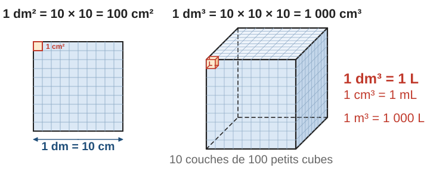
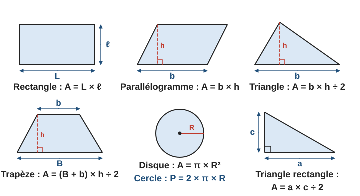
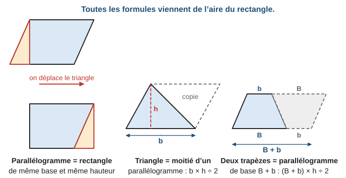
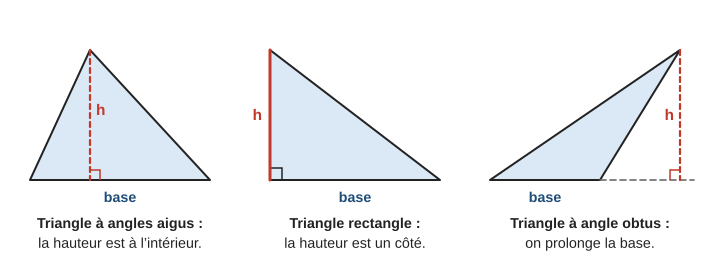
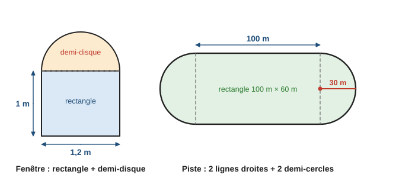
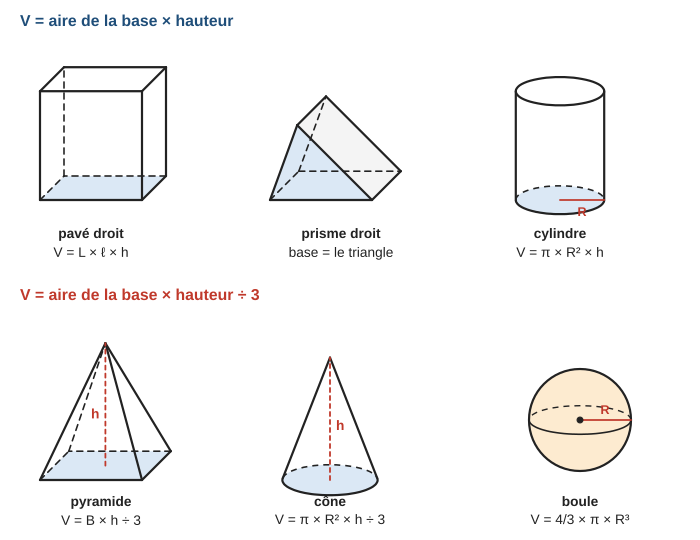
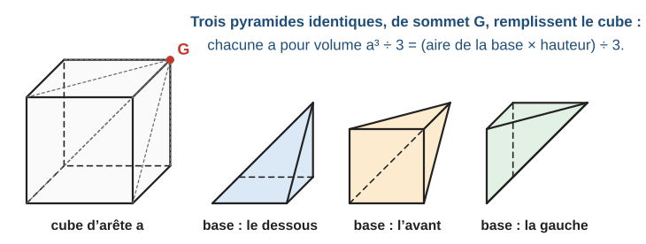
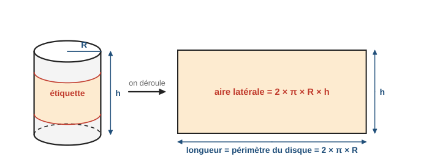
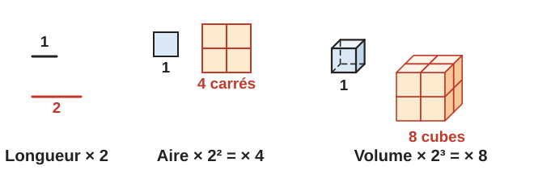

# Aires, volumes, grandeurs et mesures

> Compendium collège — chapitre unifié (sans découpage 6e / 5e / 4e / 3e).  
> Cours compact pour un élève de niveau moyen : intuition, méthode, exemples guidés, erreurs fréquentes, puis exercices progressifs (★ facile, ★★ standard, ★★★ approfondissement) avec corrigés détaillés.

---

## 0. Ce qu’on vise

**En une phrase :** mesurer, c’est compter combien de fois une **unité** rentre dans un objet : des segments-unités pour une longueur, des carrés-unités pour une aire, des cubes-unités pour un volume. Les formules ne font que compter vite.

À la fin de ce chapitre, je sais :

1. Distinguer longueur, aire et volume, et **convertir** leurs unités (y compris litres et hectares).
2. Calculer le **périmètre** d’un polygone et d’un cercle.
3. Calculer l’**aire** des figures usuelles et d’une figure composée, en choisissant la bonne **hauteur**.
4. Calculer le **volume** d’un pavé, d’un prisme, d’un cylindre, d’une pyramide, d’un cône et d’une boule, et l’aire d’une sphère.
5. Utiliser les effets d’un agrandissement : longueurs $\times k$, aires $\times k^2$, volumes $\times k^3$.
6. Calculer avec des **durées** et des grandeurs composées : débit, masse volumique, énergie en kWh.

> **Prérequis.** Tableau de numération (chapitre 2, § 1) ; puissances de $10$ (chapitre 4, § 2) ; calculer une expression (chapitre 6, § 2) ; proportionnalité (chapitre 5) ; carrés et racine carrée (chapitre 4, § 6).

---

## 1. Grandeurs et unités

### 1.1 Longueur, aire, volume : trois questions différentes

- Une **longueur** répond à « combien de mètres de long ? ». Unité : le mètre $\mathrm{m}$.
- Une **aire** répond à « combien de carrés de $1\,\mathrm{m}$ de côté pour recouvrir ? ». Unité : le mètre carré $\mathrm{m}^2$.
- Un **volume** répond à « combien de cubes de $1\,\mathrm{m}$ d’arête pour remplir ? ». Unité : le mètre cube $\mathrm{m}^3$.

Le petit exposant rappelle le nombre de dimensions : $1$ pour une longueur, $2$ pour une aire, $3$ pour un volume.

### 1.2 Les longueurs : $\times 10$ à chaque rang

| km | hm | dam | m | dm | cm | mm |
|:-:|:-:|:-:|:-:|:-:|:-:|:-:|
| | | | 4, | 5 | 0 | |

Le tableau se lit ainsi : $4{,}5\,\mathrm{m} = 45\,\mathrm{dm} = 450\,\mathrm{cm}$. Pour passer à l’unité voisine plus petite, on multiplie par $10$.

### 1.3 Les aires : $\times 100$ à chaque rang

Un carré de $1\,\mathrm{dm}$ de côté mesure $10\,\mathrm{cm}$ de côté : il contient $10 \times 10 = 100$ carrés de $1\,\mathrm{cm}^2$.

> **À retenir — unités d’aire.** Entre deux unités d’aire voisines, on multiplie ou on divise par $100$. Dans le tableau de conversion, chaque unité occupe **deux** colonnes.
>
> Unités agraires : $1\,\mathrm{a} = 1\,\mathrm{dam}^2 = 100\,\mathrm{m}^2$ (are) et $1\,\mathrm{ha} = 1\,\mathrm{hm}^2 = 10\,000\,\mathrm{m}^2$ (hectare).

**Exemple guidé 1.** Convertir $3{,}5\,\mathrm{m}^2$ en $\mathrm{cm}^2$, puis $2\,500\,\mathrm{m}^2$ en hectares.

**Réflexion.** Du $\mathrm{m}^2$ au $\mathrm{cm}^2$, il y a deux rangs ($\mathrm{dm}^2$ puis $\mathrm{cm}^2$) : on multiplie par $100 \times 100 = 10\,000$.

**Rédaction.**

> $3{,}5\,\mathrm{m}^2 = 3{,}5 \times 10\,000\,\mathrm{cm}^2 = 35\,000\,\mathrm{cm}^2$.
>
> $1\,\mathrm{ha} = 10\,000\,\mathrm{m}^2$, donc $2\,500\,\mathrm{m}^2 = 2\,500 \div 10\,000\,\mathrm{ha} = 0{,}25\,\mathrm{ha}$.

| m² | | dm² | | cm² | |
|:-:|:-:|:-:|:-:|:-:|:-:|
| | 3, | 5 | 0 | 0 | 0 |

**Contrôle.** Un $\mathrm{cm}^2$ est minuscule par rapport à un $\mathrm{m}^2$ : il en faut beaucoup, le nombre devait grandir fortement.

> **Erreur fréquente.** Multiplier par $10$ comme pour les longueurs : « $2\,\mathrm{m}^2 = 20\,\mathrm{dm}^2$ » est **faux**. Un carré de $1\,\mathrm{m}$ de côté contient $10$ rangées de $10$ carrés de $1\,\mathrm{dm}$ de côté : $2\,\mathrm{m}^2 = 200\,\mathrm{dm}^2$.

### 1.4 Les volumes et les capacités : $\times 1\,000$ à chaque rang

Un cube de $1\,\mathrm{dm}$ d’arête contient $10$ couches de $10 \times 10$ petits cubes de $1\,\mathrm{cm}$ d’arête : $1\,\mathrm{dm}^3 = 1\,000\,\mathrm{cm}^3$.

> **À retenir — volumes et capacités.** Entre deux unités de volume voisines : $\times 1\,000$ ou $\div 1\,000$ (trois colonnes par unité).
>
> $$1\,\mathrm{L} = 1\,\mathrm{dm}^3 \qquad 1\,\mathrm{mL} = 1\,\mathrm{cm}^3 \qquad 1\,\mathrm{m}^3 = 1\,000\,\mathrm{L}$$
>
> Les capacités (L, dL, cL, mL) se convertissent comme les longueurs : $\times 10$ à chaque rang ($1\,\mathrm{L} = 10\,\mathrm{dL} = 100\,\mathrm{cL} = 1\,000\,\mathrm{mL}$).

**Exemple guidé 2.** Convertir $0{,}35\,\mathrm{m}^3$ en litres et $2{,}5\,\mathrm{L}$ en $\mathrm{cm}^3$.

> $1\,\mathrm{m}^3 = 1\,000\,\mathrm{L}$, donc $0{,}35\,\mathrm{m}^3 = 350\,\mathrm{L}$.
>
> $1\,\mathrm{L} = 1\,\mathrm{dm}^3 = 1\,000\,\mathrm{cm}^3$, donc $2{,}5\,\mathrm{L} = 2\,500\,\mathrm{cm}^3$.

> **Méthode — réussir une conversion.**
> 1. Identifier la grandeur : longueur ($\times 10$), aire ($\times 100$), volume ($\times 1\,000$).
> 2. Compter le nombre de rangs entre les deux unités.
> 3. Vers une unité **plus petite**, le nombre **grandit** ; vers une unité plus grande, il diminue.
> 4. Pour les litres, passer par $1\,\mathrm{L} = 1\,\mathrm{dm}^3$.

---

## 2. Périmètres

Le **périmètre** d’une figure est la longueur de son contour. Pour un polygone, on additionne les longueurs des côtés.

Pour un cercle, le contour s’enroule : on a mesuré depuis l’Antiquité que le périmètre d’un cercle vaut toujours un peu plus de $3$ fois son diamètre. Ce nombre s’appelle $\pi$ (« pi ») : $\pi \approx 3{,}14$.

> **Formule.** Le périmètre d’un cercle de rayon $R$ (et de diamètre $D = 2R$) est
>
> $$P = 2 \times \pi \times R = \pi \times D$$

**Exemple guidé 3.** Une roue de vélo a un diamètre de $70\,\mathrm{cm}$. Quelle distance parcourt le vélo quand la roue fait un tour ? Combien de tours fait la roue sur $1\,\mathrm{km}$ ?

**Rédaction.**

> En un tour, le vélo avance du périmètre de la roue : $P = \pi \times 70 \approx 219{,}9\,\mathrm{cm}$.
>
> $1\,\mathrm{km} = 100\,000\,\mathrm{cm}$. Nombre de tours : $100\,000 \div (\pi \times 70) \approx 455$ tours.

**Contrôle.** Un tour fait environ $2{,}2\,\mathrm{m}$ ; $455 \times 2{,}2 \approx 1\,000\,\mathrm{m}$.

> **Erreur fréquente.** Confondre rayon et diamètre. Avec $R = 35\,\mathrm{cm}$ : $P = 2 \times \pi \times 35$ ; avec $D = 70\,\mathrm{cm}$ : $P = \pi \times 70$. Les deux donnent le même résultat. Mais $2 \times \pi \times 70$ donnerait le double.

---

## 3. Aires des figures planes

### 3.1 Le formulaire

| Figure | Aire | Remarque |
|:--|:--|:--|
| Carré de côté $c$ | $c \times c = c^2$ | |
| Rectangle | $L \times \ell$ | longueur × largeur |
| Parallélogramme | $b \times h$ | $h$ : hauteur relative à la base $b$ |
| Triangle | $\dfrac{b \times h}{2}$ | $h$ : hauteur relative à la base $b$ |
| Triangle rectangle | $\dfrac{a \times c}{2}$ | $a$, $c$ : côtés de l’angle droit |
| Trapèze | $\dfrac{(B + b) \times h}{2}$ | $B$, $b$ : les deux côtés parallèles |
| Disque de rayon $R$ | $\pi \times R^2$ | |

### 3.2 D’où viennent ces formules

Il est inutile d’apprendre les formules « par cœur sans comprendre » : elles viennent toutes du rectangle.

- On découpe un triangle d’un côté du **parallélogramme** et on le recolle de l’autre : on obtient un rectangle de même base et de même hauteur. Donc $\mathcal{A} = b \times h$.
- Deux **triangles** identiques forment un parallélogramme : un triangle a pour aire la moitié, $\dfrac{b \times h}{2}$.
- Deux **trapèzes** identiques, dont l’un est retourné, forment un parallélogramme de base $B + b$ : un trapèze a pour aire $\dfrac{(B + b) \times h}{2}$.

### 3.3 La hauteur : toujours perpendiculaire à la base

La hauteur relative à une base est la distance entre cette base (ou son prolongement) et le sommet opposé. Elle est **perpendiculaire** à la base.

> **Erreur fréquente.** Prendre un côté « penché » comme hauteur. Dans un triangle de base $8\,\mathrm{cm}$, dont la hauteur mesure $4{,}5\,\mathrm{cm}$ et un côté oblique $6\,\mathrm{cm}$, l’aire vaut $\dfrac{8 \times 4{,}5}{2} = 18\,\mathrm{cm}^2$, et non $\dfrac{8 \times 6}{2} = 24\,\mathrm{cm}^2$. Dans un triangle rectangle seulement, un côté de l’angle droit **est** une hauteur.

### 3.4 Figures composées

Pour une figure compliquée, on la **découpe** en figures simples (et on additionne), ou on la voit comme une grande figure à laquelle on **enlève** des morceaux (et on soustrait).

**Exemple guidé 4.** Une fenêtre est formée d’un rectangle de $1{,}2\,\mathrm{m}$ de large et $1\,\mathrm{m}$ de haut, surmonté d’un demi-disque de diamètre $1{,}2\,\mathrm{m}$. Calculer son aire au centième de $\mathrm{m}^2$ et la longueur de son contour au centimètre.

**Réflexion.** Aire : rectangle + demi-disque de rayon $0{,}6\,\mathrm{m}$. Contour : trois côtés du rectangle (le côté du haut est à l’intérieur) + un demi-cercle.

**Rédaction.**

> Aire du rectangle : $1{,}2 \times 1 = 1{,}2\,\mathrm{m}^2$. Aire du demi-disque : $\dfrac{\pi \times 0{,}6^2}{2} \approx 0{,}565\,\mathrm{m}^2$.
>
> Aire de la fenêtre : $1{,}2 + \dfrac{\pi \times 0{,}6^2}{2} \approx 1{,}77\,\mathrm{m}^2$.
>
> Contour : $1{,}2 + 1 + 1 + \dfrac{2 \times \pi \times 0{,}6}{2} = 3{,}2 + 0{,}6\pi \approx 5{,}08\,\mathrm{m}$.

**Contrôle.** L’aire est un peu plus grande que celle du rectangle seul ($1{,}2\,\mathrm{m}^2$) ; le demi-disque ajoute environ la moitié de cette aire, ce qui est cohérent avec le dessin.

> **Méthode — figure composée.**
> 1. Repérer les figures simples (dessiner les traits de découpe).
> 2. Noter les dimensions de chacune : attention, un **diamètre** donne un rayon deux fois plus petit.
> 3. Additionner (ou soustraire) les aires.
> 4. Pour le périmètre, ne compter que le **contour extérieur**, pas les traits de découpe.

---

## 4. Volumes

### 4.1 Les solides « droits » : aire de la base × hauteur

Un pavé, un prisme droit ou un cylindre est formé de **couches** identiques à sa base, empilées sur toute la hauteur. Son volume est donc l’aire d’une couche multipliée par la hauteur.

> **Formules.**
>
> - Pavé droit : $V = L \times \ell \times h$ ; cube d’arête $a$ : $V = a^3$.
> - Prisme droit : $V = \mathcal{B} \times h$, où $\mathcal{B}$ est l’aire de la base.
> - Cylindre de rayon $R$ et de hauteur $h$ : $V = \pi \times R^2 \times h$.

**Exemple guidé 5.** Une cuve cylindrique a un rayon de $4\,\mathrm{dm}$ et une hauteur de $10\,\mathrm{dm}$. Quelle est sa contenance en litres ?

**Réflexion.** Les dimensions sont en $\mathrm{dm}$ : le volume sera en $\mathrm{dm}^3$, c’est-à-dire en litres.

**Rédaction.**

> $V = \pi \times R^2 \times h = \pi \times 4^2 \times 10 = 160\pi \approx 502{,}65\,\mathrm{dm}^3$.
>
> Comme $1\,\mathrm{dm}^3 = 1\,\mathrm{L}$, la cuve contient environ $503\,\mathrm{L}$.

**Contrôle.** Le cylindre tient dans un pavé de $8 \times 8 \times 10 = 640\,\mathrm{dm}^3$ : $503 < 640$, cohérent.

### 4.2 Pyramide et cône : le tiers

Une pyramide est beaucoup plus « pointue » qu’un prisme de même base et de même hauteur. Elle en occupe exactement le **tiers** : on peut découper un cube en trois pyramides identiques.

> **Formules.**
>
> - Pyramide : $V = \dfrac{\mathcal{B} \times h}{3}$.
> - Cône de rayon $R$ et de hauteur $h$ : $V = \dfrac{\pi \times R^2 \times h}{3}$.
>
> La hauteur $h$ se mesure du sommet **perpendiculairement** à la base (pas le long d’une arête).

**Exemple guidé 6.** La pyramide du Louvre a une base carrée de $35\,\mathrm{m}$ de côté et une hauteur de $21{,}6\,\mathrm{m}$. Calculer son volume.

> Aire de la base : $\mathcal{B} = 35^2 = 1\,225\,\mathrm{m}^2$.
>
> $$V = \dfrac{1\,225 \times 21{,}6}{3} = 8\,820\,\mathrm{m}^3$$

**Contrôle.** Le pavé de même base et de même hauteur aurait un volume de $1\,225 \times 21{,}6 = 26\,460\,\mathrm{m}^3$, et $26\,460 \div 3 = 8\,820$.

> **Erreur fréquente.** Oublier de diviser par $3$ pour une pyramide ou un cône. Réflexe : un solide **pointu** → « $\div 3$ ».

### 4.3 Boule et sphère

> **Formules.** Pour une boule de rayon $R$ : $V = \dfrac{4}{3} \times \pi \times R^3$.  
> Aire de la sphère (la surface) de rayon $R$ : $\mathcal{A} = 4 \times \pi \times R^2$.

**Exemple guidé 7.** Un ballon de football a un rayon de $11\,\mathrm{cm}$. Calculer son volume au $\mathrm{cm}^3$ près, puis l’aire du cuir nécessaire au dixième.

> $V = \dfrac{4}{3} \times \pi \times 11^3 \approx 5\,575\,\mathrm{cm}^3$, soit environ $5{,}6\,\mathrm{L}$.
>
> $\mathcal{A} = 4 \times \pi \times 11^2 \approx 1\,520{,}5\,\mathrm{cm}^2$.

> **Erreur fréquente.** Mélanger les deux formules. Le volume est en **cm³** et contient $R^3$ ; l’aire est en **cm²** et contient $R^2$. L’exposant de $R$ est celui de l’unité.

### 4.4 Aire latérale d’un cylindre

Déroulée, la surface latérale d’un cylindre est un rectangle (chapitre 15, § 3.5) : sa longueur est le périmètre de la base et sa largeur la hauteur.

$$\mathcal{A}_{\text{latérale}} = 2 \times \pi \times R \times h$$

**Exemple guidé 8.** Une boîte de conserve a un rayon de $4\,\mathrm{cm}$ et une hauteur de $11\,\mathrm{cm}$. Quelle est l’aire de son étiquette (qui fait le tour complet) ?

> $\mathcal{A} = 2 \times \pi \times 4 \times 11 = 88\pi \approx 276{,}5\,\mathrm{cm}^2$.

L’**aire totale** d’un solide est la somme des aires de toutes ses faces : ici on ajouterait les deux disques, $2 \times \pi \times 4^2$.

---

## 5. Agrandissement, réduction : $k$, $k^2$, $k^3$ [[Programme 2020]]

> **Propriété** (chapitre 12, § 5). Dans un agrandissement ou une réduction de rapport $k$ :
>
> - les **longueurs** sont multipliées par $k$ ;
> - les **aires** sont multipliées par $k^2$ ;
> - les **volumes** sont multipliés par $k^3$.

**Exemple guidé 9.** Un verre en forme de cône (pointe en bas) a une hauteur de $12\,\mathrm{cm}$ et contient $24\,\mathrm{cL}$ quand il est plein. On le remplit jusqu’à $6\,\mathrm{cm}$ de hauteur. Quelle quantité de liquide contient-il ?

**Réflexion.** Le liquide forme un petit cône, réduction du grand de rapport $k = \dfrac{6}{12} = \dfrac{1}{2}$.

**Rédaction.**

> Le liquide forme un cône réduit de rapport $k = \dfrac{6}{12} = \dfrac{1}{2}$. Les volumes sont multipliés par $k^3 = \dfrac{1}{8}$.
>
> Volume de liquide : $24 \times \dfrac{1}{8} = 3\,\mathrm{cL}$.

**Contrôle.** À mi-hauteur, le verre est loin d’être à moitié plein : la partie large est en haut. $3\,\mathrm{cL}$ sur $24$, c’est cohérent.

---

## 6. Durées et grandeurs composées

### 6.1 Calculer avec des durées

Une heure compte $60$ minutes, et non $100$ : les durées ne s’écrivent pas comme les nombres décimaux.

> **À retenir.** $1\,\mathrm{h} = 60\,\mathrm{min}$ et $1\,\mathrm{min} = 60\,\mathrm{s}$.  
> $0{,}5\,\mathrm{h} = 30\,\mathrm{min}$ ; $0{,}25\,\mathrm{h} = 15\,\mathrm{min}$ ; $0{,}1\,\mathrm{h} = 6\,\mathrm{min}$.  
> Pour convertir des heures décimales en minutes : on multiplie la partie décimale par $60$. Exemple : $2{,}4\,\mathrm{h} = 2\,\mathrm{h} + 0{,}4 \times 60\,\mathrm{min} = 2\,\mathrm{h}\,24\,\mathrm{min}$.

> **Erreur fréquente.** Écrire $1\,\mathrm{h}\,30\,\mathrm{min} = 1{,}30\,\mathrm{h}$. En réalité, $30\,\mathrm{min} = \dfrac{30}{60}\,\mathrm{h} = 0{,}5\,\mathrm{h}$, donc $1\,\mathrm{h}\,30\,\mathrm{min} = 1{,}5\,\mathrm{h}$.

### 6.2 Grandeurs composées

Une grandeur composée est un **quotient** (ou un produit) de deux grandeurs. La vitesse (kilomètres **par** heure) est étudiée au chapitre 5. Voici trois autres exemples.

| Grandeur | Définition | Unités courantes |
|:--|:--|:--|
| Débit | $\dfrac{\text{volume}}{\text{durée}}$ | $\mathrm{L/min}$, $\mathrm{m}^3/\mathrm{h}$ |
| Masse volumique | $\dfrac{\text{masse}}{\text{volume}}$ | $\mathrm{g/cm}^3$, $\mathrm{kg/m}^3$ |
| Énergie électrique | $\text{puissance} \times \text{durée}$ | $\mathrm{kWh}$ (kilowattheure) |

**Exemple guidé 10.** a) Un robinet a un débit de $12\,\mathrm{L/min}$. Combien de temps pour remplir une baignoire de $500\,\mathrm{L}$ ? b) Un radiateur de $2\,\mathrm{kW}$ fonctionne pendant $3\,\mathrm{h}\,30\,\mathrm{min}$. Quelle énergie consomme-t-il, et pour quel coût à $0{,}25$ € le kWh ?

**Rédaction.**

> a) Durée $= \dfrac{\text{volume}}{\text{débit}} = \dfrac{500}{12} \approx 41{,}7\,\mathrm{min}$, soit environ $41\,\mathrm{min}\,40\,\mathrm{s}$.
>
> b) $3\,\mathrm{h}\,30\,\mathrm{min} = 3{,}5\,\mathrm{h}$. Énergie : $E = 2 \times 3{,}5 = 7\,\mathrm{kWh}$. Coût : $7 \times 0{,}25 = 1{,}75$ €.

**Contrôle.** a) En $40$ minutes, le robinet verse $12 \times 40 = 480\,\mathrm{L}$ : il faut un peu plus de $40$ minutes. b) On a bien converti la durée en heures décimales avant de multiplier.

> **Méthode — grandeurs composées.**
> 1. Écrire la définition avec les mots (« débit = volume ÷ durée »).
> 2. Mettre les données dans des unités **compatibles** avec celle de la grandeur (minutes avec des $\mathrm{L/min}$, heures avec des $\mathrm{kW}$).
> 3. Calculer, puis écrire l’unité du résultat.

L’eau a une masse volumique de $1\,\mathrm{g/cm}^3$, c’est-à-dire $1\,\mathrm{kg/L}$ : un litre d’eau pèse $1\,\mathrm{kg}$.

---

## 7. Mini-synthèse

> **À retenir.**
>
> - Conversions : longueurs $\times 10$, aires $\times 100$, volumes $\times 1\,000$ à chaque rang. $1\,\mathrm{L} = 1\,\mathrm{dm}^3$, $1\,\mathrm{mL} = 1\,\mathrm{cm}^3$, $1\,\mathrm{m}^3 = 1\,000\,\mathrm{L}$, $1\,\mathrm{ha} = 10\,000\,\mathrm{m}^2$.
> - Cercle : $P = 2\pi R$. Disque : $\mathcal{A} = \pi R^2$.
> - Aires : rectangle $L \times \ell$, parallélogramme $b \times h$, triangle $\dfrac{b \times h}{2}$, trapèze $\dfrac{(B + b) \times h}{2}$. La hauteur est **perpendiculaire** à la base.
> - Volumes : prisme et cylindre $\mathcal{B} \times h$ ; pyramide et cône $\dfrac{\mathcal{B} \times h}{3}$ ; boule $\dfrac{4}{3}\pi R^3$. Sphère : $4\pi R^2$.
> - Agrandissement de rapport $k$ : longueurs $\times k$, aires $\times k^2$, volumes $\times k^3$.
> - Durées : $1\,\mathrm{h} = 60\,\mathrm{min}$. Débit = volume ÷ durée ; masse volumique = masse ÷ volume ; énergie = puissance × durée.
> - Toujours **convertir** dans des unités cohérentes **avant** de calculer.

---

## 8. Exercices types

> Objectif : automatismes. Difficulté croissante dans chaque série. Sauf mention contraire, arrondir au dixième. Corrigés détaillés au § 10.

### A. Conversions (★)

**A1.** Convertir : $3{,}5\,\mathrm{km}$ en $\mathrm{m}$ ; $450\,\mathrm{cm}$ en $\mathrm{m}$ ; $72\,\mathrm{mm}$ en $\mathrm{cm}$ ; $0{,}8\,\mathrm{m}$ en $\mathrm{mm}$.

**A2.** Convertir : $2\,\mathrm{m}^2$ en $\mathrm{cm}^2$ ; $3\,\mathrm{ha}$ en $\mathrm{m}^2$ ; $4\,500\,\mathrm{cm}^2$ en $\mathrm{dm}^2$ ; $0{,}5\,\mathrm{km}^2$ en $\mathrm{ha}$.

**A3.** Convertir : $5\,\mathrm{dm}^3$ en $\mathrm{cm}^3$ ; $2{,}5\,\mathrm{L}$ en $\mathrm{cm}^3$ ; $0{,}35\,\mathrm{m}^3$ en $\mathrm{L}$ ; $750\,\mathrm{mL}$ en $\mathrm{L}$.

**A4.** Ranger dans l’ordre croissant : $0{,}3\,\mathrm{m}^3$ ; $250\,\mathrm{L}$ ; $4\,000\,\mathrm{dm}^3$ ; $280\,000\,\mathrm{cm}^3$.

**A5.** a) Convertir $2{,}4\,\mathrm{h}$ en heures et minutes. b) Convertir $135\,\mathrm{min}$ en heures et minutes, puis en heures décimales. c) Convertir $1\,\mathrm{h}\,45\,\mathrm{min}$ en heures décimales.

### B. Périmètres et aires (★ → ★★)

**B1.** Calculer le périmètre et l’aire : a) d’un rectangle de $8\,\mathrm{cm}$ sur $5\,\mathrm{cm}$ ; b) d’un carré de $7\,\mathrm{cm}$ de côté.

**B2.** a) Aire d’un triangle de base $12\,\mathrm{cm}$ et de hauteur associée $7\,\mathrm{cm}$. b) Dans le triangle $ABC$, l’angle en $B$ est obtus, $BC = 5\,\mathrm{cm}$ et la hauteur issue de $A$ (à l’extérieur du triangle) mesure $4\,\mathrm{cm}$. Calculer l’aire.

**B3.** a) Aire d’un parallélogramme de base $9\,\mathrm{cm}$ et de hauteur $4\,\mathrm{cm}$. b) Aire d’un trapèze dont les côtés parallèles mesurent $10\,\mathrm{cm}$ et $6\,\mathrm{cm}$, et la hauteur $4\,\mathrm{cm}$.

**B4.** Calculer l’aire et le périmètre (valeur exacte avec $\pi$, puis arrondi au dixième) : a) d’un disque de rayon $5\,\mathrm{cm}$ ; b) d’un disque de diamètre $8\,\mathrm{cm}$.

**B5.** Une figure est formée d’un rectangle de $6\,\mathrm{cm}$ sur $4\,\mathrm{cm}$ et d’un demi-disque collé à l’extérieur sur un côté de $4\,\mathrm{cm}$. Calculer son aire et son périmètre.

**B6.** (★★) a) Un rectangle a une aire de $54\,\mathrm{cm}^2$ et une largeur de $6\,\mathrm{cm}$. Quelle est sa longueur ? b) Un carré a une aire de $20\,\mathrm{cm}^2$. Quel est son côté, au millimètre ? c) Un disque a une aire de $50\,\mathrm{cm}^2$. Quel est son rayon, au millimètre ?

### C. Volumes (★ → ★★)

**C1.** Un aquarium a la forme d’un pavé de $5\,\mathrm{dm}$ sur $4\,\mathrm{dm}$ sur $3\,\mathrm{dm}$. Calculer son volume en $\mathrm{dm}^3$, puis en litres.

**C2.** Un prisme droit a pour base un triangle rectangle dont les côtés de l’angle droit mesurent $3\,\mathrm{cm}$ et $4\,\mathrm{cm}$ ; sa hauteur est $10\,\mathrm{cm}$. Calculer son volume.

**C3.** Volume d’un cylindre de rayon $3\,\mathrm{cm}$ et de hauteur $10\,\mathrm{cm}$ (valeur exacte, puis arrondi).

**C4.** Volume d’une pyramide de hauteur $9\,\mathrm{cm}$ dont la base est un carré de $6\,\mathrm{cm}$ de côté.

**C5.** Volume d’un cône de rayon $6\,\mathrm{cm}$ et de hauteur $5\,\mathrm{cm}$ (valeur exacte, puis arrondi).

**C6.** (★★) Une boule a pour rayon $3\,\mathrm{cm}$. Calculer son volume et l’aire de sa surface. Que remarque-t-on ? Les deux résultats sont-ils comparables ?

### D. Aires latérales et totales (★★)

**D1.** Calculer l’aire totale d’un cube de $5\,\mathrm{cm}$ d’arête (pour fabriquer une boîte).

**D2.** Un cylindre a pour rayon $5\,\mathrm{cm}$ et pour hauteur $12\,\mathrm{cm}$. Calculer son aire latérale, puis son aire totale.

**D3.** Un ballon de basket a un rayon de $12\,\mathrm{cm}$. Calculer l’aire de sa surface.

### E. Agrandissement et réduction (★ → ★★) [[Programme 2020]]

**E1.** Un cube de $2\,\mathrm{cm}$ d’arête est agrandi avec le rapport $k = 3$. Calculer le nouveau volume. Par combien le volume a-t-il été multiplié ?

**E2.** Dans un agrandissement, une aire passe de $12\,\mathrm{cm}^2$ à $48\,\mathrm{cm}^2$. Quel est le rapport $k$ ?

**E3.** (★★) La maquette d’un bâtiment est à l’échelle $\dfrac{1}{100}$. a) La façade de la maquette a une aire de $0{,}3\,\mathrm{m}^2$ : aire de la vraie façade ? b) Le volume de la maquette est $0{,}05\,\mathrm{m}^3$ : volume du vrai bâtiment ?

**E4.** Un cône a un volume de $96\,\mathrm{cm}^3$. On le réduit avec le rapport $k = \dfrac{1}{2}$. Quel est le volume du cône réduit ?

### F. Durées et grandeurs composées (★ → ★★)

**F1.** a) Un film commence à $20\,\mathrm{h}\,45$ et dure $1\,\mathrm{h}\,50\,\mathrm{min}$. À quelle heure se termine-t-il ? b) Un train part à $9\,\mathrm{h}\,38$ et arrive à $12\,\mathrm{h}\,15$. Quelle est la durée du trajet ?

**F2.** Une cuve de $1{,}2\,\mathrm{m}^3$ est vidée par une pompe de débit $40\,\mathrm{L/min}$. Combien de temps faut-il ?

**F3.** L’aluminium a une masse volumique de $2{,}7\,\mathrm{g/cm}^3$. Quelle est la masse d’un bloc d’aluminium de $10\,\mathrm{cm}$ sur $5\,\mathrm{cm}$ sur $2\,\mathrm{cm}$ ?

**F4.** Un radiateur de $1\,500\,\mathrm{W}$ fonctionne $6\,\mathrm{h}$ par jour pendant $30$ jours. Le kWh coûte $0{,}20$ €. Calculer l’énergie consommée et le coût.

**F5.** (★★) Un aquarium a la forme d’un pavé de $60\,\mathrm{cm}$ sur $30\,\mathrm{cm}$ sur $40\,\mathrm{cm}$. Combien de temps faut-il pour le remplir avec un robinet de débit $12\,\mathrm{L/min}$ ?

---

## 9. Exercices atypiques

> Objectif : comprendre, raisonner, rédiger. Plusieurs étapes, erreurs à trouver, questions ouvertes.

### G. Trouver l’erreur (★★)

**G1.** Hugo écrit : « $2\,\mathrm{m}^2 = 20\,\mathrm{dm}^2$, car $1\,\mathrm{m} = 10\,\mathrm{dm}$. » Trouver l’erreur et corriger, en s’aidant d’un dessin.

**G2.** Clara écrit : « Une piscine de $50\,\mathrm{m}^3$ contient $5\,000\,\mathrm{L}$, car $1\,\mathrm{m}^3 = 100\,\mathrm{L}$. » Corriger.

**G3.** Un triangle a une base de $8\,\mathrm{cm}$, une hauteur associée de $4{,}5\,\mathrm{cm}$ et un côté oblique de $6\,\mathrm{cm}$. Tom calcule : « $\mathcal{A} = \dfrac{8 \times 6}{2} = 24\,\mathrm{cm}^2$. » Trouver l’erreur.

**G4.** Pour un cône de **diamètre** $6\,\mathrm{cm}$ et de hauteur $10\,\mathrm{cm}$, Inès écrit : « $V = \dfrac{\pi \times 6^2 \times 10}{3} = 120\pi\,\mathrm{cm}^3$. » Trouver l’erreur et corriger.

**G5.** Nathan écrit : « $1{,}5\,\mathrm{h} = 1\,\mathrm{h}\,50\,\mathrm{min}$ et $2\,\mathrm{h}\,20\,\mathrm{min} = 2{,}2\,\mathrm{h}$. » Corriger les deux égalités.

### H. Comprendre et raisonner (★★ → ★★★)

**H1.** Expliquer, avec un dessin, pourquoi $1\,\mathrm{m}^2 = 10\,000\,\mathrm{cm}^2$, puis pourquoi $1\,\mathrm{m}^3 = 1\,000\,000\,\mathrm{cm}^3$.

**H2.** a) Trouver plusieurs rectangles de périmètre $20\,\mathrm{cm}$ (dimensions entières) et calculer leurs aires. b) Ont-ils tous la même aire ? Lequel a la plus grande ? c) Peut-on avoir deux figures de même aire et de périmètres différents ? Donner un exemple.

**H3.** On double le rayon d’un cylindre sans changer sa hauteur. Par combien son volume est-il multiplié ? Et si on double seulement la hauteur ? Et si on double les deux ?

**H4.** (★★★) Une boule de rayon $R$ est posée dans une boîte cylindrique qu’elle touche exactement (rayon $R$, hauteur $2R$). Montrer que la boule occupe les $\dfrac{2}{3}$ du volume de la boîte (résultat d’Archimède).

### I. Plusieurs étapes (★★★)

**I1.** On veut peindre les murs d’une chambre de $4\,\mathrm{m}$ sur $3{,}5\,\mathrm{m}$, haute de $2{,}5\,\mathrm{m}$. La porte mesure $2\,\mathrm{m}$ sur $0{,}8\,\mathrm{m}$ et la fenêtre $1{,}2\,\mathrm{m}$ sur $1\,\mathrm{m}$ (on ne les peint pas). Il faut deux couches ; $1\,\mathrm{L}$ de peinture couvre $10\,\mathrm{m}^2$. La peinture est vendue en pots de $2{,}5\,\mathrm{L}$ à $24$ € le pot. Quel est le coût ?

**I2.** Une piscine a la forme d’un pavé de $8\,\mathrm{m}$ sur $4\,\mathrm{m}$, profonde de $1{,}5\,\mathrm{m}$. a) Volume en $\mathrm{m}^3$ et en litres ? b) Une pompe débite $6\,\mathrm{m}^3$ par heure : durée du remplissage ? c) L’eau coûte $4$ € le $\mathrm{m}^3$ : coût du remplissage ?

**I3.** Un verre cylindrique a un rayon intérieur de $3\,\mathrm{cm}$ et une hauteur de $10\,\mathrm{cm}$. a) Quelle est sa contenance en $\mathrm{cm}^3$ ? b) Combien de verres pleins peut-on servir avec une bouteille de $1{,}5\,\mathrm{L}$ ?

**I4.** Un cornet de glace est un cône de rayon $2{,}5\,\mathrm{cm}$ et de hauteur $10\,\mathrm{cm}$, rempli de glace et surmonté d’une demi-boule de glace de même rayon. Calculer le volume total de glace (valeur exacte avec $\pi$, puis arrondi).

**I5.** Une piste est formée de deux lignes droites de $100\,\mathrm{m}$ reliées par deux demi-cercles de rayon $30\,\mathrm{m}$ (figure du § 3.4). a) Calculer la longueur d’un tour. b) Combien de tours complets faut-il pour parcourir au moins $5\,\mathrm{km}$ ? c) Calculer l’aire de la pelouse intérieure.

### J. Ouvert (★★)

**J1.** Estimer le volume d’air de votre salle de classe (choisir des dimensions vraisemblables). Combien de bouteilles de $1{,}5\,\mathrm{L}$ faudrait-il pour contenir ce volume ?

**J2.** Expliquer à un élève de 6e la différence entre $\mathrm{m}$, $\mathrm{m}^2$ et $\mathrm{m}^3$, avec un exemple concret pour chacun.

**J3.** Une canette de $33\,\mathrm{cL}$ a un rayon de $3{,}3\,\mathrm{cm}$ et une hauteur de $11{,}5\,\mathrm{cm}$. Calculer son volume. Pourquoi n’obtient-on pas exactement $330\,\mathrm{cm}^3$ ?

---

## 10. Corrigés

> Les corrigés marqués **(modèle)** montrent la rédaction attendue. Les autres donnent les étapes clés.

### Exercices types

**A1.** $3\,500\,\mathrm{m}$ ; $4{,}5\,\mathrm{m}$ ; $7{,}2\,\mathrm{cm}$ ; $800\,\mathrm{mm}$.

**A2. (modèle)**
> Aires : on multiplie ou on divise par $100$ à chaque rang.  
> $2\,\mathrm{m}^2 = 2 \times 100 \times 100\,\mathrm{cm}^2 = 20\,000\,\mathrm{cm}^2$ (deux rangs).  
> $3\,\mathrm{ha} = 3 \times 10\,000\,\mathrm{m}^2 = 30\,000\,\mathrm{m}^2$.  
> $4\,500\,\mathrm{cm}^2 = 4\,500 \div 100\,\mathrm{dm}^2 = 45\,\mathrm{dm}^2$ (un rang).  
> $1\,\mathrm{km}^2 = 100\,\mathrm{hm}^2 = 100\,\mathrm{ha}$, donc $0{,}5\,\mathrm{km}^2 = 50\,\mathrm{ha}$.

**A3.** $5\,000\,\mathrm{cm}^3$ ; $2\,500\,\mathrm{cm}^3$ ; $350\,\mathrm{L}$ ; $0{,}75\,\mathrm{L}$.

**A4.** On convertit tout en $\mathrm{m}^3$ : $250\,\mathrm{L} = 0{,}25\,\mathrm{m}^3$ ; $4\,000\,\mathrm{dm}^3 = 4\,\mathrm{m}^3$ ; $280\,000\,\mathrm{cm}^3 = 280\,\mathrm{dm}^3 = 0{,}28\,\mathrm{m}^3$. Ordre : $250\,\mathrm{L} < 280\,000\,\mathrm{cm}^3 < 0{,}3\,\mathrm{m}^3 < 4\,000\,\mathrm{dm}^3$.

**A5.** a) $0{,}4 \times 60 = 24$ : $2\,\mathrm{h}\,24\,\mathrm{min}$. b) $135 = 2 \times 60 + 15$ : $2\,\mathrm{h}\,15\,\mathrm{min}$ ; $15\,\mathrm{min} = 0{,}25\,\mathrm{h}$, donc $2{,}25\,\mathrm{h}$. c) $45\,\mathrm{min} = \dfrac{45}{60}\,\mathrm{h} = 0{,}75\,\mathrm{h}$ : $1{,}75\,\mathrm{h}$.

**B1.** a) $P = 2 \times (8 + 5) = 26\,\mathrm{cm}$ ; $\mathcal{A} = 40\,\mathrm{cm}^2$. b) $P = 28\,\mathrm{cm}$ ; $\mathcal{A} = 49\,\mathrm{cm}^2$.

**B2.** a) $\dfrac{12 \times 7}{2} = 42\,\mathrm{cm}^2$. b) La formule reste valable avec la hauteur extérieure : $\dfrac{5 \times 4}{2} = 10\,\mathrm{cm}^2$.

**B3.** a) $9 \times 4 = 36\,\mathrm{cm}^2$. b) $\dfrac{(10 + 6) \times 4}{2} = 32\,\mathrm{cm}^2$.

**B4. (modèle)**
> a) $R = 5\,\mathrm{cm}$. Aire : $\pi \times 5^2 = 25\pi \approx 78{,}5\,\mathrm{cm}^2$. Périmètre : $2 \times \pi \times 5 = 10\pi \approx 31{,}4\,\mathrm{cm}$.  
> b) Le diamètre vaut $8\,\mathrm{cm}$, donc $R = 4\,\mathrm{cm}$. Aire : $\pi \times 4^2 = 16\pi \approx 50{,}3\,\mathrm{cm}^2$. Périmètre : $\pi \times 8 = 8\pi \approx 25{,}1\,\mathrm{cm}$.

**B5.** Demi-disque de rayon $2\,\mathrm{cm}$. Aire : $24 + \dfrac{\pi \times 2^2}{2} = 24 + 2\pi \approx 30{,}3\,\mathrm{cm}^2$. Périmètre : trois côtés du rectangle ($6 + 4 + 6 = 16$) plus le demi-cercle ($\pi \times 2$) : $16 + 2\pi \approx 22{,}3\,\mathrm{cm}$.

**B6.** a) $54 \div 6 = 9\,\mathrm{cm}$. b) $c^2 = 20$, donc $c = \sqrt{20} \approx 4{,}5\,\mathrm{cm}$. c) $\pi R^2 = 50$, donc $R^2 = \dfrac{50}{\pi}$ et $R = \sqrt{\dfrac{50}{\pi}} \approx 4{,}0\,\mathrm{cm}$.

**C1.** $5 \times 4 \times 3 = 60\,\mathrm{dm}^3 = 60\,\mathrm{L}$.

**C2. (modèle)**
> La base est un triangle rectangle : $\mathcal{B} = \dfrac{3 \times 4}{2} = 6\,\mathrm{cm}^2$.  
> Volume du prisme : $V = \mathcal{B} \times h = 6 \times 10 = 60\,\mathrm{cm}^3$.

**C3.** $\pi \times 3^2 \times 10 = 90\pi \approx 282{,}7\,\mathrm{cm}^3$.

**C4.** $\dfrac{6^2 \times 9}{3} = \dfrac{36 \times 9}{3} = 108\,\mathrm{cm}^3$.

**C5.** $\dfrac{\pi \times 6^2 \times 5}{3} = 60\pi \approx 188{,}5\,\mathrm{cm}^3$.

**C6.** $V = \dfrac{4}{3} \times \pi \times 3^3 = 36\pi \approx 113{,}1\,\mathrm{cm}^3$ et $\mathcal{A} = 4 \times \pi \times 3^2 = 36\pi \approx 113{,}1\,\mathrm{cm}^2$. Les nombres sont égaux (c’est une coïncidence propre à $R = 3$), mais les grandeurs ne sont pas comparables : l’une est un volume en $\mathrm{cm}^3$, l’autre une aire en $\mathrm{cm}^2$.

**D1.** Six faces carrées : $6 \times 5^2 = 150\,\mathrm{cm}^2$.

**D2. (modèle)**
> Aire latérale : $2 \times \pi \times R \times h = 2 \times \pi \times 5 \times 12 = 120\pi \approx 377{,}0\,\mathrm{cm}^2$.  
> Les deux disques : $2 \times \pi \times 5^2 = 50\pi$.  
> Aire totale : $120\pi + 50\pi = 170\pi \approx 534{,}1\,\mathrm{cm}^2$.

**D3.** $4 \times \pi \times 12^2 = 576\pi \approx 1\,809{,}6\,\mathrm{cm}^2$.

**E1.** Nouveau cube d’arête $6\,\mathrm{cm}$ : $V = 6^3 = 216\,\mathrm{cm}^3$. Ancien volume : $8\,\mathrm{cm}^3$. Le volume est multiplié par $27 = 3^3$.

**E2.** $k^2 = \dfrac{48}{12} = 4$, donc $k = 2$.

**E3. (modèle)**
> Le rapport d’agrandissement de la maquette au bâtiment est $k = 100$.  
> a) Les aires sont multipliées par $k^2 = 10\,000$ : $0{,}3 \times 10\,000 = 3\,000\,\mathrm{m}^2$.  
> b) Les volumes sont multipliés par $k^3 = 1\,000\,000$ : $0{,}05 \times 1\,000\,000 = 50\,000\,\mathrm{m}^3$.

**E4.** $96 \times \left(\dfrac{1}{2}\right)^3 = 96 \div 8 = 12\,\mathrm{cm}^3$.

**F1.** a) $20\,\mathrm{h}\,45 + 1\,\mathrm{h}\,50 = 21\,\mathrm{h}\,95 = 22\,\mathrm{h}\,35$. b) De $9\,\mathrm{h}\,38$ à $10\,\mathrm{h}$ : $22\,\mathrm{min}$ ; de $10\,\mathrm{h}$ à $12\,\mathrm{h}\,15$ : $2\,\mathrm{h}\,15\,\mathrm{min}$. Total : $2\,\mathrm{h}\,37\,\mathrm{min}$.

**F2. (modèle)**
> On convertit le volume dans l’unité du débit : $1{,}2\,\mathrm{m}^3 = 1\,200\,\mathrm{L}$.  
> Durée $= \dfrac{\text{volume}}{\text{débit}} = \dfrac{1\,200}{40} = 30\,\mathrm{min}$.

**F3.** Volume : $10 \times 5 \times 2 = 100\,\mathrm{cm}^3$. Masse : $100 \times 2{,}7 = 270\,\mathrm{g}$.

**F4.** $1\,500\,\mathrm{W} = 1{,}5\,\mathrm{kW}$ ; durée totale $6 \times 30 = 180\,\mathrm{h}$. Énergie : $1{,}5 \times 180 = 270\,\mathrm{kWh}$. Coût : $270 \times 0{,}20 = 54$ €.

**F5.** Volume : $60 \times 30 \times 40 = 72\,000\,\mathrm{cm}^3 = 72\,\mathrm{L}$. Durée : $72 \div 12 = 6\,\mathrm{min}$.

### Exercices atypiques

**G1. (modèle)**
> Hugo a multiplié par $10$ comme pour une longueur. Or un carré de $1\,\mathrm{m}$ de côté se découpe en $10$ rangées de $10$ carrés de $1\,\mathrm{dm}$ de côté : $1\,\mathrm{m}^2 = 100\,\mathrm{dm}^2$.  
> Donc $2\,\mathrm{m}^2 = 200\,\mathrm{dm}^2$.

**G2.** $1\,\mathrm{m}^3 = 1\,000\,\mathrm{dm}^3 = 1\,000\,\mathrm{L}$ (un cube de $1\,\mathrm{m}$ contient $10 \times 10 \times 10$ cubes de $1\,\mathrm{dm}$). La piscine contient $50\,000\,\mathrm{L}$.

**G3.** Le côté de $6\,\mathrm{cm}$ est oblique, ce n’est pas une hauteur : la hauteur doit être perpendiculaire à la base. $\mathcal{A} = \dfrac{8 \times 4{,}5}{2} = 18\,\mathrm{cm}^2$.

**G4.** La formule utilise le **rayon** : $R = 6 \div 2 = 3\,\mathrm{cm}$. $V = \dfrac{\pi \times 3^2 \times 10}{3} = 30\pi \approx 94{,}2\,\mathrm{cm}^3$. Inès a trouvé $4$ fois trop, car $6^2 = 4 \times 3^2$.

**G5.** $1{,}5\,\mathrm{h} = 1\,\mathrm{h} + 0{,}5 \times 60\,\mathrm{min} = 1\,\mathrm{h}\,30\,\mathrm{min}$. $20\,\mathrm{min} = \dfrac{20}{60}\,\mathrm{h} = \dfrac{1}{3}\,\mathrm{h} \approx 0{,}33\,\mathrm{h}$, donc $2\,\mathrm{h}\,20\,\mathrm{min} \approx 2{,}33\,\mathrm{h}$.

**H1.** Un carré de $1\,\mathrm{m}$ de côté mesure $100\,\mathrm{cm}$ de côté : il contient $100$ rangées de $100$ carrés de $1\,\mathrm{cm}^2$, soit $100 \times 100 = 10\,000\,\mathrm{cm}^2$. Un cube de $1\,\mathrm{m}$ d’arête contient $100$ couches de $10\,000$ petits cubes : $100 \times 100 \times 100 = 1\,000\,000\,\mathrm{cm}^3$.

**H2. (modèle)**
> a) Si $L + \ell = 10$ : $1 \times 9$ (aire $9$), $2 \times 8$ (aire $16$), $3 \times 7$ (aire $21$), $4 \times 6$ (aire $24$), $5 \times 5$ (aire $25$), en $\mathrm{cm}^2$.  
> b) Non : à périmètre égal, les aires sont différentes. La plus grande est celle du carré $5 \times 5$.  
> c) Oui : un rectangle de $1 \times 16$ et un carré de $4 \times 4$ ont tous deux une aire de $16\,\mathrm{cm}^2$, mais des périmètres de $34\,\mathrm{cm}$ et $16\,\mathrm{cm}$. Aire et périmètre sont deux grandeurs **différentes**.

**H3.** $V = \pi R^2 h$. Rayon doublé : $\pi (2R)^2 h = 4\pi R^2 h$, volume $\times 4$. Hauteur doublée : volume $\times 2$. Les deux : $\times 8$ (c’est un agrandissement de rapport $2$, et $2^3 = 8$).

**H4.** Volume de la boîte : $\pi \times R^2 \times 2R = 2\pi R^3$. Volume de la boule : $\dfrac{4}{3}\pi R^3$. Rapport : $\dfrac{\frac{4}{3}\pi R^3}{2\pi R^3} = \dfrac{4}{3} \div 2 = \dfrac{2}{3}$.

**I1. (modèle)**
> Aire des quatre murs : le tour de la pièce mesure $2 \times (4 + 3{,}5) = 15\,\mathrm{m}$, donc $15 \times 2{,}5 = 37{,}5\,\mathrm{m}^2$.  
> On retire la porte ($2 \times 0{,}8 = 1{,}6\,\mathrm{m}^2$) et la fenêtre ($1{,}2 \times 1 = 1{,}2\,\mathrm{m}^2$) : $37{,}5 - 1{,}6 - 1{,}2 = 34{,}7\,\mathrm{m}^2$.  
> Deux couches : $2 \times 34{,}7 = 69{,}4\,\mathrm{m}^2$ à couvrir, soit $69{,}4 \div 10 = 6{,}94\,\mathrm{L}$ de peinture.  
> Deux pots ($5\,\mathrm{L}$) ne suffisent pas ; il en faut $3$ ($7{,}5\,\mathrm{L}$). Coût : $3 \times 24 = 72$ €.

**I2.** a) $8 \times 4 \times 1{,}5 = 48\,\mathrm{m}^3 = 48\,000\,\mathrm{L}$. b) $48 \div 6 = 8\,\mathrm{h}$. c) $48 \times 4 = 192$ €.

**I3.** a) $\pi \times 3^2 \times 10 = 90\pi \approx 282{,}7\,\mathrm{cm}^3$. b) $1{,}5\,\mathrm{L} = 1\,500\,\mathrm{cm}^3$ et $1\,500 \div 282{,}7 \approx 5{,}3$ : on sert $5$ verres pleins (et il reste un peu de liquide).

**I4.** Cône : $\dfrac{\pi \times 2{,}5^2 \times 10}{3} = \dfrac{62{,}5\pi}{3} \approx 65{,}4\,\mathrm{cm}^3$. Demi-boule : $\dfrac{1}{2} \times \dfrac{4}{3} \times \pi \times 2{,}5^3 = \dfrac{31{,}25\pi}{3} \approx 32{,}7\,\mathrm{cm}^3$. Total : $\dfrac{93{,}75\pi}{3} = 31{,}25\pi \approx 98{,}2\,\mathrm{cm}^3$.

**I5.** a) Les deux demi-cercles forment un cercle de rayon $30\,\mathrm{m}$ : $2 \times 100 + 2 \times \pi \times 30 = 200 + 60\pi \approx 388{,}5\,\mathrm{m}$. b) $5\,000 \div 388{,}5 \approx 12{,}9$ : il faut $13$ tours. c) Rectangle de $100\,\mathrm{m}$ sur $60\,\mathrm{m}$ et un disque de rayon $30\,\mathrm{m}$ : $6\,000 + 900\pi \approx 8\,827\,\mathrm{m}^2$.

**J1.** Exemple : une salle de $8\,\mathrm{m}$ sur $7\,\mathrm{m}$, haute de $3\,\mathrm{m}$ : $168\,\mathrm{m}^3 = 168\,000\,\mathrm{L}$. Nombre de bouteilles : $168\,000 \div 1{,}5 = 112\,000$ bouteilles. Toute réponse cohérente avec les dimensions choisies convient.

**J2.** Exemple : « Le mètre mesure une longueur : la longueur d’un couloir ($12\,\mathrm{m}$). Le mètre carré mesure une surface à recouvrir : le carrelage d’une chambre ($12\,\mathrm{m}^2$, c’est-à-dire $12$ carrés de $1\,\mathrm{m}$ de côté). Le mètre cube mesure ce qu’on peut remplir : l’eau d’une piscine ($50\,\mathrm{m}^3$, c’est-à-dire $50$ cubes de $1\,\mathrm{m}$ d’arête). »

**J3. (modèle)**
> $V = \pi \times 3{,}3^2 \times 11{,}5 \approx 393\,\mathrm{cm}^3$, soit environ $39\,\mathrm{cL}$.  
> On trouve plus que $33\,\mathrm{cL}$ car la canette n’est pas remplie jusqu’en haut (il reste de l’air), sa forme n’est pas exactement un cylindre (le haut et le bas sont rétrécis) et les mesures sont prises à l’extérieur, épaisseur du métal comprise.

---

## 11. Liens avec les autres chapitres

- **Chapitres 2 et 4** (décimaux, puissances de $10$) : multiplier ou diviser par $10$, $100$, $1\,000$ dans les conversions ; écriture scientifique des très grandes ou très petites mesures.
- **Chapitre 5** (proportionnalité) : vitesse, échelles, pourcentages ; débit et masse volumique sont des coefficients de proportionnalité.
- **Chapitre 9** (géométrie plane) : figures usuelles, hauteurs d’un triangle.
- **Chapitre 4** (racine carrée, § 6) : retrouver un côté ou un rayon à partir d’une aire (B6).
- **Chapitre 11** (Pythagore) : calculer une hauteur manquante avant une aire.
- **Chapitre 12** (Thalès, agrandissement-réduction) : $k$, $k^2$, $k^3$ (§ 5, E, exemple 9).
- **Chapitre 15** (espace) : patrons et aires latérales, sections de pyramides et de cônes, volumes de troncs.

---

## 12. Fiche-synthèse

| Je dois savoir… | Comment | Exemple express | S’entraîner |
|---|---|---|---|
| Convertir | par rang : $\times 10$ (longueurs), $\times 100$ (aires), $\times 1\,000$ (volumes) | $3{,}5\,\mathrm{m}^2 = 35\,000\,\mathrm{cm}^2$ ; $1\,\mathrm{L} = 1\,\mathrm{dm}^3$ | série A |
| Cercle et disque | $P = 2\pi R$ ; $\mathcal{A} = \pi R^2$ | $R = 5$ : $P \approx 31{,}4$ et $\mathcal{A} \approx 78{,}5$ | série B |
| Aire d’une figure | hauteur perpendiculaire à la base ; découper ou soustraire | triangle : $\dfrac{8 \times 4{,}5}{2} = 18$ | série B |
| Volume d’un solide | base $\times$ hauteur ; solide pointu : on divise par $3$ ; boule : $\dfrac{4}{3}\pi R^3$ | cône $R = 6$, $h = 5$ : $60\pi \approx 188{,}5$ | séries C et D |
| Agrandissement de rapport $k$ | aires $\times k^2$, volumes $\times k^3$ | verre conique rempli à mi-hauteur : $\dfrac{1}{8}$ du volume | série E |
| Durées, grandeurs composées | heures décimales ; débit $=$ volume $\div$ durée | $1\,\mathrm{h}\,30\,\mathrm{min} = 1{,}5\,\mathrm{h}$ ; $1\,200\,\mathrm{L}$ à $40\,\mathrm{L/min}$ : $30\,\mathrm{min}$ | série F |

**Pièges à éviter :** rayon $=$ diamètre $\div 2$ ; $1\,\mathrm{h}\,30\,\mathrm{min} \neq 1{,}30\,\mathrm{h}$ ; ne pas oublier le « $\div 3$ » des pyramides et des cônes.

---

*Version v0.3 — relecture (prérequis harmonisés, fiche-synthèse, corrections : voir `PLAN-REVISION.md`, § 10). Base : v0.2 — révision vague 1 (cours développé : unités, périmètres, aires et hauteurs, volumes, agrandissement, durées et grandeurs composées ; 9 figures SVG ; 46 exercices corrigés). Ancienne version : `cours-et-exercices.md.bak` (anciennes figures dans `figures-v01.bak/`).*
