# Géométrie dans l’espace

> Compendium collège — chapitre unifié (sans découpage 6e / 5e / 4e / 3e).  
> Cours compact pour un élève de niveau moyen : intuition, méthode, exemples guidés, erreurs fréquentes, puis exercices progressifs (★ facile, ★★ standard, ★★★ approfondissement) avec corrigés détaillés.

---

## 0. Ce qu’on vise

**En une phrase :** un objet de l’espace ne tient pas sur une feuille. Pour le représenter, on utilise trois outils : la **perspective cavalière** (un dessin qui donne l’impression du relief), le **patron** (le solide « déplié » à plat) et les **vues** (ce que l’on voit de face, de dessus, de côté). On apprend aussi à **couper** un solide par un plan (sections) et à **repérer** un point dans un pavé ou sur la Terre.

À la fin de ce chapitre, je sais :

1. Reconnaître et nommer les solides usuels, compter leurs faces, arêtes et sommets.
2. Dessiner un pavé, un cube ou une pyramide en **perspective cavalière** en respectant les règles.
3. Reconnaître et construire un **patron** de cube, de pavé, de prisme, de pyramide et de cylindre.
4. Passer d’un assemblage de cubes à ses **vues**, et inversement.
5. Donner la nature et les dimensions de la **section** d’un solide par un plan.
6. **Repérer** un point dans un pavé (abscisse, ordonnée, altitude) et sur une sphère (latitude, longitude).

> **Prérequis.** Figures planes et parallélisme (chapitre 9) ; théorème de Pythagore (chapitre 11, § 3) ; agrandissement et réduction (chapitre 12, § 5) ; périmètre du cercle et volumes (chapitre 14, § 2 et 4).

---

## 1. Les solides usuels

### 1.1 Polyèdres et solides de révolution

Un **polyèdre** est un solide dont toutes les faces sont **planes** : ce sont des polygones. Le cube, le pavé droit, le prisme droit et la pyramide sont des polyèdres.

Le cylindre, le cône et la boule ont une surface **courbe** : ce ne sont pas des polyèdres.

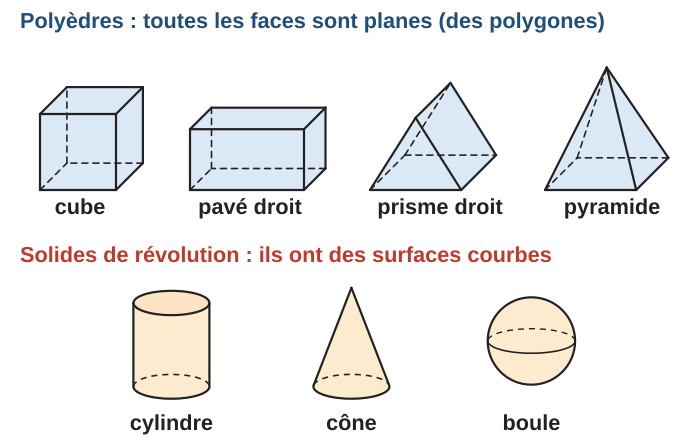

Vocabulaire d’un polyèdre :

- une **face** est un polygone qui limite le solide ;
- une **arête** est un segment commun à deux faces ;
- un **sommet** est un point commun à plusieurs arêtes.

| Solide | Faces | Arêtes | Sommets | Description |
|:--|:-:|:-:|:-:|:--|
| Cube | 6 | 12 | 8 | 6 carrés identiques |
| Pavé droit | 6 | 12 | 8 | 6 rectangles, opposés deux à deux identiques |
| Prisme droit à base triangulaire | 5 | 9 | 6 | 2 bases triangulaires identiques et parallèles, 3 faces latérales rectangulaires |
| Pyramide à base carrée | 5 | 8 | 5 | 1 base carrée, 4 faces latérales triangulaires qui se rejoignent au sommet |
| Tétraèdre (pyramide à base triangulaire) | 4 | 6 | 4 | 4 triangles |

> **Méthode — compter sans se tromper.** Pour un **prisme** dont la base a $n$ côtés : $n + 2$ faces, $3n$ arêtes, $2n$ sommets. Pour une **pyramide** dont la base a $n$ côtés : $n + 1$ faces, $2n$ arêtes, $n + 1$ sommets. On peut vérifier avec la relation d’Euler : $\text{faces} + \text{sommets} - \text{arêtes} = 2$.

La **hauteur** d’un prisme droit ou d’un cylindre est la distance entre ses deux bases. La hauteur d’une pyramide ou d’un cône est la distance entre le **sommet** et le plan de la base : on la mesure sur la perpendiculaire à la base, pas sur une arête.

### 1.2 Les solides de révolution

Un solide de révolution est obtenu en faisant **tourner** une figure plane autour d’une droite, l’**axe**.

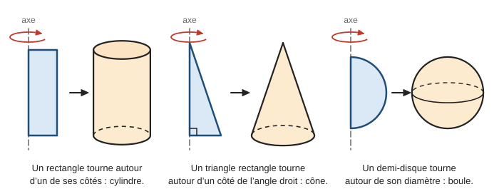

- Un rectangle tourne autour d’un de ses côtés : on obtient un **cylindre**. Le côté sur l’axe donne la hauteur, l’autre côté donne le rayon.
- Un triangle rectangle tourne autour d’un côté de l’angle droit : on obtient un **cône**. Ce côté donne la hauteur, l’autre côté de l’angle droit donne le rayon de la base.
- Un demi-disque tourne autour de son diamètre : on obtient une **boule**.

> **Erreur fréquente.** Confondre **sphère** et **boule**. La sphère de centre $O$ et de rayon $5\,\mathrm{cm}$ est la **surface** : tous les points à exactement $5\,\mathrm{cm}$ de $O$ (la peau d’un ballon). La boule est le **solide plein** : tous les points à $5\,\mathrm{cm}$ ou moins de $O$.

---

## 2. La perspective cavalière

### 2.1 Les règles

Une photo d’un cube déforme les longueurs et les angles. La perspective cavalière est un dessin **conventionnel** : facile à tracer, il garde le parallélisme et permet de lire certaines longueurs.

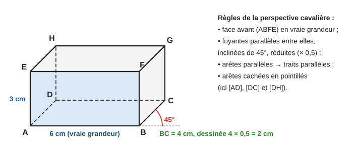

> **Règles de la perspective cavalière.**
>
> 1. La face **avant** (et toutes les faces qui lui sont parallèles) est dessinée **en vraie grandeur** : mêmes longueurs, mêmes angles.
> 2. Les arêtes perpendiculaires à la face avant sont les **fuyantes**. On les dessine **parallèles entre elles**, inclinées d’un même angle (souvent $45^\circ$) et **réduites** par un même coefficient (souvent $0{,}5$).
> 3. Deux arêtes parallèles dans la réalité sont dessinées **parallèles**.
> 4. Les arêtes **cachées** sont dessinées en **pointillés**.

Sur le pavé ci-dessus, $AB = 6\,\mathrm{cm}$ et $AE = 3\,\mathrm{cm}$ sont en vraie grandeur. L’arête $[BC]$ mesure $4\,\mathrm{cm}$ dans la réalité ; c’est une fuyante, on la dessine donc de longueur $4 \times 0{,}5 = 2\,\mathrm{cm}$.

> **Erreur fréquente.** Croire que tout ce qui est dessiné est en vraie grandeur. Sur le dessin, l’angle $\widehat{ABC}$ mesure $135^\circ$ (la fuyante $[BC]$ fait $45^\circ$ avec le prolongement de $[AB]$), alors que dans le pavé c’est un angle **droit**. La face $BCGF$ est dessinée comme un parallélogramme, alors que c’est un **rectangle**. Seules les faces parallèles à la face avant sont fidèles.

### 2.2 Exemple guidé 1 — dessiner un cube

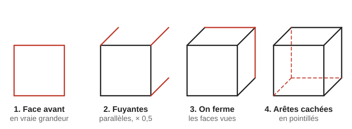

**Énoncé.** Dessiner un cube $ABCDEFGH$ d’arête $4\,\mathrm{cm}$ en perspective cavalière (fuyantes à $45^\circ$, coefficient $0{,}5$), avec la face avant $ABFE$.

**Réflexion.** La face avant est en vraie grandeur : un carré de $4\,\mathrm{cm}$. Les fuyantes mesurent $4 \times 0{,}5 = 2\,\mathrm{cm}$ sur le dessin.

**Rédaction.**

> 1. Je trace le carré $ABFE$ de côté $4\,\mathrm{cm}$ (face avant).
> 2. Depuis $B$, $F$ et $E$, je trace trois segments parallèles, inclinés de $45^\circ$, de longueur $2\,\mathrm{cm}$ : j’obtiens $C$, $G$ et $H$.
> 3. Je ferme les faces visibles : $[CG]$ et $[GH]$.
> 4. Depuis $A$, je trace la fuyante $[AD]$ de $2\,\mathrm{cm}$, puis $[DC]$ et $[DH]$ : ce sont les arêtes **cachées**, en pointillés.

**Contrôle.** Il y a bien $12$ arêtes : $9$ en traits pleins et $3$ en pointillés, qui partent toutes du sommet caché $D$.

> **Méthode — dessiner un solide en perspective cavalière.**
> 1. Tracer la face avant en vraie grandeur.
> 2. Tracer les fuyantes : parallèles, même angle, longueurs multipliées par le coefficient.
> 3. Relier les extrémités en respectant le parallélisme.
> 4. Repasser en pointillés les arêtes cachées par le solide.

Pour une **pyramide** à base carrée, on dessine d’abord la base (elle est horizontale : deux côtés en vraie grandeur, deux côtés fuyants), on trace ses diagonales pour trouver le centre $O$, puis on place le sommet $S$ à la verticale de $O$ : la hauteur est verticale, donc dessinée en vraie grandeur.

Pour un **cylindre** ou un **cône**, on dessine les disques de base comme des ovales aplatis (des ellipses) ; la moitié arrière de la base du bas est en pointillés.

---

## 3. Les patrons

### 3.1 Qu’est-ce qu’un patron ?

Un **patron** d’un solide est une figure plane, d’un seul morceau, qui permet de fabriquer le solide par **pliage**, sans superposition ni trou. C’est la « boîte en carton dépliée ».

### 3.2 Patrons du cube

Un cube a $6$ faces carrées : un patron du cube est formé de $6$ carrés. Mais **tous** les assemblages de $6$ carrés ne sont pas des patrons !

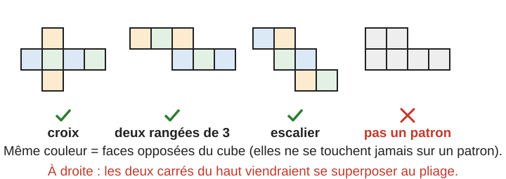

Le cube a en tout $11$ patrons différents. Pour savoir si un assemblage est un patron, on le **plie mentalement** :

> **Méthode — tester un patron de cube.**
> 1. On choisit une face qui sera le **dessous**.
> 2. On replie les faces voisines vers le haut, une par une, et on note la position de chacune : dessous, dessus, avant, arrière, gauche, droite.
> 3. Si **deux carrés** arrivent à la même place, ce n’est **pas** un patron. Sinon, c’en est un.
>
> Astuce : dans une **rangée** de carrés, deux carrés séparés par **un** carré sont des faces **opposées**. Deux faces opposées ne se touchent jamais.

> **Erreur fréquente.** Penser qu’une rangée de $5$ carrés peut faire un patron. Une rangée de $4$ carrés fait déjà tout le tour du cube : le $5\text{e}$ carré revient sur le $1^{\text{er}}$. De même, un bloc de $2 \times 2$ carrés n’apparaît jamais dans un patron de cube.

### 3.3 Exemple guidé 2 — le patron d’un pavé

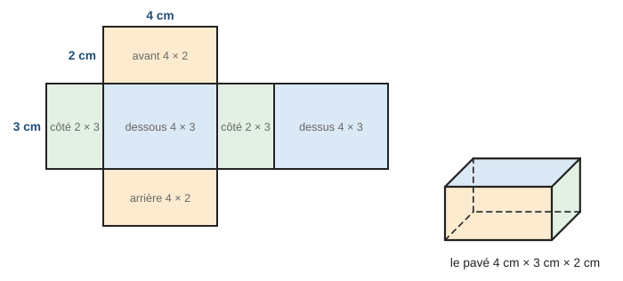

**Énoncé.** Un pavé droit a pour dimensions $4\,\mathrm{cm}$, $3\,\mathrm{cm}$ et $2\,\mathrm{cm}$. Décrire un patron, puis calculer l’aire totale de carton nécessaire.

**Réflexion.** Un pavé a $6$ faces rectangulaires, identiques deux par deux : $2$ faces de $4 \times 3$, $2$ faces de $4 \times 2$, $2$ faces de $3 \times 2$. Dans le patron, deux faces qui se recollent ont des côtés de **même longueur**.

**Rédaction.**

> Le patron est formé de $6$ rectangles : deux de $4\,\mathrm{cm}$ sur $3\,\mathrm{cm}$ (dessous et dessus), deux de $4\,\mathrm{cm}$ sur $2\,\mathrm{cm}$ (avant et arrière) et deux de $3\,\mathrm{cm}$ sur $2\,\mathrm{cm}$ (côtés).
>
> $$\mathcal{A} = 2 \times (4 \times 3) + 2 \times (4 \times 2) + 2 \times (3 \times 2) = 24 + 16 + 12 = 52\,\mathrm{cm}^2$$

**Contrôle.** Sur le dessin, chaque côté qui se recolle avec un autre a la même longueur : le côté de $4\,\mathrm{cm}$ de la face avant se recolle sur le côté de $4\,\mathrm{cm}$ du dessous, etc.

### 3.4 Patrons d’un prisme droit et d’une pyramide

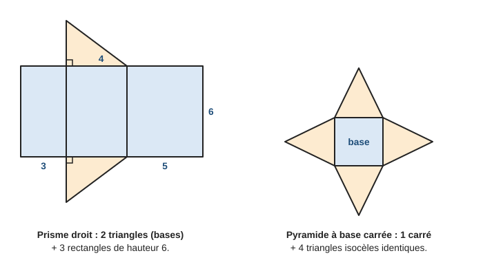

- **Prisme droit :** les faces latérales forment un grand rectangle, de hauteur la hauteur du prisme et de longueur le **périmètre de la base** ($3 + 4 + 5 = 12$ ci-dessus). Les deux bases sont collées de part et d’autre.
- **Pyramide :** la base, et sur chacun de ses côtés un triangle. Les côtés qui se recollent ont la même longueur : dans une pyramide régulière, les triangles sont isocèles et identiques.

### 3.5 Patrons d’un cylindre et d’un cône

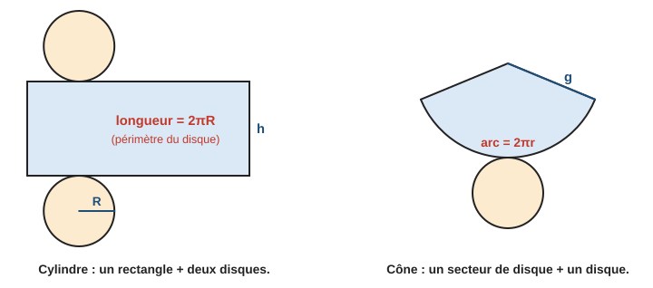

Si on déroule la surface latérale d’un **cylindre** (l’étiquette d’une boîte de conserve), on obtient un **rectangle**. Sa largeur est la hauteur $h$ du cylindre. Sa longueur s’enroule exactement autour du disque de base : c’est le **périmètre** de ce disque, $2\pi R$.

**Exemple guidé 3.** Patron d’un cylindre de rayon $3\,\mathrm{cm}$ et de hauteur $5\,\mathrm{cm}$.

> Le patron est formé de deux disques de rayon $3\,\mathrm{cm}$ et d’un rectangle de largeur $5\,\mathrm{cm}$ et de longueur
>
> $$L = 2 \pi R = 2 \times \pi \times 3 = 6\pi \approx 18{,}8\,\mathrm{cm}$$

**Contrôle.** $18{,}8$ est un peu plus que $3 \times 6 = 18$ : le périmètre d’un cercle vaut un peu plus de $3$ fois son diamètre.

> **Erreur fréquente.** Prendre le **diamètre** ($6\,\mathrm{cm}$) comme longueur du rectangle. Le rectangle doit faire **tout le tour** du disque : sa longueur est le périmètre, environ $3{,}14$ fois le diamètre.

Pour un **cône** (★★★), la surface latérale se déroule en un **secteur de disque** : son rayon est la génératrice $g$ (la longueur du sommet au bord de la base) et son arc mesure $2\pi r$, le périmètre de la base. L’angle du secteur est proportionnel à l’arc :

$$\text{angle} = 360^\circ \times \dfrac{2\pi r}{2\pi g} = 360^\circ \times \dfrac{r}{g}$$

Sur la figure, $r = 1{,}5\,\mathrm{cm}$ et $g = 4\,\mathrm{cm}$ : l’angle vaut $360^\circ \times \dfrac{1{,}5}{4} = 135^\circ$.

---

## 4. Les vues

Un architecte ne dessine pas seulement en perspective : il donne des **vues** (plans), où chaque longueur est en vraie grandeur.

- La **vue de face** : ce que l’on voit en regardant l’objet de face, à hauteur d’objet.
- La **vue de dessus** : ce que l’on voit en regardant d’en haut.
- La **vue de droite** (ou de gauche) : ce que l’on voit en regardant depuis ce côté.

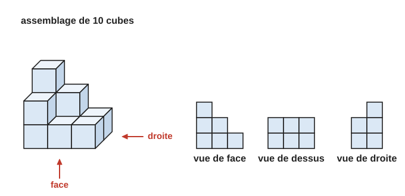

**Exemple guidé 4.** Combien de cubes compte l’assemblage ci-dessus ? Expliquer ses vues.

> L’assemblage a deux rangées de trois piles. Rangée de derrière : piles de $3$, $2$ et $1$ cubes. Rangée de devant : piles de $2$, $1$ et $1$ cubes. Total : $3 + 2 + 1 + 2 + 1 + 1 = 10$ cubes.
>
> **Vue de face :** pour chaque colonne, on voit la pile la **plus haute** (derrière ou devant) : $3$, $2$, $1$.  
> **Vue de dessus :** on voit $3 \times 2 = 6$ carrés (une case par pile).  
> **Vue de droite :** on voit la rangée de devant à gauche (hauteur maximale $2$) et la rangée de derrière à droite (hauteur maximale $3$).

> **Erreur fréquente.** Compter les cubes visibles sur le dessin en perspective. Des cubes peuvent être cachés : on compte **pile par pile**, avec la vue de dessus et les hauteurs.

> **Méthode — le plan coté.** On dessine la vue de dessus et on écrit dans chaque case la **hauteur de la pile**. Le nombre de cubes est la somme des nombres. La vue de face se lit en prenant, dans chaque colonne, le **plus grand** nombre.

---

## 5. Sections de solides par un plan

Couper un solide d’un seul coup de scie droit, c’est le couper par un **plan**. La surface obtenue s’appelle la **section**.

### 5.1 Pavé droit et cylindre

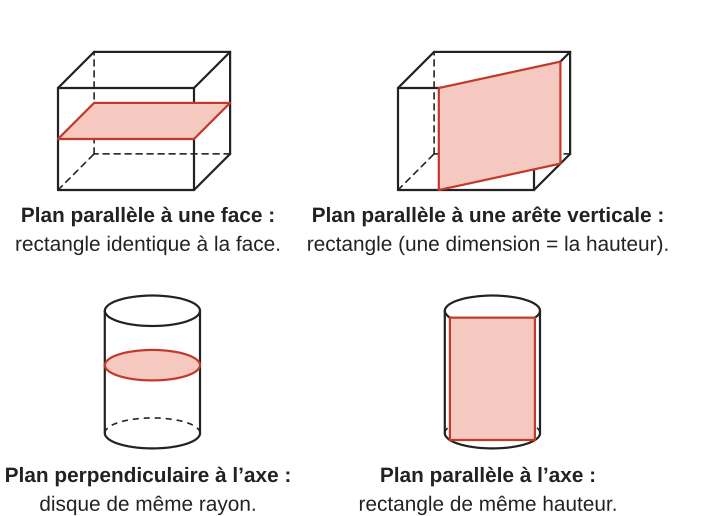

> **À retenir — sections d’un pavé et d’un cylindre.**
>
> - Pavé coupé par un plan **parallèle à une face** : un rectangle **identique à cette face**.
> - Pavé coupé par un plan **parallèle à une arête** : un **rectangle** dont un côté a la longueur de cette arête.
> - Cylindre coupé par un plan **perpendiculaire à l’axe** : un **disque** de même rayon que la base.
> - Cylindre coupé par un plan **parallèle à l’axe** : un **rectangle** dont un côté est la hauteur du cylindre.

Pour trouver les dimensions qui manquent, on cherche souvent un triangle rectangle : c’est Pythagore (chapitre 11). Par exemple, si on coupe un pavé de $6\,\mathrm{cm}$ sur $4\,\mathrm{cm}$ sur $5\,\mathrm{cm}$ en suivant une diagonale du dessous, la section est un rectangle dont un côté est la diagonale $\sqrt{6^2 + 4^2} = \sqrt{52} \approx 7{,}2\,\mathrm{cm}$ et l’autre la hauteur $5\,\mathrm{cm}$.

### 5.2 Pyramide et cône : une réduction de la base [[Programme 2020]]

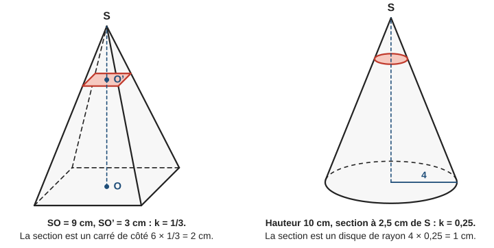

> **Propriété.** La section d’une pyramide ou d’un cône par un plan **parallèle à la base** est une **réduction** de la base. Le coefficient est
>
> $$k = \dfrac{\text{distance du sommet au plan de coupe}}{\text{hauteur totale}}$$
>
> La petite pyramide (ou le petit cône) au-dessus de la coupe est une réduction de la grande, de coefficient $k$.

**Exemple guidé 5.** Une pyramide $SABCD$ a pour base un carré de côté $6\,\mathrm{cm}$ et pour hauteur $SO = 9\,\mathrm{cm}$. On la coupe par un plan parallèle à la base, à $3\,\mathrm{cm}$ du sommet. Nature et dimensions de la section ?

**Réflexion.** Le plan est parallèle à la base : la section est une réduction du carré de base. Coefficient : $\dfrac{3}{9}$.

**Rédaction.**

> La section est parallèle à la base, c’est donc une réduction de la base, de coefficient $k = \dfrac{SO'}{SO} = \dfrac{3}{9} = \dfrac{1}{3}$.
>
> C’est un carré de côté $6 \times \dfrac{1}{3} = 2\,\mathrm{cm}$.

**Contrôle.** $2 < 6$ : c’est bien une réduction. Plus la coupe est proche du sommet, plus la section est petite.

Même raisonnement pour le cône de la figure : hauteur $10\,\mathrm{cm}$, coupe à $2{,}5\,\mathrm{cm}$ du sommet, donc $k = \dfrac{2{,}5}{10} = 0{,}25$. La section est un disque de rayon $4 \times 0{,}25 = 1\,\mathrm{cm}$.

> **Erreur fréquente.** Oublier que les **aires** sont multipliées par $k^2$ (chapitre 12, § 5). Coupée à mi-hauteur ($k = \dfrac{1}{2}$), une pyramide donne une section dont l’aire est le **quart** de l’aire de la base, pas la moitié.

### 5.3 Sphère

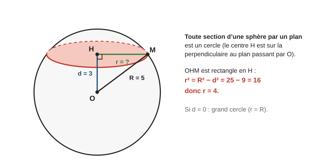

> **Propriété.** La section d’une sphère par un plan est un **cercle** (un disque pour la boule). Son centre $H$ est le pied de la perpendiculaire au plan passant par le centre $O$ de la sphère. Si le plan passe par $O$, la section est un **grand cercle**, de même rayon que la sphère.

**Exemple guidé 6.** Une sphère de centre $O$ a pour rayon $5\,\mathrm{cm}$. On la coupe par un plan situé à $3\,\mathrm{cm}$ de $O$. Calculer le rayon de la section.

**Réflexion.** Le triangle $OHM$, avec $M$ un point du cercle de section, est rectangle en $H$. On connaît l’hypoténuse $OM = 5$ (un rayon de la sphère) et $OH = 3$.

**Rédaction.**

> Le triangle $OHM$ est rectangle en $H$. D’après le théorème de Pythagore :
>
> $$HM^2 = OM^2 - OH^2 = 5^2 - 3^2 = 25 - 9 = 16$$
>
> donc $HM = 4\,\mathrm{cm}$. La section est un cercle de centre $H$ et de rayon $4\,\mathrm{cm}$.

**Contrôle.** $4 < 5$ : la section est plus petite qu’un grand cercle, puisque le plan ne passe pas par le centre.

---

## 6. Se repérer dans l’espace [[Programme 2020]]

### 6.1 Dans un pavé droit

Dans le plan, deux nombres suffisent pour repérer un point (abscisse, ordonnée). Dans l’espace, il en faut **trois**. On choisit un sommet du pavé comme **origine** et trois arêtes qui en partent comme directions.

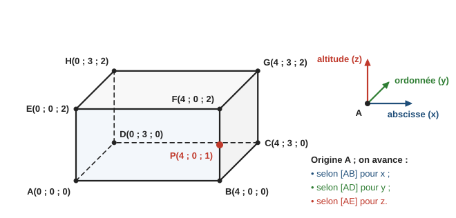

> **Définition.** Un point $M$ du pavé est repéré par trois nombres $(x\,;y\,;z)$ :
>
> - l’**abscisse** $x$ : on avance de $x$ dans la direction de $[AB]$ ;
> - l’**ordonnée** $y$ : on avance de $y$ dans la direction de $[AD]$ ;
> - l’**altitude** $z$ : on monte de $z$ dans la direction de $[AE]$.

**Exemple guidé 7.** Dans le pavé ci-dessus ($AB = 4$, $AD = 3$, $AE = 2$), donner les coordonnées de $G$ et du point $P$, milieu de $[BF]$.

> Pour aller de $A$ à $G$ : on avance de $4$ selon $[AB]$, de $3$ selon $[AD]$ et on monte de $2$. Donc $G(4\,;3\,;2)$.
>
> $P$ est au-dessus de $B(4\,;0\,;0)$, à mi-hauteur : $P(4\,;0\,;1)$.

**Contrôle.** Tous les points de la face du dessous $ABCD$ ont une altitude nulle ; tous ceux de la face du dessus ont une altitude égale à $2$.

> **Erreur fréquente.** Mélanger l’ordre des coordonnées. On écrit **toujours** abscisse, puis ordonnée, puis altitude : $(4\,;0\,;1)$ et $(0\,;4\,;1)$ sont deux points différents.

### 6.2 Sur la sphère terrestre

On assimile la Terre à une sphère. L’**équateur** est le grand cercle à égale distance des deux pôles. Les **méridiens** sont les demi-grands cercles qui vont d’un pôle à l’autre ; le méridien de référence passe par Greenwich (près de Londres). Les **parallèles** sont les cercles parallèles à l’équateur.

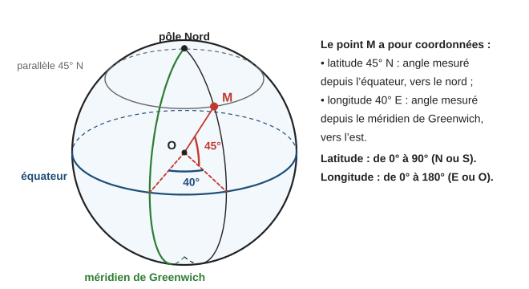

> **Définition.** Un point de la Terre est repéré par deux angles :
>
> - sa **latitude**, de $0^\circ$ à $90^\circ$, Nord ou Sud : l’angle mesuré depuis l’équateur. Tous les points d’un même **parallèle** ont la même latitude.
> - sa **longitude**, de $0^\circ$ à $180^\circ$, Est ou Ouest : l’angle mesuré depuis le méridien de Greenwich. Tous les points d’un même **méridien** ont la même longitude.

**Exemple guidé 8.** Paris a pour coordonnées environ $48{,}9^\circ$ N et $2{,}3^\circ$ E ; Barcelone environ $41{,}4^\circ$ N et $2{,}2^\circ$ E. Le tour de la Terre en suivant un méridien mesure environ $40\,000\,\mathrm{km}$. Estimer la distance entre les deux villes.

**Réflexion.** Les longitudes sont presque égales : les deux villes sont (presque) sur le même méridien. Sur un grand cercle, la longueur d’un arc est proportionnelle à son angle.

**Rédaction.**

> Les deux villes sont presque sur le même méridien. L’écart de latitude vaut $48{,}9^\circ - 41{,}4^\circ = 7{,}5^\circ$.
>
> Un tour complet ($360^\circ$) mesure $40\,000\,\mathrm{km}$, donc la distance vaut environ
>
> $$\dfrac{7{,}5}{360} \times 40\,000 \approx 833\,\mathrm{km}$$

**Contrôle.** $1^\circ$ de méridien représente $\dfrac{40\,000}{360} \approx 111\,\mathrm{km}$, et $7{,}5 \times 111 \approx 833$. La distance réelle à vol d’oiseau est d’environ $830\,\mathrm{km}$.

> **Erreur fréquente.** Inverser latitude et longitude. Moyen mnémotechnique : la **latitude** se lit sur des cercles « à plat » comme les **lattes** d’un sommier (les parallèles) ; la **longitude** se lit sur les méridiens, **longs** cercles qui vont d’un pôle à l’autre.

---

## 7. Mini-synthèse

> **À retenir.**
>
> - Polyèdres : faces planes. Prisme à base de $n$ côtés : $n + 2$ faces, $3n$ arêtes, $2n$ sommets. Pyramide : $n + 1$ faces, $2n$ arêtes, $n + 1$ sommets.
> - Perspective cavalière : face avant en vraie grandeur, fuyantes parallèles, inclinées et réduites (souvent $45^\circ$ et $0{,}5$), arêtes cachées en pointillés.
> - Patron : figure d’un seul morceau qui se plie sans superposition. Cube : $6$ carrés, $11$ patrons possibles. Cylindre : rectangle de longueur $2\pi R$ et deux disques.
> - Vues : de face, de dessus, de côté, en vraie grandeur ; plan coté pour compter les cubes.
> - Sections : pavé → rectangle ; cylindre → disque ou rectangle ; pyramide et cône (plan parallèle à la base) → réduction de coefficient $k$ ; sphère → cercle, rayon par Pythagore.
> - Repérage : pavé $(x\,;y\,;z)$ = abscisse, ordonnée, altitude ; Terre = latitude (N/S) et longitude (E/O).

---

## 8. Exercices types

> Objectif : automatismes. Difficulté croissante dans chaque série. Sauf mention contraire, les longueurs sont arrondies au millimètre et les aires au dixième. Corrigés détaillés au § 10.

### A. Vocabulaire et solides (★)

**A1.** Donner le nombre de faces, d’arêtes et de sommets : a) d’une pyramide à base hexagonale ; b) d’un prisme droit à base hexagonale ; c) d’une pyramide à base triangulaire.

**A2.** Quel solide obtient-on, et avec quelles dimensions, si l’on fait tourner : a) un rectangle de $5\,\mathrm{cm}$ sur $3\,\mathrm{cm}$ autour de son côté de $5\,\mathrm{cm}$ ? b) un triangle rectangle dont les côtés de l’angle droit mesurent $4\,\mathrm{cm}$ et $6\,\mathrm{cm}$, autour du côté de $6\,\mathrm{cm}$ ? c) un demi-disque de diamètre $4\,\mathrm{cm}$ autour de ce diamètre ?

**A3.** On considère le pavé $ABCDEFGH$ du § 2.1. a) Quelle face est parallèle à la face $ABFE$ ? b) Citer les arêtes parallèles à $[AE]$. c) Citer les deux arêtes qui partent de $A$ et sont perpendiculaires à $[AB]$.

**A4.** Vrai ou faux ? a) Un cube est un pavé droit particulier. b) Une pyramide a autant de faces que de sommets. c) Une sphère et une boule de même rayon, c’est la même chose. d) Un cylindre a deux bases.

### B. Perspective cavalière (★ → ★★)

**B1.** On dessine un cube d’arête $4\,\mathrm{cm}$ en perspective cavalière (fuyantes à $45^\circ$, coefficient $0{,}5$). Quelles longueurs trace-t-on pour la face avant ? Pour les fuyantes ?

**B2.** Un pavé droit mesure $5\,\mathrm{cm}$ de largeur, $4\,\mathrm{cm}$ de profondeur et $3\,\mathrm{cm}$ de hauteur. La face avant est la face de $5\,\mathrm{cm}$ sur $3\,\mathrm{cm}$. a) Donner les longueurs à tracer (coefficient $0{,}5$). b) Combien d’arêtes seront en pointillés ?

**B3.** Sur un dessin en perspective cavalière de coefficient $0{,}5$, une fuyante mesure $2{,}5\,\mathrm{cm}$ et une arête de la face avant mesure $3\,\mathrm{cm}$. Quelles sont leurs longueurs réelles ?

**B4.** Sur le dessin d’un cube $ABCDEFGH$ en perspective cavalière (face avant $ABFE$), dire si c’est vrai sur le dessin, puis dans la réalité : a) $AB = BC$ ; b) l’angle $\widehat{ABF}$ est droit ; c) l’angle $\widehat{ABC}$ est droit ; d) $(AE)$ et $(CG)$ sont parallèles.

**B5.** (★★) Décrire les étapes pour dessiner en perspective cavalière une pyramide $SABCD$ à base carrée de côté $4\,\mathrm{cm}$ et de hauteur $5\,\mathrm{cm}$ (face $AB$ à l’avant, coefficient $0{,}5$). Quelles arêtes sont cachées ?

### C. Patrons (★ → ★★)

**C1.** Parmi les assemblages de six carrés ci-dessous, lesquels sont des patrons de cube ? Justifier pour ceux qui n’en sont pas.

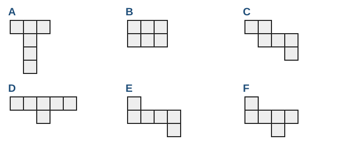

**C2.** Dessiner à main levée un patron d’un pavé droit de $5\,\mathrm{cm}$ sur $3\,\mathrm{cm}$ sur $2\,\mathrm{cm}$, en indiquant les dimensions de chaque face, puis calculer l’aire totale du patron.

**C3.** Un cylindre a pour rayon $2\,\mathrm{cm}$ et pour hauteur $6\,\mathrm{cm}$. a) Donner les dimensions du rectangle de son patron. b) En déduire l’aire latérale du cylindre.

**C4.** (★★) Une pyramide régulière a pour base un carré de côté $4\,\mathrm{cm}$ ; ses faces latérales sont des triangles isocèles de côtés $5\,\mathrm{cm}$, $5\,\mathrm{cm}$ et $4\,\mathrm{cm}$. a) Calculer la hauteur d’une face latérale. b) Calculer l’aire totale du patron.

**C5.** Le patron en croix du § 3.2 est numéroté ainsi : la rangée horizontale porte, de gauche à droite, les numéros $1$, $2$, $3$, $4$ ; le carré du haut porte le $5$, celui du bas le $6$ (tous deux accrochés au carré $2$). Une fois le cube plié, quelles sont les faces opposées ?

### D. Vues (★ → ★★)

**D1.** Décrire la vue de face et la vue de dessus : a) d’un cylindre posé sur une de ses bases ; b) d’un cône posé sur sa base ; c) d’une boule.

**D2.** Dans l’assemblage du § 4, on retire le cube du haut de la pile de $3$. Combien reste-t-il de cubes ? Quelles vues changent ?

**D3.** (★★) Un assemblage est décrit par son plan coté (vue de dessus avec les hauteurs des piles) : rangée de derrière $3$ et $1$ ; rangée de devant $2$ et $1$ (de gauche à droite). a) Combien de cubes ? b) Dessiner la vue de face et la vue de droite.

### E. Sections (★ → ★★)

**E1.** Un pavé droit mesure $6\,\mathrm{cm}$ de long, $4\,\mathrm{cm}$ de large et $3\,\mathrm{cm}$ de haut. On le coupe par un plan parallèle à la face du dessous. Nature et dimensions de la section ?

**E2.** $ABCDEFGH$ est un pavé droit avec $AB = 6\,\mathrm{cm}$, $AD = 4\,\mathrm{cm}$ et $AE = 5\,\mathrm{cm}$. a) Nature et dimensions de la section par un plan parallèle à la face $ABFE$ ? b) (★★) On coupe le pavé par le plan qui contient $A$, $C$, $G$ et $E$. Nature et dimensions de la section $ACGE$ ?

**E3.** Un cylindre a pour rayon $3\,\mathrm{cm}$ et pour hauteur $8\,\mathrm{cm}$. a) Section par un plan perpendiculaire à l’axe : nature et aire ? b) Section par un plan qui contient l’axe : nature et dimensions ?

**E4.** Une pyramide a pour base un carré de côté $8\,\mathrm{cm}$ et pour hauteur $12\,\mathrm{cm}$. On la coupe par un plan parallèle à la base, à $3\,\mathrm{cm}$ du sommet. Calculer le côté et l’aire de la section.

**E5.** (★★) Une boule de centre $O$ a pour rayon $13\,\mathrm{cm}$. On la coupe par un plan situé à $5\,\mathrm{cm}$ de $O$. Calculer le rayon de la section, puis son aire.

**E6.** (★★) On coupe une sphère de rayon $10\,\mathrm{cm}$ par un plan : la section est un cercle de rayon $8\,\mathrm{cm}$. À quelle distance du centre se trouve le plan ?

### F. Repérage (★ → ★★) [[Programme 2020]]

**F1.** Dans le pavé du § 6.1 ($A$ origine, $AB = 4$, $AD = 3$, $AE = 2$) : a) donner les coordonnées du milieu $I$ de $[AB]$ ; b) du milieu $J$ de $[EH]$ ; c) quel sommet a pour coordonnées $(4\,;3\,;0)$ ? d) donner les coordonnées du centre $K$ de la face $BCGF$.

**F2.** $ABCDEFGH$ est un cube d’arête $2$, repéré comme au § 6.1 (origine $A$). Donner les coordonnées de $G$, du milieu de $[EG]$ et du centre du cube.

**F3.** Coordonnées approximatives : Paris ($49^\circ$ N ; $2^\circ$ E), Quito ($0^\circ$ ; $78^\circ$ O), Sydney ($34^\circ$ S ; $151^\circ$ E). a) Quelle ville est sur l’équateur ? b) Laquelle est dans l’hémisphère Sud ? c) Laquelle est la plus proche du méridien de Greenwich ?

**F4.** (★★) Deux points sont sur le même méridien, l’un à la latitude $45^\circ$ N, l’autre à $45^\circ$ S. Le tour de la Terre mesure $40\,000\,\mathrm{km}$. Quelle distance les sépare en suivant le méridien ?

---

## 9. Exercices atypiques

> Objectif : comprendre, raisonner, rédiger. Plusieurs étapes, erreurs à trouver, questions ouvertes.

### G. Trouver l’erreur (★★)

**G1.** Pour le patron d’un cylindre de rayon $4\,\mathrm{cm}$ et de hauteur $5\,\mathrm{cm}$, Lucas dessine deux disques de rayon $4\,\mathrm{cm}$ et un rectangle de $8\,\mathrm{cm}$ sur $5\,\mathrm{cm}$. Trouver l’erreur et corriger.

**G2.** Sur un dessin en perspective cavalière (coefficient $0{,}5$), Emma mesure une fuyante d’un cube : $3\,\mathrm{cm}$. Elle écrit : « L’arête du cube mesure $3\,\mathrm{cm}$. Et la face de droite n’est pas un carré, puisque ses angles mesurent $45^\circ$ et $135^\circ$. » Corriger ses deux affirmations.

**G3.** Yanis affirme : « Quand on coupe un cône par un plan parallèle à sa base, on obtient un triangle. » Qu’en penser ? Dans quel cas obtient-on un triangle ?

**G4.** Une pyramide a pour base un carré de côté $6\,\mathrm{cm}$. Léa la coupe à mi-hauteur par un plan parallèle à la base et écrit : « L’aire de la section est la moitié de l’aire de la base, soit $18\,\mathrm{cm}^2$. » Trouver l’erreur.

### H. Comprendre et raisonner (★★ → ★★★)

**H1.** a) Vérifier la relation d’Euler $\text{faces} + \text{sommets} - \text{arêtes} = 2$ pour le cube, la pyramide à base carrée et le prisme à base triangulaire. b) (★★★) Démontrer qu’elle est vraie pour tout prisme dont la base a $n$ côtés.

**H2.** Une fourmi est sur le sommet $A$ d’un cube d’arête $1\,\mathrm{m}$ et veut aller au sommet opposé $G$ en marchant sur les faces. a) Quelle distance parcourt-elle en suivant les arêtes ? b) (★★★) En dépliant deux faces voisines, trouver un chemin plus court et calculer sa longueur.

**H3.** (★★★) Un cube a pour arête $2\,\mathrm{cm}$. On le coupe par un plan qui passe par les milieux de six de ses arêtes : la section est un hexagone dont les six côtés ont la même longueur. Chaque côté joint les milieux de deux arêtes qui ont un sommet commun. Calculer la longueur d’un côté, puis le périmètre de l’hexagone.

**H4.** Proposer deux solides différents dont la vue de face et la vue de droite sont toutes les deux des carrés. Quelle vue permet de les distinguer ?

### I. Plusieurs étapes (★★★)

**I1.** $ABCDEFGH$ est un pavé droit avec $AB = 5\,\mathrm{cm}$, $AD = 9\,\mathrm{cm}$ et $AE = 12\,\mathrm{cm}$. On le coupe par le plan qui contient les arêtes $[AB]$ et $[HG]$. a) Expliquer pourquoi la section $ABGH$ est un rectangle. b) Calculer $AH$. c) Calculer l’aire de la section.

**I2.** Un cône a pour rayon de base $6\,\mathrm{cm}$ et pour hauteur $8\,\mathrm{cm}$. a) Calculer sa génératrice $g$. b) Calculer la longueur de l’arc du secteur de son patron. c) Calculer l’angle de ce secteur.

**I3.** Une pyramide a pour base un carré de côté $9\,\mathrm{cm}$ et pour hauteur $12\,\mathrm{cm}$. On la coupe par un plan parallèle à la base, à $4\,\mathrm{cm}$ du sommet. a) Donner le coefficient de réduction et les dimensions de la petite pyramide. b) Calculer le volume de la grande et de la petite pyramide (rappel : $V = \dfrac{\text{aire de la base} \times \text{hauteur}}{3}$, chapitre 14). c) En déduire le volume du tronc de pyramide restant.

**I4.** (avec le chapitre 13) Le tour de la Terre en suivant l’équateur mesure $40\,000\,\mathrm{km}$. On considère le parallèle de latitude $60^\circ$ N. a) Faire un schéma en coupe : le centre $O$ de la Terre, un point $M$ du parallèle et le centre $H$ de ce parallèle. b) Montrer que le rayon du parallèle est la moitié du rayon de la Terre. c) En déduire la longueur du parallèle.

### J. Ouvert (★★)

**J1.** Sur un dé, la somme des faces opposées vaut toujours $7$. On dessine une rangée de quatre carrés numérotés $1$, $2$, $6$, $5$. Où placer les faces $3$ et $4$ pour obtenir le patron d’un dé correct ?

**J2.** Expliquer par écrit à un camarade absent comment dessiner un cube en perspective cavalière, en cinq phrases au plus.

**J3.** Pourquoi dessine-t-on les arêtes cachées en pointillés plutôt que de ne pas les dessiner ? Donner un exemple où, sans pointillés, on ne pourrait pas savoir quel solide est dessiné.

---

## 10. Corrigés

> Les corrigés marqués **(modèle)** montrent la rédaction attendue. Les autres donnent les étapes clés.

### Exercices types

**A1.** a) Base hexagonale ($n = 6$) : $7$ faces, $12$ arêtes, $7$ sommets. b) $8$ faces, $18$ arêtes, $12$ sommets. c) $4$ faces, $6$ arêtes, $4$ sommets.

**A2. (modèle)**
> a) Le rectangle tourne autour d’un de ses côtés : on obtient un **cylindre** de hauteur $5\,\mathrm{cm}$ (le côté sur l’axe) et de rayon $3\,\mathrm{cm}$.  
> b) Le triangle rectangle tourne autour d’un côté de l’angle droit : on obtient un **cône** de hauteur $6\,\mathrm{cm}$ et de rayon de base $4\,\mathrm{cm}$.  
> c) Le demi-disque tourne autour de son diamètre : on obtient une **boule** de rayon $4 \div 2 = 2\,\mathrm{cm}$.

**A3.** a) La face $DCGH$. b) $[BF]$, $[CG]$ et $[DH]$. c) $[AD]$ et $[AE]$.

**A4.** a) Vrai : ses six faces sont des rectangles (des carrés). b) Vrai : une base à $n$ côtés donne $n + 1$ faces et $n + 1$ sommets. c) Faux : la sphère est la surface, la boule est le solide plein. d) Vrai : deux disques parallèles et identiques.

**B1.** Face avant : un carré de $4\,\mathrm{cm}$ de côté. Fuyantes : $4 \times 0{,}5 = 2\,\mathrm{cm}$, inclinées de $45^\circ$.

**B2. (modèle)**
> a) La face avant est en vraie grandeur : un rectangle de $5\,\mathrm{cm}$ sur $3\,\mathrm{cm}$. La profondeur $4\,\mathrm{cm}$ est portée par les fuyantes : $4 \times 0{,}5 = 2\,\mathrm{cm}$ sur le dessin.  
> b) Les arêtes cachées sont les trois arêtes qui partent du sommet arrière gauche du bas : $3$ arêtes en pointillés.

**B3.** La fuyante est réduite de moitié : longueur réelle $2{,}5 \div 0{,}5 = 5\,\mathrm{cm}$. L’arête de la face avant est en vraie grandeur : $3\,\mathrm{cm}$.

**B4.** a) Faux sur le dessin ($BC$ est deux fois plus court), vrai en réalité. b) Vrai sur le dessin et en réalité (face avant en vraie grandeur). c) Faux sur le dessin ($135^\circ$), vrai en réalité. d) Vrai sur le dessin et en réalité (le parallélisme est conservé).

**B5.** 1) Base : $[AB]$ de $4\,\mathrm{cm}$ horizontal ; $[AD]$ et $[BC]$ sont des fuyantes de $4 \times 0{,}5 = 2\,\mathrm{cm}$ à $45^\circ$ ; on ferme avec $[DC]$. 2) On trace les diagonales de la base : elles se coupent au centre $O$. 3) On place $S$ à la verticale de $O$, à $5\,\mathrm{cm}$ (une verticale est en vraie grandeur). 4) On relie $S$ aux quatre sommets. Arêtes cachées : celles qui partent du sommet arrière gauche $D$, c’est-à-dire $[AD]$, $[DC]$ et $[SD]$, ainsi que les diagonales et la hauteur $[SO]$ si on les laisse.

**C1. (modèle)**
> On plie mentalement chaque assemblage.  
> **A**, **C**, **E** et **F** sont des patrons : en repliant les faces autour d’une face choisie comme dessous, les six carrés occupent six places différentes.  
> **B** n’est pas un patron : il contient un bloc de $2 \times 2$ carrés ; au pliage, deux carrés se superposent.  
> **D** n’est pas un patron : la rangée de $5$ carrés fait plus que le tour du cube ; le $5\text{e}$ carré se superpose au $1^{\text{er}}$.

**C2.** Six rectangles : deux de $5 \times 3$, deux de $5 \times 2$, deux de $3 \times 2$ (disposés comme au § 3.3, en vérifiant que les côtés recollés ont la même longueur). Aire : $2 \times 15 + 2 \times 10 + 2 \times 6 = 30 + 20 + 12 = 62\,\mathrm{cm}^2$.

**C3.** a) Largeur $6\,\mathrm{cm}$ (la hauteur) ; longueur $2 \pi \times 2 = 4\pi \approx 12{,}6\,\mathrm{cm}$. b) Aire latérale $= 4\pi \times 6 = 24\pi \approx 75{,}4\,\mathrm{cm}^2$.

**C4. (modèle)**
> a) Dans une face latérale isocèle, la hauteur issue du sommet coupe la base de $4\,\mathrm{cm}$ en son milieu. On obtient un triangle rectangle d’hypoténuse $5\,\mathrm{cm}$ et dont un côté mesure $2\,\mathrm{cm}$. D’après le théorème de Pythagore :
>
> $$h^2 = 5^2 - 2^2 = 25 - 4 = 21 \quad \text{donc} \quad h = \sqrt{21} \approx 4{,}58\,\mathrm{cm}$$
>
> b) Aire d’une face latérale : $\dfrac{4 \times \sqrt{21}}{2} = 2\sqrt{21} \approx 9{,}17\,\mathrm{cm}^2$.  
> Aire totale : $4 \times 4 + 4 \times 2\sqrt{21} = 16 + 8\sqrt{21} \approx 52{,}7\,\mathrm{cm}^2$.

**C5.** Dans la rangée $1$, $2$, $3$, $4$, deux carrés séparés par un carré sont opposés : $1$ et $3$, $2$ et $4$. Les carrés $5$ et $6$ sont accrochés de part et d’autre du même carré : $5$ et $6$ sont opposés.

**D1.** a) Face : un rectangle ; dessus : un disque. b) Face : un triangle isocèle ; dessus : un disque (avec le sommet au centre). c) Un disque, quelle que soit la vue.

**D2.** Il reste $9$ cubes. La vue de face devient $2$, $2$, $1$ (colonne de gauche : la pile de derrière ne fait plus que $2$, comme celle de devant). La vue de droite devient $2$, $2$. La vue de dessus ne change pas : la pile existe toujours.

**D3. (modèle)**
> a) Le nombre de cubes est la somme des hauteurs : $3 + 1 + 2 + 1 = 7$ cubes.  
> b) **Vue de face :** colonne de gauche $\max(3\,;2) = 3$ cubes de haut, colonne de droite $\max(1\,;1) = 1$ cube : deux colonnes de hauteurs $3$ et $1$.  
> **Vue de droite :** on voit la rangée de devant à gauche, de hauteur $\max(2\,;1) = 2$, et la rangée de derrière à droite, de hauteur $\max(3\,;1) = 3$ : deux colonnes de hauteurs $2$ et $3$.

**E1.** Un rectangle identique à la face du dessous : $6\,\mathrm{cm}$ sur $4\,\mathrm{cm}$.

**E2. (modèle)**
> a) Le plan est parallèle à la face $ABFE$ : la section est un rectangle identique à cette face, de $6\,\mathrm{cm}$ sur $5\,\mathrm{cm}$.  
> b) Le plan contient les arêtes verticales $[AE]$ et $[CG]$ : la section $ACGE$ est un rectangle de côtés $AC$ et $AE = 5\,\mathrm{cm}$. Le triangle $ABC$ est rectangle en $B$ ; d’après le théorème de Pythagore :
>
> $$AC^2 = AB^2 + BC^2 = 6^2 + 4^2 = 36 + 16 = 52 \quad \text{donc} \quad AC = \sqrt{52} \approx 7{,}2\,\mathrm{cm}$$
>
> La section est un rectangle d’environ $7{,}2\,\mathrm{cm}$ sur $5\,\mathrm{cm}$.

**E3.** a) Un disque de rayon $3\,\mathrm{cm}$ : aire $\pi \times 3^2 = 9\pi \approx 28{,}3\,\mathrm{cm}^2$. b) Un rectangle de largeur le diamètre $6\,\mathrm{cm}$ et de longueur la hauteur $8\,\mathrm{cm}$.

**E4.** $k = \dfrac{3}{12} = \dfrac{1}{4}$. La section est un carré de côté $8 \times \dfrac{1}{4} = 2\,\mathrm{cm}$ et d’aire $4\,\mathrm{cm}^2$ (contrôle : $64 \times \left(\dfrac{1}{4}\right)^2 = 4$).

**E5.** Triangle $OHM$ rectangle en $H$ : $HM^2 = 13^2 - 5^2 = 169 - 25 = 144$, donc $r = 12\,\mathrm{cm}$. Aire du disque : $\pi \times 12^2 = 144\pi \approx 452{,}4\,\mathrm{cm}^2$.

**E6.** $OH^2 = OM^2 - HM^2 = 10^2 - 8^2 = 100 - 64 = 36$, donc le plan est à $6\,\mathrm{cm}$ du centre.

**F1.** a) $I(2\,;0\,;0)$. b) $E(0\,;0\,;2)$ et $H(0\,;3\,;2)$, donc $J(0\,;1{,}5\,;2)$. c) Le sommet $C$. d) $K$ est sur la face $x = 4$, au milieu en ordonnée et en altitude : $K(4\,;1{,}5\,;1)$.

**F2. (modèle)**
> $G$ est le sommet opposé à $A$ : $G(2\,;2\,;2)$.  
> $E(0\,;0\,;2)$ et $G(2\,;2\,;2)$ : le milieu de $[EG]$ a pour coordonnées les moyennes, $(1\,;1\,;2)$. C’est le centre de la face du dessus.  
> Le centre du cube est au milieu de $[AG]$ : $(1\,;1\,;1)$.

**F3.** a) Quito (latitude $0^\circ$). b) Sydney (latitude Sud). c) Paris (longitude $2^\circ$, la plus proche de $0^\circ$).

**F4.** L’angle entre les deux points, mesuré au centre de la Terre, vaut $45^\circ + 45^\circ = 90^\circ$, soit un quart de tour. Distance : $\dfrac{90}{360} \times 40\,000 = 10\,000\,\mathrm{km}$.

### Exercices atypiques

**G1. (modèle)**
> Lucas a pris pour longueur du rectangle le **diamètre** du disque. Or le rectangle doit s’enrouler autour de tout le disque : sa longueur est le **périmètre** du disque.
>
> $$L = 2\pi R = 2 \times \pi \times 4 = 8\pi \approx 25{,}1\,\mathrm{cm}$$
>
> Le rectangle mesure environ $25{,}1\,\mathrm{cm}$ sur $5\,\mathrm{cm}$.

**G2.** Une fuyante est réduite de moitié : l’arête réelle mesure $3 \div 0{,}5 = 6\,\mathrm{cm}$. La face de droite est fuyante : elle est déformée par le dessin (parallélogramme), mais c’est en réalité un carré, comme toutes les faces d’un cube.

**G3.** C’est faux : la section par un plan parallèle à la base est une réduction de la base, donc un **disque**. On obtient un triangle (isocèle) quand le plan **contient l’axe** du cône, c’est-à-dire passe par le sommet et le centre de la base.

**G4.** À mi-hauteur, $k = \dfrac{1}{2}$ : les longueurs sont divisées par $2$ mais les aires sont multipliées par $k^2 = \dfrac{1}{4}$. La section est un carré de côté $3\,\mathrm{cm}$, d’aire $9\,\mathrm{cm}^2$, soit le quart de $36\,\mathrm{cm}^2$.

**H1.** a) Cube : $6 + 8 - 12 = 2$. Pyramide à base carrée : $5 + 5 - 8 = 2$. Prisme à base triangulaire : $5 + 6 - 9 = 2$.  
b) **(modèle)**
> Un prisme dont la base a $n$ côtés a $n + 2$ faces ($2$ bases et $n$ faces latérales), $2n$ sommets ($n$ sur chaque base) et $3n$ arêtes ($n$ sur chaque base et $n$ arêtes latérales).
>
> $$(n + 2) + 2n - 3n = 2$$
>
> La relation est vraie pour tout $n$.

**H2.** a) Trois arêtes : $3\,\mathrm{m}$. b) On déplie la face avant et la face du dessus (par exemple) : elles forment un rectangle de $2\,\mathrm{m}$ sur $1\,\mathrm{m}$, et $A$ et $G$ sont deux coins opposés. Le chemin le plus court est la diagonale : $\sqrt{2^2 + 1^2} = \sqrt{5} \approx 2{,}24\,\mathrm{m}$. Elle passe par le milieu de l’arête commune aux deux faces.

**H3.** Deux milieux d’arêtes qui ont un sommet commun sont à $1\,\mathrm{cm}$ de ce sommet, sur deux arêtes perpendiculaires : ils forment avec lui un triangle rectangle isocèle. Côté de l’hexagone : $\sqrt{1^2 + 1^2} = \sqrt{2} \approx 1{,}41\,\mathrm{cm}$. Périmètre : $6\sqrt{2} \approx 8{,}49\,\mathrm{cm}$.

**H4.** Par exemple un cube et un cylindre dont la hauteur est égale au diamètre (posé sur sa base) : de face et de droite, on voit un carré dans les deux cas. La **vue de dessus** les distingue : un carré pour le cube, un disque pour le cylindre.

**I1. (modèle)**
> a) L’arête $[AB]$ est perpendiculaire à la face $ADHE$, donc à toute droite de cette face passant par $A$, en particulier à $(AH)$. De plus $[AB]$ et $[HG]$ sont parallèles et de même longueur. Le quadrilatère $ABGH$ a deux côtés opposés parallèles et égaux et un angle droit : c’est un rectangle.  
> b) Le triangle $ADH$ est rectangle en $D$. D’après le théorème de Pythagore :
>
> $$AH^2 = AD^2 + DH^2 = 9^2 + 12^2 = 81 + 144 = 225 \quad \text{donc} \quad AH = 15\,\mathrm{cm}$$
>
> c) Aire de la section : $AB \times AH = 5 \times 15 = 75\,\mathrm{cm}^2$.

**I2.** a) Triangle rectangle formé par la hauteur, un rayon et une génératrice : $g^2 = 6^2 + 8^2 = 100$, donc $g = 10\,\mathrm{cm}$. b) L’arc mesure le périmètre de la base : $2\pi \times 6 = 12\pi \approx 37{,}7\,\mathrm{cm}$. c) Angle : $360^\circ \times \dfrac{6}{10} = 216^\circ$.

**I3.** a) $k = \dfrac{4}{12} = \dfrac{1}{3}$ ; la petite pyramide a pour base un carré de côté $9 \times \dfrac{1}{3} = 3\,\mathrm{cm}$ et pour hauteur $4\,\mathrm{cm}$. b) Grande : $\dfrac{81 \times 12}{3} = 324\,\mathrm{cm}^3$. Petite : $\dfrac{9 \times 4}{3} = 12\,\mathrm{cm}^3$ (contrôle : $324 \times \left(\dfrac{1}{3}\right)^3 = 12$). c) Tronc : $324 - 12 = 312\,\mathrm{cm}^3$.

**I4.** a) Dans la coupe, $H$ est sur l’axe des pôles, $[HM]$ est parallèle au rayon de l’équateur, et l’angle entre $[OM]$ et le plan de l’équateur vaut $60^\circ$ ; donc $\widehat{HMO} = 60^\circ$ (angles alternes-internes) et le triangle $OHM$ est rectangle en $H$. b) $\cos \widehat{HMO} = \dfrac{HM}{OM}$, donc $HM = OM \times \cos 60^\circ = OM \times 0{,}5$ : le rayon du parallèle est la moitié du rayon de la Terre. c) Les périmètres sont proportionnels aux rayons : le parallèle mesure $40\,000 \div 2 = 20\,000\,\mathrm{km}$.

**J1. (modèle)**
> Dans une rangée de quatre carrés, deux carrés séparés par un carré deviennent des faces opposées. Les faces $1$ et $6$ sont opposées, et $1 + 6 = 7$ ; les faces $2$ et $5$ aussi, et $2 + 5 = 7$.  
> Il reste $3$ et $4$, qui doivent être opposées ($3 + 4 = 7$). Deux carrés accrochés de part et d’autre d’un **même** carré de la rangée sont opposés : on place par exemple le $3$ au-dessus du $2$ et le $4$ au-dessous du $2$.

**J2.** Exemple : « Trace un carré : c’est la face avant, en vraie grandeur. Depuis trois de ses sommets, trace des segments parallèles, inclinés à $45^\circ$, deux fois plus courts que le côté. Relie leurs extrémités pour fermer le dessus et le côté droit. Depuis le dernier sommet (en bas à gauche), trace en pointillés la fuyante cachée, puis les deux arêtes cachées qui en partent. Vérifie que tu as $12$ arêtes, dont $3$ en pointillés. »

**J3.** Les pointillés montrent la forme complète du solide et lèvent les ambiguïtés. Sans eux, le dessin d’un cube et celui d’un « coin » de cube (un cube auquel il manquerait le sommet caché) sont identiques : on ne voit que trois faces. Les pointillés indiquent ce qu’il y a derrière.

---

## 11. Liens avec les autres chapitres

- **Chapitre 9** (géométrie plane) : figures planes, parallélisme et perpendicularité, utilisés dans chaque face.
- **Chapitre 11** (Pythagore) : diagonales de sections, hauteur d’une face de pyramide, génératrice d’un cône, section d’une sphère (exemple 6, C4, E2, E5, E6, I1, I2).
- **Chapitre 12** (Thalès, agrandissement-réduction) : sections parallèles à la base d’une pyramide ou d’un cône, coefficients $k$, $k^2$ et $k^3$ (§ 5.2, G4, I3).
- **Chapitre 13** (trigonométrie) : rayon d’un parallèle terrestre (I4).
- **Chapitre 14** (aires et volumes) : aires des patrons, aire latérale, volumes des solides de ce chapitre.
- **Chapitre 5** (proportionnalité) : longueur d’un arc proportionnelle à l’angle (exemple 8, F4) ; angle du secteur d’un cône.

---

## 12. Fiche-synthèse

| Je dois savoir… | Comment | Exemple express | S’entraîner |
|---|---|---|---|
| Compter faces, arêtes, sommets | prisme : $n + 2$, $3n$, $2n$ ; pyramide : $n + 1$, $2n$, $n + 1$ | pyramide à base hexagonale : $7$, $12$, $7$ | série A |
| Dessiner en perspective cavalière | face avant en vraie grandeur, fuyantes parallèles à $45^\circ$, réduites | cube d’arête $4$ : fuyantes de $2$ | série B |
| Reconnaître un patron | plier mentalement ; dans une rangée, deux carrés séparés par un carré sont opposés | une rangée de $5$ carrés n’est jamais un patron de cube | série C |
| Lire des vues | plan coté : somme des hauteurs ; vue de face : la plus haute pile de chaque colonne | plan coté $3$, $1$, $2$, $1$ : $3+1+2+1=7$ cubes | série D |
| Trouver une section | pavé : rectangle ; pyramide : réduction de la base ; sphère : cercle (Pythagore) | sphère de rayon $5$, plan à $3$ du centre : rayon $4$ | série E |
| Repérer un point [[Programme 2020]] | $(x\,;y\,;z)$ dans un pavé ; latitude et longitude sur la Terre | milieu de $[BF]$ : $(4\,;0\,;1)$ | série F |

**Pièges à éviter :** en perspective cavalière, seule la face avant est en vraie grandeur ; le rectangle du patron d’un cylindre mesure $2\pi R$ ; la sphère est la surface, la boule le solide plein.

---

*Version v0.3 — relecture (prérequis harmonisés, fiche-synthèse, corrections : voir `PLAN-REVISION.md`, § 10). Base : v0.2 — révision vague 1 (cours développé : solides, perspective cavalière, patrons, vues, sections, repérage dans le pavé et sur la sphère ; 15 figures SVG ; 42 exercices corrigés). Ancienne version : `cours-et-exercices.md.bak` (et `cours-et-exercices.md.phase0.bak` après les corrections ponctuelles).*
