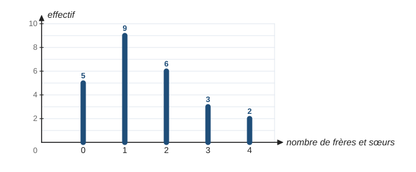
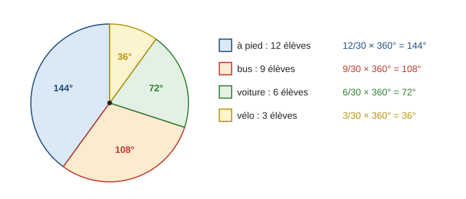
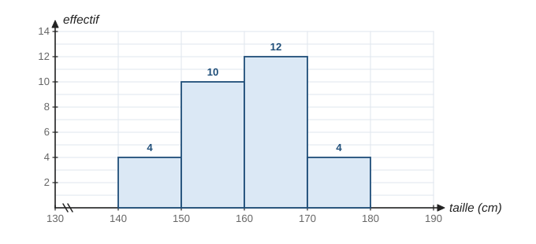
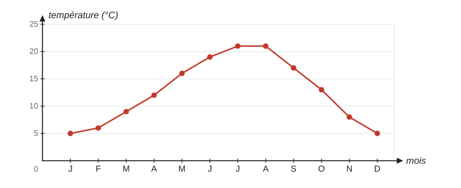
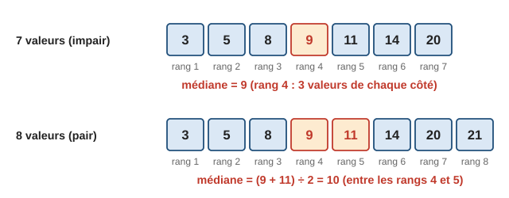
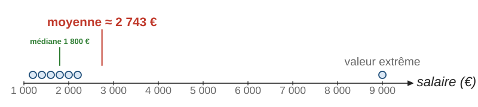
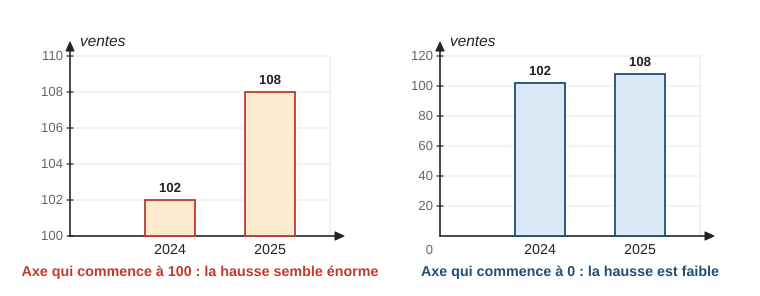
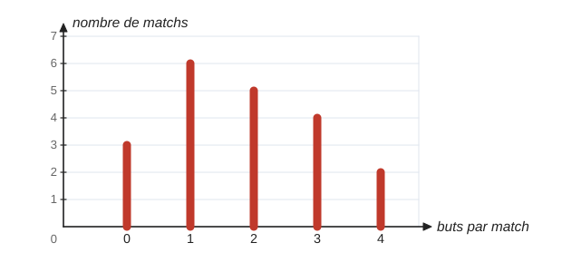

# Statistiques

> Compendium collège — chapitre unifié (sans découpage 6e / 5e / 4e / 3e).  
> Cours compact pour un élève de niveau moyen : intuition, méthode, exemples guidés, erreurs fréquentes, puis exercices progressifs (★ facile, ★★ standard, ★★★ approfondissement) avec corrigés détaillés.

---

## 0. Ce qu’on vise

**En une phrase :** faire des statistiques, c’est **résumer** beaucoup de données par un tableau, un graphique et quelques nombres (moyenne, médiane, étendue), puis savoir ce que ces nombres disent… et ce qu’ils ne disent pas.

À la fin de ce chapitre, je sais :

1. Utiliser le vocabulaire : population, individu, caractère, effectif, fréquence.
2. Organiser des données dans un **tableau** d’effectifs et de fréquences (y compris effectifs cumulés).
3. Lire et construire un diagramme en **bâtons**, un diagramme **circulaire**, un **histogramme**, un graphique d’**évolution**.
4. Calculer et interpréter la **moyenne** (simple ou pondérée), la **médiane** et l’**étendue**.
5. Choisir entre moyenne et médiane, et repérer un **graphique trompeur**.
6. Utiliser un tableur pour ces calculs.

> **Prérequis.** Fractions et pourcentages (chapitre 1, § 8, et chapitre 5, § 4) ; lire un graphique (chapitre 8, § 2) ; mesurer un angle au rapporteur (chapitre 9, § 2.1).

---

## 1. Vocabulaire et tableaux

On étudie un **caractère** (une propriété) sur une **population** formée d’**individus**. Par exemple : la taille (caractère) des élèves (individus) d’un collège (population).

- Le caractère est **quantitatif** s’il se mesure par un nombre (taille, note, nombre de frères et sœurs), **qualitatif** sinon (moyen de transport, couleur préférée).
- L’**effectif** d’une valeur est le nombre d’individus qui ont cette valeur ; l’**effectif total** $N$ est le nombre total d’individus.

> **À retenir.** La **fréquence** d’une valeur est $\dfrac{\text{effectif de la valeur}}{\text{effectif total}}$. C’est un nombre entre $0$ et $1$, souvent écrit en pourcentage. La somme des fréquences vaut $1$ (soit $100\,\%$).

**Exemple guidé 1.** On a demandé à $25$ élèves leur nombre de frères et sœurs. Réponses : $0$ (5 élèves), $1$ (9), $2$ (6), $3$ (3), $4$ (2). Dresser le tableau des effectifs, des fréquences et des effectifs cumulés.

**Rédaction.**

> | Nombre de frères et sœurs | $0$ | $1$ | $2$ | $3$ | $4$ | Total |
> |:-:|:-:|:-:|:-:|:-:|:-:|:-:|
> | Effectif | $5$ | $9$ | $6$ | $3$ | $2$ | $25$ |
> | Fréquence | $0{,}2$ | $0{,}36$ | $0{,}24$ | $0{,}12$ | $0{,}08$ | $1$ |
> | Fréquence en % | $20\,\%$ | $36\,\%$ | $24\,\%$ | $12\,\%$ | $8\,\%$ | $100\,\%$ |
> | Effectif cumulé croissant | $5$ | $14$ | $20$ | $23$ | $25$ | |

**Contrôle.** Les fréquences font bien $1$ ; le dernier effectif cumulé est l’effectif total.

L’**effectif cumulé croissant** d’une valeur est le nombre d’individus qui ont cette valeur **ou une valeur plus petite** : ici, $14$ élèves ont au plus un frère ou une sœur.

---

## 2. Représenter des données

### 2.1 Diagramme en bâtons

Pour un caractère qui prend peu de valeurs : la **hauteur** de chaque bâton est proportionnelle à l’effectif.

### 2.2 Diagramme circulaire

Pour montrer la **répartition** d’un tout en parts. L’angle de chaque secteur est proportionnel à l’effectif.

> **À retenir.** Angle du secteur $=$ fréquence $\times 360^\circ = \dfrac{\text{effectif}}{\text{effectif total}} \times 360^\circ$.

**Exemple guidé 2.** Sur $30$ élèves, $12$ viennent à pied, $9$ en bus, $6$ en voiture et $3$ à vélo. Calculer les angles du diagramme circulaire.

**Rédaction.**

> À pied : $\dfrac{12}{30} \times 360^\circ = 144^\circ$. Bus : $\dfrac{9}{30} \times 360^\circ = 108^\circ$. Voiture : $\dfrac{6}{30} \times 360^\circ = 72^\circ$. Vélo : $\dfrac{3}{30} \times 360^\circ = 36^\circ$.

**Contrôle.** $144 + 108 + 72 + 36 = 360$. Raccourci : un élève correspond à $\dfrac{360}{30} = 12^\circ$.

> **Erreur fréquente.** Confondre pourcentage et angle : « $40\,\%$ donne un angle de $40^\circ$ ». Non : $40\,\%$ de $360^\circ$, c’est $0{,}4 \times 360 = 144^\circ$.

### 2.3 Histogramme

Quand le caractère prend beaucoup de valeurs (tailles, durées), on les regroupe en **classes** : $[150\,;160[$ contient les tailles de $150\,\mathrm{cm}$ (compris) à $160\,\mathrm{cm}$ (non compris). L’**amplitude** de cette classe est $160 - 150 = 10\,\mathrm{cm}$. Dans un histogramme, les rectangles sont **accolés** ; quand toutes les classes ont la même amplitude, la hauteur de chaque rectangle est proportionnelle à l’effectif.

### 2.4 Graphique d’évolution

Pour suivre une grandeur **dans le temps**, on relie les points par des segments.

> **Méthode — choisir un graphique.**
> - Peu de valeurs numériques (notes entières, nombre d’enfants) → bâtons.
> - Parts d’un tout (budget, répartition) → circulaire.
> - Valeurs regroupées en classes (tailles, durées) → histogramme.
> - Évolution dans le temps → graphique d’évolution (courbe).

---

## 3. Moyenne

### 3.1 Moyenne simple et pondérée

> **À retenir.**
> - Moyenne d’une série : $\dfrac{\text{somme des valeurs}}{\text{nombre de valeurs}}$.
> - Avec un tableau d’effectifs (moyenne **pondérée**) : $\dfrac{\text{somme des produits valeur} \times \text{effectif}}{\text{effectif total}}$.

**Interprétation :** la moyenne est la valeur que tout le monde aurait si l’on « partageait équitablement » le total.

**Exemple guidé 3.** Calculer le nombre moyen de frères et sœurs des $25$ élèves de l’exemple 1.

**Rédaction.**

> $\dfrac{0 \times 5 + 1 \times 9 + 2 \times 6 + 3 \times 3 + 4 \times 2}{25} = \dfrac{0 + 9 + 12 + 9 + 8}{25} = \dfrac{38}{25} = 1{,}52$.
>
> En moyenne, ces élèves ont $1{,}52$ frère ou sœur.

**Contrôle.** La moyenne est comprise entre la plus petite ($0$) et la plus grande ($4$) valeur, et proche de la valeur la plus fréquente ($1$). Une moyenne peut ne pas être une valeur possible : personne n’a $1{,}52$ frère.

**Exemple guidé 4.** Au brevet blanc, Inès a $14$ en mathématiques (coefficient $3$), $11$ en français (coefficient $2$) et $16$ en anglais (coefficient $1$). Calculer sa moyenne.

**Rédaction.**

> Les coefficients jouent le rôle des effectifs : $\dfrac{14 \times 3 + 11 \times 2 + 16 \times 1}{3 + 2 + 1} = \dfrac{42 + 22 + 16}{6} = \dfrac{80}{6} \approx 13{,}3$.

**Contrôle.** Sans coefficients, on trouverait $\dfrac{14 + 11 + 16}{3} \approx 13{,}7$ ; le $11$ pèse plus lourd avec son coefficient $2$, la moyenne baisse un peu : c’est cohérent.

> **Erreur fréquente.** Faire la moyenne des **valeurs** du tableau sans tenir compte des effectifs : $\dfrac{0 + 1 + 2 + 3 + 4}{5} = 2$, au lieu de $1{,}52$.

### 3.2 Moyenne d’une série regroupée en classes (★★)

On remplace chaque classe par son **centre** (le milieu de la classe), puis on calcule une moyenne pondérée. On obtient une **valeur approchée**. Pour l’histogramme du § 2.3 : centres $145$, $155$, $165$, $175$, et

$$\dfrac{145 \times 4 + 155 \times 10 + 165 \times 12 + 175 \times 4}{30} = \dfrac{4\,810}{30} \approx 160{,}3\,\mathrm{cm}.$$

---

## 4. Médiane et étendue

### 4.1 Médiane

> **À retenir.** La **médiane** d’une série **rangée dans l’ordre croissant** partage la série en deux moitiés : au moins la moitié des valeurs sont inférieures ou égales à la médiane, et au moins la moitié lui sont supérieures ou égales.
> - Effectif total **impair** : la médiane est la valeur du milieu.
> - Effectif total **pair** : la médiane est la moyenne des deux valeurs du milieu.

> **Méthode — trouver la médiane d’un tableau d’effectifs.**
> 1. Calculer l’effectif total $N$ et repérer le ou les rangs du milieu ($N = 25$ : le $13^\text{e}$ ; $N = 20$ : les $10^\text{e}$ et $11^\text{e}$).
> 2. Calculer les effectifs cumulés croissants.
> 3. La médiane est la première valeur dont l’effectif cumulé atteint ce rang.

**Exemple guidé 5.** Trouver la médiane du nombre de frères et sœurs (exemple 1).

**Rédaction.**

> $N = 25$ est impair : la médiane est la $13^\text{e}$ valeur de la série rangée.
>
> Effectifs cumulés : $5$ (valeur $0$), $14$ (valeur $1$). Les valeurs de rang $6$ à $14$ sont égales à $1$, donc la $13^\text{e}$ aussi : la médiane est $1$.

**Contrôle.** $14$ élèves sur $25$ ont au plus $1$ frère ou sœur (au moins la moitié), et $20$ élèves en ont au moins $1$ (au moins la moitié aussi).

> **Erreur fréquente.** Prendre la valeur du milieu **sans ranger** la série. Pour $7$, $2$, $9$, $4$, $5$, la médiane n’est pas $9$ : rangée, la série est $2$, $4$, $5$, $7$, $9$, et la médiane est $5$.

### 4.2 Moyenne ou médiane ?

La moyenne utilise **toutes** les valeurs : une seule valeur extrême peut la déplacer beaucoup. La médiane ne dépend que du **rang** : elle résiste aux valeurs extrêmes.

Dans cet exemple, la moyenne vaut $\dfrac{19\,200}{7} \approx 2\,743$ € alors que six salariés sur sept gagnent moins de $2\,300$ € : la médiane ($1\,800$ €) décrit mieux un salaire « typique ».

### 4.3 Étendue

> **À retenir.** L’**étendue** d’une série est la différence entre la plus grande et la plus petite valeur. Elle mesure la **dispersion** : plus elle est grande, plus les valeurs sont étalées.

**Exemple guidé 6.** Deux élèves ont les notes suivantes. Léo : $10$, $11$, $12$, $13$, $14$. Zoé : $4$, $8$, $12$, $16$, $20$. Comparer moyennes, médianes et étendues.

**Rédaction.**

> Léo : moyenne $\dfrac{60}{5} = 12$, médiane $12$, étendue $14 - 10 = 4$.
>
> Zoé : moyenne $\dfrac{60}{5} = 12$, médiane $12$, étendue $20 - 4 = 16$.
>
> Même moyenne et même médiane, mais les notes de Zoé sont beaucoup plus irrégulières.

**Contrôle.** Moyenne et médiane ne suffisent pas à décrire une série : il faut aussi un indicateur de dispersion.

---

## 5. Avec un tableur

Dans un tableur, on tape la formule dans une cellule vide ; la plage `A2:A31` désigne les cellules de A2 à A31.

| Calcul | Formule (données en A2:A31) |
|---|---|
| Moyenne | `=MOYENNE(A2:A31)` |
| Médiane | `=MEDIANE(A2:A31)` |
| Étendue | `=MAX(A2:A31)-MIN(A2:A31)` |
| Effectif d’une valeur, par exemple $12$ | `=NB.SI(A2:A31;12)` |
| Effectif total | `=NB(A2:A31)` |

---

## 6. Lire un graphique avec un œil critique

Un graphique peut être exact et pourtant donner une impression fausse. Premier réflexe : regarder **où commence l’axe vertical**.

Avec un axe qui commence à $100$, le rectangle de 2025 paraît quatre fois plus haut que celui de 2024 ; en réalité, la hausse est de $6$ ventes sur $102$, environ $6\,\%$. Autres pièges : diagrammes en 3D qui déforment les parts, échelles irrégulières, pourcentages calculés sur des totaux différents, absence d’effectif total.

> **Méthode — lire un graphique statistique.**
> 1. Titre, population, caractère étudié, unités.
> 2. Graduations : où commence l’axe ? Sont-elles régulières ?
> 3. Effectif total : sur combien d’individus ?
> 4. Ce que le graphique montre… et ce qu’il ne prouve pas.

---

## 7. Mini-synthèse

> **À retenir.**
> - Fréquence $= \dfrac{\text{effectif}}{\text{effectif total}}$ ; somme des fréquences $= 1$.
> - Bâtons : hauteur proportionnelle à l’effectif. Circulaire : angle $=$ fréquence $\times 360^\circ$. Histogramme : classes, rectangles accolés.
> - Moyenne $= \dfrac{\text{somme des valeurs}}{\text{nombre de valeurs}}$ ; avec effectifs ou coefficients : moyenne pondérée.
> - Médiane : **ranger** d’abord ; valeur du milieu (ou moyenne des deux du milieu). Elle résiste aux valeurs extrêmes.
> - Étendue $=$ max $-$ min : dispersion.
> - Graphique : vérifier l’axe vertical et l’effectif total.

---

## 8. Exercices types

> Arrondir les fréquences au dixième de pourcentage et les moyennes au dixième, sauf indication contraire.

### A. Effectifs et fréquences (★)

**A1.** Notes d’un groupe : $8$ ; $12$ ; $12$ ; $15$ ; $9$ ; $12$ ; $14$. Dresser le tableau des effectifs et des fréquences (en fraction, puis en pourcentage).

**A2.** Trois catégories ont pour effectifs $4$, $6$ et $10$. Calculer leurs fréquences en décimal et en pourcentage.

**A3.** Dans une classe de $40$ élèves, la fréquence des élèves qui font de la musique est $0{,}25$. Combien d’élèves font de la musique ?

**A4.** Compléter le tableau (sport préféré de $50$ élèves).

| Sport | football | basket | natation | autre | Total |
|:-:|:-:|:-:|:-:|:-:|:-:|
| Effectif | $18$ | ? | $12$ | $8$ | $50$ |
| Fréquence en % | ? | ? | ? | ? | $100\,\%$ |

### B. Diagrammes (★ → ★★)

**B1.** Sur $40$ élèves interrogés, $15$ préfèrent le rap, $10$ la pop, $9$ le rock et $6$ une autre musique. Calculer les angles du diagramme circulaire.

**B2.** Dans un diagramme circulaire, un secteur mesure $90^\circ$. a) Quelle fraction de la population représente-t-il ? b) La population compte $60$ personnes : quel est l’effectif de ce secteur ?

**B3.** Avec l’histogramme du § 2.3 : a) combien d’élèves mesurent entre $160$ et $170\,\mathrm{cm}$ ? b) Quel pourcentage des élèves mesure moins de $160\,\mathrm{cm}$ ?

**B4.** Le diagramme donne le nombre de buts marqués par une équipe lors de ses $20$ matchs. a) Dresser le tableau des effectifs. b) Quelle est la fréquence des matchs avec exactement $2$ buts ?

### C. Moyenne (★ → ★★)

**C1.** Calculer la moyenne de $3$, $7$, $8$, $10$, $12$.

**C2.** Calculer la moyenne de la série : valeurs $10$, $12$, $14$ avec les effectifs $5$, $3$, $2$.

**C3.** La moyenne de $5$ notes est $12$. On ajoute une sixième note : $18$. Quelle est la nouvelle moyenne ?

**C4.** Calculer la moyenne de Paul : $12$ (coefficient $2$), $9$ (coefficient $3$), $17$ (coefficient $1$).

**C5.** ★★ Durée du trajet domicile-collège de $20$ élèves : $[0\,;10[$ : $6$ élèves ; $[10\,;20[$ : $9$ ; $[20\,;30[$ : $4$ ; $[30\,;40[$ : $1$ (en minutes). Estimer la durée moyenne à l’aide des centres des classes.

**C6.** ★★ Après $4$ contrôles, la moyenne de Sami est $11$. Quelle note doit-il obtenir au cinquième pour avoir $12$ de moyenne ?

### D. Médiane et étendue (★ → ★★)

**D1.** Série : $4$, $9$, $1$, $7$, $3$. Calculer la médiane et l’étendue.

**D2.** Série : $2$, $5$, $5$, $8$, $9$, $11$. Calculer la médiane.

**D3.** Avec le diagramme de l’exercice B4, calculer la moyenne, la médiane et l’étendue du nombre de buts.

**D4.** Pointures de $25$ élèves : $36$ (2 élèves), $37$ (5), $38$ (8), $39$ (6), $40$ (4). Calculer la moyenne et la médiane.

**D5.** ★★ Deux classes ont la même moyenne, $12$, à un contrôle. L’étendue des notes est $6$ dans la classe A et $14$ dans la classe B. Que peut-on en dire ?

### E. Interpréter (★★)

**E1.** Sept salaires (en euros) : $1\,200$, $1\,400$, $1\,600$, $1\,800$, $2\,000$, $2\,200$, $9\,000$. a) Calculer la moyenne et la médiane. b) Laquelle décrit le mieux un salaire « typique » de cette entreprise ?

**E2.** Dans un tableur, les notes de $30$ élèves sont dans les cellules B2 à B31. Quelles formules donnent la moyenne, la médiane, l’étendue ?

**E3.** Un journal affiche les ventes de 2024 et 2025 avec le diagramme de gauche du § 6, sous le titre « Les ventes explosent ! ». Critiquer.

---

## 9. Exercices atypiques

### F. Trouver l’erreur (★★)

**F1.** « Série : $7$, $2$, $9$, $4$, $5$. La médiane est $9$, la valeur du milieu. »

**F2.** « $5$ élèves ont $10$, $3$ ont $12$ et $2$ ont $14$. Moyenne : $\dfrac{10 + 12 + 14}{3} = 12$. »

**F3.** « Une catégorie représente $40\,\%$ de l’effectif, donc son secteur mesure $40^\circ$. »

**F4.** « La moyenne de la classe est $11$, donc la moitié des élèves a plus de $11$. »

### G. Comprendre et raisonner (★★ → ★★★)

**G1.** ★★ Inventer une série de $5$ valeurs dont la moyenne est $10$ et la médiane $7$.

**G2.** ★★ On ajoute $2$ points à toutes les notes d’une série. Que deviennent la moyenne, la médiane et l’étendue ?

**G3.** ★★★ La classe A ($20$ élèves) a $12$ de moyenne, la classe B ($10$ élèves) a $15$. Quelle est la moyenne des $30$ élèves ? Pourquoi n’est-ce pas $13{,}5$ ?

**G4.** ★★ Quand l’étendue d’une série vaut-elle $0$ ?

**G5.** ★★★ Une série a pour moyenne $10$ et pour étendue $4$. Peut-elle contenir la valeur $15$ ?

### H. Plusieurs étapes (★★ → ★★★)

**H1.** ★★ Un sondage auprès de $200$ personnes donne les fréquences : $45\,\%$ pour A, $30\,\%$ pour B, $25\,\%$ pour C. Calculer les effectifs puis les angles d’un diagramme circulaire.

**H2.** ★★ Les notes de Maëlle sont $12$, $15$, $x$, $9$ et $14$, et sa moyenne est $13$. Trouver $x$, puis la médiane et l’étendue de ses notes.

**H3.** ★★★ Classe A : $8$, $9$, $10$, $11$, $12$, $13$, $14$. Classe B : $4$, $6$, $11$, $11$, $12$, $16$, $17$. Calculer pour chaque classe la moyenne, la médiane et l’étendue, puis comparer.

**H4.** ★★★ Avec l’histogramme du § 2.3 : a) plus de la moitié des élèves mesurent-ils moins de $160\,\mathrm{cm}$ ? b) Dans quelle classe se trouve la médiane ? c) Peut-on connaître la taille exacte du plus grand élève ?

### I. Situations ouvertes (★★)

**I1.** Mener une mini-enquête dans la classe (taille, temps de sommeil, nombre de frères et sœurs…) : tableau, graphique adapté, moyenne, médiane, étendue, et trois phrases de conclusion.

**I2.** Pour chaque situation, choisir un graphique et justifier : a) l’évolution de la population d’une ville de 1950 à 2020 ; b) la répartition du budget d’une famille ; c) les tailles des élèves d’un collège ; d) le nombre d’enfants par famille dans un immeuble.

**I3.** Expliquer à un camarade, avec un exemple de notes, pourquoi deux élèves qui ont la même moyenne peuvent avoir des résultats très différents.

---

## 10. Corrigés

> Les corrigés marqués **(modèle)** montrent la rédaction attendue. Les autres donnent les étapes clés.

### Exercices types

**A1. (modèle)**
> On range les notes et on compte : $N = 7$.
>
> | Note | $8$ | $9$ | $12$ | $14$ | $15$ | Total |
> |:-:|:-:|:-:|:-:|:-:|:-:|:-:|
> | Effectif | $1$ | $1$ | $3$ | $1$ | $1$ | $7$ |
> | Fréquence | $\dfrac{1}{7}$ | $\dfrac{1}{7}$ | $\dfrac{3}{7}$ | $\dfrac{1}{7}$ | $\dfrac{1}{7}$ | $1$ |
> | Fréquence en % | $14{,}3\,\%$ | $14{,}3\,\%$ | $42{,}9\,\%$ | $14{,}3\,\%$ | $14{,}3\,\%$ | $100\,\%$ |
>
> (La somme des pourcentages arrondis donne $100{,}1\,\%$ : c’est un effet des arrondis.)

**A2.** $N = 20$ : $0{,}2$ ; $0{,}3$ ; $0{,}5$, soit $20\,\%$, $30\,\%$, $50\,\%$.

**A3.** $0{,}25 \times 40 = 10$ élèves.

**A4.** Basket : $50 - 18 - 12 - 8 = 12$. Fréquences : football $36\,\%$, basket $24\,\%$, natation $24\,\%$, autre $16\,\%$.

**B1.** Un élève correspond à $\dfrac{360}{40} = 9^\circ$ : rap $135^\circ$, pop $90^\circ$, rock $81^\circ$, autre $54^\circ$ (total $360^\circ$).

**B2.** a) $\dfrac{90}{360} = \dfrac{1}{4}$. b) $\dfrac{1}{4} \times 60 = 15$ personnes.

**B3.** a) $12$ élèves. b) $4 + 10 = 14$ élèves sur $30$ : $\dfrac{14}{30} \approx 46{,}7\,\%$.

**B4. (modèle)**
> a) On lit la hauteur de chaque bâton :
>
> | Buts | $0$ | $1$ | $2$ | $3$ | $4$ | Total |
> |:-:|:-:|:-:|:-:|:-:|:-:|:-:|
> | Nombre de matchs | $3$ | $6$ | $5$ | $4$ | $2$ | $20$ |
>
> b) Fréquence des matchs à $2$ buts : $\dfrac{5}{20} = 0{,}25$, soit $25\,\%$.

**C1.** $\dfrac{40}{5} = 8$.

**C2.** $\dfrac{10 \times 5 + 12 \times 3 + 14 \times 2}{10} = \dfrac{114}{10} = 11{,}4$.

**C3. (modèle)**
> La somme des $5$ premières notes vaut $5 \times 12 = 60$.  
> Avec la sixième : $60 + 18 = 78$ points pour $6$ notes.  
> Nouvelle moyenne : $\dfrac{78}{6} = 13$.

**C4.** $\dfrac{12 \times 2 + 9 \times 3 + 17 \times 1}{6} = \dfrac{68}{6} \approx 11{,}3$.

**C5.** Centres $5$, $15$, $25$, $35$ : $\dfrac{5 \times 6 + 15 \times 9 + 25 \times 4 + 35 \times 1}{20} = \dfrac{300}{20} = 15$ minutes environ.

**C6.** Il lui faut $5 \times 12 = 60$ points ; il en a $4 \times 11 = 44$ ; il doit obtenir $60 - 44 = 16$.

**D1.** Rangée : $1$, $3$, $4$, $7$, $9$ ; médiane $4$ ; étendue $9 - 1 = 8$.

**D2.** $N = 6$ : moyenne des $3^\text{e}$ et $4^\text{e}$ valeurs, $\dfrac{5 + 8}{2} = 6{,}5$.

**D3. (modèle)**
> Moyenne : $\dfrac{0 \times 3 + 1 \times 6 + 2 \times 5 + 3 \times 4 + 4 \times 2}{20} = \dfrac{36}{20} = 1{,}8$ but par match.  
> Médiane : $N = 20$ est pair, on prend les $10^\text{e}$ et $11^\text{e}$ valeurs. Effectifs cumulés : $3$, $9$, $14$… Les valeurs de rang $10$ à $14$ valent $2$ : la médiane est $\dfrac{2 + 2}{2} = 2$.  
> Étendue : $4 - 0 = 4$.

**D4.** Moyenne :

$$\dfrac{36 \times 2 + 37 \times 5 + 38 \times 8 + 39 \times 6 + 40 \times 4}{25} = \dfrac{955}{25} = 38{,}2.$$

Médiane : $13^\text{e}$ valeur ; cumulés $2$, $7$, $15$ : la médiane est $38$.

**D5.** En moyenne, les deux classes ont réussi de la même façon, mais les notes de la classe B sont beaucoup plus dispersées (des notes très basses et très hautes) ; la classe A est plus homogène.

**E1.** a) Moyenne $\dfrac{19\,200}{7} \approx 2\,742{,}86$ € ; médiane : $4^\text{e}$ valeur, $1\,800$ €. b) La médiane : la moyenne est tirée vers le haut par le salaire de $9\,000$ €, alors que six salaires sur sept sont inférieurs à $2\,300$ €.

**E2.** `=MOYENNE(B2:B31)` ; `=MEDIANE(B2:B31)` ; `=MAX(B2:B31)-MIN(B2:B31)`.

**E3.** L’axe vertical commence à $100$, ce qui grossit la différence. Les ventes passent de $102$ à $108$ : une hausse de $6$, soit $\dfrac{6}{102} \approx 5{,}9\,\%$. C’est une hausse modeste, pas une « explosion ».

### Exercices atypiques

**F1. (modèle)**
> Il faut d’abord **ranger** la série : $2$, $4$, $5$, $7$, $9$.  
> L’effectif $5$ est impair : la médiane est la $3^\text{e}$ valeur, soit $5$ (et non $9$).

**F2.** Il faut pondérer par les effectifs : $\dfrac{10 \times 5 + 12 \times 3 + 14 \times 2}{10} = 11{,}4$.

**F3.** L’angle vaut $0{,}4 \times 360 = 144^\circ$.

**F4.** C’est la propriété de la **médiane**, pas de la moyenne. Contre-exemple : avec les notes $5$, $5$, $5$, $5$, $35$, la moyenne vaut $\dfrac{55}{5} = 11$, mais un seul élève sur cinq a plus de $11$.

**G1.** Par exemple $5$, $6$, $7$, $15$, $17$ : rangée, la valeur du milieu est $7$ ; la somme vaut $50$, donc la moyenne est $10$.

**G2.** La moyenne et la médiane augmentent de $2$ ; l’étendue ne change pas (le maximum et le minimum augmentent tous les deux de $2$).

**G3. (modèle)**
> Total des points : classe A, $20 \times 12 = 240$ ; classe B, $10 \times 15 = 150$.  
> Moyenne des $30$ élèves : $\dfrac{240 + 150}{30} = \dfrac{390}{30} = 13$.  
> $13{,}5$ serait la moyenne des deux moyennes, comme si les deux classes avaient le même effectif ; or la classe A, deux fois plus nombreuse, pèse deux fois plus.

**G4.** Quand toutes les valeurs sont égales (max $=$ min).

**G5.** Non. Si $15$ était la plus grande valeur, la plus petite serait $15 - 4 = 11$ : toutes les valeurs seraient au moins égales à $11$, et la moyenne aussi, ce qui contredit « moyenne $10$ ».

**H1.** Effectifs : $0{,}45 \times 200 = 90$, $0{,}3 \times 200 = 60$, $0{,}25 \times 200 = 50$. Angles : $0{,}45 \times 360 = 162^\circ$, $0{,}3 \times 360 = 108^\circ$, $0{,}25 \times 360 = 90^\circ$.

**H2.** $12 + 15 + x + 9 + 14 = 5 \times 13 = 65$, donc $50 + x = 65$ et $x = 15$. Série rangée : $9$, $12$, $14$, $15$, $15$ ; médiane $14$ ; étendue $15 - 9 = 6$.

**H3. (modèle)**
> Classe A : somme $77$, moyenne $\dfrac{77}{7} = 11$ ; médiane (4e valeur) $11$ ; étendue $14 - 8 = 6$.  
> Classe B : somme $77$, moyenne $11$ ; médiane $11$ ; étendue $17 - 4 = 13$.  
> Mêmes moyenne et médiane, mais les notes de B sont beaucoup plus dispersées : la classe A est plus homogène, la classe B a à la fois des élèves en grande difficulté et de très bons élèves.

**H4.** a) $4 + 10 = 14$ élèves sur $30$, moins de la moitié : non. b) Les $15^\text{e}$ et $16^\text{e}$ tailles sont dans la classe $[160\,;170[$ (cumulés $4$, $14$, $26$) : la médiane est dans cette classe. c) Non : on sait seulement qu’il mesure entre $170$ et $180\,\mathrm{cm}$.

**I1.** Réponse libre ; vérifier que le graphique est adapté (§ 2.4), que les fréquences totalisent $100\,\%$ et que la médiane est calculée sur la série rangée.

**I2.** a) Graphique d’évolution. b) Diagramme circulaire. c) Histogramme (classes de tailles). d) Diagramme en bâtons.

**I3.** Exemple : $10$, $10$, $10$, $10$ et $2$, $18$, $4$, $16$ ont toutes deux $10$ de moyenne ; le premier élève est très régulier (étendue $0$), le second très irrégulier (étendue $16$).

---

## 11. Liens avec les autres chapitres

- **Chapitres 1 et 5** (fractions, pourcentages) : fréquences, pourcentages, proportionnalité des angles.
- **Chapitre 8** (fonctions) : lecture de graphiques, graphiques d’évolution.
- **Chapitre 9** (géométrie plane) : angles des secteurs, rapporteur.
- **Chapitre 17** (probabilités) : la fréquence observée se stabilise autour de la probabilité.

---

## 12. Fiche-synthèse

| Je dois savoir… | Comment | Exemple express | S’entraîner |
|---|---|---|---|
| Calculer une fréquence | effectif $\div$ effectif total | $9$ sur $25$ : $0{,}36 = 36\,\%$ | série A |
| Angles d’un diagramme circulaire | fréquence $\times 360^\circ$ | $12$ sur $30$ : $144^\circ$ | série B |
| Calculer une moyenne pondérée | somme des « valeur $\times$ effectif », divisée par l’effectif total | $14$ (coef. $3$), $11$ (coef. $2$), $16$ (coef. $1$) : $\dfrac{80}{6} \approx 13{,}3$ | série C |
| Trouver la médiane | ranger, puis valeur du milieu (ou moyenne des deux du milieu) | $2$, $5$, $5$, $8$, $9$, $11$ : $6{,}5$ | série D |
| Calculer l’étendue | plus grande valeur moins plus petite | notes de $4$ à $20$ : $16$ | série D |
| Interpréter, critiquer | valeurs extrêmes : préférer la médiane ; vérifier où commence l’axe | salaires : médiane $1\,800$ €, moyenne $\approx 2\,743$ € | série E |

**Pièges à éviter :** pondérer par les effectifs ; ranger la série avant de chercher la médiane ; $40\,\%$ correspond à $144^\circ$, pas à $40^\circ$.

---

*Version v0.3 — relecture (prérequis harmonisés, fiche-synthèse, corrections : voir `PLAN-REVISION.md`, § 10). Base : v0.2 — révision vague 2 (cours développé : vocabulaire, tableaux et effectifs cumulés, diagrammes en bâtons, circulaire, histogramme et graphique d’évolution tracés avec graphkit, moyenne simple, pondérée et par classes, médiane, étendue, moyenne ou médiane, tableur, graphiques trompeurs ; 8 figures SVG ; 38 exercices corrigés). Ancienne version : `cours-et-exercices.md.bak` (ancienne figure dans `figures-v01.bak/`).*
