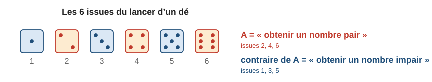
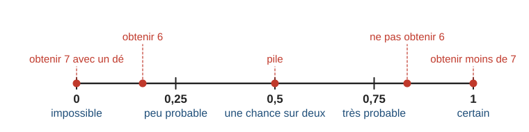
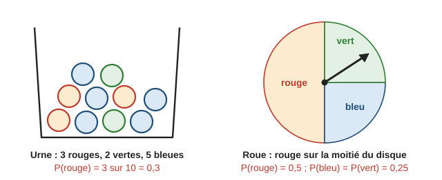
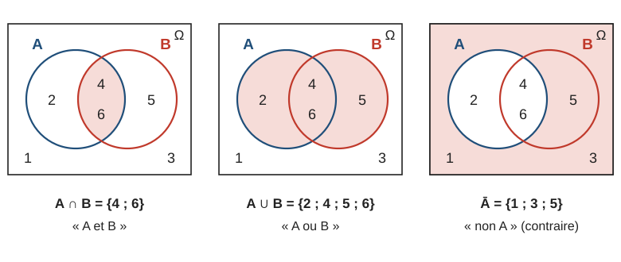
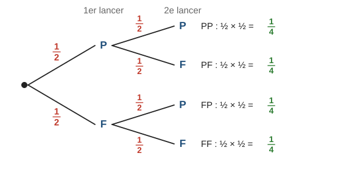
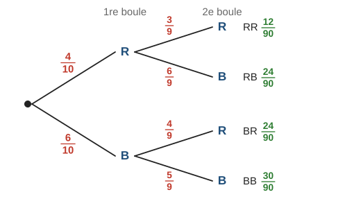
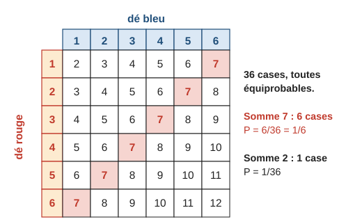
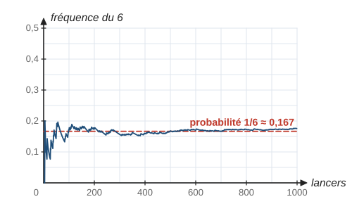
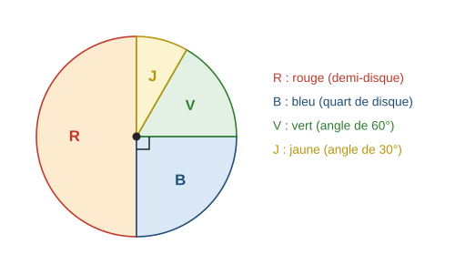

# Probabilités

> Compendium collège — chapitre unifié (sans découpage 6e / 5e / 4e / 3e).  
> Cours compact pour un élève de niveau moyen : intuition, méthode, exemples guidés, erreurs fréquentes, puis exercices progressifs (★ facile, ★★ standard, ★★★ approfondissement) avec corrigés détaillés.

---

## 0. Ce qu’on vise

**En une phrase :** une probabilité est un nombre entre $0$ et $1$ qui mesure les chances qu’un événement se produise ; quand toutes les issues ont les mêmes chances, on la calcule en **comptant** : cas favorables sur cas possibles.

À la fin de ce chapitre, je sais :

1. Utiliser le vocabulaire : expérience aléatoire, issue, événement, événement contraire, événements incompatibles.
2. Placer une probabilité sur l’échelle de $0$ (impossible) à $1$ (certain).
3. Calculer une probabilité dans une situation d’**équiprobabilité** (dé, pièce, urne, cartes, roue).
4. Utiliser $P(\text{non } A) = 1 - P(A)$ et additionner les probabilités d’événements incompatibles ; utiliser les notations $\overline{A}$, $A \cap B$, $A \cup B$, $\varnothing$ (4e) et la formule $P(A \cup B) + P(A \cap B) = P(A) + P(B)$ (3e).
5. Traiter une expérience à **deux épreuves** avec un **arbre** ou un **tableau à double entrée**, avec ou sans remise.
6. Relier **fréquence** observée et probabilité, observer la **fluctuation** des fréquences, et estimer une probabilité par simulation.

> **Prérequis.** Simplifier, additionner et multiplier des fractions (chapitre 1, § 2, 4 et 5) ; pourcentages (chapitre 5, § 4) ; fréquences (chapitre 16, § 1).

---

## 1. Vocabulaire

Une **expérience aléatoire** est une expérience dont on connaît tous les résultats possibles, mais dont on ne peut pas prévoir lequel se produira (lancer un dé, tirer une carte, faire tourner une roue). Chaque résultat possible est une **issue**.

Un **événement** est une condition que certaines issues réalisent : il est décrit par une phrase (« obtenir un nombre pair ») ou par la liste des issues qui le réalisent ($2$, $4$, $6$).

| Mot | Sens | Exemple avec un dé |
|---|---|---|
| Événement élémentaire | réalisé par une seule issue | « obtenir $3$ » |
| Événement impossible | aucune issue ne le réalise | « obtenir $7$ » |
| Événement certain | toutes les issues le réalisent | « obtenir moins de $7$ » |
| Contraire de $A$ (noté $\overline{A}$ ou « non $A$ ») | réalisé exactement quand $A$ ne l’est pas | contraire de « pair » : « impair » |
| $A$ et $B$ incompatibles | ne peuvent pas être réalisés en même temps | « obtenir $2$ » et « obtenir un nombre impair » |

> **Erreur fréquente.** Croire que le contraire de « obtenir $6$ » est « obtenir $1$ ». Le contraire de « obtenir $6$ » est « ne pas obtenir $6$ », c’est-à-dire obtenir $1$, $2$, $3$, $4$ ou $5$.

---

## 2. Probabilité d’un événement

### 2.1 L’échelle des probabilités

> **À retenir.** La probabilité d’un événement $A$, notée $P(A)$, est un nombre compris entre $0$ et $1$. $P(A) = 0$ si $A$ est impossible, $P(A) = 1$ si $A$ est certain. Plus $P(A)$ est proche de $1$, plus $A$ a de chances de se produire.

Une probabilité peut s’écrire en fraction, en décimal ou en pourcentage : $\dfrac{1}{4} = 0{,}25 = 25\,\%$.

### 2.2 Situation d’équiprobabilité

Quand toutes les issues ont **les mêmes chances** (dé équilibré, pièce équilibrée, boule tirée « au hasard », carte bien mélangée), on dit qu’il y a **équiprobabilité**.

> **À retenir.** En situation d’équiprobabilité :
> $$P(A) = \dfrac{\text{nombre d’issues qui réalisent } A}{\text{nombre total d’issues}}$$

**Exemple guidé 1.** On lance un dé équilibré à six faces. Calculer la probabilité d’obtenir : a) un $5$ ; b) un nombre pair ; c) un nombre au moins égal à $5$.

**Réflexion.** Six issues équiprobables. On compte les issues favorables.

**Rédaction.**

> Le dé est équilibré : les $6$ issues sont équiprobables.
>
> a) Une seule issue : $P = \dfrac{1}{6}$. b) Issues $2$, $4$, $6$ : $P = \dfrac{3}{6} = \dfrac{1}{2}$. c) Issues $5$, $6$ : $P = \dfrac{2}{6} = \dfrac{1}{3}$.

**Contrôle.** Toutes les réponses sont entre $0$ et $1$ ; « pair » a autant de chances que « impair » : $\dfrac{1}{2}$ est cohérent.

**Exemple guidé 2.** Une urne contient $3$ boules rouges, $2$ vertes et $5$ bleues, indiscernables au toucher. On tire une boule au hasard. Calculer $P(\text{rouge})$ et $P(\text{verte ou bleue})$.

**Rédaction.**

> Il y a $3 + 2 + 5 = 10$ boules, toutes ont la même chance d’être tirées.
>
> $P(\text{rouge}) = \dfrac{3}{10} = 0{,}3$. $P(\text{verte ou bleue}) = \dfrac{2 + 5}{10} = \dfrac{7}{10} = 0{,}7$.

**Contrôle.** $0{,}3 + 0{,}7 = 1$ : « verte ou bleue » est le contraire de « rouge ».

> **Erreur fréquente.** Raisonner sur les **couleurs** au lieu des **boules** : « il y a trois couleurs, donc $P(\text{rouge}) = \dfrac{1}{3}$ ». Les couleurs ne sont pas équiprobables (il y a plus de bleues) ; ce sont les boules qui le sont.

### 2.3 Une roue : la probabilité est proportionnelle à l’angle

Sur une roue bien équilibrée, la probabilité de s’arrêter sur un secteur est proportionnelle à son angle : $P = \dfrac{\text{angle du secteur}}{360^\circ}$.

**Exemple guidé 3.** Sur la roue ci-dessus, le secteur rouge est un demi-disque, les secteurs bleu et vert sont des quarts de disque. Calculer les probabilités.

**Rédaction.**

> $P(\text{rouge}) = \dfrac{180}{360} = \dfrac{1}{2}$ ; $P(\text{bleu}) = P(\text{vert}) = \dfrac{90}{360} = \dfrac{1}{4}$.

**Contrôle.** $\dfrac{1}{2} + \dfrac{1}{4} + \dfrac{1}{4} = 1$. Ici, les **trois couleurs** ne sont pas équiprobables, même s’il y a trois secteurs.

---

## 3. Règles de calcul

> **À retenir.**
> - **Somme des issues.** La somme des probabilités de toutes les issues vaut $1$.
> - **Contraire.** $P(\text{non } A) = 1 - P(A)$.
> - **Incompatibles.** Si $A$ et $B$ ne peuvent pas se produire en même temps : $P(A \text{ ou } B) = P(A) + P(B)$.

**Exemple guidé 4.** On tire une carte dans un jeu de $32$ cartes (quatre couleurs : pique, cœur, carreau, trèfle ; dans chaque couleur : $7$, $8$, $9$, $10$, valet, dame, roi, as). Calculer : a) $P(\text{roi ou dame})$ ; b) $P(\text{ne pas tirer un as})$ ; c) $P(\text{cœur ou roi})$.

**Réflexion.** a) « roi » et « dame » sont incompatibles. b) Contraire. c) Attention : le roi de cœur est à la fois cœur et roi.

**Rédaction.**

> a) $P(\text{roi}) = \dfrac{4}{32}$ et $P(\text{dame}) = \dfrac{4}{32}$ ; une carte ne peut pas être à la fois un roi et une dame, donc $P(\text{roi ou dame}) = \dfrac{4}{32} + \dfrac{4}{32} = \dfrac{8}{32} = \dfrac{1}{4}$.
>
> b) $P(\text{as}) = \dfrac{4}{32} = \dfrac{1}{8}$, donc $P(\text{pas d’as}) = 1 - \dfrac{1}{8} = \dfrac{7}{8}$.
>
> c) Les événements ne sont **pas** incompatibles : on compte les cartes. $8$ cœurs, plus les $3$ rois qui ne sont pas des cœurs : $11$ cartes. $P = \dfrac{11}{32}$.

**Contrôle.** En additionnant $\dfrac{8}{32} + \dfrac{4}{32}$ au c), on compterait deux fois le roi de cœur.

### 3.1 Le langage des ensembles [[Programme 2026 · 4e]]

On peut décrire une expérience aléatoire avec des **ensembles** : l’ensemble de toutes les issues est souvent noté $\Omega$ (« oméga »), et un événement est l’ensemble des issues qui le réalisent. Pour un dé : $\Omega = \{1\,;2\,;3\,;4\,;5\,;6\}$, et l’événement $A$ « obtenir un nombre pair » s’écrit $A = \{2\,;4\,;6\}$.

> **Définition.** $A$ et $B$ sont deux événements.
> - Le **complémentaire** de $A$, noté $\overline{A}$, est formé des issues qui ne sont **pas** dans $A$ : c’est l’événement contraire « non $A$ ».
> - L’**intersection** $A \cap B$ (« $A$ inter $B$ ») est formée des issues qui sont **à la fois** dans $A$ et dans $B$ : c’est l’événement « $A$ **et** $B$ ».
> - La **réunion** $A \cup B$ (« $A$ union $B$ ») est formée des issues qui sont dans $A$, dans $B$, **ou dans les deux** : c’est l’événement « $A$ **ou** $B$ ».
> - L’**ensemble vide**, noté $\varnothing$, ne contient aucune issue : c’est l’événement **impossible**. $A$ et $B$ sont incompatibles quand $A \cap B = \varnothing$.

Avec le dé : $A \cap B = \{4\,;6\}$, $A \cup B = \{2\,;4\,;5\,;6\}$, $\overline{A} = \{1\,;3\,;5\}$. En mathématiques, « ou » est **inclusif** : les issues $4$ et $6$, qui sont dans $A$ et dans $B$, sont aussi dans $A \cup B$.

> **Erreur fréquente.** Confondre $\cap$ et $\cup$. Moyen mnémotechnique : $\cup$ ressemble à un **U**, comme **U**nion (réunion) ; l’intersection est la partie commune, plus petite.

### 3.2 Probabilité d’une réunion [[Programme 2026 · 3e]]

> **Propriété.** Pour deux événements $A$ et $B$ quelconques :
>
> $$P(A \cup B) + P(A \cap B) = P(A) + P(B)$$
>
> Autrement dit : $P(A \cup B) = P(A) + P(B) - P(A \cap B)$.

**Pourquoi.** Dans $P(A) + P(B)$, les issues de $A \cap B$ sont comptées **deux fois** (une fois dans $A$, une fois dans $B$) ; dans $P(A \cup B)$, elles ne le sont qu’une fois. Avec le dé : $P(A) + P(B) = \dfrac{3}{6} + \dfrac{3}{6} = 1$ et $P(A \cup B) + P(A \cap B) = \dfrac{4}{6} + \dfrac{2}{6} = 1$. Si $A$ et $B$ sont incompatibles, $P(A \cap B) = 0$ et on retrouve $P(A \cup B) = P(A) + P(B)$.

**Exemple guidé 4 bis.** Dans une classe de $30$ élèves, $18$ pratiquent un sport ($S$), $12$ jouent d’un instrument ($M$) et $7$ font les deux. On choisit un élève au hasard. Calculer $P(S \cup M)$, puis la probabilité que l’élève ne fasse ni sport ni musique.

**Rédaction.**

> Les $30$ élèves ont la même chance d’être choisis : $P(S) = \dfrac{18}{30}$, $P(M) = \dfrac{12}{30}$, $P(S \cap M) = \dfrac{7}{30}$.  
> $P(S \cup M) = P(S) + P(M) - P(S \cap M) = \dfrac{18 + 12 - 7}{30} = \dfrac{23}{30}$.  
> « Ni sport ni musique » est le contraire de $S \cup M$ : $P = 1 - \dfrac{23}{30} = \dfrac{7}{30}$.

**Contrôle.** $18 - 7 = 11$ élèves font seulement du sport, $12 - 7 = 5$ seulement de la musique, $7$ les deux : $11 + 5 + 7 = 23$ élèves sur $30$ ✓.

---

## 4. Expériences à deux épreuves

### 4.1 L’arbre des possibles

Quand une expérience se fait en deux étapes (deux lancers, deux tirages), on la représente par un **arbre** : chaque branche porte la probabilité de l’étape correspondante.

> **À retenir — règles de l’arbre.**
> - La probabilité d’un **chemin** est le **produit** des probabilités portées par ses branches.
> - La probabilité d’un **événement** est la **somme** des probabilités des chemins qui le réalisent.
> - Les branches issues d’un même point ont une somme égale à $1$ ; toutes les feuilles ensemble aussi.

Pourquoi un produit ? Dans la moitié des cas on obtient P au premier lancer, et dans la moitié de **ces** cas on obtient encore P : c’est « la moitié de la moitié », soit $\dfrac{1}{2} \times \dfrac{1}{2} = \dfrac{1}{4}$.

**Exemple guidé 5.** On lance deux fois une pièce équilibrée. Calculer la probabilité d’obtenir : a) deux fois pile ; b) une fois pile et une fois face (dans n’importe quel ordre).

**Rédaction.**

> a) Un seul chemin, PP : $\dfrac{1}{2} \times \dfrac{1}{2} = \dfrac{1}{4}$.
>
> b) Deux chemins, PF et FP : $\dfrac{1}{4} + \dfrac{1}{4} = \dfrac{1}{2}$.

**Contrôle.** $P(\text{PP}) + P(\text{FF}) + P(\text{une de chaque}) = \dfrac{1}{4} + \dfrac{1}{4} + \dfrac{1}{2} = 1$.

### 4.2 Avec ou sans remise

Si l’on **remet** la première boule avant le deuxième tirage, l’urne est la même à chaque fois. **Sans remise**, au deuxième tirage il reste une boule de moins, et les probabilités du deuxième niveau changent selon la première branche.

**Exemple guidé 6.** Une urne contient $4$ boules rouges et $6$ bleues. On tire successivement deux boules **sans remise**. Calculer : a) $P(\text{deux rouges})$ ; b) $P(\text{deux boules de couleurs différentes})$.

**Réflexion.** Après une rouge, il reste $3$ rouges sur $9$ boules ; après une bleue, il reste $4$ rouges et $5$ bleues sur $9$.

**Rédaction.**

> a) Chemin RR : $\dfrac{4}{10} \times \dfrac{3}{9} = \dfrac{12}{90} = \dfrac{2}{15}$.
>
> b) Chemins RB et BR : $\dfrac{4}{10} \times \dfrac{6}{9} + \dfrac{6}{10} \times \dfrac{4}{9} = \dfrac{24}{90} + \dfrac{24}{90} = \dfrac{48}{90} = \dfrac{8}{15}$.

**Contrôle.** Les quatre feuilles : $\dfrac{12 + 24 + 24 + 30}{90} = \dfrac{90}{90} = 1$.

> **Erreur fréquente.** Garder $\dfrac{4}{10}$ au deuxième tirage alors qu’il n’y a pas de remise. Avec remise, on aurait $\dfrac{4}{10} \times \dfrac{4}{10} = \dfrac{16}{100}$, un résultat différent.

### 4.3 Le tableau à double entrée

Pour deux dés (ou deux épreuves avec beaucoup d’issues), un **tableau** est plus lisible qu’un arbre : chaque case est une issue, et les $36$ cases sont équiprobables.

**Exemple guidé 7.** On lance deux dés équilibrés et on additionne les résultats. Calculer $P(\text{somme} = 7)$ et $P(\text{somme} = 10)$. Quelle somme est la plus probable ?

**Rédaction.**

> Le tableau compte $36$ cases équiprobables.
>
> Somme $7$ : $6$ cases, donc $P = \dfrac{6}{36} = \dfrac{1}{6}$. Somme $10$ : cases $(4\,;6)$, $(5\,;5)$, $(6\,;4)$, donc $P = \dfrac{3}{36} = \dfrac{1}{12}$.
>
> La somme $7$ occupe le plus de cases (la grande diagonale) : c’est la plus probable.

**Contrôle.** Les sommes vont de $2$ à $12$, mais elles ne sont **pas** équiprobables : $2$ n’apparaît qu’une fois, $7$ six fois.

> **Méthode — expérience à deux épreuves.**
> 1. Dire si les deux épreuves se font avec ou sans remise (ou si elles sont indépendantes, comme deux dés).
> 2. Faire un arbre (peu d’issues) ou un tableau (deux dés, deux roues…).
> 3. Repérer les chemins ou les cases qui réalisent l’événement.
> 4. Multiplier le long d’un chemin, additionner les chemins ; contrôler que tout fait $1$.

---

## 5. « Au moins un » : passer par le contraire (★★)

Le contraire de « au moins un $6$ » est « **aucun** $6$ ». Ce contraire est souvent un seul chemin, donc plus simple à calculer.

**Exemple guidé 8.** On lance deux fois un dé équilibré. Quelle est la probabilité d’obtenir au moins un $6$ ?

**Rédaction.**

> Contraire : « aucun $6$ ». À chaque lancer, $P(\text{pas } 6) = \dfrac{5}{6}$, donc $P(\text{aucun } 6) = \dfrac{5}{6} \times \dfrac{5}{6} = \dfrac{25}{36}$.
>
> $P(\text{au moins un } 6) = 1 - \dfrac{25}{36} = \dfrac{11}{36}$.

**Contrôle.** Dans le tableau des deux dés, la ligne $6$ et la colonne $6$ contiennent $6 + 6 - 1 = 11$ cases.

---

## 6. Fréquence et probabilité

On répète une expérience $n$ fois ; si l’événement $A$ s’est produit $k$ fois, sa **fréquence** est $\dfrac{k}{n}$ (chapitre 16).

> **À retenir.** Quand on répète un grand nombre de fois une expérience, la fréquence d’un événement se **stabilise** autour de sa probabilité. Sur peu d’essais, elle peut en être très éloignée.

Cela permet :

- d’**estimer** une probabilité qu’on ne peut pas calculer (une punaise qui tombe pointe en haut, un dé truqué) par la fréquence observée sur beaucoup d’essais ;
- de **simuler** une expérience au tableur avec `=ALEA.ENTRE.BORNES(1;6)` ou dans Scratch avec « nombre aléatoire entre $1$ et $6$ ».

**Exemple guidé 9.** On lance $1\,000$ fois une punaise : elle tombe $613$ fois pointe en haut. Estimer la probabilité de « pointe en haut ».

**Rédaction.**

> La fréquence observée est $\dfrac{613}{1\,000} = 0{,}613$. Sur un grand nombre de lancers, la fréquence est proche de la probabilité : $P(\text{pointe en haut}) \approx 0{,}61$.

**Contrôle.** On ne peut pas calculer cette probabilité par « cas favorables sur cas possibles » : les deux positions ne sont pas équiprobables.

> **À retenir — fluctuation des fréquences.** [[Programme 2026 · 4e]] Si l’on répète **plusieurs fois** une série d’un **même nombre** d’expériences, on n’obtient pas la même fréquence à chaque fois : la fréquence **fluctue** d’une série à l’autre. Plus les séries sont longues, plus les fréquences obtenues sont resserrées autour de la probabilité.

Par exemple, cinq élèves lancent chacun $50$ fois une pièce équilibrée et notent le nombre de piles : $23$ ; $28$ ; $25$ ; $21$ ; $27$. Les fréquences de pile sont $0{,}46$ ; $0{,}56$ ; $0{,}50$ ; $0{,}42$ ; $0{,}54$ : elles **varient** d’un élève à l’autre, autour de $0{,}5$. Aucun élève ne s’est « trompé » : c’est le hasard. En regroupant les $250$ lancers ($124$ piles), la fréquence $\dfrac{124}{250} = 0{,}496$ est plus proche de $0{,}5$.

> **Erreur fréquente.** Croire que le hasard « compense ». Après cinq piles de suite, la probabilité d’obtenir face au lancer suivant est toujours $\dfrac{1}{2}$ : la pièce n’a pas de mémoire.

---

## 7. Mini-synthèse

> **À retenir.**
> - Une probabilité est entre $0$ (impossible) et $1$ (certain).
> - Équiprobabilité : $P(A) = \dfrac{\text{issues favorables}}{\text{issues possibles}}$ ; compter des **objets** équiprobables (boules, cartes, cases), pas des catégories.
> - Roue : $P = \dfrac{\text{angle}}{360^\circ}$.
> - $P(\text{non } A) = 1 - P(A)$ ; incompatibles : $P(A \text{ ou } B) = P(A) + P(B)$.
> - Ensembles (4e) : $\overline{A}$ (contraire), $A \cap B$ (« et »), $A \cup B$ (« ou »), $\varnothing$ (impossible). Formule (3e) : $P(A \cup B) + P(A \cap B) = P(A) + P(B)$.
> - Arbre : produit sur un chemin, somme des chemins ; sans remise, le deuxième niveau change.
> - Deux dés : tableau de $36$ cases équiprobables.
> - « Au moins un » : $1 - P(\text{aucun})$.
> - Fréquence $\approx$ probabilité sur un grand nombre d’essais ; sur des séries de même taille, la fréquence fluctue.

---

## 8. Exercices types

> Préciser à chaque fois pourquoi les issues sont équiprobables (ou ne le sont pas). Simplifier les fractions.

### A. Vocabulaire (★)

**A1.** On lance un dé à six faces. Donner les issues qui réalisent chaque événement : a) « obtenir un nombre pair » ; b) « obtenir un nombre strictement supérieur à $4$ » ; c) « obtenir un multiple de $3$ » ; d) « obtenir $0$ ».

**A2.** Dire si l’événement est impossible, certain, ou ni l’un ni l’autre : a) tirer une boule rouge dans une urne qui ne contient que des boules bleues ; b) obtenir un nombre entier en lançant un dé ; c) obtenir pile en lançant une pièce ; d) tirer un $14$ dans un jeu de $32$ cartes.

**A3.** Énoncer le contraire de chaque événement : a) « obtenir un nombre pair » (dé) ; b) « tirer un cœur » (cartes) ; c) « obtenir au moins un pile » (deux pièces) ; d) « obtenir un nombre inférieur ou égal à $2$ » (dé).

**A4.** On lance un dé. Les événements sont-ils incompatibles ? a) « obtenir un nombre pair » et « obtenir $5$ » ; b) « obtenir un nombre pair » et « obtenir au moins $4$ ».

### B. Calculer une probabilité (★ → ★★)

**B1.** On lance un dé équilibré. Calculer la probabilité d’obtenir : a) $6$ ; b) un nombre impair ; c) un nombre strictement inférieur à $3$ ; d) un diviseur de $6$.

**B2.** Une urne contient $3$ boules rouges, $2$ vertes et $5$ bleues. On tire une boule au hasard. Calculer $P(\text{verte})$, $P(\text{pas bleue})$ et $P(\text{jaune})$.

**B3.** On tire une carte dans un jeu de $32$ cartes. Calculer la probabilité de tirer : a) un cœur ; b) un roi ; c) le roi de cœur ; d) une figure (valet, dame ou roi).

**B4.** On fait tourner la roue ci-dessous. Calculer la probabilité de chaque couleur et vérifier que leur somme vaut $1$.

**B5.** On écrit chaque lettre du mot PROBABILITE sur un carton, on mélange et on tire un carton. Calculer $P(\text{B})$, $P(\text{une voyelle})$ et $P(\text{Z})$.

**B6.** ★★ Une urne contient $12$ boules, rouges ou noires. La probabilité de tirer une rouge est $\dfrac{1}{3}$. a) Combien y a-t-il de boules rouges ? b) On ajoute $3$ boules rouges : quelle est la nouvelle probabilité de tirer une rouge ?

### C. Contraire et incompatibles (★ → ★★)

**C1.** a) $P(A) = 0{,}3$ : calculer $P(\text{non } A)$. b) La probabilité qu’il pleuve demain est $35\,\%$. Quelle est la probabilité qu’il ne pleuve pas ?

**C2.** Un dé est truqué. Le tableau donne la probabilité de chaque face, sauf une.

| Face | $1$ | $2$ | $3$ | $4$ | $5$ | $6$ |
|:-:|:-:|:-:|:-:|:-:|:-:|:-:|
| Probabilité | $0{,}1$ | $0{,}15$ | $0{,}2$ | $0{,}15$ | $0{,}1$ | ? |

a) Calculer $P(6)$. b) Calculer $P(\text{pair})$.

**C3.** ★★ Jeu de $32$ cartes. Calculer : a) $P(\text{roi ou as})$ ; b) $P(\text{cœur ou roi})$ (attention : ces événements ne sont pas incompatibles).

**C4.** ★★ Peut-on avoir deux événements incompatibles $A$ et $B$ avec $P(A) = 0{,}6$ et $P(B) = 0{,}5$ ? Justifier.

**C5.** [[Programme 2026 · 4e]] On tire une carte au hasard parmi dix cartes numérotées de $1$ à $10$. $A$ : « le numéro est pair » ; $B$ : « le numéro est un multiple de $3$ ». Écrire avec des accolades : $A$, $B$, $\overline{A}$, $A \cap B$, $A \cup B$. Puis donner $P(A \cap B)$ et $P(A \cup B)$.

**C6.** [[Programme 2026 · 3e]] $P(A) = 0{,}5$, $P(B) = 0{,}4$ et $P(A \cap B) = 0{,}15$. Calculer $P(A \cup B)$ et $P(\overline{A \cup B})$.

**C7.** ★★ [[Programme 2026 · 3e]] Jeu de $32$ cartes. Retrouver le résultat de l’exemple guidé 4 c) avec la formule $P(A \cup B) + P(A \cap B) = P(A) + P(B)$, pour $A$ « cœur » et $B$ « roi ».

### D. Deux épreuves (★★)

**D1.** On lance deux pièces équilibrées. Construire l’arbre, puis calculer : a) $P(\text{deux faces})$ ; b) $P(\text{au moins un pile})$.

**D2.** Une urne contient $4$ boules rouges et $6$ bleues. On tire deux boules **avec remise**. Calculer : a) $P(\text{deux rouges})$ ; b) $P(\text{deux boules de la même couleur})$.

**D3.** Même urne, tirage de deux boules **sans remise**. Construire l’arbre, puis calculer $P(\text{deux bleues})$ et $P(\text{au moins une rouge})$.

**D4.** On lance deux dés équilibrés. À l’aide du tableau du § 4.3, calculer : a) $P(\text{somme} = 4)$ ; b) $P(\text{somme} \geqslant 10)$ ; c) $P(\text{obtenir un double})$.

**D5.** Un menu propose $2$ entrées (salade, soupe) et $3$ plats (poisson, pâtes, poulet). Léa choisit au hasard une entrée puis un plat. a) Combien de menus différents ? b) Quelle est la probabilité qu’elle choisisse soupe et pâtes ? c) Qu’elle ne prenne pas de poisson ?

### E. Fréquences et simulation (★ → ★★)

**E1.** Sur $200$ lancers d’une pièce, on a obtenu $104$ piles. Calculer la fréquence de pile et la comparer à la probabilité.

**E2.** Tom lance $10$ fois une pièce et obtient $8$ piles. Il conclut que la pièce est truquée. A-t-il raison ?

**E3.** Dans un tableur, que fait la formule `=ALEA.ENTRE.BORNES(1;6)` ? Comment simuler $500$ lancers d’un dé et calculer la fréquence du $6$ ?

**E4.** ★★ Une punaise est lancée $1\,000$ fois ; elle tombe $613$ fois pointe en haut. a) Estimer la probabilité de « pointe en bas ». b) Pourquoi ne peut-on pas dire que cette probabilité vaut $\dfrac{1}{2}$ ?

**E5.** [[Programme 2026 · 4e]] Quatre groupes lancent chacun $60$ fois un dé équilibré et comptent les $6$ obtenus : $8$ ; $13$ ; $10$ ; $6$. a) Calculer la fréquence du $6$ pour chaque groupe (arrondir au centième). b) Les fréquences sont différentes : un groupe a-t-il forcément mal compté ? c) Calculer la fréquence du $6$ sur l’ensemble des lancers et la comparer à $\dfrac{1}{6} \approx 0{,}17$.

---

## 9. Exercices atypiques

### F. Trouver l’erreur (★★)

**F1.** « Au Loto, il y a deux issues : gagner ou perdre. Donc la probabilité de gagner est $\dfrac{1}{2}$. »

**F2.** « Avec deux dés, les sommes possibles vont de $2$ à $12$ : il y en a $11$. Donc $P(\text{somme} = 7) = \dfrac{1}{11}$. »

**F3.** « J’ai obtenu cinq fois pile de suite ; au prochain lancer, face est plus probable. »

**F4.** « On tire deux boules sans remise dans une urne de $4$ rouges et $6$ bleues : $P(\text{deux rouges}) = \dfrac{4}{10} \times \dfrac{4}{10} = \dfrac{4}{25}$. »

### G. Comprendre et raisonner (★★ → ★★★)

**G1.** ★★ Expliquer avec des fractions de quantités pourquoi on multiplie les probabilités le long d’un chemin (prendre $100$ parties de deux lancers de pièce).

**G2.** ★★ On lance trois pièces équilibrées. Calculer la probabilité d’obtenir au moins une face.

**G3.** ★★ Une famille a deux enfants ; on suppose que chaque naissance donne une fille ou un garçon avec la probabilité $\dfrac{1}{2}$. Calculer $P(\text{deux garçons})$ et $P(\text{au moins une fille})$.

**G4.** ★★ Un sac contient des jetons numérotés de $1$ à $20$. On tire un jeton. Calculer la probabilité d’obtenir : a) un nombre premier ; b) un multiple de $3$ ; c) un nombre premier **ou** un multiple de $3$.

**G5.** ★★★ Au XVIIe siècle, le chevalier de Méré pariait qu’en lançant $4$ fois un dé, il obtiendrait au moins un $6$. Calculer sa probabilité de gagner. Avait-il intérêt à parier ?

### H. Plusieurs étapes (★★ → ★★★)

**H1.** ★★ Alice et Bob lancent deux dés. Alice gagne si la somme vaut $6$, $7$ ou $8$ ; sinon Bob gagne. Le jeu est-il équitable ?

**H2.** ★★★ Dans une boîte de $10$ tickets, $3$ sont gagnants. On tire deux tickets sans remise. Quelle est la probabilité d’avoir au moins un ticket gagnant ?

**H3.** ★★ Un cadenas a un code de $3$ chiffres (de $0$ à $9$ chacun). a) Combien de codes possibles ? b) Probabilité de trouver le code au premier essai, au hasard ? c) Même question si l’on connaît le premier chiffre.

**H4.** ★★★ Une urne contient des boules rouges, vertes et bleues. On sait que $P(\text{rouge}) = \dfrac{1}{4}$, $P(\text{verte}) = \dfrac{1}{3}$ et qu’il y a $10$ boules bleues. Combien y a-t-il de boules de chaque couleur ?

### I. Situations ouvertes (★★)

**I1.** Fabriquer une roue de loterie à trois couleurs telle que $P(\text{rouge}) = \dfrac{1}{3}$ et $P(\text{bleu}) = 2 \times P(\text{vert})$. Donner les angles des secteurs.

**I2.** Lancer $60$ fois un dé (ou simuler au tableur) et noter la fréquence de chaque face. Comparer à $\dfrac{1}{6} \approx 0{,}17$. Que se passe-t-il avec $600$ lancers ?

**I3.** La météo annonce « $70\,\%$ de risque de pluie ». Il ne pleut pas. La météo s’est-elle trompée ?

---

## 10. Corrigés

> Les corrigés marqués **(modèle)** montrent la rédaction attendue. Les autres donnent les étapes clés.

### Exercices types

**A1. (modèle)**
> a) Les issues $2$, $4$, $6$.  
> b) « Strictement supérieur à $4$ » : les issues $5$ et $6$.  
> c) Les multiples de $3$ entre $1$ et $6$ : $3$ et $6$.  
> d) Aucune issue : c’est un événement impossible.

**A2.** a) Impossible. b) Certain. c) Ni l’un ni l’autre ($P = \dfrac{1}{2}$). d) Impossible.

**A3.** a) « Obtenir un nombre impair ». b) « Ne pas tirer un cœur » (pique, carreau ou trèfle). c) « N’obtenir aucun pile », c’est-à-dire deux faces. d) « Obtenir un nombre supérieur ou égal à $3$ » (strictement supérieur à $2$).

**A4.** a) Oui : $5$ n’est pas pair. b) Non : $4$ et $6$ réalisent les deux.

**B1.** a) $\dfrac{1}{6}$. b) $\dfrac{3}{6} = \dfrac{1}{2}$. c) Issues $1$, $2$ : $\dfrac{2}{6} = \dfrac{1}{3}$. d) Diviseurs de $6$ : $1$, $2$, $3$, $6$ : $\dfrac{4}{6} = \dfrac{2}{3}$.

**B2. (modèle)**
> Il y a $10$ boules, tirées au hasard : elles sont équiprobables.  
> $P(\text{verte}) = \dfrac{2}{10} = \dfrac{1}{5}$.  
> « Pas bleue » est le contraire de « bleue » : $P = 1 - \dfrac{5}{10} = \dfrac{1}{2}$.  
> Il n’y a pas de boule jaune : événement impossible, $P(\text{jaune}) = 0$.

**B3.** a) $\dfrac{8}{32} = \dfrac{1}{4}$. b) $\dfrac{4}{32} = \dfrac{1}{8}$. c) $\dfrac{1}{32}$. d) $3 \times 4 = 12$ figures : $\dfrac{12}{32} = \dfrac{3}{8}$.

**B4.** $P(R) = \dfrac{180}{360} = \dfrac{1}{2}$ ; $P(B) = \dfrac{90}{360} = \dfrac{1}{4}$ ; $P(V) = \dfrac{60}{360} = \dfrac{1}{6}$ ; $P(J) = \dfrac{30}{360} = \dfrac{1}{12}$. Somme : $\dfrac{6 + 3 + 2 + 1}{12} = 1$.

**B5.** $11$ cartons. Deux B : $P(\text{B}) = \dfrac{2}{11}$. Voyelles O, A, I, I, E : $P = \dfrac{5}{11}$. $P(\text{Z}) = 0$.

**B6.** a) $\dfrac{1}{3} \times 12 = 4$ boules rouges. b) $7$ rouges sur $15$ boules : $\dfrac{7}{15}$.

**C1.** a) $0{,}7$. b) $100 - 35 = 65\,\%$.

**C2. (modèle)**
> a) La somme des probabilités des six faces vaut $1$ : $P(6) = 1 - (0{,}1 + 0{,}15 + 0{,}2 + 0{,}15 + 0{,}1) = 1 - 0{,}7 = 0{,}3$.  
> b) Les faces $2$, $4$, $6$ sont des issues distinctes (incompatibles) : $P(\text{pair}) = 0{,}15 + 0{,}15 + 0{,}3 = 0{,}6$.

**C3.** a) Incompatibles : $\dfrac{4}{32} + \dfrac{4}{32} = \dfrac{1}{4}$. b) $8$ cœurs $+ 3$ autres rois $= 11$ cartes : $\dfrac{11}{32}$.

**C4.** Non : on aurait $P(A \text{ ou } B) = 0{,}6 + 0{,}5 = 1{,}1 > 1$, impossible pour une probabilité.

**C5.** $A = \{2\,;4\,;6\,;8\,;10\}$ ; $B = \{3\,;6\,;9\}$ ; $\overline{A} = \{1\,;3\,;5\,;7\,;9\}$ ; $A \cap B = \{6\}$ ; $A \cup B = \{2\,;3\,;4\,;6\,;8\,;9\,;10\}$. Les $10$ cartes sont équiprobables : $P(A \cap B) = \dfrac{1}{10}$ et $P(A \cup B) = \dfrac{7}{10}$.

**C6.** $P(A \cup B) = 0{,}5 + 0{,}4 - 0{,}15 = 0{,}75$ ; $P(\overline{A \cup B}) = 1 - 0{,}75 = 0{,}25$.

**C7.** $P(A) = \dfrac{8}{32}$, $P(B) = \dfrac{4}{32}$ et $A \cap B$ = « roi de cœur », $P(A \cap B) = \dfrac{1}{32}$. Donc $P(A \cup B) = \dfrac{8 + 4 - 1}{32} = \dfrac{11}{32}$ : c’est bien le résultat obtenu en comptant les cartes.

**D1.** a) Chemin FF : $\dfrac{1}{4}$. b) Contraire de « deux faces » : $1 - \dfrac{1}{4} = \dfrac{3}{4}$.

**D2.** a) $\dfrac{4}{10} \times \dfrac{4}{10} = \dfrac{16}{100} = \dfrac{4}{25}$. b) $\dfrac{16}{100} + \dfrac{6}{10} \times \dfrac{6}{10} = \dfrac{16 + 36}{100} = \dfrac{52}{100} = \dfrac{13}{25}$.

**D3. (modèle)**
> Arbre : première boule R ($\dfrac{4}{10}$) ou B ($\dfrac{6}{10}$) ; après R : R ($\dfrac{3}{9}$), B ($\dfrac{6}{9}$) ; après B : R ($\dfrac{4}{9}$), B ($\dfrac{5}{9}$).  
> $P(\text{BB}) = \dfrac{6}{10} \times \dfrac{5}{9} = \dfrac{30}{90} = \dfrac{1}{3}$.  
> « Au moins une rouge » est le contraire de « deux bleues » : $P = 1 - \dfrac{1}{3} = \dfrac{2}{3}$.

**D4.** a) $(1\,;3)$, $(2\,;2)$, $(3\,;1)$ : $\dfrac{3}{36} = \dfrac{1}{12}$. b) Sommes $10$, $11$, $12$ : $3 + 2 + 1 = 6$ cases, $\dfrac{6}{36} = \dfrac{1}{6}$. c) $6$ doubles : $\dfrac{6}{36} = \dfrac{1}{6}$.

**D5.** a) $2 \times 3 = 6$ menus. b) $\dfrac{1}{2} \times \dfrac{1}{3} = \dfrac{1}{6}$. c) $P(\text{pas de poisson}) = \dfrac{2}{3}$ (le choix de l’entrée n’y change rien).

**E1.** $\dfrac{104}{200} = 0{,}52$, proche de la probabilité $0{,}5$ (écart $0{,}02$).

**E2.** Non : sur $10$ lancers seulement, la fréquence peut s’éloigner beaucoup de $0{,}5$. Il faudrait beaucoup plus de lancers pour conclure.

**E3.** Elle donne un entier au hasard entre $1$ et $6$ (un lancer de dé simulé). On recopie la formule sur $500$ lignes, puis on compte les $6$ avec `=NB.SI(A1:A500;6)` et on divise par $500$.

**E4. (modèle)**
> a) La fréquence de « pointe en haut » est $0{,}613$, donc celle de « pointe en bas » est $1 - 0{,}613 = 0{,}387$. Sur $1\,000$ lancers, on peut estimer $P(\text{pointe en bas}) \approx 0{,}39$.  
> b) Deux positions possibles ne signifient pas deux issues équiprobables : la forme de la punaise favorise l’une des positions, et l’expérience le montre.

**E5.** a) $\dfrac{8}{60} \approx 0{,}13$ ; $\dfrac{13}{60} \approx 0{,}22$ ; $\dfrac{10}{60} \approx 0{,}17$ ; $\dfrac{6}{60} = 0{,}10$. b) Non : sur $60$ lancers, la fréquence fluctue naturellement d’une série à l’autre. c) $8 + 13 + 10 + 6 = 37$ six sur $240$ lancers : $\dfrac{37}{240} \approx 0{,}15$, assez proche de $\dfrac{1}{6} \approx 0{,}17$ ; avec beaucoup plus de lancers, la fréquence aurait tendance à se stabiliser autour de $\dfrac{1}{6}$.

### Exercices atypiques

**F1. (modèle)**
> La formule « cas favorables sur cas possibles » n’est valable que si les issues sont **équiprobables**. « Gagner » et « perdre » ne le sont pas du tout : il y a une seule grille gagnante parmi des millions de grilles possibles.  
> La probabilité de gagner est donc très faible, bien loin de $\dfrac{1}{2}$.

**F2.** Les $11$ sommes ne sont pas équiprobables. Il faut compter les $36$ couples équiprobables : la somme $7$ apparaît $6$ fois, $P = \dfrac{6}{36} = \dfrac{1}{6}$.

**F3.** Les lancers sont indépendants : la pièce n’a pas de mémoire. $P(\text{face}) = \dfrac{1}{2}$ à chaque lancer.

**F4.** C’est le calcul **avec** remise. Sans remise : $\dfrac{4}{10} \times \dfrac{3}{9} = \dfrac{2}{15}$.

**G1.** Sur $100$ parties, environ la moitié ($50$) commencent par pile ; parmi ces $50$, environ la moitié ($25$) continuent par pile. Donc PP arrive environ $25$ fois sur $100$ : $\dfrac{1}{2}$ de $\dfrac{1}{2}$, c’est $\dfrac{1}{2} \times \dfrac{1}{2} = \dfrac{1}{4}$.

**G2. (modèle)**
> Le contraire de « au moins une face » est « trois piles ».  
> $P(\text{PPP}) = \dfrac{1}{2} \times \dfrac{1}{2} \times \dfrac{1}{2} = \dfrac{1}{8}$.  
> Donc $P(\text{au moins une face}) = 1 - \dfrac{1}{8} = \dfrac{7}{8}$.

**G3.** Issues FF, FG, GF, GG équiprobables. $P(\text{GG}) = \dfrac{1}{4}$ ; « au moins une fille » est le contraire de GG : $\dfrac{3}{4}$.

**G4.** a) Premiers : $2, 3, 5, 7, 11, 13, 17, 19$ : $\dfrac{8}{20} = \dfrac{2}{5}$. b) $3, 6, 9, 12, 15, 18$ : $\dfrac{6}{20} = \dfrac{3}{10}$. c) $3$ est dans les deux listes : $8 + 6 - 1 = 13$ jetons, $\dfrac{13}{20}$.

**G5.** Contraire : aucun $6$ en $4$ lancers, $\left(\dfrac{5}{6}\right)^4 = \dfrac{625}{1\,296}$. $P(\text{gagner}) = 1 - \dfrac{625}{1\,296} = \dfrac{671}{1\,296} \approx 0{,}518$. C’est un peu plus que $\dfrac{1}{2}$ : sur un grand nombre de paris, il gagnait plus souvent qu’il ne perdait.

**H1. (modèle)**
> Dans le tableau des $36$ cases équiprobables : somme $6$ : $5$ cases ; somme $7$ : $6$ cases ; somme $8$ : $5$ cases.  
> $P(\text{Alice gagne}) = \dfrac{5 + 6 + 5}{36} = \dfrac{16}{36} = \dfrac{4}{9} \approx 0{,}44$, et $P(\text{Bob gagne}) = 1 - \dfrac{4}{9} = \dfrac{5}{9} \approx 0{,}56$.  
> Le jeu n’est pas équitable : il avantage Bob.

**H2.** Contraire : aucun gagnant, $\dfrac{7}{10} \times \dfrac{6}{9} = \dfrac{42}{90} = \dfrac{7}{15}$. Donc $P(\text{au moins un gagnant}) = 1 - \dfrac{7}{15} = \dfrac{8}{15}$.

**H3.** a) $10 \times 10 \times 10 = 1\,000$ codes. b) $\dfrac{1}{1\,000}$. c) Il reste $100$ codes : $\dfrac{1}{100}$.

**H4.** $P(\text{bleue}) = 1 - \dfrac{1}{4} - \dfrac{1}{3} = \dfrac{12 - 3 - 4}{12} = \dfrac{5}{12}$. Les $10$ bleues représentent les $\dfrac{5}{12}$ des boules : il y a $10 \div \dfrac{5}{12} = 24$ boules, dont $\dfrac{24}{4} = 6$ rouges, $\dfrac{24}{3} = 8$ vertes et $10$ bleues.

**I1.** Rouge : $\dfrac{1}{3}$ de $360^\circ$ soit $120^\circ$. Il reste $240^\circ$ à partager en bleu $= 2 \times$ vert : vert $80^\circ$, bleu $160^\circ$. Contrôle : $\dfrac{160}{360} = \dfrac{4}{9} = 2 \times \dfrac{2}{9}$.

**I2.** Avec $60$ lancers, les fréquences s’écartent souvent de $0{,}17$ (par exemple $0{,}10$ ou $0{,}25$). Avec $600$ lancers, elles sont en général beaucoup plus proches de $0{,}17$ : c’est la stabilisation des fréquences.

**I3. (modèle)**
> « $70\,\%$ de risque » signifie que, dans des situations météo comparables, il pleut environ $7$ fois sur $10$. Il ne pleut donc pas environ $3$ fois sur $10$.  
> Une journée sans pluie ne prouve pas que la prévision était fausse ; on ne peut juger une probabilité que sur un grand nombre de prévisions.

---

## 11. Liens avec les autres chapitres

- **Chapitre 1** (fractions) : simplifier, additionner et multiplier des fractions.
- **Chapitre 2** (entiers) : diviseurs, multiples, nombres premiers dans les événements (B1, G4).
- **Chapitre 5** (proportionnalité, pourcentages) : probabilité en pourcentage ; roue et angles proportionnels.
- **Chapitre 16** (statistiques) : fréquences, effectifs ; la fréquence se stabilise autour de la probabilité.

---

## 12. Fiche-synthèse

| Je dois savoir… | Comment | Exemple express | S’entraîner |
|---|---|---|---|
| Utiliser le vocabulaire | issue, événement, contraire, incompatibles | contraire de « obtenir $6$ » : obtenir $1$, $2$, $3$, $4$ ou $5$ | série A |
| Calculer une probabilité | équiprobabilité : issues favorables $\div$ issues possibles (compter des objets) | $3$ rouges sur $10$ boules : $0{,}3$ | série B |
| Contraire, incompatibles | $1 - P(A)$ ; $P(A) + P(B)$ si incompatibles | $P(\text{pas d’as}) = 1 - \dfrac{4}{32} = \dfrac{7}{8}$ | série C |
| Notations des ensembles [[Programme 2026 · 4e]] | $\overline{A}$ : non $A$ ; $A \cap B$ : $A$ et $B$ ; $A \cup B$ : $A$ ou $B$ ; $\varnothing$ : impossible | dé : pair $\cap$ « au moins 4 » $= \{4\,;6\}$ | série C |
| Probabilité d’une réunion [[Programme 2026 · 3e]] | $P(A \cup B) = P(A) + P(B) - P(A \cap B)$ | $0{,}5 + 0{,}4 - 0{,}15 = 0{,}75$ | série C |
| Deux épreuves | arbre (produit sur un chemin, somme des chemins) ou tableau | sans remise : $\dfrac{4}{10} \times \dfrac{3}{9} = \dfrac{2}{15}$ | série D |
| « Au moins un » | $1 - P(\text{aucun})$ | deux dés, au moins un $6$ : $1 - \dfrac{25}{36} = \dfrac{11}{36}$ | séries D et G |
| Relier fréquence et probabilité | sur beaucoup d’essais, la fréquence se stabilise | $613$ fois sur $1\,000$ : $P \approx 0{,}61$ | série E |

**Pièges à éviter :** compter des boules, pas des couleurs ; sans remise, le deuxième tirage change ; le hasard ne « compense » pas.

---

*Version v0.3 — relecture (prérequis harmonisés, fiche-synthèse, corrections : voir `PLAN-REVISION.md`, § 10). Base : v0.2 — révision vague 2 (cours développé : vocabulaire, échelle des probabilités, équiprobabilité, roue et angles, contraire et incompatibles, arbres avec et sans remise, tableau à double entrée, « au moins un », fréquence et simulation ; 8 figures SVG dont une simulation de 1 000 lancers ; 39 exercices corrigés). Ancienne version : `cours-et-exercices.md.bak` (ancienne figure dans `figures-v01.bak/`).*
